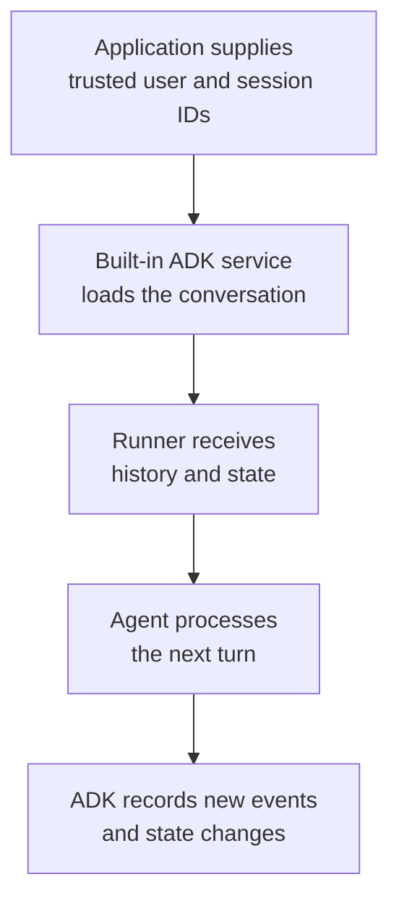
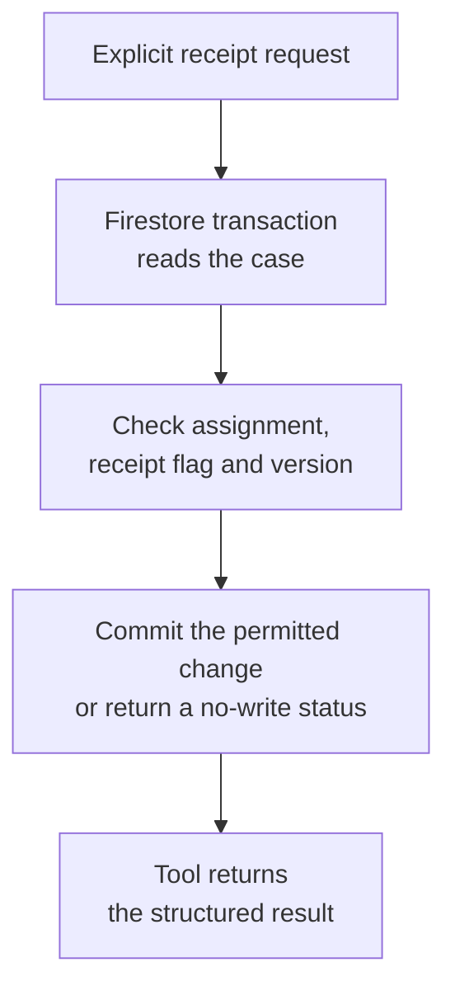

# Module 13.5: Resume a Bank Review Without Losing the Work

## Before you begin: what this module teaches

**ADK concept: durable sessions and separate business records.**

An agent needs somewhere to keep the conversation when its Python process stops. In Google’s **Agent Development Kit (ADK)**, a **session** groups one conversation’s messages, events and working state. A **session service** saves and retrieves that information. The **Runner** uses the configured service when it executes a turn. You will learn how these pieces work together instead of writing your own conversation database.

There is a second kind of information: the bank’s actual review checklist. It must remain available even when an analyst starts a different conversation. This module teaches you to separate those responsibilities: ADK stores the conversation; Firestore stores the case record; a tool reads or changes the case under explicit rules. `ToolContext.state` can remember a useful case ID, but that remembered ID is not proof of the case’s current status.

**Where you would use this in real work.**

Meet Meera, an analyst at the fictional Sovereign Horizon Bank. She is checking documents for Acme Robotics. On Monday she records that the financial statements have arrived. She closes the application and returns on Tuesday. Another employee may have updated the checklist in the meantime.

Her request is ordinary: “Let me continue where I stopped, and show me the current record before I change it.” Your engineering job is to turn that into two kinds of persistence and a rule for conflicting updates. The same pattern applies to service complaints or investigations that continue over several days.

**Connection to Gemini Enterprise Agent Platform and Google Cloud.**

You first use ADK’s `DatabaseSessionService` with a local SQLite file so you can stop the program, restart it and observe what survives. The managed Google path uses `VertexAiSessionService` to connect to Gemini Enterprise Agent Platform Sessions. Google Cloud Firestore is a separate supporting service for the shared case checklist.

You will identify which identity, application and session each operation belongs to. Configuring storage does not establish the analyst’s identity: the serving application must supply a trusted user scope. That distinction matters when this local learning exercise becomes a hosted bank application.

**By the end, you should be able to:**

- **Explain the design:** classify a chat message, a remembered case ID and a document-receipt flag into their correct stores.
- **Trace ADK execution:** show how Runner, the session service, an event and ToolContext.state participate in saving a turn.
- **Build and observe:** reopen a conversation in a fresh process and read the same authorized business case from another session.
- **Handle a failure:** explain a stale-version conflict and why retrying an already-recorded receipt must not count twice.
- **Transfer the pattern:** outline the corresponding storage and update rules for a bank complaint that lasts several days.

**How this moves the story forward.** Meera can now continue a review across days. Module 14 addresses her next need: retrieving an existing company profile through a tool the bank already owns.

Read the detailed customer task below, then follow the [guided lab](./lab.md). Build one checkpoint at a time and compare your explanation with the observed result.

## Begin with the bank's problem

### Read this as a bank employee's task

A bank analyst is checking which documents have arrived for a business loan application. The review may take several days. The analyst needs to close the application today and continue tomorrow without losing the conversation or the checklist.

In this course, an analyst is the employee who gathers and checks information for a review. Picture a business banking team preparing for a company meeting. The bank, company and records are fictional.

> Let me reopen the same conversation tomorrow. Show the current checklist for my assigned case, and let me record that a document has arrived. If someone else changed the record, tell me before replacing their update.

---

### 🚨 The Operational Disaster: The $34M Lost Collateral Checklist at Apex Commercial Bank

During an audit of a \$34,000,000 secured asset-backed credit facility for a regional medical equipment distributor, Apex Commercial Bank discovered that its collateral lien perfection filings were completely missing.

The forensic incident review uncovered a catastrophic architecture flaw in the bank's AI lending assistant:
1. **The In-Memory Session Trap:**
   The prototype assistant stored borrower document checklists directly in ephemeral session working memory (`tool_context.state["checklist"]`). The engineering team assumed that because the conversation was active, the checklist was safe.
2. **The Cloud Run Scaling Eviction:**
   On Tuesday evening, Google Cloud Run automatically scaled down the assistant container instance due to an idle traffic window. When the credit analyst returned on Wednesday morning, their next chat turn was routed to a fresh container instance. The in-memory session was wiped clean.
3. **The Unperfected $34M Default:**
   Faced with a blank checklist on Wednesday, the analyst assumed a colleague had already finalized the verification out-of-band and proceeded to disburse the \$34M term loan without verifying the mandatory UCC-1 state lien filing. When the distributor filed for Chapter 11 bankruptcy 60 days later, the bank found itself an unperfected, unsecured creditor—losing \$34M in senior collateral rights.

> *"This catastrophe exposed the vital difference between a conversation and a business record,"* explains the Lead FDE. *"Conversation events belong in an ADK SessionService (`DatabaseSessionService` or `VertexAiSessionService`). Authoritative business records (loan checklists, collateral filings, compliance approvals) belong in a durable, ACID-compliant database like **Google Cloud Firestore**, guarded by optimistic locking and transaction version numbers."*

---

| What you need to understand first | This exercise's answer |
|---|---|
| What information starts the task? | A case ID and, when recording receipt, the document name and the version last read. |
| What should the employee receive? | The current checklist, or confirmation that the requested receipt was recorded. Starting a new conversation must not erase the business checklist. |
| What should happen when it cannot be completed? | An unassigned user gets no case details. An outdated update returns a conflict so the analyst can read the new version first. |

### New words, explained using this task

| Term | Meaning here |
|---|---|
| Persistence | Saving information so it remains after the application stops. |
| Session | One conversation, identified separately from the bank case. |
| Transaction | A database operation that checks and commits related changes together. |
| Version | A number used to detect whether the record changed since it was read. |

The next technical table connects these requirements to ADK objects and checks. Read one row at a time: the employee's need comes first, then the coding choice, then the result that would show it works.


An FDE should first ask what “remember the review” means. It contains different requirements: preserve the conversation, retain authoritative case data, and potentially recall long-term preferences. They need different storage boundaries.

The implementation in this module makes a small, realistic capability: **read a loan-review checklist and record receipt of two document types**. Recording receipt does not verify the documents, approve credit, or move money. All example customer data is fictional.

## What changed from the earlier version

The earlier lab asked learners to build a custom `FirestoreSessionService` before establishing whether one was needed. This revision starts with the built-in ADK service contract:

- **Conversation history and session state:** ADK `DatabaseSessionService` with local SQLite for the first exercise; `VertexAiSessionService` for the managed Google Cloud path.
- **Shared business records:** Firestore through Google's official asynchronous Python client and transaction helper.
- **Cross-conversation semantic memory:** optional Memory Bank when the customer has that requirement; it is not needed for this checklist.

There is no built-in Python `FirestoreSessionService` exported by the reviewed ADK 2.11.0 package. A class with that name in application code is a custom implementation, not a Google-managed session provider.

The folder keeps its existing name so course links remain stable. The [advanced playbook](./enterprise-playbook.md) explains when a custom provider may be justified and what the old implementation got wrong.

## Work through the concept as a customer problem

### The branch diary and the official case register

Picture Meera keeping a diary of customer conversations while the branch maintains an official case register. “We discussed the ownership register yesterday” belongs in the diary. “The register has been received and recorded” belongs in the case register. Losing the diary must not erase the case; opening a new conversation must not create a new loan application.

In ADK, a **session** identifies a conversation, an **event** records something that happened during execution, and **state** holds scoped working values. A **SessionService** stores and retrieves these objects. Firestore stores the business case in this module; it is not being used as a custom replacement for ADK's event service.

### Derive the persistence requirements

“Come back tomorrow” means data must survive process exit: choose a durable provider and demonstrate a fresh-process read. “Open the same case in a new chat” means the case ID must be independent of the session ID. “Only my assigned cases” means trusted caller identity plus a backend assignment check. “Do not overwrite another analyst” means compare a version inside the transaction that performs the update.

A **transaction** groups the relevant read/check/write so concurrent changes cannot silently invalidate the checked version. A **conflict** means another update has made the caller's expected version stale. An **idempotent** operation can be repeated without repeating its business effect. Here, marking an already-received document is a no-op; that narrow behavior is not a general guarantee for arbitrary banking writes.

Think through this trace: Meera reads version 4; another analyst records a document and creates version 5; Meera submits an update expecting version 4. The correct result is a conflict that prompts a fresh read. A model should not guess which update to overwrite.

### Three reviews before accepting the design

- **Beginner:** explain the case ID, user ID and session ID as three separate labels. Run the persistence probe in two processes; show which provider makes the second read possible.
- **Experienced engineer:** test stale versions, repeated receipt operations and an unavailable database. Distinguish a rejected write from an uncertain result after a timeout; do not claim a transaction spans the session store and Firestore.
- **Bank FDE:** ask who authenticates the analyst, which service owns the case, who may amend it and how retention is approved. Managed Sessions can handle conversation persistence; Firestore handles the case contract. Choosing Google services does not remove the need for those ownership decisions.

**Carry forward:** [Module 14](../module14-third-party-tools/README.md) adds an existing company-lookup tool. The same question remains: which source owns the fact returned by the tool?

## Learning path

| Stage | You should be able to explain | Evidence you produce |
|---|---|---|
| Beginner | A function, dictionary, ID, event, and durable write | Two separate Python processes recover the same session |
| Intermediate | ADK state changes and service injection | A runner uses a built-in session service |
| Intermediate | Firestore documents and trusted caller identity | A tool returns only an accessible case |
| Advanced | Transactions, versions, retries, and uncertain outcomes | Conflicts and repeated requests have explicit results |
| Customer delivery | Storage choice, security, retention, evaluation, operations | A technical specification and a release evidence plan |

Follow the [guided lab](./lab.md), then compare with the [annotated solution](./lab-solution.md). The runnable files and tests are in `example/`. Read the [enterprise playbook](./enterprise-playbook.md) before applying the pattern to customer systems.

## Translate English into a technical specification

Start with observable behavior, not class names.

| ID | Customer words | Technical decision | Acceptance check |
|---|---|---|---|
| R1 | “Return tomorrow after a restart” | Persist ADK events/state using a built-in durable session service | A fresh process retrieves the same session |
| R2 | “Continue the same conversation” | Preserve application name, authenticated user ID, and returned session ID | Resume does not silently create a different conversation |
| R3 | “Start a new conversation about the same case” | Store the checklist in Firestore, independently of session IDs | A new session can read the same authorized case |
| R4 | “Only assigned cases” | Derive user identity from a trusted application context and check assignment | Wrong-user reads/updates return no case details |
| R5 | “Do not overwrite someone else's changes” | Read and compare a version inside a Firestore transaction | A stale version produces `conflict` |
| R6 | “A retry must not count twice” | Marking an already-received document is a no-op | The version does not increment again |
| R7 | “Do not approve loans” | Expose only checklist read/receipt tools | No credit-decision or payment capability exists |
| R8 | “Use Google's platform” | Reuse ADK service implementations and Firestore SDK transactions | No custom event database or retry engine |

**Exercise assumptions to confirm with a customer:** one assigned analyst per case; two document categories; marking receipt is a low-impact administrative action; actual document validation and credit approval happen elsewhere. The local CLI uses a synthetic identity. Production authentication is a separate required integration.

## A development approach you can reuse

Convert each sentence into five questions:

1. **Nouns → data:** What are the objects? Analyst, case, document, conversation.
2. **Verbs → operations:** Read a case, record receipt, resume a session.
3. **Rules → checks:** Is the ID valid? Is this analyst assigned? Is the version current?
4. **Lifetime → storage:** Does this value belong to one turn, one conversation, or the business record?
5. **Failure → result:** What should the analyst do when access is denied, a write conflicts, or the service is unavailable?

For “record the financial statements as received,” the implementation plan becomes:

```text
Inputs: case_id, document_name, expected_version
Trusted context: authenticated analyst identity
Read: review_cases/{case_id}
Check: assignment, schema, current receipt flag, version
Write: receipt flag + incremented version + server timestamp
Return: structured result after the transaction completes
```

The model helps interpret the request. Python enforces the input contract and assignment check. Firestore coordinates the transaction. The application must establish the user's identity.

## Keep three kinds of information separate

| Information | Example | Storage owner |
|---|---|---|
| Conversation history | User message, tool call/result, agent response | ADK session service |
| Session hint | `last_case_id = "CASE-001"` | ADK session state |
| Authoritative business record | Which documents are received; current record version | Firestore case document |
| Optional semantic memory | A user's preferred explanation style across conversations | Memory service, if needed |

The session hint is a convenience, not proof of current case status. Read Firestore again before reporting current facts. A past tool result in conversation history may be out of date.

### Resume a conversation

<!-- TEACHER_NOTE_START -->
**Teacher's note (ADK instructor view):**
- **Learning goal:** Explain the concept clearly from beginner to advanced, with a simple mental model first.
- **Why it matters:** Connect the concept to real Google agentic workflows, Python engineering habits, and production-ready decisions.
- **Version watch:** Validate against the latest official ADK / Google docs before teaching; call out deprecations or migration notes when needed.
- **Module linkage:** Connect this idea to the previous and next modules so learners see the progression across the course.
<!-- TEACHER_NOTE_END -->


This diagram shows session responsibilities. Loading history does not guarantee every historical event fits in the next model request; context limits and compression are separate concerns.

### Update the business record

<!-- TEACHER_NOTE_START -->
**Teacher's note (ADK instructor view):**
- **Learning goal:** Explain the concept clearly from beginner to advanced, with a simple mental model first.
- **Why it matters:** Connect the concept to real Google agentic workflows, Python engineering habits, and production-ready decisions.
- **Version watch:** Validate against the latest official ADK / Google docs before teaching; call out deprecations or migration notes when needed.
- **Module linkage:** Connect this idea to the previous and next modules so learners see the progression across the course.
<!-- TEACHER_NOTE_END -->


A Firestore transaction and an ADK event append are separate commits. A successful case update can outlive a failed conversation append. The recovery path is to re-read the authoritative case. This design does not claim a distributed transaction across both services.

## Understand ADK's persistence vocabulary

- **`Session`:** one conversation identified by an application, user, and session ID.
- **`Event`:** one item in that conversation, such as a message or tool response.
- **`event.id`:** identifies an individual event.
- **`event.invocation_id`:** groups events from an invocation. Several events can share it.
- **`EventActions.state_delta`:** changed state values carried by an event.
- **`ToolContext.state`:** the supported tool interface for recording state changes that ADK carries into events.
- **`SessionService`:** creates, retrieves, lists, deletes, and updates sessions through its supported contract.
- **`MemoryService`:** supports longer-term recall; it is a different interface.

A turn often creates multiple events. Using `invocation_id` as the only event-document key can overwrite history. The first lab exercise deliberately stores two events sharing one invocation ID and verifies that both survive.

### State scopes

| Key | Intended scope |
|---|---|
| `last_case_id` | This session |
| `user:display_preference` | This user within the application |
| `app:policy_version` | Shared application state |
| `temp:working_value` | Current invocation; not durable state |

Provider support and configuration matter. The supplied tests verify these scopes with `DatabaseSessionService`; they are not a substitute for validating a managed deployment. Do not put confidential per-user data in `app:` state. See [ADK state](https://adk.dev/sessions/state/).

## Choose a supported storage path

| Option | Use it when | Important boundary |
|---|---|---|
| `InMemorySessionService` | Disposable prototypes or tests | Process memory does not survive restart |
| `DatabaseSessionService` | You need supported SQL-backed sessions | SQLite teaches the contract locally; a container's local file is not a durable shared cloud database |
| `VertexAiSessionService` | You want Google-managed session storage | Configure the managed resource, location, identity, and required SDK extra |
| Firestore application records | Several conversations or applications use the same business case | You own the case schema, business authorization, and update policy |
| `VertexAiMemoryBankService` | The customer needs cross-session semantic recall | It does not replace the session service or an authoritative ledger |
| Custom `BaseSessionService` | A documented requirement cannot be met by supported providers | You own serialization, state scopes, concurrency, event ordering, deletion, and upgrades |

Managed sessions can be called by an application running outside Agent Runtime when configured and authorized appropriately. Choosing Cloud Run does not automatically require a custom Firestore session service. See [ADK session implementations](https://adk.dev/sessions/session/) and [Agent Platform Sessions](https://docs.cloud.google.com/gemini-enterprise-agent-platform/scale/sessions).

The product uses Agent Platform terminology, while Python symbols such as `VertexAiSessionService` retain their current SDK names. Do not invent replacement import names.

## Version and verification baseline

See the [course review and verification record](../module15-intro-to-multi-agent-systems/review-notes.md) for the cross-module checks and the evidence still required from a customer deployment.

Reviewed **3 October 2026**:

| Component | Example baseline |
|---|---|
| Google ADK | [2.11.0](https://pypi.org/project/google-adk/2.11.0/), with the `db` extra and optional `gcp` extra |
| Firestore client | [2.33.0](https://pypi.org/project/google-cloud-firestore/2.33.0/) |
| SQLAlchemy | `sqlalchemy[asyncio]==2.1.1` for the local ADK database service |
| Python | Code targets 3.12+; executed on 3.14.7; latest stable 3.14.8 was unavailable in the local download catalog |
| Gemini | Configured through `GEMINI_MODEL`; the template suggests `gemini-3.8-flash`, subject to project access and evaluation |

ADK 2.11.0's `db` extra now requests `sqlalchemy[asyncio]`, including the required `greenlet` dependency. The example also pins SQLAlchemy explicitly to keep its tested database version reproducible; this is no longer a workaround for a missing ADK dependency. See Google's [2.11.0 release notes](https://github.com/google/adk-python/releases/tag/v2.11.0) and SQLAlchemy's [asyncio installation guidance](https://docs.sqlalchemy.org/en/21/orm/extensions/asyncio.html#asyncio-platform-installation-notes-including-apple-m1).

The example includes a lock file. Re-test upgrades rather than assuming the word “latest” establishes compatibility. Record upstream warnings with the exact emitting package and version; do not suppress them to make an upgrade look clean.

Offline checks exercise actual ADK session persistence, real process restart, tool schemas, and mocked Firestore boundaries. They do not establish cloud IAM, Firestore contention behavior, managed-session availability, or Gemini response quality. The solution records the validation boundary.

## Correct the original module's misleading claims

| Earlier claim | Correction |
|---|---|
| One invocation ID identifies one event | Several events can belong to the same invocation |
| Call `super().append_event()` first and persistence is solved | The base method alone cannot make custom durable writes atomic or implement every provider concern |
| Firestore TTL deletes subcollections for free | TTL deletion is billed, asynchronous, and does not cascade into subcollections |
| A Firestore path creates tenant IAM isolation | Server SDK access uses IAM; application authorization must enforce record access |
| Firestore always takes under 10 ms | Latency depends on the real workload, location, configuration, and contention |
| Sleep-based mocks prove cloud performance | Mocks test logic; measurements require actual services and recorded methodology |
| A transcript automatically meets banking regulations | Retention, access controls, integrity, and evidence requirements need customer review |
| Session state is the bank's credit ledger | Business transactions belong in an authoritative system with its own controls |

Read Google's [TTL documentation](https://docs.cloud.google.com/firestore/native/docs/ttl) and [server-client security distinction](https://docs.cloud.google.com/firestore/native/docs/security/get-started) before designing deletion or authorization.

## Apply the pattern to another customer

For a bank's fraud-investigation assistant, change the business object to an investigation case. Keep durable ADK conversations and separately authorized business records. Define permitted updates, conflict handling, and evidence requirements before adding tools. An account freeze or payment action requires a different authority and approval design from marking a document received.

You understand this module when you can explain **which component remembers what, who may read or change it, when a change is committed, and how the application recovers after failure**.

## Continue the course story

Previous: [Module 13](../module13-tool-context/README.md) · Next: [Module 14](../module14-third-party-tools/README.md) · [See how the concepts build](../learning-journey.md)

Before continuing, explain one input, one ADK execution boundary and one failure outcome from this module. Use the next chapter to add a new customer requirement, not merely another component.

<!-- © 2026 Inder Chauhan (https://github.com/inderanz/google-adk-training). All rights reserved. Ref: IC-ADK-module13_5-firestore-persistence -->
---

## Official References

- Google ADK docs (latest): https://google.github.io/adk-docs/
- Google AI / Gemini docs: https://ai.google.dev/
- Google GenAI Python SDK reference: https://googleapis.github.io/python-genai/
- Context7 / current SDK lookup for the exact installed version and API signatures
- Related module path: review the surrounding modules for continuity, prerequisites, and follow-on concepts

