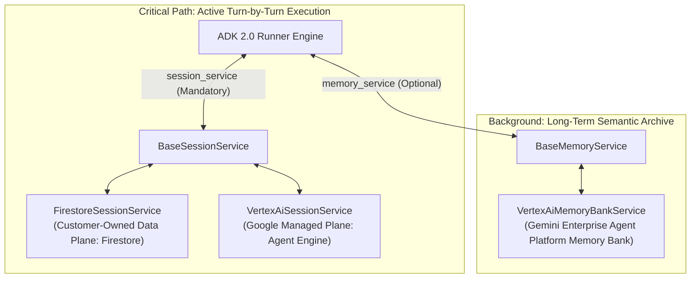
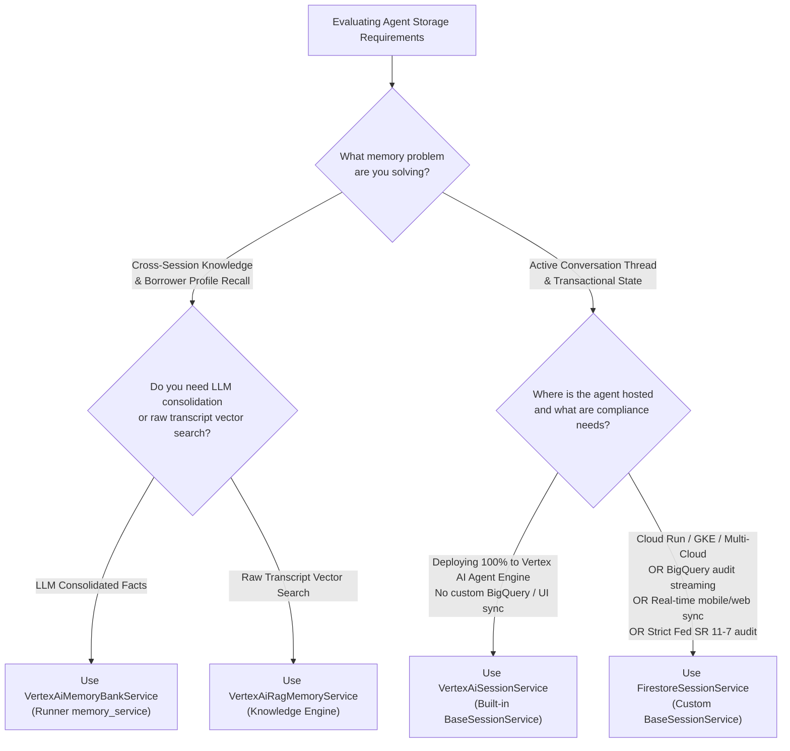
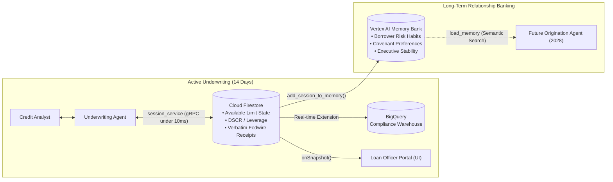

# Module 13.5 Enterprise Playbook: Custom Persistence with Firestore and Enterprise Memory

This module marks a major shift in the enterprise ADK story. Up to this point, the system has been learning how to reason, use tools, ground itself in facts, and maintain short-lived state. Module 13.5 introduces the next critical capability: persistent enterprise memory.
This module marks a major shift in the enterprise ADK story. Up to this point, the system has been learning how to reason, use tools, ground itself in facts, and maintain short-lived state. Module 13.5 introduces the next critical capability: **persistent enterprise memory**.

For a forward-deployed engineer, this is where the conversation becomes a long-lived business object rather than a temporary interaction. Modern enterprise AI systems cannot rely only on ephemeral in-memory state. They need durable, inspectable, and recoverable memory.
For a Google Forward-Deployed Engineer (FDE), this is where the conversation becomes a long-lived business object rather than a temporary interaction. Modern enterprise AI systems cannot rely only on ephemeral in-memory state. They need durable, inspectable, and recoverable memory.

## The forward-deployed engineer lens
---

Customers often ask for patterns like:
## 🏛️ The FDE Executive Advisory Guide: Evaluating the Storage Triad

- “Remember the user's preferences and workflow journey across sessions.”
- “Persist conversations and state in our existing platform.”
- “Use our Google Cloud architecture and Firestore for agent memory.”
- “We need state to survive restarts and support operational continuity.”
When presenting AI agent architecture to enterprise executives (CTOs, Chief Information Security Officers, Heads of Credit Risk), you will inevitably be asked:
> *"Google Cloud offers Vertex AI Agent Engine Sessions (`VertexAiSessionService`) and Vertex AI Memory Bank (`VertexAiMemoryBankService`). Why should our enterprise engineer a custom `FirestoreSessionService`?"*

This is not a storage detail. It is a business continuity and system design issue.
As an FDE, you must ground your recommendation in the **two decoupled framework contracts of Google ADK 2.0**:

## Business translation


The idea of “custom persistence” means the system’s memory is no longer a local convenience. It becomes part of the enterprise architecture.
### The FDE Executive Script: Answering Victoria Sterling (Head of Credit Risk)

In business terms, this means:
> **Client Executive:** *"Can't we just point our agent to Gemini Enterprise Memory Bank and let it remember everything across our underwriting workflows?"*
>
> **Google FDE Response:** *"No, Victoria, and doing so would violate both Federal Reserve SR 11-7 model governance and your operational SLAs. Here is why:
>
> 1. **Memory Bank is a Semantic Knowledge Store, not a Transactional Ledger:** Memory Bank uses an LLM to extract qualitative facts and embed them for similarity search. It cannot perform deterministic mathematical state updates—such as calculating your available \$10M credit line balance or validating a 1.25x DSCR covenant.
> 2. **Regulatory Post-Hoc Reconstructibility:** Fed SR 11-7 examiners require an unaltered, chronological audit trail of raw tool inputs, exact timestamps, and unsummarized return receipts. Memory Bank explicitly consolidates, merges, and paraphrases history using an LLM. Paraphrased transcripts fail regulatory audit scrutiny.
> 3. **Synchronous Turn Latency (Under 10ms vs. Seconds):** On every conversational turn, the runner records events synchronously. Writing to Firestore takes under 10 milliseconds. Generating and consolidating memories in Memory Bank triggers background LLM reasoning jobs with standard quotas of 10 requests per minute, which would choke your high-volume underwriting portal."*

- agent state should survive restarts,
- conversation history should be recoverable,
- session identity can map to real user or workflow contexts,
- enterprise storage patterns can be reused for auditability and operational needs.
---

This is exactly the kind of design requirement that comes up in customer-facing AI systems.
## 📊 Comprehensive Storage Comparison Matrix

## Core ADK concept
| Enterprise Dimension | **Customer Cloud Firestore (`FirestoreSessionService`)** | **Vertex AI Session Service (`VertexAiSessionService`)** | **Vertex AI Memory Bank (`VertexAiMemoryBankService`)** |
|---|---|---|---|
| **ADK Framework Contract** | Implements `BaseSessionService` | Implements `BaseSessionService` | Implements **`BaseMemoryService`** |
| **Runner Slot** | `Runner(session_service=...)` | `Runner(session_service=...)` | `Runner(memory_service=...)` |
| **Data Plane Ownership** | **Customer-Owned Data Plane:** Documents reside directly in your GCP project's Cloud Firestore. | **Google-Managed Service Plane:** Stored inside Vertex AI Agent Engine control plane. | **Google-Managed Knowledge Plane:** Vector index and LLM memory store managed by Google. |
| **Infrastructure Coupling** | **Zero Coupling:** Works on Cloud Run, GKE, on-prem, AWS, or local developer laptops. | **Tightly Coupled:** Requires provisioning a Vertex AI Reasoning Engine / Agent Engine instance. | **Coupled:** Requires Agent Platform API and Agent Runtime ID. |
| **Direct Queryability & BigQuery ETL** | **Native Real-Time Streaming:** The official *Stream Collections to BigQuery* extension mirrors all event records into BigQuery automatically. | **Batch Export:** Requires writing custom scheduled ETL scripts to pull session transcripts via REST API. | **Vector Semantic Search:** Queryable via semantic text prompts (`search_memory`), not SQL. |
| **Real-Time Client Streaming** | **Native Snapshot Listeners:** Web and mobile clients (React, Flutter) listen via `onSnapshot()` for instant turn streaming. | **Polling Gateway:** Clients must poll an API gateway or backend service to detect new events. | **N/A:** Memory Bank is not used for real-time turn streaming. |
| **Turn Execution Latency** | **Direct gRPC Socket (Under 10ms):** Direct, low-latency socket between container and database. | **Gateway Network Hop (~50–150ms):** Additional routing hops through Vertex AI API gateways. | **Seconds:** Invokes background LLM memory extraction (`memories.generate`). |
| **Multi-Cloud Portability** | **Universal Extensibility:** Subclassing `BaseSessionService` establishes a pattern portable to Redis, Mongo, or DynamoDB. | **Proprietary:** Bound strictly to Google Cloud Vertex AI Agent Platform. | **Proprietary:** Bound strictly to Vertex AI Agent Platform. |

ADK supports pluggable session services. A custom `BaseSessionService` can be implemented to use Firestore or any other storage system.
---

This is important because it separates:
## 🎯 Practical Decision Flowchart for Enterprise Architecture

- the agent logic
- the runtime and session orchestration
- the persistence layer
Use this decision logic during customer architecture workshops:

This separation is one of the strongest enterprise patterns in the framework. It allows the solution to align with existing cloud architecture and organizational standards instead of forcing a fixed storage approach.


## Enterprise pattern
---

### Pattern 1: Durable user session memory
Persist session data so a user can resume a workflow or interaction without losing context.
## 💼 Sovereign Horizon Bank: The Dual-Engine Blueprint

Use cases:
In commercial lending origination (Project Aegis Underwrite), the Google FDE architecture pairs **Cloud Firestore** and **Vertex AI Memory Bank** as complementary systems:

- support case tracking
- customer onboarding
- internal workflow assistance
- multi-turn agent interactions


### Pattern 2: Workload-state persistence
Persist structured state used by the workflow itself rather than only conversation text.
### Production Setup Code

Examples:
```python
from firestore_provider import FirestoreSessionService
from google.adk import Runner
from google.adk.memory import VertexAiMemoryBankService

- current case status
- selected options
- intermediate decision outputs
- complex task state across retries or restarts
# Sovereign Horizon Bank Dual-Engine Architecture
runner = Runner(
    app=commercial_underwriting_app,
    # 1. Active Transactional Execution Engine (Direct Data Plane)
    session_service=FirestoreSessionService(
        project_id="sovereign-horizon-prod"
    ),
    # 2. Cross-Session Long-Term Semantic Archive (Agent Platform)
    memory_service=VertexAiMemoryBankService(
        project="sovereign-horizon-prod", location="us-central1"
    ),
)
```

### Pattern 3: Cloud-native integration
Use a managed storage system such as Firestore to align with the rest of the customer’s cloud platform and reduce custom operations burden.
---

## Why this matters in production
## 🚫 Common Enterprise Anti-Patterns to Avoid

Many AI failures are not model failures; they are state and orchestration failures. If the system forgets context, loses progress, or stores memory in an inconsistent way, the agent becomes unreliable.
### Anti-Pattern 1: The "Everything in Memory Bank" Fallacy
Attempting to use Memory Bank as the primary `session_service`. Because Memory Bank does not implement `BaseSessionService`, it cannot track active `session.state` or manage synchronous turn execution.

A proper enterprise design treats memory as infrastructure. That means:
### Anti-Pattern 2: Storing Unstructured Chat Blobs in Firestore
Writing raw text strings into a single Firestore document field without using sub-collections. This blows past Firestore's 1MB document limit and prevents chronological indexing. Always use the `events` sub-collection with `order_by("timestamp")`.

- durable storage
- structured state design
- clear session identity
- explicit retrieval strategies
- safe handling of sensitive data
### Anti-Pattern 3: Omitting `super().append_event()`
Implementing a custom `BaseSessionService` and directly writing `event` to the database without calling `await super().append_event(session=session, event=event)`. This silently drops `event.actions.state_delta`, meaning state mutations from tools are never applied to `session.state`.

## Best practices for real customer work
### Anti-Pattern 4: Ignoring Data Retention (TTL)
Failing to configure Cloud Firestore Time-to-Live policies. In banking, credit sessions must be archived or purged in accordance with SOX and GLBA policies. Configure automated TTL rules on `ttl_timestamp` fields to maintain compliance at zero operational cost.

### 1. Match memory to business lifecycle
Different workflows need different memory durations: ephemeral, session-based, or long-lived durable state.

### 2. Keep the structure explicit
Use keys and schema that reflect business meaning instead of storing raw opaque state.

### 3. Align with enterprise stack
If the customer already uses Google Cloud / Firestore, custom persistence is often the right architectural choice.

### 4. Treat persistence as part of the trust layer
If the system forgets important values, the agent may mislead users or act on stale assumptions.

### 5. Separate memory from model behavior
The model should reason using the state, but the state itself should be governed by deterministic storage rules and explicit design decisions.

## Common enterprise anti-patterns

### Anti-pattern 1: storing everything in memory forever
This creates operational fragility and poor continuity across restarts.

### Anti-pattern 2: mixing business state and raw chat logs without structure
This makes debugging, auditing, and lifecycle management much harder.

### Anti-pattern 3: treating a custom persistence service as a quick hack
If the customer relies on it for production, it must follow the same reliability and observability standards as the rest of the architecture.

### Anti-pattern 4: ignoring data governance
Persistent memory can contain sensitive or regulated information. Security and policy must be designed into the storage pattern.

## Persistence as a design artifact

A custom session service is more than a technical implementation detail. It is how the enterprise decides where conversations and workflow state live.

This is a major architectural decision because it affects:

- performance
- resilience
- debugging ability
- observability
- business continuity
- compliance posture

## Related modules

- [Module 06 Enterprise Playbook](../module06-programmatic-execution/enterprise-playbook.md)
- [Module 10 Enterprise Playbook](../module10-advanced-function-tools/enterprise-playbook.md)
- [Module 22 State and Memory](../module22-state-and-memory/README.md)
- [Module 24 Evaluation](../module24-evaluation/README.md)
- [Module 25 Observability](../module25-observability/README.md)

## Recommended next move in the learning path

After learning how to persist state, the next layer is to understand how agents scale across workflows, memory systems, and autonomous operations. That leads naturally into orchestration and multi-agent patterns.

## Final enterprise takeaway

Module 13.5 teaches a core truth: durable memory is a platform capability, not just a convenience for the model.

When the agent can persist state in a customer-aligned architecture like Firestore, it becomes much more usable in real enterprise environments. That is the difference between a demo and an operational system.

## Official ADK / Google references

- ADK docs home: https://google.github.io/adk-docs/
- ADK sessions and memory docs: https://google.github.io/adk-docs/sessions/
- Firestore docs: https://cloud.google.com/firestore/docs
- Google Cloud docs: https://cloud.google.com/docs
- Gemini API docs: https://ai.google.dev/gemini-api/docs

Use these official references to validate state, session persistence, and cloud storage decisions as the framework or platform evolves.

---

## Related roadmap
## 📖 Official References & Documentation

- [Enterprise ADK Playbook Index](../enterprise-adk-roadmap.md)
- [Module 13.5 README](./README.md)
---

## Official References

- Google ADK docs (latest): https://google.github.io/adk-docs/
- Google AI / Gemini docs: https://ai.google.dev/
- Google GenAI Python SDK reference: https://googleapis.github.io/python-genai/
- Context7 / current SDK lookup for the exact installed version and API signatures
- Related module path: review the surrounding modules for continuity, prerequisites, and follow-on concepts

- **Google ADK Sessions Documentation:** [https://google.github.io/adk-docs/sessions/](https://google.github.io/adk-docs/sessions/)
- **Google ADK Memory Bank Guide:** [https://google.github.io/adk-docs/sessions/memory/](https://google.github.io/adk-docs/sessions/memory/)
- **Vertex AI Agent Engine Sessions Overview:** [https://cloud.google.com/vertex-ai/generative-ai/docs/agent-engine/sessions/overview](https://cloud.google.com/vertex-ai/generative-ai/docs/agent-engine/sessions/overview)
- **Cloud Firestore Native Mode Documentation:** [https://cloud.google.com/firestore/docs](https://cloud.google.com/firestore/docs)
- **Federal Reserve SR 11-7 (Model Risk Management):** [https://www.federalreserve.gov/supervisionreg/srletters/sr1107.htm](https://www.federalreserve.gov/supervisionreg/srletters/sr1107.htm)
