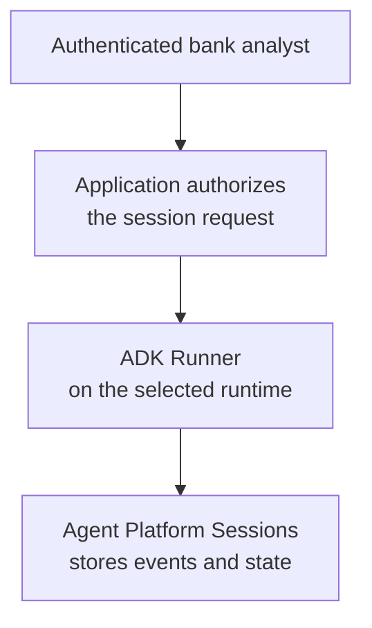
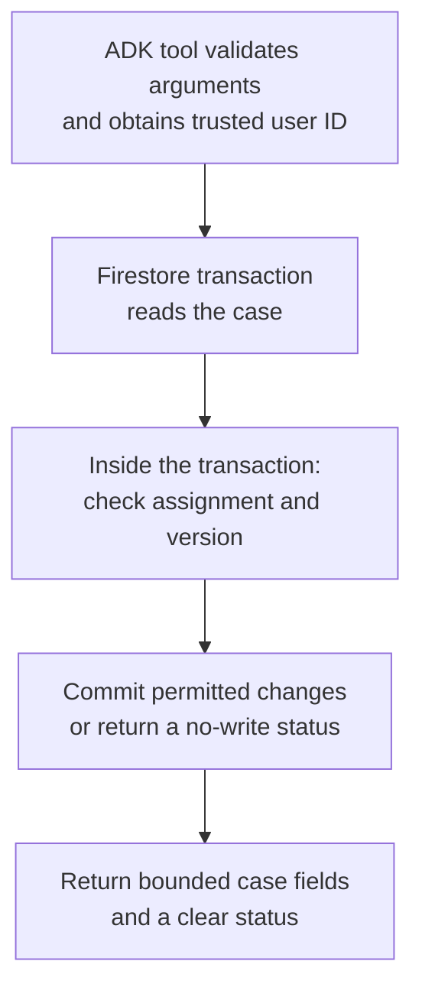
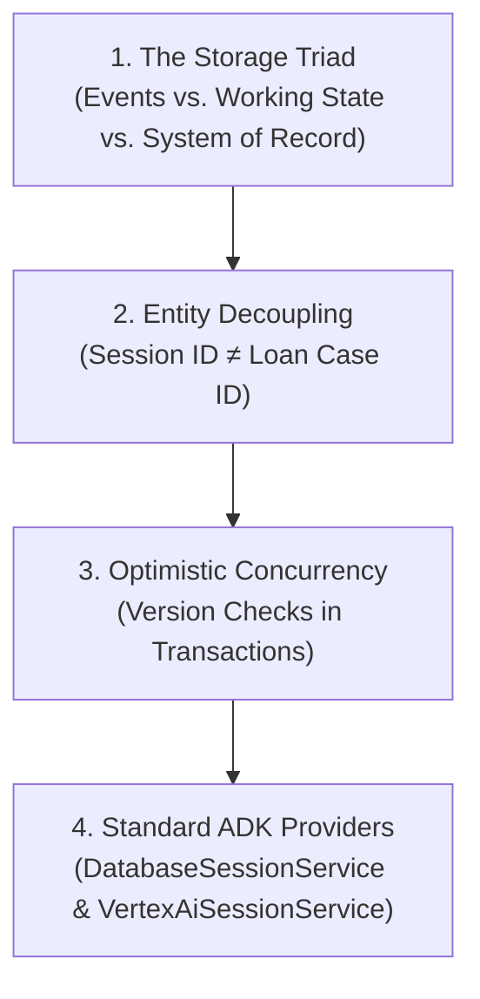

# Module 13.5 Enterprise Playbook: From Bank Requirements to Release Evidence

The employee needs this result: The current checklist, or confirmation that the requested receipt was recorded. Starting a new conversation must not erase the business checklist. An unassigned user gets no case details. An outdated update returns a conflict so the analyst can read the new version first.

Read the [plain-English task and term explanations](./README.md#read-this-as-a-bank-employees-task) before the implementation details.

## 1. Start by separating the customer's promises

The fictional bank asks for a review that survives overnight restarts. Do not immediately translate “memory” into a database product. Ask what must survive and who must be able to use it.

| Discovery question | Design consequence | Exercise assumption |
|---|---|---|
| Must the same conversation resume, or can a new one open the case? | Determines conversation identity and business-record ownership | Both are required |
| Who is authorized to see or change a case? | Determines trusted identity and record authorization | One assigned analyst |
| Which updates can the assistant perform? | Determines tool authority and approval requirements | Record receipt of two document types |
| Is receipt equivalent to verified content or credit approval? | Prevents an administrative flag becoming a financial decision | No |
| Can several systems update the same record? | Requires concurrency and recovery design | Yes; compare a record version |
| What happens after an ambiguous timeout? | Determines reconciliation and retry behavior | Re-read the authoritative case |
| Which data must be retained, deleted, or placed on hold? | Determines lifecycle policies and audit design | Customer records owner defines it |
| Which regions and services are permitted? | Determines runtime, model, session, and Firestore configuration | Explicitly approved locations |

Document the answers as a short technical specification with owners and acceptance evidence. A conversation transcript is not a substitute for that agreement.

## 2. Prefer supported services before custom storage code

| Need | Preferred starting point | Why |
|---|---|---|
| Local understanding of durable ADK sessions | `DatabaseSessionService` with SQLite | A real persistent provider with no cloud setup |
| Managed Google Cloud conversations | Agent Platform Sessions through the supported ADK integration | Reuse session lifecycle and event handling |
| Customer-controlled SQL sessions | `DatabaseSessionService` with a supported production database | Reuse ADK's provider rather than implement one |
| Business records shared across conversations | Firestore or the customer's existing system of record | Case lifecycle is independent of chat lifecycle |
| Cross-session semantic preferences | Memory Bank, if the requirement exists | Memory-specific interface and lifecycle |
| Mandatory unsupported session backend | A separately reviewed custom provider | Accept ownership only after establishing the gap |

SQLite is a learning step, not the proposed cloud persistence tier. A container-local SQLite file can disappear when the instance is replaced and cannot serve as a shared session store for independently scaled instances.

A Cloud Run or GKE application can use a configured managed session service. Its hosting platform does not force a custom Firestore session implementation. Conversely, Firestore's presence in the customer architecture does not mean it must hold ADK events.

See [ADK's supported session implementations](https://adk.dev/sessions/session/) and [Agent Platform Sessions](https://docs.cloud.google.com/gemini-enterprise-agent-platform/scale/sessions).

## 3. Keep the Google-native target architecture readable

The following is a target deployment. The example implements the agent/tools and provider selection; it does not provision or authenticate this deployment.

### Conversation path

Gemini model calls happen during Runner execution. Agent Runtime, Cloud Run, or another approved host can run the application; the deployment must wire the intended provider and identity.

### Business-data path

The assignment check happens after the document is read **inside** the Firestore transaction. The receipt flag is also checked: an already-true flag returns without writing, even when the supplied version is old.

The two storage paths do not form a distributed transaction. Keep authoritative business facts in one place and document how to reconcile a partial failure.

## 4. Design identity at both boundaries

| Identity | Role | Required separation |
|---|---|---|
| Analyst | Uses the application and assigned cases | Verified by the bank's entry point, not a prompt |
| Runtime service identity | Calls Gemini, sessions, and Firestore | Grant only required resources and operations |
| Case setup/assignment identity | Creates cases and changes assignments | Separate from the agent's narrow receipt capability |
| Deployment identity | Builds and promotes releases | Does not inherit broad business-data access unnecessarily |
| Operations/audit reader | Investigates authorized incidents | Access and retention reviewed separately |

`ToolContext.user_id` is useful only when the upstream application supplies a trustworthy value. An API endpoint that lets an unauthenticated caller choose another user's ID is not secured by passing that string into ADK.

The demo uses `DEMO_USER_ID = "analyst-demo"` to make the fixture reproducible. It contains no login system or verified caller token. Replace this at the application boundary for customer use.

The Firestore Python server SDK authenticates using ADC and IAM, and bypasses Firebase/Firestore Security Rules. The tool therefore checks assignment before returning data or queuing an update. Runtime IAM still limits the application's overall authority; a path such as `users/{id}/cases/{case}` is not, by itself, per-document IAM.

Use Google's [Firestore security guidance](https://docs.cloud.google.com/firestore/native/docs/security/get-started) and [IAM reference](https://docs.cloud.google.com/firestore/native/docs/security/iam). Test both a service identity that lacks database access and a valid service identity handling an analyst who lacks case access.

For confidential multi-tenant data, evaluate separate databases/projects or an approved authorization service where required. Do not treat the sample's single-assignee rule as a complete enterprise entitlement model.

## 5. Define exactly what the update guarantees

The implemented operation is “set one supported receipt flag to true.”

| Situation | Implemented response |
|---|---|
| Case absent or assigned to another user | Return `not_found`; no business write |
| Record invalid | Return `invalid_record`; no business write |
| Flag already true | Return `already_received`; do not increment version |
| Flag false and supplied version stale | Return `conflict`; request a fresh read |
| Flag false and version current | Queue flag, incremented version, and server timestamp together |
| SDK returns an error | Return `unavailable`; re-read if commit outcome is uncertain |

A Firestore transaction coordinates changes to its documents. Its retryable body must contain only the reads, checks, and queued writes needed for that transaction. External actions and model calls belong outside it.

The expected version represents what the caller observed. SDK retry does not mean the application should discard that expectation: a newer version can correctly produce a business conflict.

The duplicate no-op policy is specific to this monotonic flag. Payments, reversals, notifications, and credit decisions require their own operation IDs, state machines, authorization, and reconciliation. Do not claim exactly-once execution from a Boolean check.

The agent instruction requests explicit analyst intent before recording receipt. That is model behavior to evaluate, not an enforced human approval workflow. If the customer requires a formal gate, use supported ADK confirmation/workflow mechanisms and verify identity, expiry, and execution binding.

## 6. Plan for the failure between business and session writes

Possible sequence:

1. Firestore commits the document update.
2. The tool prepares its result.
3. Saving the ADK event fails, or the process stops.
4. A later request sees older conversation history but newer business data.

Recovery must consult Firestore before repeating an update. A `last_case_id` hint can be stale without corrupting the checklist because it is not the system of record.

If the customer needs a durable business change record, write an appropriately designed audit/outbox record in the same Firestore transaction as the case update. Downstream export and notification consumers then need deduplication and recovery. This is additional work, not something the sample claims to provide.

A stored ADK event has operational value but is not automatically immutable, signed, complete, or sufficient for a regulatory obligation. Confirm the bank's evidence requirements with its records and risk owners. Do not use model internal reasoning as the audit contract; capture authorized inputs, external tool actions/results, decisions, and relevant versions according to policy.

## 7. Retention and deletion need separate policies

Treat session history, business records, source documents, derived memory, and operational logs as distinct data classes. Each can have a different owner, retention period, legal hold, and deletion workflow.

Firestore TTL:

- Deletes eligible documents asynchronously.
- Does not cascade into subcollections.
- Incurs document deletion charges.
- Is not an exact-time access control mechanism.

If expired records must immediately become inaccessible, enforce that policy in the application as well as scheduling physical deletion. Deleting an ADK session does not delete its independent Firestore case. Deleting a case does not automatically remove earlier copies of its data from session events, logs, exports, backups, or derived memory.

Use [Firestore's TTL semantics](https://docs.cloud.google.com/firestore/native/docs/ttl), and verify the chosen session provider's deletion behavior. The example does not enable TTL or choose a legal retention period.

## 8. Advanced review: when a custom Firestore session provider is justified

Only choose this when an agreed requirement cannot be met by supported providers and the team accepts the maintenance burden.

A review must cover more than `create_session`, `get_session`, and `append_event`:

| Concern | Required design and evidence |
|---|---|
| Event identity | Individual event keys; several events per invocation; defined duplicate behavior |
| Event ordering | Stable ordering and tie handling, including concurrent writes |
| Atomic changes | Consistency between an appended event and applicable state records |
| State scopes | Session, user, application, and temporary behavior compatible with the contract |
| Partial events | Streaming/partial events handled according to the reviewed ADK version |
| Stale sessions | Explicit concurrency handling; no last-writer-wins full-state overwrite |
| Serialization | Round-trip every supported Event field, content type, and metadata needed by the application |
| Pagination and filters | Correct listing/retrieval semantics and documented limits |
| Deletion | Events, subcollections, shared state and retention handled deliberately |
| Failure recovery | No local object falsely reporting durable success after a failed commit |
| SDK upgrades | Contract tests against pinned and candidate ADK versions |

The earlier module used `event.invocation_id` as the event key, so several events could overwrite each other. It also called the base append implementation before performing non-atomic durable writes. Updating an in-memory object first does not make those writes atomic.

Calling `super().append_event()` can reuse base behavior, but “always call it first” is not a complete implementation rule. Study the exact current contract and supported provider behavior. Do not copy private SDK internals into application code without an explicit maintenance decision.

The current lab proves the event-ID distinction using the built-in database service and avoids requiring beginners to own this custom-provider project.

## 9. Verify in layers

| Layer | Required evidence | What it cannot prove |
|---|---|---|
| Offline Python/ADK | 26 supplied tests: restart, scopes, tool schema, identity forwarding, transaction branches | Production IAM, real contention or LLM quality |
| Firestore emulator | Actual create/read/update, simultaneous updates, repeated request, separate app processes | Production IAM, regional durability or representative latency |
| Development cloud | Managed-session restart, actual Firestore transactions, IAM denials, error handling | Full production workload without a representative load test |
| Model evaluation | Correct tool choice, no invented success, fresh reads, scope limits, injection cases | A universal guarantee for unseen inputs |
| Operational rehearsal | Restore, rollback, retention/deletion, alerts, concurrent sessions | Future incident-free operation |

The review ran the offline suite. It did not run the emulator (Java was unavailable), live cloud calls, or model evaluations. Keep those limitations visible in customer handover material.

For mutation evaluations, use disposable cases with known initial versions and reset them deliberately between cases. Record model version, prompt, tool arguments/results, resulting document version, and final response. A judge score alone should not replace checking the authoritative state transition.

For performance, measure the actual operation in the actual region under representative load. Report sample count, concurrency, payload size, retry count, warm/cold conditions, error rate, and latency percentiles. No numbers in this module are claimed as measured cloud benchmarks. A mock with a programmed delay cannot establish that Firestore is faster than a managed session service.

## 10. Promote using Google's deployment patterns

Use the organization's approved ADK project scaffold and deployment path. A generated Google ADK prototype was inspected during this review; its service configuration separates model location from the Agent Runtime resource location. The teaching files keep that distinction explicit.

A release plan should:

1. Select the runtime and built-in production session backend; verify supported locations.
2. Create the Firestore database and case schema through a reviewed platform process.
3. Bind authenticated analyst identity to ADK user/session identity.
4. Configure runtime IAM and case authorization; remove the demo identity.
5. Package the agent using the supported Agent Runtime or Cloud Run entry point.
6. Add lifecycle handling, time budgets, concurrency limits, safe telemetry, and secret/config management.
7. Run storage integration and model evaluations in a development environment.
8. Build an immutable artifact through the approved Cloud Build/Artifact Registry process where applicable.
9. Promote with recorded evidence and a tested rollback plan.

The local CLI is not a production server. When the selected deployment integration manages sessions automatically, follow that integration's documented configuration; do not accidentally create a second independent session store.

Use [Agent Runtime deployment guidance](https://docs.cloud.google.com/gemini-enterprise-agent-platform/scale/runtime/deploy-an-agent) for current packaging. Deployment and publication to a Gemini Enterprise entry point are separate decisions.

## 11. Operate the service

| Symptom | Investigate | Recovery |
|---|---|---|
| Session cannot be found | Application/user/session tuple, selected backend, project/resource/location | Restore the correct mapping; do not hide the problem with a new session |
| Case `not_found` | Assignment and case ID through an authorized support path | Correct entitlement or input without exposing another case |
| Conflict rate rises | Multiple writers, stale UI state, excessive retries | Refresh records and review workflow contention |
| `unavailable` after a write | Service status, permissions, timeouts, record version | Re-read before retrying |
| Old answer despite a new case version | Tool invocation and use of cached conversation facts | Correct the behavior and add a regression evaluation |
| Unexpected record loss | Deletion jobs, TTL, retention changes, environment mix-up | Follow tested restoration and incident procedures |
| New SDK warning or initialization failure | Dependency changes and supported extras | Reproduce in isolation, fix dependencies, re-run acceptance checks |

Track tool status rates, transaction conflicts, session append failures, query/write latency, model cost, and reconciliation incidents. Protect logs and traces; storing less in session state does not prevent tool results from appearing in conversation events or telemetry.

## 12. Customer handover and capstone

Hand over the specification, architecture, identity map, source/record owners, tested versions, test results, unverified items, retention policy, runbook, and recovery evidence.

**Capstone:** the bank now wants multiple regional analysts to collaborate, attach documents, and request an account freeze. Identify which assumptions change. Propose shared authorization, artifact storage, version policy, formal approval, and action reconciliation using supported Google services. Keep the learned separation between conversation, business state, and optional memory.

<!-- © 2026 Inder Chauhan (https://github.com/inderanz/google-adk-training). All rights reserved. Ref: IC-ADK-module13_5-firestore-persistence-enterprise-playbook -->
---

## 🏛️ The 4 Tenets of Production Session & Record Persistence

### Tenet 1: The Three-Tier Storage Triad
Never mix conversation history, working memory, and legal business records into a single database:
1. **Conversation History:** Stored in ADK `SessionService` (messages, tool calls, and model responses).
2. **Session Working Memory (`tool_context.state`):** Ephemeral multi-turn context (e.g. `last_active_case_id`).
3. **Durable System of Record:** External ACID transactional store (Google Cloud Firestore / Spanner) holding authoritative checklists, collateral records, and compliance statuses.

### Tenet 2: Decouple Session ID from Business Entity ID
A chat session (`session_id`) represents a transient communication channel between a user and an agent. A business case (`case_id`) represents a durable commercial asset that spans weeks, multiple analysts, and independent chat threads. Never equate `session_id == case_id`.

### Tenet 3: Optimistic Concurrency & Transactional Versioning
In multi-user commercial lending, concurrent analysts may review the same borrower simultaneously. All mutating tools must submit an expected version number and execute inside an atomic Firestore transaction (`transaction.get()` $\rightarrow$ verify version $\rightarrow$ `transaction.update()`). Stale submissions must fail closed with `conflict`, forcing a fresh read.

### Tenet 4: Built-in Session Providers Over Invented Stores
Do not write custom `FirestoreSessionService` classes. Official ADK exports `DatabaseSessionService` (for SQL/SQLite engines) and `VertexAiSessionService` (for managed Gemini Enterprise Agent Platform Sessions). Use built-in providers for sessions and standard Google Cloud client SDKs (`google.cloud.firestore`) for business entities.

---

## ⚠️ Enterprise Anti-Pattern Comparison Matrix

| Architectural Dimension | ❌ High-Risk Anti-Pattern | ✅ Google FDE Production Standard | Consequence of Failure |
|---|---|---|---|
| **Checklist Storage** | Storing compliance checklists in `tool_context.state` only | Storing authoritative checklists in Firestore with versioning | Cloud Run instance eviction wipes uncommitted state; $34M unperfected loan default. |
| **Identity Coupling** | Binding `case_id` directly to `session_id` | Decoupled `case_id` referenced across multiple sessions | Opening a new chat tab creates an accidental duplicate loan application. |
| **Concurrent Updates** | Blind `doc.set(data)` overwrite (last-writer-wins) | Atomic `firestore.transaction` with version increment | Concurrent analyst updates overwrite each other, erasing collateral verifications. |
| **Session Providers** | Building brittle custom `FirestoreSessionService` classes | Using `DatabaseSessionService` or `VertexAiSessionService` | Broken event ordering, telemetry loss, and upgrade incompatibilities. |
| **Idempotency** | Incrementing version and re-recording duplicate document receipts | Monotonic idempotent checks returning `already_received` | Misleading audit logs showing multiple contradictory receipt events. |

---

## 🔗 Related Course Curriculum

* [Module 10 Theory](../module10-advanced-function-tools/README.md) — Custom function tools and ephemeral state.
* [Module 13 Theory](../module13-tool-context/README.md) — Advanced ToolContext and runtime actions.
* [Module 14 Theory](../module14-third-party-tools/README.md) — Third-party tools and BigQuery lookups.
* [Enterprise ADK Roadmap](../enterprise-adk-roadmap.md) — Complete master roadmap for Google ADK enterprise architecture.

---

## 📚 Official References

- Google ADK Session & State Management: https://adk.dev/sessions/
- Google Cloud Firestore Python SDK: https://cloud.google.com/python/docs/reference/firestore/latest
- Gemini Enterprise Agent Platform Sessions: https://docs.cloud.google.com/gemini-enterprise-agent-platform/agents
- Federal Reserve SR 11-7 (Model Risk Management): https://www.federalreserve.gov/supervisionreg/srletters/sr1107.htm
