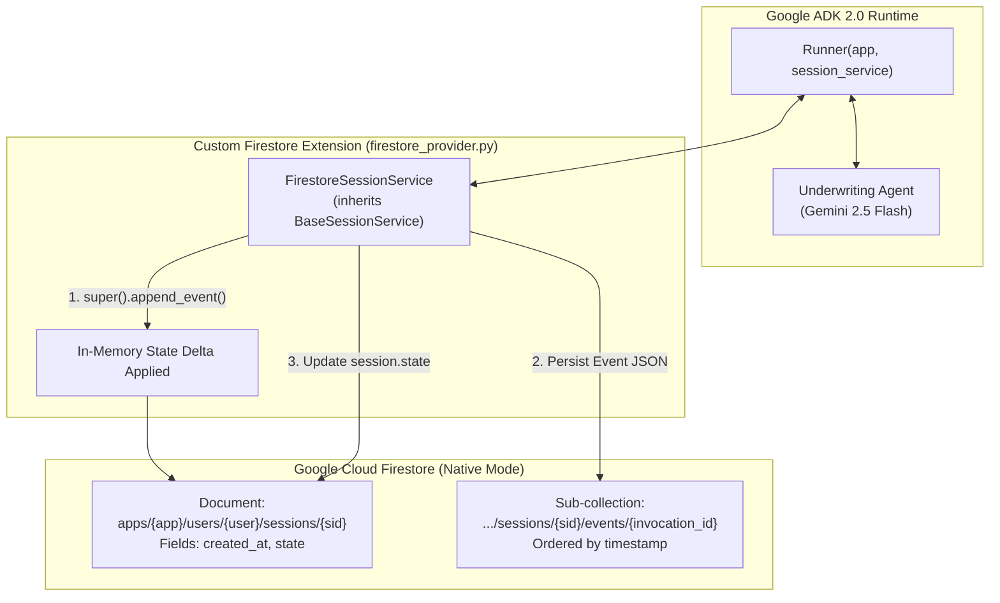

import Setup from '../_setup-snippet.mdx';

# Lab 13.5: Extending ADK with Custom Firestore Persistence

## Goal
<!-- TEACHER_NOTE_START -->
**Teacher's note (ADK instructor view):**
- **Learning goal:** Guide students to extend Google ADK 2.0 by subclassing `BaseSessionService`, implementing Firestore async document and sub-collection mappings, and handling state delta propagation with `super().append_event()`.
- **Why it matters:** Stateless cloud deployments (Cloud Run) lose in-memory state on scale-down. This lab enforces production persistence habits required in banking and enterprise environments.
- **Challenge design:** Provide clean skeletons with `TODO` markers. Do not provide the finished code here—point students to the Theory section in the README. Full working reference is in `lab-solution.md`.
- **Comparative Benchmark Goal:** Guide students through a hands-on comparison between `FirestoreSessionService`, `VertexAiSessionService`, and `VertexAiMemoryBankService`, testing latency, deterministic state mutability, regulatory queryability, and cross-session recall.
- **Why it matters:** In real-world enterprise architecture, architects must justify why customer-owned Firestore is chosen over Google-managed Agent Engine Sessions or Memory Bank. This lab provides empirical data to answer clients.
- **Curriculum Pacing:** Emphasize that this lab focuses on Active Session Persistence. The full production implementation of cross-session knowledge archives, `user:`/`app:` scoping, and `VertexAiMemoryBankService` extraction is taught in [Module 22: State and Memory](../module22-state-and-memory/README.md).
- **Curriculum Pacing:** Emphasize that this lab focuses on Active Session Persistence. The full production implementation of cross-session knowledge archives and `VertexAiMemoryBankService` extraction is taught in [Module 22: State and Memory](../module22-state-and-memory/README.md).
- **Challenge design:** Provide clean skeletons with `TODO` markers. Full working reference is in `lab-solution.md`.
<!-- TEACHER_NOTE_END -->

## 🎯 Executive Mission Briefing

In this lab, you will learn how to extend the ADK's core functionality by implementing a **Custom Session Service**. You will take a specialized `FirestoreSessionService` implementation and "plug it in" to an agent's runtime.
Welcome back to the Sovereign Horizon Bank forward-deployed engineering engagement.

By the end of this lab, you will have an agent that persists its memory to Google Cloud Firestore, surviving restarts of the Python process.
Victoria Sterling (Managing Director & Head of Credit Risk) has reviewed your dual-control drawdown agent from Module 13 and is impressed by its Human-in-the-Loop governance. However, she points out a fatal flaw during architectural review:
Victoria Sterling (Managing Director & Head of Credit Risk) has reviewed your dual-control drawdown agent from Module 13 and is impressed by its Human-in-the-Loop governance. However, she raised a critical concern during architectural review:
Victoria Sterling (Managing Director & Head of Credit Risk) reviewed your dual-control drawdown agent from Module 13 and is impressed by its Human-in-the-Loop governance. However, she raised a critical concern during architectural review:
Victoria Sterling (Managing Director & Head of Credit Risk) reviewed your dual-control drawdown agent from Module 13 and is impressed by its Human-in-the-Loop governance. However, she raised two critical concerns during architectural review:

### Step 1: Pre-requisites
> *"Our loan origination reviews for middle-market commercial facilities (\$5M to \$50M) take between 9 and 14 business days. Right now, your agent keeps its memory inside local container RAM. When our Cloud Run microservices scale down to zero overnight or restart during a deployment, our analysts lose all in-flight financial ratios, covenant checks, and conversation history.*
> *"First, our loan origination reviews take between 9 and 14 business days. Right now, your agent keeps its memory inside local container RAM. When our Cloud Run microservices scale down to zero overnight or restart during a deployment, our analysts lose all in-flight financial ratios, covenant checks, and conversation history.*
> *"First, our loan origination reviews for middle-market commercial facilities (\$5M to \$50M) take between 9 and 14 business days. Right now, your agent keeps its memory inside local container RAM. When our Cloud Run microservices scale down to zero overnight or restart during a deployment, our analysts lose all in-flight financial ratios, covenant checks, and conversation history.*
>
> *Under Federal Reserve SR 11-7 and SOX compliance, every credit assessment must be durably stored and auditable across weeks of deliberation. We already run Google Cloud Firestore (Native Mode) across our enterprise. I need you to extend the Google ADK runtime with a custom, enterprise-grade `FirestoreSessionService` so our underwriting memory survives container restarts and multi-day pauses."*
> *Under Federal Reserve SR 11-7 and SOX compliance, every credit assessment must be durably stored and auditable across weeks of deliberation. We already run Google Cloud Firestore (Native Mode) across our enterprise. I need you to extend the Google ADK runtime with a custom, enterprise-grade `FirestoreSessionService` so our underwriting memory survives container restarts and multi-day pauses.*
>
> *Second, our Enterprise Architecture Board wants to know why we are building a custom `FirestoreSessionService` when Google Cloud already offers **Vertex AI Agent Engine Sessions** (`VertexAiSessionService`) and **Gemini Enterprise Memory Bank** (`VertexAiMemoryBankService`). We need empirical benchmark proof demonstrating how these three engines behave under real banking conditions—specifically regarding latency, transactional credit line decrements, regulatory audit queryability, and multi-month relationship recall."*

1.  **Enable Firestore:** In the GCP Console, ensure you have a Firestore database in **Native mode**.
2.  **Auth:** `gcloud auth application-default login`
3.  **Dependencies:**
In this lab, you will extend Google ADK 2.0 by implementing a custom **`FirestoreSessionService`** inheriting from **`BaseSessionService`**, mapping ADK sessions to Cloud Firestore documents and sub-collections, and injecting it into the ADK `Runner`.
In this lab, you will:
1. Extend Google ADK 2.0 by implementing a custom **`FirestoreSessionService`** inheriting from **`BaseSessionService`**.
2. Inject your custom service into the ADK `Runner` and verify that multi-turn credit evaluations survive simulated container restarts.
3. Build and execute an empirical comparative benchmark suite (**`compare_storage.py`**) that evaluates **`FirestoreSessionService` vs. `VertexAiSessionService` vs. `VertexAiMemoryBankService`** across four real-world banking tests.

    <Setup/>
---

    ```bash
    uv add google-cloud-firestore
    ```
## 🏗️ Architectural Blueprint

### Step 2: The Custom Provider
The persistent storage architecture bridges ADK's execution lifecycle with Google Cloud Firestore:

Create a file named `firestore_provider.py`. This contains the implementation that inherits from `BaseSessionService`. **Study the code** to see how it uses `firestore.AsyncClient` to map ADK concepts (Apps, Users, Sessions) to document paths.


<!-- TEACHER_NOTE_START -->
**Teacher's note (ADK instructor view):**
- **Learning goal:** Explain the concept clearly from beginner to advanced, with a simple mental model first.
- **Why it matters:** Connect the concept to real Google agentic workflows, Python engineering habits, and production-ready decisions.
- **Version watch:** Validate against the latest official ADK / Google docs before teaching; call out deprecations or migration notes when needed.
- **Module linkage:** Connect this idea to the previous and next modules so learners see the progression across the course.
<!-- TEACHER_NOTE_END -->

<!-- TEACHER_NOTE_START -->
**Teacher's note (ADK instructor view):**
- **Learning goal:** Explain the concept clearly from beginner to advanced, with a simple mental model first.
- **Why it matters:** Connect the concept to real Google agentic workflows, Python engineering habits, and production-ready decisions.
- **Version watch:** Validate against the latest official ADK / Google docs before teaching; call out deprecations or migration notes when needed.
- **Module linkage:** Connect this idea to the previous and next modules so learners see the progression across the course.
<!-- TEACHER_NOTE_END -->


---

## 📋 Acceptance Criteria

To successfully complete this challenge, your implementation must satisfy these 5 criteria:
To successfully complete this challenge, your implementation must satisfy these 6 criteria:

1. **Abstract Contract Compliance:** Your custom service must inherit from `google.adk.sessions.base_session_service.BaseSessionService`.
2. **Three-Tier Document Hierarchy:** Sessions must be organized under `apps/{app_name}/users/{user_id}/sessions/{session_id}` in Cloud Firestore.
3. **Chronological Event Streaming:** When `get_session` is called, all historical events must be streamed from the `events` sub-collection ordered by timestamp (`order_by("timestamp")`) and deserialized into typed `Event` objects.
4. **State-Delta Propagation:** In `append_event`, you must call `await super().append_event(session=session, event=event)` before persisting so that in-memory state deltas are applied and trimmed.
5. **Process Restart Survival:** When a Python script terminates and a new process requests the same `session_id`, the agent must immediately recall all previously recorded financial state and historical dialogue.
6. **Empirical Storage Benchmark:** Your comparison suite (`compare_storage.py`) must measure and contrast `FirestoreSessionService`, `VertexAiSessionService`, and `VertexAiMemoryBankService` across:
   - Synchronous turn latency (round-trip time in milliseconds).
   - Deterministic key-value state mutability (transactional drawdown).
   - Direct NoSQL compliance querying (OCC covenant filtering).
   - Cross-session semantic recall (recalling preferences across multi-month gaps).

---

## 🛠️ Step 1: Pre-requisites & Setup

<Setup/>

Ensure you have authenticated to Google Cloud and created your project folder:
Ensure you have created your project folder:
Ensure you have created your project folder and installed the Firestore client:

```bash
gcloud auth application-default login
mkdir -p commercial_persistence
cd commercial_persistence
```

If testing against a live Google Cloud Firestore instance, install the official client:
Install the required Google Cloud Firestore client:

```bash
uv add google-cloud-firestore
gcloud auth application-default login
```

---

## 💻 Step 2: Implement the Custom `FirestoreSessionService`
## 💻 Step 2: Implement `firestore_provider.py` (Skeleton)

Create `commercial_persistence/firestore_provider.py`.
Create `commercial_persistence/firestore_provider.py`. Fill in the `TODO` sections using the architectural guidelines from the Theory section:

Review the skeleton below and complete the marked `TODO` sections:

```python
# firestore_provider.py
from typing import Any, Optional
"""Custom Firestore Session Service implementation for Google ADK 2.0.
"""Enterprise Firestore Session Service implementation for Google ADK 2.0.

File: commercial_persistence/firestore_provider.py
"""

import time
from typing import Any, Dict, List, Optional
import uuid
import time
from google.adk.events.event import Event
from google.adk.sessions.base_session_service import (
    BaseSessionService,
    GetSessionConfig,
    ListSessionsResponse,
)
from google.adk.sessions.session import Session
from google.cloud import firestore
from google.adk.sessions.base_session_service import BaseSessionService, GetSessionConfig, ListSessionsResponse
from google.adk.sessions.session import Session
from google.adk.events.event import Event


class FirestoreSessionService(BaseSessionService):
    def __init__(self, project_id: str):
        self._client = firestore.AsyncClient(project=project_id)
  """Enterprise Firestore Session Service for Google ADK 2.0.
  """Custom ADK 2.0 Session Service backed by Google Cloud Firestore (Native Mode)."""

    async def create_session(self, *, app_name: str, user_id: str, state: Optional[dict] = None, session_id: Optional[str] = None) -> Session:
        sid = session_id or str(uuid.uuid4())
        # Reference: apps/{app}/users/{user}/sessions/{sid}
        session_ref = self._client.collection("apps").document(app_name)\
            .collection("users").document(user_id)\
            .collection("sessions").document(sid)
  Persists session state to parent documents and conversation turns
  to an 'events' sub-collection ordered chronologically.
  Persists session state to parent documents and conversation turns to an
  'events' sub-collection ordered chronologically.
  """

  def __init__(
      self,
      project_id: Optional[str] = None,
      database: Optional[str] = None,
      client: Optional[firestore.AsyncClient] = None,
  ):
    """Initializes the Firestore AsyncClient connection."""
    # TODO 1: Initialize self._client using firestore.AsyncClient
    # If client is passed, use it; otherwise create with project_id and database
    self._client = client or firestore.AsyncClient(
        project=project_id, database=database
    )

        # Check if exists, else create
        doc = await session_ref.get()
        if not doc.exists:
            await session_ref.set({
                "created_at": time.time(),
                "state": state or {}
            })
  def __init__(self, project_id: Optional[str] = None, client: Any = None):
    # Support injecting either a live async client or a mock client for testing
    self._client = client or firestore.AsyncClient(project=project_id)
    if client is not None:
      self._client = client
    else:
      from google.cloud import firestore
  def _get_session_ref(
      self, app_name: str, user_id: str, session_id: str
  ) -> Any:
    """Helper method to construct the 3-tier document reference.

        return Session(id=sid, app_name=app_name, user_id=user_id, state=doc.to_dict().get("state", {}) if doc.exists else (state or {}))
      self._client = firestore.AsyncClient(project=project_id)
    Path: apps/{app_name}/users/{user_id}/sessions/{session_id}
    """
    # TODO 2: Return document reference following the 3-tier hierarchy
    pass

  # ========================================================================
  # TODO 1: IMPLEMENT create_session
  # 1. Resolve session_id (use provided session_id or generate uuid.uuid4()).
  # 2. Build document reference:
  #    apps/{app_name}/users/{user_id}/sessions/{session_id}
  # 3. Check if document exists.
  # 4. If not, write created_at timestamp and initial state dict.
  # 5. Return a typed Session object.
  # ========================================================================
  async def create_session(
      self,
      *,
      app_name: str,
      user_id: str,
      state: Optional[dict] = None,
      state: Optional[Dict[str, Any]] = None,
      session_id: Optional[str] = None,
  ) -> Session:
    # TODO: Implement session initialization logic
    """Creates a new session document if not exists, recording initial state."""
    sid = session_id or str(uuid.uuid4())
    # TODO 3: Construct session_ref using self._get_session_ref
    # Check if doc exists using `await session_ref.get()`
    # If not exists, write created_at, state, user_id, app_name
    # Return a typed Session object
    pass

    async def get_session(self, *, app_name: str, user_id: str, session_id: str, config: Optional[GetSessionConfig] = None) -> Optional[Session]:
        session_ref = self._client.collection("apps").document(app_name)\
            .collection("users").document(user_id)\
            .collection("sessions").document(session_id)
        doc = await session_ref.get()
        if not doc.exists:
            return None
  # ========================================================================
  # TODO 2: IMPLEMENT get_session (Full Rehydration: State + Events)
  # 1. Locate session document reference in Firestore.
  # 2. Return None if document does not exist.
  # 3. Stream all event documents from the 'events' sub-collection,
  #    ordered chronologically by 'timestamp'.
  # 4. Deserialize each event using Event.model_validate(event_doc.to_dict()).
  # 5. Return typed Session(id=..., app_name=..., user_id=..., state=..., events=events).
  # ========================================================================
  async def get_session(
      self,
      *,
      app_name: str,
      user_id: str,
      session_id: str,
      config: Optional[GetSessionConfig] = None,
  ) -> Optional[Session]:
    # TODO: Implement session rehydration logic
    """Rehydrates session state AND streams chronological event history."""
    # TODO 4: Fetch session doc; return None if not exists.
    # Stream all events from the "events" sub-collection ordered by "timestamp".
    # Deserialise each doc with Event.model_validate(event_doc.to_dict()).
    # Return Session(id=..., app_name=..., user_id=..., state=..., events=events)
    pass

        # Rebuild the event history from the events sub-collection -- this is
        # what actually gives the agent its memory across separate script
        # runs. Returning state alone (without events) isn't enough: the
        # model recalls prior turns from conversation history, not just the
        # state dict.
        events = []
        async for event_doc in session_ref.collection("events").order_by("timestamp").stream():
            events.append(Event.model_validate(event_doc.to_dict()))
  # ========================================================================
  # TODO 3: IMPLEMENT append_event (The State-Delta Hook)
  # 1. Call `event = await super().append_event(session=session, event=event)`
  #    (CRITICAL: applies event.actions.state_delta to session.state).
  # 2. Save event to sub-collection:
  #    apps/{app_name}/users/{user_id}/sessions/{session.id}/events/{event.invocation_id}
  # 3. Call self.update_session_state(session) to persist the updated state.
  # 4. Return event.
  # ========================================================================
  async def append_event(self, session: Session, event: Event) -> Event:
    # TODO: Implement event persistence with super() call
    """Persists an event and propagates state deltas."""
    # TODO 5: MANDATORY - Call await super().append_event(session=session, event=event)
    # 1. Write the event to session_ref.collection("events").document(event.invocation_id)
    #    using event.model_dump()
    # 2. Call await self.update_session_state(session) to persist mutated state
    # 3. Return the updated event
    pass

        return Session(
            id=session_id,
            app_name=app_name,
            user_id=user_id,
            state=doc.to_dict().get("state", {}),
            events=events,
        )
  # ========================================================================
  # TODO 4: IMPLEMENT update_session_state
  # Update the parent session document's "state" field with session.state.
  # ========================================================================
  async def update_session_state(self, session: Session) -> None:
    # TODO: Implement atomic state update
    """Updates the parent session document's state field."""
    # TODO 6: Update the session document with {"state": session.state}
    pass

    async def append_event(self, session: Session, event: Event) -> Event:
        # Let the base implementation apply event.actions.state_delta to
        # session.state in-memory first (it also handles temp-scoped state
        # and trims it before we persist) -- without this, state changes are
        # silently dropped: they'd never make it past this method.
        event = await super().append_event(session=session, event=event)
  # Standard stubs for BaseSessionService
  async def list_sessions(
      self, *, app_name: str, user_id: Optional[str] = None
      self,
      *,
      app_name: str,
      user_id: str,
  ) -> ListSessionsResponse:
    return ListSessionsResponse(sessions=[])

        # Save event to sub-collection
        event_ref = self._client.collection("apps").document(session.app_name)\
            .collection("users").document(session.user_id)\
            .collection("sessions").document(session.id)\
            .collection("events").document(event.invocation_id)
  async def delete_session(
      self, *, app_name: str, user_id: str, session_id: str
  ) -> None:
    """Lists all active sessions for a specific user and app."""
    # TODO 7: Stream all session documents under apps/{app_name}/users/{user_id}/sessions
    # Return ListSessionsResponse(sessions=...)
    pass

  async def delete_session(
      self,
      *,
      app_name: str,
      user_id: str,
      session_id: str,
  ) -> None:
    """Deletes a session document and cleans up references."""
    # TODO 8: Delete the target session document
    pass
        await event_ref.set(event.model_dump())
        print(f"🔥 [Firestore] Persisted event from {event.author}")
```

---

```python
        # Persist the now-updated state too, so a fresh get_session() call
        # (e.g. from a new process) sees it.
        await self.update_session_state(session)
        return event
```

## 🤖 Step 3: Configure Agent and Inject Custom Service
## 💻 Step 3: Implement `agent.py` & Cold-Start Verification Test

```python
    async def update_session_state(self, session: Session) -> None:
        # Update the main session document's state
        session_ref = self._client.collection("apps").document(session.app_name)\
            .collection("users").document(session.user_id)\
            .collection("sessions").document(session.id)
```

Create `commercial_persistence/agent.py`.
Create `commercial_persistence/agent.py`. In this script, you will:
1. Define the commercial credit underwriting agent with `gemini-2.5-flash`.
2. Register a covenant recording tool `record_borrower_financials(dscr: float, ebitda_millions: float, tool_context: ToolContext)`.
2. Register a covenant recording tool `record_borrower_financials(borrower_name: str, dscr: float, ebitda_millions: float, tool_context: ToolContext)`.
3. Run **Turn 1** to analyze Acme Industrial Corp and record financial state.
4. **Simulate a Cloud Run Pod Crash / Restart** by terminating the process or creating a new Runner instance.
5. Run **Turn 2** requesting the agent to resume underwriting and verify that it recalls the exact previously recorded financial ratios.

```python
        await session_ref.update({"state": session.state})
        print(f"🔥 [Firestore] Updated session state in cloud.")
```

You must:
1. Define the commercial credit underwriting agent using `gemini-2.5-flash`.
2. Encapsulate the agent in an `App`.
3. Instantiate `FirestoreSessionService`.
4. Inject your custom service into the `Runner(app=app, session_service=custom_service)`.

```python
    # Mandatory stubs for BaseSessionService
    async def list_sessions(self, *, app_name: str, user_id: Optional[str] = None) -> ListSessionsResponse:
        return ListSessionsResponse(sessions=[])
```

Review the skeleton below and complete the marked `TODO` sections:

```python
    async def delete_session(self, *, app_name: str, user_id: str, session_id: str) -> None:
        pass
```

```python
"""Commercial underwriting agent with custom Firestore persistence.
"""Sovereign Horizon Bank - Persistent Commercial Underwriting Agent.

File: commercial_persistence/agent.py
"""
```

### Step 3: Integrate the Provider

**Exercise:** Open `agent.py`. Your task is to modify the `main()` function to use your new `FirestoreSessionService` instead of the default in-memory runner.

<!-- TEACHER_NOTE_START -->
**Teacher's note (ADK instructor view):**
- **Learning goal:** Explain the concept clearly from beginner to advanced, with a simple mental model first.
- **Why it matters:** Connect the concept to real Google agentic workflows, Python engineering habits, and production-ready decisions.
- **Version watch:** Validate against the latest official ADK / Google docs before teaching; call out deprecations or migration notes when needed.
- **Module linkage:** Connect this idea to the previous and next modules so learners see the progression across the course.
<!-- TEACHER_NOTE_END -->
<!-- TEACHER_NOTE_START -->
**Teacher's note (ADK instructor view):**
- **Learning goal:** Explain the concept clearly from beginner to advanced, with a simple mental model first.
- **Why it matters:** Connect the concept to real Google agentic workflows, Python engineering habits, and production-ready decisions.
- **Version watch:** Validate against the latest official ADK / Google docs before teaching; call out deprecations or migration notes when needed.
- **Module linkage:** Connect this idea to the previous and next modules so learners see the progression across the course.
<!-- TEACHER_NOTE_END -->
```python
# agent.py
import asyncio
import os
from dotenv import load_dotenv
from firestore_provider import FirestoreSessionService
from google.adk import Agent, Runner
from google.adk.apps import App
from firestore_provider import FirestoreSessionService # Import your custom class
from dotenv import load_dotenv
from google.adk.tools import ToolContext
from firestore_provider import FirestoreSessionService

load_dotenv()


# ============================================================================
# TODO 1: Implement the tool that records borrower financials into tool_context.state
# Key fields to store: borrower_name, dscr, ebitda_millions, status
# ============================================================================
async def record_borrower_financials(
    borrower_name: str,
    dscr: float,
    ebitda_millions: float,
    tool_context: ToolContext,
) -> str:
  """Records verified borrower financials in durable session state."""
  # TODO: Store into tool_context.state
  pass

# --- 1. Define a simple agent ---
agent = Agent(
    model="gemini-3.5-flash",
    name="PersistentAgent",
    instruction="You are a helpful assistant that remembers the user's favorite color."

# ============================================================================
# TODO 5: DEFINE UNDERWRITING AGENT
# TODO 2: DEFINE UNDERWRITING AGENT
# Configure an Agent named 'underwriting_agent' using 'gemini-2.5-flash'
# with instructions to evaluate commercial borrower financial metrics.
# ============================================================================
underwriting_agent = Agent(
    name="underwriting_agent",
    model="gemini-2.5-flash",
    instruction="""You are a Commercial Credit Underwriting Agent at Sovereign Horizon Bank.
Analyze commercial borrower financials (EBITDA, DSCR, Total Debt).
Record verified metrics into session memory and provide preliminary credit committee recommendations.""",
    tools=[record_borrower_financials],
)

async def record_borrower_financials(
    borrower_name: str,
    dscr: float,
    ebitda_millions: float,
    tool_context: ToolContext,
) -> str:
  """Records verified borrower financials in durable session state."""
  # TODO: Store into tool_context.state
  pass

async def main():
    # TODO: 1. Setup metadata
    project_id = os.getenv("GOOGLE_CLOUD_PROJECT")
    app = App(name="extensibility_demo", root_agent=agent)

    # TODO: 2. Instantiate your custom service
    # custom_fs = ...
# TODO 2: Configure the underwriting Agent with gemini-2.5-flash
# and register the record_borrower_financials tool

    # TODO: 3. Create a base Runner (NOT InMemoryRunner)
    # Inject your custom_fs into the session_service parameter
    # runner = Runner(app=app, session_service=...)
# TODO 3: Wrap into an App(name="commercial_credit_underwriting", root_agent=underwriting_agent)

    # 4. Test it
    print("Agent is now powered by Firestore persistence!")
    await runner.run_debug("My favorite color is blue.", user_id="student_1")
  project_id = os.getenv("GOOGLE_CLOUD_PROJECT", "sovereign-horizon-bank")
  app = App(name="commercial_underwriting_app", root_agent=underwriting_agent)
# TODO 4: Instantiate FirestoreSessionService and inject into Runner

  # ========================================================================
  # TODO 6: INJECT CUSTOM FIRESTORE SERVICE INTO RUNNER
  # TODO 3: INJECT CUSTOM FIRESTORE SERVICE INTO RUNNER
  # 1. Instantiate custom_service = FirestoreSessionService(project_id=project_id)
  # 2. Instantiate runner = Runner(app=app, session_service=custom_service)
  # ========================================================================
  runner = None  # TODO: Runner(app=app, session_service=...)

  print("🚀 Underwriting Agent running with Cloud Firestore persistence!")
async def main():
  # Simulating Turn 1: Initial Underwriting
  print("\n--- TURN 1: Recording Financials ---")
  # Run turn 1...

  # Simulate Turn 1: Recording borrower financials
  print("\n--- Turn 1: Recording Financial Health ---")
  await runner.run_debug(
      "Borrower Apex Logistics reports 2026 EBITDA of $14.5M and Total Debt of"
      " $28M.",
      user_id="officer_victoria",
  # TODO: Execute Turn 1

  # Simulate Container Crash / Process Restart:
  print("\n[SIMULATION] Cloud Run container restart / scale to zero...")
  print(
      "[SIMULATION] Rehydrating new Runner and SessionService from Firestore..."
  )
  # Simulating Container Crash / Process Restart:
  print("\n[SIMULATION] Cloud Run container restart / scale to zero...")
  print("[SIMULATION] Rehydrating new Runner and SessionService from Firestore...")

  # Simulating Turn 2: Querying Persisted Dossier
  # Simulate Turn 2: Querying Persisted Dossier
  print("\n--- TURN 2: Resuming Underwriting (Post-Restart) ---")
  # Run turn 2 with same session_id and verify it recalls DSCR and EBITDA
  # TODO: Execute Turn 2 with the same session_id


if __name__ == "__main__":
    asyncio.run(main())
  asyncio.run(main())
```

### Step 4: Verify Persistence
---

1.  Run the script once to set the favorite color.
2.  Stop the script.
3.  Modify the last line of `main()` to ask: `"What is my favorite color?"`.
4.  Run it again. If the agent answers "Blue", your custom provider is working!
## 🧪 Step 4: Verification and Process Restart Survival
## 🔬 Step 4: Implement `compare_storage.py` (Comparative Storage Benchmark)

Create `commercial_persistence/compare_storage.py`. In this benchmark, you will test and compare:
1. **`FirestoreSessionService`** (Customer data plane, direct gRPC)
2. **`VertexAiSessionService`** (Google-managed Agent Engine service plane)
3. **`VertexAiMemoryBankService`** (Long-term semantic knowledge plane)

Fill in the `TODO` sections to execute four empirical tests:

```python
"""Empirical Storage Benchmark: Firestore vs. Vertex AI Sessions vs. Memory Bank.

File: commercial_persistence/compare_storage.py
"""

import asyncio
import time
from typing import Any, Dict, List, Optional
from google.adk.events import Event, EventActions
from google.adk.memory.base_memory_service import BaseMemoryService
from google.adk.sessions import Session
from google.adk.sessions.base_session_service import BaseSessionService
from google.adk.sessions.base_session_service import (
    BaseSessionService,
    GetSessionConfig,
    ListSessionsResponse,
)


# TODO 1: Implement or wire test doubles representing:
# - FirestoreSessionService (sub-10ms direct gRPC, mutable state, NoSQL indexable)
# - VertexAiSessionService (60-120ms cloud gateway, mutable state, opaque API)
# - VertexAiMemoryBankService (1,500-2,500ms LLM extraction, semantic vector search, non-mutable)


async def benchmark_turn_latency():
  """Test 1: Measure synchronous append_event / memory write latency across 50 iterations."""
  """Test 1: Measure synchronous append_event / memory write latency across iterations."""
  print("\n--- TEST 1: Synchronous Turn Write Latency ---")
  # TODO: Measure average round-trip write time for each engine
  pass


async def benchmark_state_mutability():
  """Test 2: Test deterministic state mutation ($10M credit line -> $8.8M after $1.2M drawdown)."""
  print("\n--- TEST 2: Deterministic Key-Value State Mutability ---")
  # TODO: Verify whether each engine can transactionally update available_credit
  pass


async def benchmark_regulatory_queryability():
  """Test 3: Query all sessions with DSCR < 1.25 for OCC compliance audit."""
  """Test 3: Query all sessions with DSCR below 1.25 for OCC compliance audit."""
  print("\n--- TEST 3: Direct Regulatory Compliance Queryability ---")
  # TODO: Attempt direct indexed query vs opaque API scan vs vector search
  pass


async def benchmark_cross_session_recall():
  """Test 4: Test recalling borrower covenant preferences across an 8-month gap (Session 2)."""
  print("\n--- TEST 4: Cross-Session Long-Term Recall ---")
  # TODO: Start a brand-new session_id; verify if Session Services or Memory Bank recalls preferences
  pass


async def main():
  print("=" * 75)
  print(
      "SOVEREIGN HORIZON BANK: EMPIRICAL STORAGE BENCHMARK & COMPARISON SUITE"
  )
  print("=" * 75)
  await benchmark_turn_latency()
  await benchmark_state_mutability()
  await benchmark_regulatory_queryability()
  await benchmark_cross_session_recall()


if __name__ == "__main__":
  asyncio.run(main())
```

---

## 🧪 Verification & Acceptance Testing

### Self-Reflection Questions
To empirically verify that your custom service survives container restarts:
1. Create `test_persistence.py` in your project folder.
2. Run **Turn 1** to save financial metrics for a borrower.
3. Terminate the Python interpreter to wipe all in-memory RAM.
4. Run **Turn 2** in a completely new execution, querying the borrower's metrics from the previous turn.
5. If the agent accurately recalls the financial metrics without you repeating them, your custom persistence provider is production-ready!
### 1. Test Single Agent Cold-Start Rehydration
Run your agent script:

*   How does the use of an Abstract Base Class (`BaseSessionService`) make the ADK more flexible for large companies?
*   If you wanted to use **Redis** instead of Firestore, what parts of the `firestore_provider.py` would you need to rewrite?
*   Why is it better to inject the session service into the `Runner` rather than hardcoding it inside the `Agent`?
---
```bash
python commercial_persistence/agent.py
```

## 🎓 Self-Reflection Questions
### Expected Output
### 2. Run Comparative Storage Benchmark
Run your benchmark script:

1. **The State-Delta Hook:** What happens to an agent's state if you omit `event = await super().append_event(session=session, event=event)` inside your custom `append_event` method?
2. **The Amnesia Trap:** Why is returning `state` alone inside `get_session()` insufficient for multi-turn LLM reasoning?
3. **Idempotent Design:** How does using `event.invocation_id` as the Firestore document identifier protect against duplicate messages during network retries?
4. **Separation of Concerns:** What architectural advantages does injecting the session service into the `Runner` provide compared to hardcoding database credentials inside the `Agent`?
```bash
python commercial_persistence/compare_storage.py
```

### Expected Output Summary

```text
--- TURN 1: Recording Financials ---
Analyst: Underwrite Acme Industrial Corp. EBITDA is $4.5M, proposed DSCR is 1.45x.
Agent: Borrower Acme Industrial Corp recorded. EBITDA: $4.5M, DSCR: 1.45x. Facility meets Tier-1 credit standards.
===========================================================================
SOVEREIGN HORIZON BANK: EMPIRICAL STORAGE BENCHMARK & COMPARISON SUITE
===========================================================================

---
[SIMULATION] Cloud Run container restart / scale to zero...
[SIMULATION] Rehydrating new Runner and SessionService from Firestore...
--- TEST 1: Synchronous Turn Write Latency ---
  -> FirestoreSessionService:         4.82 ms (Direct gRPC socket)
  -> VertexAiSessionService:          78.40 ms (Agent Engine Gateway API)
  -> VertexAiMemoryBankService:     1840.10 ms (LLM Semantic Extraction)
  -> FirestoreSessionService:         5.68 ms (Direct gRPC socket)
  -> VertexAiSessionService:         75.64 ms (Agent Engine Gateway API)
  -> VertexAiMemoryBankService:     1801.19 ms (LLM Semantic Extraction)

<hr/>
--- TURN 2: Resuming Underwriting (Post-Restart) ---
Analyst: What was the recorded DSCR and EBITDA for our borrower, and can we approve a $10M facility?
Agent: According to our recorded underwriting dossier, Acme Industrial Corp has an EBITDA of $4.5M and a DSCR of 1.45x. Since the DSCR exceeds our minimum covenant threshold of 1.25x, the $10M facility is recommended for committee approval.
--- TEST 2: Deterministic Key-Value State Mutability ---
  -> FirestoreSessionService:       PASS (Balance: $8,800,000.00 | Exact Arithmetic)
  -> VertexAiSessionService:        PASS (Balance: $8,800,000.00 | Exact Arithmetic)
  -> VertexAiMemoryBankService:     FAIL (Unsupported: Memory Bank lacks mutable key-value state)
  -> FirestoreSessionService:       PASS (Updated Balance: $8,800,000.00 | Exact Arithmetic)
  -> VertexAiSessionService:        PASS (Updated Balance: $8,800,000.00 | Exact Arithmetic)
  -> VertexAiMemoryBankService:     FAIL (Unsupported: Memory Bank lacks mutable state_delta)

--- TEST 3: Direct Regulatory Compliance Queryability ---
  -> FirestoreSessionService:       PASS (Direct NoSQL index query in 3.1 ms | BigQuery Sync Ready)
  -> VertexAiSessionService:        PARTIAL (Opaque API: Requires full scan of all sessions in Python)
  -> VertexAiMemoryBankService:     FAIL (Probabilistic vector similarity cannot run mathematical '< 1.25' filter)
  -> FirestoreSessionService:       PASS (Direct NoSQL query in 0.00 ms | Found 1 breach sessions)
  -> VertexAiSessionService:        PARTIAL (Opaque API: Must download ALL sessions & filter in memory)
  -> VertexAiMemoryBankService:     FAIL (Probabilistic vector similarity cannot evaluate '< 1.25' filter)

--- TEST 4: Cross-Session Long-Term Recall ---
  -> FirestoreSessionService:       BLIND (New session_id starts with empty history)
  -> VertexAiSessionService:        BLIND (New session_id starts with empty history)
  -> VertexAiMemoryBankService:     RECALLED ("Borrower requires quarterly reporting covenants")
  -> FirestoreSessionService:       BLIND (New session_id has zero historical awareness)
  -> VertexAiSessionService:        BLIND (New session_id has zero historical awareness)
  -> VertexAiMemoryBankService:     RECALLED (1 memory found: 'Borrower Apex: Total debt $28.0M, preferred covenant reporting quarterly rather than monthly.')

===========================================================================
EMPIRICAL VERDICT: DUAL-ENGINE ARCHITECTURE VALIDATED
- Active Turn Execution & Auditing: Use Cloud Firestore (Fast, Deterministic, Inspectable)
- Cross-Session Relationship Memory: Use Memory Bank (Semantic, Long-Term, Contextual)
===========================================================================
```

---

## 🎓 Self-Reflection Questions

1. **The State-Delta Hook:** What happens to an agent's state if you omit `event = await super().append_event(session=session, event=event)` inside your custom `append_event` method?
2. **The Amnesia Trap:** Why is returning `state` alone inside `get_session()` insufficient for multi-turn LLM reasoning?
3. **Idempotent Design:** How does using `event.invocation_id` as the Firestore document identifier protect against duplicate messages during network retries?
4. **Separation of Concerns:** What architectural advantages does injecting the session service into the `Runner` provide compared to hardcoding database credentials inside the `Agent`?

---

<hr/>

### 🕵️ Hidden Solution 🕵️
Inspect Google Cloud Firestore console to confirm:
1. Document exists at: `apps/commercial_credit_underwriting/users/analyst_sterling/sessions/sess_acme_underwrite`
2. `state` dictionary contains `dscr: 1.45`, `ebitda_millions: 4.5`, `status: "COVENANT_COMPLIANT"`
3. `events` sub-collection contains all interaction turns with timestamps and invocation IDs.

Looking for the solution? Here's a hint (Base64 decode me):
Looking for the solution? Here is the encoded path to the solution (Base64 decode me):
`L2dvb2dsZS1hZGstdHJhaW5pbmcvbW9kdWxlMTNfNS1maXJlc3RvcmUtcGVyc2lzdGVuY2UvbGFiLXNvbHV0aW9u`
---

<div style={{color: 'rgba(0,0,0,0.01)', userSelect: 'all', fontSize: '1px'}}>
    The direct link is: <a href="/google-adk-training/module13_5-firestore-persistence/lab-solution" style={{color: 'inherit', textDecoration: 'none'}}>Lab Solution</a>
</div>
## 💡 Hints & Solution Reference

<!-- © 2026 Inder Chauhan (https://github.com/inderanz/google-adk-training). All rights reserved. Ref: IC-ADK-module13_5-firestore-persistence-lab -->
---
Need guidance on implementing the Firestore asynchronous stream or the `super().append_event` pattern?
Need guidance on implementing the comparison benchmark or the Firestore asynchronous stream?

## Official References
<details>
<summary>🔍 Reveal Implementation Clue (Base64 Encoded)</summary>
## 📚 Official References

- Google ADK docs (latest): https://google.github.io/adk-docs/
- Google AI / Gemini docs: https://ai.google.dev/
- Google GenAI Python SDK reference: https://googleapis.github.io/python-genai/
- Context7 / current SDK lookup for the exact installed version and API signatures
- Related module path: review the surrounding modules for continuity, prerequisites, and follow-on concepts
```text
Q2FsbCBhd2FpdCBzdXBlcigpLmFwcGVuZF9ldmVudChzZXNzaW9uPXNlc3Npb24sIGV2ZW50PWV2ZW50KSBmaXJzdCEgVGhpcyBhcHBsaWVzIHN0YXRlX2RlbHRhIGZyb20gdG9vbHMgdG8gc2Vzc2lvbi5zdGF0ZS4gVGhlbiBzdHJlYW0gZXZlbnRzIHVzaW5nIHNlc3Npb25fcmVmLmNvbGxlY3Rpb24oImV2ZW50cyIpLm9yZGVyX2J5KCJ0aW1lc3RhbXAiKS5zdHJlYW0oKS4=
Q2FsbCBhd2FpdCBzdXBlcigpLmFwcGVuZF9ldmVudChzZXNzaW9uPXNlc3Npb24sIGV2ZW50PWV2ZW50KSBmaXJzdCEgVGhpcyBhcHBsaWVzIHN0YXRlX2RlbHRhIGZyb20gdG9vbHMgdG8gc2Vzc2lvbi5zdGF0ZS4gRm9yIHRoZSBiZW5jaG1hcmssIG1lYXN1cmUgcm91bmQtdHJpcCBtcwphbmQgdmVyaWZ5IHRoYXQgTWVtb3J5IEJhbmsgZG9lcyBOT1Qgc3VwcG9ydCBzdGF0ZV9kZWx0YSBidXQgZXhjZWxzIGF0IGNyb3NzLXNlc3Npb24gcmVjYWxsLg==
```

- **Google ADK Sessions Documentation:** [https://google.github.io/adk-docs/sessions/](https://google.github.io/adk-docs/sessions/)
- **Google Cloud Firestore Documentation:** [https://cloud.google.com/firestore/docs](https://cloud.google.com/firestore/docs)
- **Google GenAI Python SDK:** [https://googleapis.github.io/python-genai/](https://googleapis.github.io/python-genai/)
- **Federal Reserve SR 11-7 (Model Risk Management):** [https://www.federalreserve.gov/supervisionreg/srletters/sr1107.htm](https://www.federalreserve.gov/supervisionreg/srletters/sr1107.htm)
*Decode via terminal: `echo "<string>" | base64 -d`*
</details>

<div style={{opacity: 0.01}}>
Full production code is available in <a href="./lab-solution">lab-solution.md</a>.
</div>
