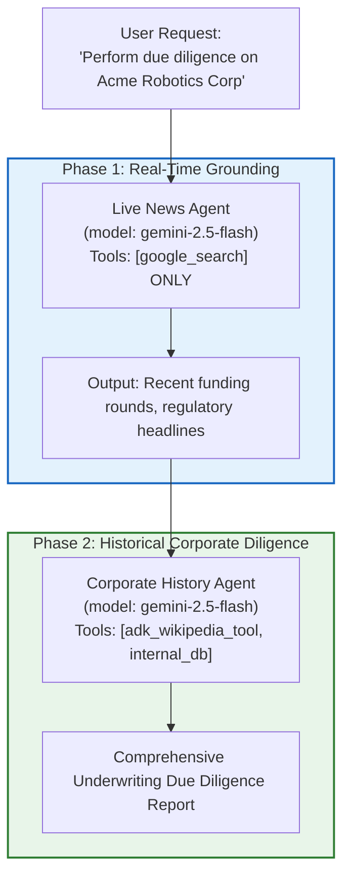

# Module 14: Integrating Third-Party Tools

## Theory
## 🧭 Executive Overview & The Enterprise Integration Dilemma

### Standing on the Shoulders of Giants
In enterprise AI engineering, development teams repeatedly face a classic architectural crossroads: **Build vs. Buy vs. Compose**.

While the ADK provides a powerful framework for building custom tools, you don't always have to reinvent the wheel. The AI and Python ecosystems are vast, with many open-source libraries that already provide pre-built tools for a wide range of tasks.
When designing intelligent agents for complex enterprise workflows—such as corporate credit underwriting, regulatory compliance monitoring, or counterparty risk intelligence—an agent rarely operates in an informational silo. It needs access to external knowledge:
1. **Public Encyclopedic and Corporate Profiles:** Entity histories, corporate hierarchy, past mergers and acquisitions, and executive leadership records.
2. **Financial and Regulatory Filings:** SEC EDGAR disclosures, company registry documents, patent filings, and legal proceedings.
3. **Scientific and Technical Literature:** ArXiv preprints, clinical trials, or engineering patents.
4. **Alternative Public Data:** Domain WHOIS records, public market indices, or weather and geospatial metrics.

Frameworks like **LangChain** have a rich ecosystem of "toolkits" and "agents" that come with ready-to-use integrations for services like Wikipedia, WolframAlpha, various search APIs, and more.
Faced with these requirements, engineering teams often fall into one of two dangerous extremes:

The Google ADK is designed with **interoperability** in mind. It allows you to tap into this vast ecosystem by providing simple wrappers that make it possible to use tools from other popular frameworks directly within your ADK agent. This lets you leverage the best of both worlds: the robust, scalable architecture of the ADK and the extensive tool library of the broader community.
```mermaid
flowchart TD
    subgraph AntiPatternA["The Novice Trap: Not-Invented-Here (NIH) Syndrome"]
        A1["Requirement: Query Wikipedia / ArXiv / Public Records"] --> B1["Hand-write 1,200 lines of custom scraping & HTTP code"]
        B1 --> C1["Fragile HTML regex parsing & unhandled pagination"]
        C1 --> D1["Massive maintenance overhead & technical debt"]
    end

### The Wrapper Pattern
    subgraph AntiPatternB["The Careless Trap: Uncontrolled Dependency Chaos"]
        A2["Requirement: Query Public Ecosystem"] --> B2["Blindly pip-install heavy third-party frameworks"]
        B2 --> C2["Dependency hell, version conflicts, transitively bloated images"]
        C2 --> D2["Unmonitored execution, supply-chain vulnerabilities, prompt leaks"]
    end

The key to this integration is the **Wrapper Pattern**. The ADK provides special wrapper classes, like `LangchainTool`, that act as adapters.
    subgraph FDEStandard["The Google FDE Standard: Controlled Ecosystem Interoperability"]
        A3["Requirement: External Public Knowledge"] --> B3["Leverage Proven Third-Party Tools via ADK Adapters"]
        B3 --> C3["Wrap with LangchainTool & Enterprise Governance Guardrails"]
        C3 --> D3["Input sanitization, output clipping, zero-trust token isolation"]
    end

Here's how it works:
    style AntiPatternA fill:#ffebee,stroke:#c62828,stroke-width:2px
    style AntiPatternB fill:#fff3e0,stroke:#e65100,stroke-width:2px
    style FDEStandard fill:#e8f5e9,stroke:#2e7d32,stroke-width:2px
```

1.  **You find a tool** you want to use from a third-party library (e.g., a Wikipedia search tool from LangChain).
2.  **You instantiate** this third-party tool according to its own library's documentation.
3.  **You "wrap"** this instance inside the corresponding ADK wrapper class (e.g., `LangchainTool(tool=your_langchain_tool_instance)`).
4.  **You add the wrapped tool** to your ADK agent's `tools` list.
### The Client Context: Sovereign Horizon Bank (Project Sentinel)

The ADK wrapper handles all the translation behind the scenes. It inspects the third-party tool, extracts its name, description, and parameters, and generates the necessary schema for the Gemini LLM to understand it. When the LLM decides to call the tool, the wrapper receives the request, calls the underlying third-party tool's execution method, and then formats the result back into a standard dictionary that the ADK agent can understand.
At **Sovereign Horizon Bank**, the Commercial Lending Group is deploying **Project Sentinel**: an autonomous Counterparty Due Diligence Agent. When a multinational enterprise applies for a syndicated loan facility exceeding \$50,000,000, credit officers must verify the borrower's public corporate profile, historical business pivots, and executive litigation history alongside internal financial spreadsheets.

Once wrapped, a third-party tool behaves just like a **custom function tool** you wrote yourself — you can freely mix multiple wrapped tools (e.g. a `WikipediaQueryRun` from LangChain alongside your own `get_order_status` function) in the same agent's `tools` list.
Writing custom web scrapers and API wrappers for Wikipedia, arXiv, or corporate directories would consume weeks of valuable engineering bandwidth. Fortunately, the broader open-source Python ecosystem (notably LangChain and community toolkits) already maintains battle-tested, actively patched libraries for hundreds of public data sources.

**Important restriction:** As Module 12 covered, a **built-in tool** like `google_search` **cannot** share an agent's `tools` list with any custom function tools — and a wrapped third-party tool counts as a custom function tool for this purpose. This is a restriction from the Gemini API itself (not the ADK): it constructs fine in Python but fails the moment the model actually runs, with `400 INVALID_ARGUMENT: Multiple tools are supported only when they are all search tools.` So an agent can have `google_search` *or* a mix of custom/third-party tools, but not both together.
Google ADK 2.0 does not force you into a walled garden. Instead, it provides first-class **interoperability adapters**—such as `LangchainTool`—enabling you to instantly harness external tool ecosystems while retaining Google ADK's enterprise-grade orchestration, zero-trust state management, and Cloud Run deployability.

If you need grounding *and* a third-party tool like Wikipedia search in the same system, use the same **sequential composition** pattern from Module 12: run a `google_search`-only agent, then feed its output into a second agent that has your wrapped third-party tool(s).
In this module, you will learn the theory and practice of third-party tool integration, moving from basic adapter mechanics to advanced governance wrappers, sandboxed dependency isolation, and multi-agent sequential composition.

### Why is this important?
---

*   **Saves Development Time:** Instead of writing your own code to connect to the Wikipedia API, you can use a pre-built, tested, and maintained tool from a library like LangChain in just a few lines of code.
*   **Access to a Huge Library:** You gain immediate access to hundreds of existing tools for a massive variety of tasks.
*   **Focus on Your Core Logic:** You can spend your time building the unique tools and business logic that are specific to your application, while relying on the community for common, general-purpose tools.
## 📚 Level 1: Mental Model & Fundamentals (Beginner)

In the lab for this module, you will put this into practice by integrating a powerful web search tool from the LangChain ecosystem into your ADK agent.
### The Adapter Pattern in Agent Development

### Key Takeaways
- The ADK is interoperable and can integrate tools from third-party libraries like LangChain.
- The ADK uses a "Wrapper Pattern" (e.g., `LangchainTool`) to adapt third-party tools for use within an ADK agent.
- This approach saves significant development time by allowing you to leverage a vast ecosystem of pre-built, community-maintained tools.
- **Potential Risk:** Integrating third-party libraries, especially those with extensive dependencies (like LangChain), can introduce the risk of "dependency conflicts" (often called "dependency hell"), where different libraries require incompatible versions of the same underlying package.
- A wrapped third-party tool counts as a custom function tool, so it can freely mix with your own function tools — but, as in Module 12, it still **cannot** share a `tools` list with a built-in tool like `google_search`; use sequential composition if you need both.
In classical software design (Gang of Four), the **Adapter Pattern** converts the interface of a class into another interface that clients expect. It allows classes with incompatible interfaces to work together seamlessly.

This wraps up **Part 2: Tools & Capabilities** — your agent can now search, remember, call your own functions, and borrow tools from an entire ecosystem. In Part 3, you'll learn how to coordinate multiple specialized agents into **Multi-Agent Systems**.
In Google ADK 2.0, an agent interacts with tools through a standardized tool interface:
- It requires a **`types.FunctionDeclaration`** containing a name, a human-readable description, and a JSON schema of typed input parameters.
- It expects an asynchronous or synchronous execution method that accepts arguments and returns a Python dictionary or primitive string.

## Official ADK / Google references
Third-party libraries like **LangChain** structure their tools around `langchain_core.tools.BaseTool` or `StructuredTool`. These objects contain their own attributes (`.name`, `.description`, `.args_schema`, `._run`, `.coroutine`).

Use the official Google and ADK documentation as the current source of truth for tool interoperability and framework behavior:
The ADK provides `LangchainTool` (`from google.adk.integrations.langchain import LangchainTool`) as an adapter:

- ADK documentation home: https://google.github.io/adk-docs/
- ADK tools documentation: https://google.github.io/adk-docs/tools/
- ADK agent and runtime docs: https://google.github.io/adk-docs/agents/
- Gemini API docs: https://ai.google.dev/gemini-api/docs
- Vertex AI docs: https://cloud.google.com/vertex-ai/generative-ai/docs
- LangChain integrations docs: https://python.langchain.com/docs/integrations/tools/
```mermaid
flowchart LR
    subgraph ExternalEcosystem["LangChain Ecosystem"]
        LT["LangChain BaseTool<br/>(e.g., WikipediaQueryRun)"]
    end

These references should be reviewed whenever the third-party tool ecosystem or ADK tool contracts evolve.
    subgraph ADKAdapter["Google ADK 2.0"]
        WRAPPER["LangchainTool Adapter<br/>- Inspects name & description<br/>- Extracts Pydantic args_schema<br/>- Generates Gemini FunctionDeclaration<br/>- Strips internal params ('run_manager')"]
    end

<!-- © 2026 Inder Chauhan (https://github.com/inderanz/google-adk-training). All rights reserved. Ref: IC-ADK-module14-third-party-tools-README -->
    subgraph GeminiModel["Google Gemini API"]
        GEMINI["Gemini 2.5 Flash<br/>(Function Calling Engine)"]
    end

    LT <--> WRAPPER
    WRAPPER <--> GEMINI
```

### The Mechanics of Wrapping a Tool

Integrating an external tool into an ADK agent involves four discrete steps:

1. **Instantiate the Third-Party Utility:** Configure the external library's native connection, setting parameters like result limits or document length.
2. **Create the Third-Party Tool:** Instantiate the library's tool object (e.g., `WikipediaQueryRun`).
3. **Wrap with ADK's `LangchainTool`:** Pass the instance into `LangchainTool(tool=...)`. ADK automatically inspects the tool and generates the Gemini function declaration.
4. **Register with the ADK Agent:** Place the wrapped tool into the `Agent(tools=[...])` list.

```python
from google.adk import Agent
from google.adk.integrations.langchain import LangchainTool
from langchain_community.tools import WikipediaQueryRun
from langchain_community.utilities import WikipediaAPIWrapper
import wikipedia

# Step 0: Set an enterprise User-Agent (Mandatory for Wikimedia API compliance)
wikipedia.set_user_agent(
    "SovereignHorizon-Sentinel/1.0 (https://sovereignhorizon.com/sentinel;"
    " sec-ops@sovereignhorizon.com)"
)

# Step 1: Instantiate the underlying LangChain API wrapper
api_wrapper = WikipediaAPIWrapper(top_k_results=2, doc_content_chars_max=2500)

# Step 2: Instantiate the LangChain tool
langchain_wikipedia = WikipediaQueryRun(api_wrapper=api_wrapper)

# Step 3: Wrap using the ADK Adapter
adk_wikipedia_tool = LangchainTool(
    tool=langchain_wikipedia,
    name="corporate_encyclopedia_search",  # Optional: Clean business name
    description=(  # Optional: Precise prompt-optimized description
        "Search Wikipedia for corporate backgrounds, business history, and"
        " executive profiles."
    ),
)

# Step 4: Register with the ADK Agent
sentinel_agent = Agent(
    name="due_diligence_agent",
    model="gemini-2.5-flash",
    instruction=(
        "You are a corporate due diligence specialist for Sovereign Horizon"
        " Bank. When researching corporate entities, use the"
        " corporate_encyclopedia_search tool to retrieve verified historical"
        " facts."
    ),
    tools=[adk_wikipedia_tool],
)
```

### The Wikimedia User-Agent Requirement: A Lesson in Real-World API Hygiene

A common stumbling block for beginners integrating third-party tools is **API Provider Policies**.

For example, the open-source `wikipedia` Python package historically defaulted to a generic `User-Agent: python-requests/x.y.z`. Because thousands of developers made millions of unthrottled requests using this identical header, Wikimedia Foundation enacted a strict policy: any request bearing a generic or missing `User-Agent` is throttled or rejected with an HTTP 403 / HTML error, leading to a confusing `requests.exceptions.JSONDecodeError`.

As a Google FDE, you must always ensure your agents operate with proper identification:
```python
wikipedia.set_user_agent(
    "EnterpriseAppName/Version (ContactURL; SecurityEmail)"
)
```
This is not merely a workaround; it is professional API governance.

---

## ⚙️ Level 2: The Core Anatomy: What, How, When, Why, Where (Intermediate)

## Official References
To make sound engineering decisions, an FDE must be able to articulate the complete architectural profile of third-party tool integrations.

- Google ADK docs (latest): https://google.github.io/adk-docs/
- Gemini API (multimodal): https://ai.google.dev/gemini-api/docs
- Google GenAI Python SDK reference: https://googleapis.github.io/python-genai/
- Vertex AI generative guidance: https://cloud.google.com/vertex-ai/generative-ai
- Cloud Vision and OCR: https://cloud.google.com/vision
### The 5 W's Architectural Breakdown

| Dimension | Question | Enterprise FDE Answer |
|---|---|---|
| **WHAT** | What is third-party tool integration in ADK? | An adapter-based integration pattern where foreign tool classes (such as LangChain `BaseTool` or `StructuredTool`) are converted into native ADK `FunctionTool` objects. ADK dynamically translates foreign Pydantic schemas into Google Gemini `FunctionDeclaration` objects and bridges execution invocations across runtime boundaries. |
| **HOW** | How does it function mechanically? | 1. **Reflection & Inspection:** ADK's `LangchainTool` inspects the wrapped object's `.args_schema`, `.name`, and `.description`.<br/>2. **Schema Synthesis:** ADK strips framework-internal parameters (e.g., `run_manager`) and converts Pydantic fields into Gemini OpenAPI-compatible parameters.<br/>3. **Dispatch:** At runtime, when Gemini outputs a function call, ADK intercepts it and delegates execution to `tool.run_async()` or `tool.run()`, returning a structured response to the agent. |
| **WHEN** | When should an FDE use third-party tools? | • When standard, community-hardened utilities already exist for **public, non-proprietary data sources** (e.g., Wikipedia, ArXiv, PubMed, DuckDuckGo, SEC EDGAR).<br/>• During **rapid discovery and prototyping sprints** where building custom scrapers would stall delivery.<br/>• **When NOT to use:** Never for core internal banking systems, sensitive customer ledger mutations, low-latency (less than 15ms) hot paths, or when the external library introduces untrusted or heavily vulnerable dependencies. |
| **WHY** | Why adopt this pattern over custom tools? | • **80%+ Time Savings:** Eliminates the need to hand-write pagination, rate-limit backoff, and text truncation logic for public APIs.<br/>• **Interoperability:** Allows enterprise teams with existing LangChain tool investments to migrate seamlessly to Google ADK without rewriting tool assets.<br/>• **Why caution is required:** Third-party libraries increase the attack surface, can introduce breaking schema changes during package updates, and risk dependency collisions. |
| **WHERE** | Where does this sit in an enterprise agentic architecture? | At the **periphery (edge connectors)** of the multi-agent system. Wrapped tools should reside in specialized, read-only research agents or data-enrichment sub-agents, safely decoupled from core financial decision nodes and ledger systems. |

---

### The Gemini API Multi-Tool Constraint: A Critical Architectural Rule

In Module 12, we explored built-in tools like `google_search`. A fundamental constraint of the Google Gemini API (at the foundation model level, not the ADK framework level) is the **Search Tool Isolation Rule**:

> [!WARNING]
> **The Gemini Multi-Tool Restriction:**
> Google Gemini models **cannot mix built-in search tools (`google_search`) with custom function tools or wrapped third-party tools in the same agent's `tools` list**.
>
> If you configure:
> ```python
> # ❌ THIS WILL FAIL AT RUNTIME
> agent = Agent(
>     model="gemini-2.5-flash",
>     tools=[
>         google_search,
>         adk_wikipedia_tool,
>     ],  # Mixes built-in search + custom/wrapped tool
> )
> ```
> The Python instantiation will succeed, but the moment the agent executes, the Gemini API returns:
> ```text
> 400 INVALID_ARGUMENT: Multiple tools are supported only when they are all search tools.
> ```

Because wrapped third-party tools (`LangchainTool`) are registered internally as **custom function tools**, they count as function tools under this rule!

#### The FDE Architectural Solution: Sequential Agent Composition

In an enterprise due diligence workflow for Sovereign Horizon Bank, you often need **both**:
- Current, breaking news and real-time press releases (via `google_search`).
- Structured historical corporate encyclopedic background (via wrapped `WikipediaQueryRun`).

How do you combine them without triggering `400 INVALID_ARGUMENT`? You use **Sequential Agent Composition**:



By decoupling search grounding from function tools across distinct, specialized agents, your system remains 100% compliant with the Gemini API specification while providing richer, multi-dimensional intelligence.

---

## 🚀 Level 3: Under the Hood: Schema Synthesis & Execution Pipeline (Advanced)

To debug and govern third-party tools effectively, an enterprise engineer must understand how Google ADK executes `LangchainTool` internally.

### Dissecting the ADK `LangchainTool` Implementation

Inspecting the ADK 2.0 source code (`google.adk.integrations.langchain.LangchainTool`) reveals how ADK bridges the two frameworks:

```python
class LangchainTool(FunctionTool):
  _langchain_tool: Union[LangchainBaseTool, object]
  _return_direct: bool

  def __init__(self, tool, name=None, description=None):
    # 1. Validation: Verify tool has .run or ._run
    if not hasattr(tool, "run") and not hasattr(tool, "_run"):
      raise ValueError("Tool must be a Langchain tool with run/_run method.")

    # 2. Extract underlying execution callable
    if isinstance(tool, StructuredTool):
      func = tool.func or tool.coroutine
    elif hasattr(tool, "_run"):
      func = tool._run
    else:
      func = tool.run

    super().__init__(func)

    # 3. Strip framework-specific internal parameters
    self._ignore_params.append("run_manager")
    self._langchain_tool = tool
    self._return_direct = getattr(tool, "return_direct", False)

    # 4. Allow overriding name and description for prompt optimization
    if name is not None:
      self.name = name
    elif hasattr(tool, "name") and tool.name:
      self.name = tool.name

    if description is not None:
      self.description = description
    elif hasattr(tool, "description") and tool.description:
      self.description = tool.description
```

### Three Critical Framework Secrets Revealed by the Source Code

#### 1. Automatic Parameter Filtering (`run_manager`)
LangChain tools frequently accept an internal `CallbackManager` parameter named `run_manager: Optional[CallbackManagerForToolRun] = None`. If passed to Gemini, the model would hallucinate JSON values for this internal object, causing immediate runtime crashes.

Notice line 21: `self._ignore_params.append('run_manager')`. ADK automatically strips this parameter so Gemini's function schema contains only clean, business-relevant arguments.

#### 2. Schema Translation (`_get_declaration()`)
When Gemini queries the agent's capabilities, `LangchainTool` invokes `_get_declaration()`. If the wrapped tool defines an `args_schema` (a Pydantic `BaseModel`), ADK extracts that schema and translates it directly into Gemini's `FunctionDeclaration`. If no Pydantic schema is present, ADK falls back to Python signature inspection.

#### 3. Preserving Verbatim Output (`return_direct`)
In LangChain, a tool can set `return_direct = True`, meaning its output should be returned immediately to the user without being summarized or rephrased by the LLM.

Notice how ADK respects this in its `run_async` implementation:
```python
if self._return_direct and not (
    isinstance(result, dict) and result.get("error")
):
  tool_context.actions.skip_summarization = True
```
ADK directly hooks into `tool_context.actions.skip_summarization = True` (which we studied in Module 13)! This guarantees that exact legal disclosures, raw financial tables, or verbatim citations bypass LLM summarization.

---

## 🛡️ Level 4: Enterprise Governance, Sandboxing & Zero-Trust Engineering (Expert)

In a Tier-1 financial institution like Sovereign Horizon Bank, importing raw open-source libraries directly into your agent runtime without governance is considered an unacceptable operational vulnerability.

### The Threat Landscape: OWASP Top 10 for LLMs

Integrating third-party tools introduces two specific vulnerabilities from the **OWASP Top 10 for Large Language Models**:

1. **LLM05: Supply Chain Vulnerabilities:** Third-party packages often import dozens of unvetted transitive dependencies. A malicious update or unmaintained dependency can compromise the host container.
2. **LLM07: Insecure Plugin Design:** External tools may accept unvalidated strings. If an adversary injects a prompt injection payload into a research query (e.g., `Marie Curie; rm -rf /`), an un-sanitized tool might execute dangerous shell commands or trigger Denial of Service.
3. **Token & Context Bloat:** Public tools like Wikipedia or web search tools may return 50,000 characters of unformatted HTML, exhausting the model's context window or costing hundreds of dollars in unnecessary token processing.

```mermaid
flowchart TD
    subgraph RawIntegration["Ungoverned Third-Party Tool (Vulnerable)"]
        A1["LLM Output"] --> B1["LangchainTool"]
        B1 --> C1["Public API / Wikipedia"]
        C1 -- "50,000 chars of raw HTML & PII" --> D1["Context Window Blown / Budget Depleted 💥"]
    end

    subgraph GovernedIntegration["Enterprise Governed Adapter (The FDE Standard)"]
        A2["LLM Output"] --> B2["FDE Governed Wrapper"]
        B2 -- "1. Validate query length & strip injection characters" --> C2["Input Sanitizer"]
        C2 --> D2["Underlying LangchainTool"]
        D2 --> E2["Public API / Wikipedia"]
        E2 --> F2["Output Guardrail"]
        F2 -- "2. Clip to 2,000 chars & redact sensitive patterns" --> G2["Sanitized Return Payload"]
        G2 --> H2["Gemini Context"]
    end

    style RawIntegration fill:#ffebee,stroke:#c62828,stroke-width:2px
    style GovernedIntegration fill:#e8f5e9,stroke:#2e7d32,stroke-width:2px
```



### Building the Enterprise Governed Tool Adapter

To eliminate these risks, Google FDEs deploy the **Enterprise Governed Tool Adapter**. Rather than passing a raw `LangchainTool` directly to the agent, we subclass or wrap it with an enterprise policy controller:

```python
import re
from typing import Any
from google.adk.integrations.langchain import LangchainTool
from google.adk.tools import ToolContext


class GovernedCorporateResearchTool(LangchainTool):
  """Enterprise-hardened wrapper for third-party research tools.

  Enforces strict input validation, length bounding, prompt injection
  neutralization, and output payload truncation.
  """

  def __init__(
      self,
      tool: Any,
      name: str = "governed_corporate_research",
      description: str = "Search external encyclopedic knowledge.",
      max_query_chars: int = 150,
      max_output_chars: int = 2500,
  ):
    super().__init__(tool=tool, name=name, description=description)
    self.max_query_chars = max_query_chars
    self.max_output_chars = max_output_chars

  def _sanitize_input(self, query: str) -> str:
    """Strip malicious control characters and enforce query length bounds."""
    if not isinstance(query, str):
      query = str(query)

    # 1. Reject empty or oversized queries
    cleaned = query.strip()
    if len(cleaned) > self.max_query_chars:
      cleaned = cleaned[: self.max_query_chars]

    # 2. Neutralize classic prompt injection escape delimiters
    cleaned = re.sub(
        r"(ignore previous instructions|system prompt|admin override)",
        "[REDACTED_INJECTION_ATTEMPT]",
        cleaned,
        flags=re.IGNORECASE,
    )

    # 3. Strip shell meta-characters
    cleaned = re.sub(r"[;&|`$]", "", cleaned)
    return cleaned

  def _sanitize_output(self, raw_output: str) -> str:
    """Enforce strict token budget guardrails and strip potential PII."""
    if not raw_output:
      return "No corporate intelligence records found."

    text = str(raw_output)

    # 1. Truncate to maximum permissible character length
    if len(text) > self.max_output_chars:
      text = (
          text[: self.max_output_chars]
          + "\n... [TRUNCATED BY ENTERPRISE POLICY TO PRESERVE CONTEXT WINDOW]"
      )

    return text

  async def run_async(
      self, *, args: dict[str, Any], tool_context: ToolContext
  ) -> Any:
    """Intercept invocation to apply pre-execution and post-execution guardrails."""
    # Pre-execution: Sanitize the query argument
    query_param_key = next(iter(args.keys())) if args else "query"
    if query_param_key in args:
      args[query_param_key] = self._sanitize_input(args[query_param_key])

    # Execute underlying LangChain tool safely
    try:
      raw_result = await super().run_async(args=args, tool_context=tool_context)
      return self._sanitize_output(str(raw_result))
    except Exception as exc:
      # Circuit breaker: Shield the LLM from raw stack traces
      return (
          f"External corporate research service temporarily unavailable: {exc}"
      )
```

### Dependency Isolation: The Container Sidecar Pattern

When an enterprise application requires libraries that have conflicting dependencies (e.g., LangChain requiring `pydantic v1` or older `numpy` while your core ADK services require modern `pydantic v2`), FDEs do not pollute the primary agent container.

Instead, we employ the **Container Sidecar Pattern**:
- Run the third-party tool inside an independent microservice container (e.g., a lightweight FastAPI or Flask container running on Cloud Run).
- Expose its endpoint via an OpenAPI 3.0 specification.
- Ingest it into your ADK agent using `OpenAPIToolset` (Module 11).

This achieves **100% dependency isolation**: the third-party dependencies never touch your agent's runtime environment!

---

## 🏛️ Level 5: Architectural Trade-Offs & FDE Decision Matrix (Expert)

When selecting how to provide tools to an agent, a Google FDE chooses between four distinct tool modalities:

### Comprehensive Tooling Modality Comparison

| Dimension | Native Custom Function (`@tool`) | Zero-Adapter OpenAPI (`OpenAPIToolset`) | Wrapped Third-Party (`LangchainTool`) | Model Context Protocol (`MCPTool`) |
|---|---|---|---|---|
| **Primary Use Case** | Bespoke internal business logic, database queries, mathematical calculations. | Existing REST APIs, microservices, enterprise ERP/CRM services. | Standard public utilities, community libraries (Wikipedia, ArXiv, scraping). | Cross-vendor desktop/IDE integrations, standardized enterprise tool hubs. |
| **Development Effort** | Medium (Writing Python functions and Pydantic schemas). | Zero (Synthesized automatically from OpenAPI spec). | Low (Instantiate and wrap in 4 lines). | Low (Connect to running MCP server). |
| **Dependency Footprint** | Minimal (Standard library or core project deps). | Minimal (Only `google-adk` and HTTP client). | **Heavy** (Imports foreign framework and transitive dependencies). | Medium (Requires MCP client/daemon). |
| **Governance & Security** | Maximum control; complete visibility into source code. | High; constrained by OpenAPI contract and API gateway policies. | **Requires Wrapper Guardrails** to prevent prompt injection and context bloat. | High; tools run in isolated processes with strict RPC schemas. |
| **Latency Profile** | Ultra-low (In-process execution: less than 5ms). | Network bound (HTTP roundtrip: 30–150ms). | Variable (Depends on external library and remote API: 150–2,000ms). | IPC/RPC overhead (10–30ms). |
| **Recommended Scope** | Core proprietary financial logic (credit models, risk calculations). | Internal microservices (Core Banking, Loan Origination APIs). | Peripheral research & public document discovery. | Developer tools, multi-agent shared resource hubs. |

---

### Requirements-to-Code Matrix: Sovereign Horizon Bank Project Sentinel

| Business Requirement | Threat / Challenge | Google FDE Implementation Pattern |
|---|---|---|
| **Query Public Corporate Records** | Reinventing the wheel; building bespoke scrapers for Wikipedia. | Wrap `WikipediaQueryRun` using `LangchainTool(name='corporate_encyclopedia_search')`. |
| **Wikimedia API Compliance** | Default user-agent blocked by Wikimedia bot policies with HTTP 403. | `wikipedia.set_user_agent("SovereignHorizon-Sentinel/1.0 (...)")`. |
| **Context Window Preservation** | Wikipedia articles returning 30,000+ characters, causing token bloat. | Configure `WikipediaAPIWrapper(doc_content_chars_max=2000)` and enforce max output clipping in wrapper. |
| **Prompt Injection Protection** | Malicious corporate descriptions escaping system prompts. | Enforce `_sanitize_input()` regex filtering to strip delimiters and injection phrases. |
| **Simultaneous News & History** | Gemini API throws `400 INVALID_ARGUMENT` if combining `google_search` with custom tools. | **Sequential Agent Composition**: Deploy a `google_search` grounding agent followed by a corporate diligence agent. |

---

## 🎯 Key Takeaways

1. **Composition Over Reinvention:** The Google ADK is designed for interoperability. Through adapters like `LangchainTool`, you can leverage hundreds of battle-tested open-source tools without rebuilding them from scratch.
2. **The Adapter Lifecycle:** Wrapping a third-party tool requires four simple steps: instantiate the underlying API wrapper, create the library tool object, wrap it with `LangchainTool`, and register it in the `Agent.tools` list.
3. **The Gemini Multi-Tool Constraint:** Gemini foundation models cannot combine built-in `google_search` with custom or wrapped tools in the same agent. Solve this using **Sequential Agent Composition** (separate research and analysis agents).
4. **Governance is Mandatory:** In enterprise environments, never deploy raw third-party tools directly to the model. Wrap them in an **Enterprise Governed Tool Adapter** to sanitize inputs, enforce token budgets, clip excessive outputs, and isolate credentials.
5. **Architectural Placement:** Keep third-party tools at the edge of your agentic topology (research, enrichment). Core business logic and financial transactions should remain native custom functions or zero-adapter OpenAPI microservices.

---

## 📚 Official References

- **Google ADK Documentation:** [https://google.github.io/adk-docs/](https://google.github.io/adk-docs/)
- **ADK Tool Integrations:** [https://google.github.io/adk-docs/tools/](https://google.github.io/adk-docs/tools/)
- **Google Gemini API Documentation:** [https://ai.google.dev/gemini-api/docs](https://ai.google.dev/gemini-api/docs)
- **LangChain Tool Ecosystem:** [https://python.langchain.com/docs/integrations/tools/](https://python.langchain.com/docs/integrations/tools/)
- **Wikimedia Foundation User-Agent Policy:** [https://meta.wikimedia.org/wiki/User-Agent_policy](https://meta.wikimedia.org/wiki/User-Agent_policy)
- **OWASP Top 10 for LLM Applications:** [https://owasp.org/www-project-top-10-for-large-language-model-applications/](https://owasp.org/www-project-top-10-for-large-language-model-applications/)
