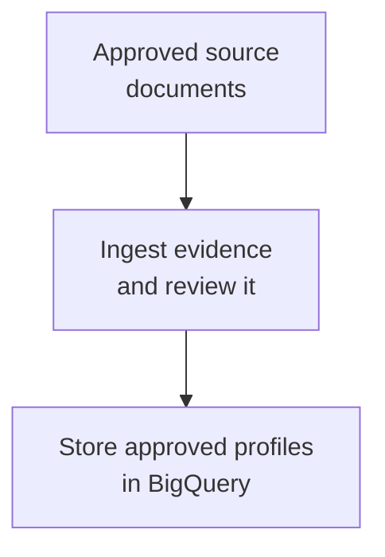
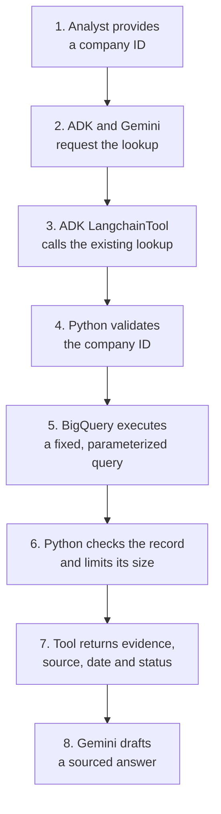
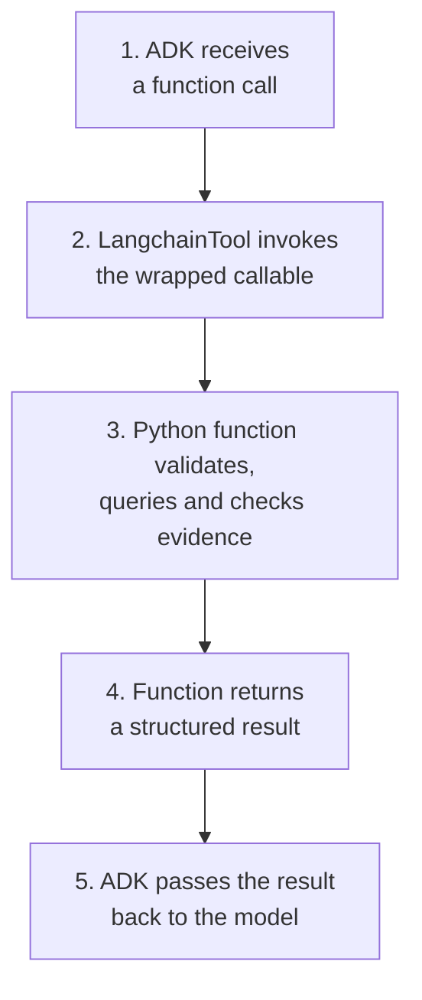

# Module 14: Third-Party Tools — Using LangChain Tools with ADK

## Before you begin: what this module teaches

**ADK concept: third-party tools inside an ADK agent.**

An agent becomes useful when it can call operations outside the model, such as looking up a company. Google’s **Agent Development Kit (ADK)** calls these capabilities **tools**. A bank may already have a useful tool defined with another library. This module teaches how ADK’s `LangchainTool` adapter makes a LangChain tool available to an ADK agent.

An **adapter** connects two interfaces. Here, it lets ADK expose and execute the existing tool’s callable capability. You will trace the company ID from the proposed tool call into the Python lookup, and follow the structured result back to the agent. The adapter connects the libraries; the lookup still needs rules for valid IDs, permitted data, freshness and failures. Those responsibilities do not disappear because a framework supplies the connection.

**Where you would use this in real work.**

In our fictional banking story, Meera is preparing for a meeting with Acme Robotics. She needs the company’s name, a short description, the source record and its review date. The bank’s earlier prototype already packaged this lookup as a LangChain tool.

The technology team asks: “Can our ADK assistant reuse that tool?” You will answer by connecting the existing capability and checking its behaviour. If the record is missing or too old, Meera needs that fact stated clearly. An attractive paragraph created without a usable record would not meet her request.

**Connection to Gemini Enterprise Agent Platform and Google Cloud.**

Gemini interprets the analyst’s request through the configured Google enterprise backend. ADK manages the agent and tool call. In this example, BigQuery stores the reviewed company profiles, and Google’s BigQuery client performs the bounded lookup inside the tool.

These are separate responsibilities: reasoning, tool execution and data retrieval. Agent Runtime can host the application on the managed path, but installing LangChain or wrapping its tool does not create a deployment. You will learn to reuse the tool while keeping the application’s execution and Google service configuration explicit.

**By the end, you should be able to:**

- **Explain the connection:** describe the ADK agent, LangchainTool adapter, existing LangChain tool and underlying Python function in order.
- **Build the integration:** register the adapted tool and inspect which arguments the model is allowed to supply.
- **Preserve the customer contract:** return a bounded profile with its source and review date, using a canonical company ID.
- **Handle a failure:** distinguish invalid input, a missing profile, stale evidence and an unavailable service.
- **Transfer the pattern:** assess another existing tool and identify what must be checked before an ADK agent may use it.

**How this moves the story forward.** Meera can obtain an existing profile. Module 15 introduces a different kind of help: consulting another agent to explain the documents used in a review.

Read the detailed customer task below, then follow the [guided lab](./lab.md). Build one checkpoint at a time and compare your explanation with the observed result.

## First understand the bank employee's task

Imagine a business banking team at **Sovereign Horizon Bank**, a fictional bank used throughout this course. **Acme Robotics**, also fictional, has asked the bank about a business loan. We keep these names and IDs consistent with the runnable examples.

A **relationship manager** works with business customers and helps coordinate their banking needs. Before meeting this company, the relationship manager asks a bank analyst to prepare a short introduction. An **analyst** is the employee who gathers information and checks the supporting records.

For this exercise, the analyst needs the company's name, a short description of what it does, the record used to write that description, and the date when the bank last reviewed that record. The analyst currently opens records and copies the details manually.

The bank wants the analyst to ask an AI assistant:

> “Please give me a short introduction to company ACME-001 before my meeting. Show me which record you used and its review date. If you cannot find the information, tell me what is missing.”

`ACME-001` is the company's identifier in the teaching data. It is not a PAN, CIN, account number or loan-case number. Later modules use `CASE-001` for a separate review case; the two IDs must not be treated as interchangeable.

## What should the assistant return?

A useful answer contains these details:

| Detail | What it means in this exercise |
|---|---|
| Company name | The name stored against the supplied company ID |
| Short description | A summary based only on the retrieved company record |
| Source | The record reference supplied with that information, so the analyst can check it |
| Review date | The date recorded by the bank's data team when it reviewed the profile; not today's lookup date |
| Missing information or problem | A clear explanation if the profile cannot be used |

The bank's data team chooses and reviews the records that analysts may use. We call these **approved records**. BigQuery stores those records in a table, which you can picture as rows and columns. Storing a row in BigQuery does not itself make the information correct.

If the company ID is missing, the assistant asks for it. It does not guess an ID from a company name. If there is no matching profile, it says so. If the record is too old, incomplete, or temporarily unavailable, it explains the problem instead of writing an invented company introduction. The current code requires all its profile fields; it does not produce a partly filled successful profile.

The assistant prepares background information. It does not approve a loan or establish that the company has passed financial or regulatory checks.

---

### 🚨 The Operational Disaster: The $9.5M Wikipedia Entity Collision at Sovereign Horizon Bank

During preliminary underwriting for a \$25,000,000 commercial expansion facility, an eager innovation team deployed a prototype due diligence agent. To save engineering time, the developers equipped the agent with an off-the-shelf open-source LangChain community tool: `WikipediaQueryRun`.

When relationship manager Meera asked the agent:
> *"Provide a commercial company overview for Apex Robotics before my credit committee briefing."*

The unvalidated third-party tool queried Wikipedia with an unconstrained fuzzy text search. Instead of retrieving the audited profile of **Apex Robotics Inc.** (a highly profitable, ISO-13485-certified surgical robotics manufacturer based in San Jose, California), the tool matched a defunct Florida entity named *Apex Robotics LLC*—a defunct theme park animatronics workshop that had filed for Chapter 7 liquidation in 2023 following a fatal equipment collapse.

The consequences were immediate and severe:
1. **Wrongful Credit Denial:** The model synthesized a devastating report: *"Borrower is currently undergoing Chapter 7 liquidation following catastrophic safety violations."* The credit committee promptly rejected the loan facility.
2. **The $9.5M Breach-of-Contract Lawsuit:** Apex Robotics Inc. was forced to forfeit a \$50,000,000 hospital procurement contract due to delayed financing and filed a \$9.5M commercial tort and defamation suit against Sovereign Horizon Bank.
3. **The Architectural Mandate:** The bank's Chief Risk Officer immediately banned all uncurated third-party tools and unconstrained public scrapers.

> *"Reusing existing Python tools through adapters like `LangchainTool` is an excellent way to prevent framework rewrites,"* notes the Principal FDE. *"However, an adapter connects code interfaces—it does NOT validate data authority. In enterprise banking, third-party tools must query curated, schema-enforced repositories like **Google Cloud BigQuery** using canonical entity IDs (`ACME-001`), with strict freshness thresholds, bounded IAM permissions, and explicit abstention when records are missing or stale."*

---

## Why is this a lesson about third-party tools?

Now consider a separate request from the bank's technology team:

> “Another team already provides a company lookup as a LangChain tool. Our new assistant uses Google ADK. Can the ADK agent use that existing tool without us rewriting the lookup?”

This is the main question of Module 14. **Third-party** means the capability comes from another library or provider. **LangChain** is a separate library that can represent Python operations as tools. **ADK's LangchainTool** is Google's adapter that makes a supported LangChain tool usable by an ADK agent. An **adapter** connects two different interfaces; it does not decide whether the returned information is true.

The main learning path is:

1. Understand the company lookup's input and result.
2. Represent that existing lookup as a LangChain `StructuredTool`.
3. Wrap it with ADK's `LangchainTool`.
4. Register the adapted tool in the ADK agent's `tools` list.
5. Inspect the arguments, returned data and final explanation.
6. Compare with a direct ADK function tool to understand what the adapter changes.

The supplied company lookup reads BigQuery. That gives us a controlled example with the same input and result in both versions. **BigQuery is the supporting data source; reusing a third-party tool through ADK is the module topic.** You do not need to build a LangChain agent or learn the whole LangChain framework.

## Keep the deployment question separate

The bank wants Google Cloud for model access, application hosting and stored company records. Using an open-source LangChain tool inside an ADK application does not, by itself, require hosting the application elsewhere. Google Cloud identity, permissions and service configuration are taught after the tool's basic execution is clear.

An earlier prototype used a LangChain Wikipedia tool. Wikipedia introduces a separate decision about where facts come from. We examine it later as a comparison; the main lab reuses a LangChain tool that reads the bank's selected records. An adapter's ability to call a tool is separate from whether that source meets the bank's needs.

## Words you will see in the code and later explanations

| Word | Simple meaning in this example |
|---|---|
| Canonical company ID | The agreed company identifier in the bank's records, such as ACME-001 |
| Evidence | The retrieved record used to support the answer |
| Provenance | Information showing where the record came from and when it was reviewed |
| Freshness | Whether the review date is recent enough for the agreed use |
| Contract | The input, result fields and failure outcomes the lookup promises to support |
| Parameterized query | A database query where the company ID is supplied as a value rather than inserted into the SQL text |
| Runtime | The process or hosted service in which the application executes |

## Work through the concept as a customer problem

### Reuse a working desk procedure through an adapter

Suppose the bank already has a company-lookup function used by a LangChain application. Meera wants the new ADK assistant to use that capability. Rewriting the query would introduce another copy to maintain. Replacing the whole agent framework would also be unnecessary. The narrow problem is making the existing tool callable from ADK.

An **adapter** translates an interface: how an operation is described, called and returned. Think of a branch using a standard request form to contact an established records desk. The form changes how the branch requests help; it does not change who owns the records or make the records more reliable.

### Follow the four layers separately

The underlying Python lookup validates a company ID and reads a bounded BigQuery result. LangChain's `StructuredTool` describes that operation as a tool. ADK's `LangchainTool` adapts that tool into ADK's interface. The ADK `Agent` exposes the adapted capability in its `tools` list; Gemini may request it during execution.

**Schema** means the permitted argument/result structure. **Validation** checks a value against the contract. **Provenance** identifies the record's source. **Freshness** concerns whether the recorded review time is acceptable for this use. A schema-valid answer can still be old; an adapter cannot resolve that business question.

If the user asks about “Acme,” first resolve the intended canonical company ID. Do not manufacture `ACME-001` from a case ID or use the model's guessed association as bank truth. When no approved record exists, a clear missing-record result is more useful than an invented company profile.

### Three reviews before accepting the design

- **Beginner:** point to the underlying function, LangChain wrapper, ADK adapter and agent registration. Explain which layer actually queries BigQuery and why a LangChain agent is not required.
- **Experienced engineer:** compare the same lookup through a native ADK function tool and the LangChain adapter. Check argument validation, errors, source fields and result size. Retain the adapter when reuse justifies the dependency.
- **Bank FDE:** ask whether an existing approved tool must be reused, who curates its data and how stale/missing records should appear to analysts. Google Cloud hosting is compatible with an open-source adapter; it does not make an arbitrary public source approved for customer decisions.

**Carry forward:** [Module 15](../module15-intro-to-multi-agent-systems/README.md) keeps the familiar call-and-return idea but makes the callable capability a reasoning agent rather than a data lookup.

## Learning path and deliverables

| Stage | What you learn | What you produce |
|---|---|---|
| Beginner | Functions, arguments, dictionaries, imports, exceptions, type hints | Explain one lookup without calling any code a “black box” |
| Intermediate | ADK schemas, function tools and adapters for other libraries | A working LangChain tool registered through the ADK adapter |
| Advanced | Provenance, freshness, parameterized SQL, output budgets, failure modes | Deterministic tests and a model evaluation plan |
| Enterprise delivery | Identity boundaries, IAM, deployment, monitoring, rollback | A reviewable customer design and deployment evidence checklist |

Read this page, complete the [lab](./lab.md), compare with the [annotated solution](./lab-solution.md), and apply the [enterprise playbook](./enterprise-playbook.md). Executable source, tests, a dependency lock, and evaluation inputs live in the sibling `example/` directory.

The earlier modules taught function tools, grounding, and `ToolContext`. This module teaches **how an ADK agent calls a tool supplied through another library**. A context object is not required when a function does not use it; the lookup here authenticates to BigQuery through the application's Google Cloud identity.

## Version baseline and what was verified

See the [course review and verification record](../module15-intro-to-multi-agent-systems/review-notes.md) for the cross-module checks and the evidence still required from a customer deployment.

Reviewed **3 October 2026**:

| Component | Baseline | Evidence and scope |
|---|---|---|
| Google ADK | `2.11.0` | Current stable [PyPI release](https://pypi.org/project/google-adk/2.11.0/); imports, schemas, and tool execution checked |
| BigQuery Python client | `3.45.2` | Resolved from PyPI; query configuration tested with the real SDK and a mocked client |
| LangChain Core (required for the main lab) | `1.6.6` | Resolved from PyPI; adapter schema and execution compared with the native tool |
| Python | Code supports 3.12+; tested on 3.14.7 | Latest stable patch is [3.14.8](https://www.python.org/downloads/release/python-3148/); it was unavailable through the local `uv` download catalog during this review |
| Gemini model | Deployment configuration | `.env.example` suggests `gemini-3.8-flash`; confirm access, location, lifecycle, and evaluation results in your project |

Google's [model lifecycle table](https://docs.cloud.google.com/gemini-enterprise-agent-platform/models/model-versions) lists Gemini 3.8 Flash and schedules Gemini 2.5 Flash retirement for 20 October 2026. The example reads `GEMINI_MODEL` from configuration instead of embedding an aging model ID in the implementation.

**Validation boundary:** deterministic tests use no cloud services. Live Gemini responses, BigQuery IAM, deployed networking, and model-based evaluation require an approved project and credentials; passing local tests does not establish production readiness. The solution records the checks actually performed.

The updated lock uses Google Gen AI SDK 2.28.0 and LangSmith 0.14.4. Earlier warnings from their older versions are not evidence about this resolution. Keep warnings visible during testing and record the emitting package/version; the lesson should use public supported APIs rather than copying dependency internals.

## Run the example and understand every command

Before changing the code, run the supplied example's tests. This gives you a **baseline**: a known result from the unchanged reference implementation. Later, if a test fails after your edit, you can compare the new behavior with that starting point.

Think of this as rehearsing a bank enquiry with fictional records. We want to check that the assistant asks for the right company, preserves the evidence source, and refuses invalid requests before we connect it to a live banking environment.

### 1. Open a terminal in the correct directory

From the repository root, run:

```bash
cd training/module14-third-party-tools/example
pwd
ls
```

`cd` changes your terminal's working directory. `pwd` prints that directory; it should end in `module14-third-party-tools/example`. `ls` lists its contents. You should see `pyproject.toml`, `uv.lock`, `corporate_research`, and `tests`. If your terminal is already in `example`, skip the `cd` command.

Run the following commands here, one at a time. Opening a Python file in your editor does not necessarily put the terminal in that file's directory. For the later practice exercise, use the corresponding directory in your practice copy.

### 2. Understand the project files before installing anything

| Item | What it means in this exercise |
|---|---|
| `pyproject.toml` | Declares Python requirements and direct dependencies: ADK, the BigQuery client and LangChain Core. |
| `uv.lock` | Records resolved versions, including dependencies needed by those libraries. Let `uv` manage it; do not edit it by hand. |
| `.venv/` | The project's Python environment, containing its interpreter and installed packages. It is created locally and can be rebuilt. |
| `corporate_research/` | Our application code: agent registration, adapter, lookup rules and database access. |
| `tests/` | Executable checks that compare actual behavior with expected behavior. |
| `eval/` | Separate model-evaluation scenarios; the `unittest` command below does not execute these files. |

The lock is the recorded dependency selection; `.venv` is the local installation. A virtual environment separates Python packages—it does not sandbox the application's permissions or network access. See [uv's project guide](https://docs.astral.sh/uv/guides/projects/).

### 3. Install the locked dependencies

```bash
uv sync --locked
```

- `uv sync` creates or updates this project's `.venv` to match the selected dependencies. By default, it can remove extra packages that do not belong in that environment.
- `--locked` checks that `uv.lock` agrees with the project requirements and refuses to change it. A missing or outdated lock causes an error.

LangChain Core is already a required dependency here; no optional installation step is needed. Installation may download packages. It does not run the agent or query BigQuery. If everything is installed, a short audit message is normal. See [uv's locking and syncing documentation](https://docs.astral.sh/uv/concepts/projects/sync/).

### 4. Check which Python will run the example

```bash
uv run --locked python --version
```

`uv run` executes a command in the project environment, checking its dependencies first. `python --version` prints that interpreter's version. You do not need to activate `.venv` manually when using `uv run`.

For example, `Python 3.12.14` means this command selected Python 3.12.14. Your patch version may differ. The project's declared minimum is Python 3.12; the [verification table above](#version-baseline-and-what-was-verified) records the reviewed test environment separately. This command checks interpreter selection, not whether the application works.

### 5. Run the local tests

```bash
uv run --locked python -m unittest discover -s tests -v
```

Read it from left to right:

| Part | Instruction |
|---|---|
| `uv run --locked` | Use this project's environment without updating its dependency lock. |
| `python -m unittest` | Run Python's built-in `unittest` module as a program. |
| `discover` | Find test files automatically; the default filename pattern is `test*.py`. |
| `-s tests` | Start searching in the `tests` directory. |
| `-v` | Use verbose output: show each test name and its result. |

A **test** supplies inputs, executes code and checks an expectation. An **assertion** is the check that fails when the result differs from the expected behavior. See [Python's test-discovery documentation](https://docs.python.org/3/library/unittest.html#test-discovery).

### 6. Understand what these 23 tests actually exercise

| Test group | Count | What it checks in this example |
|---|---:|---|
| Lookup business rules | 15 | Invalid IDs, missing or stale evidence, dates, source fields, output limits, Unicode, error handling and excluded fields. |
| Repository behavior | 3 | Parameterized SQL, query resource limits, empty results and table-configuration validation. |
| Tool and adapter behavior | 3 | Native tool execution, the exposed argument schema, and equivalent lookup results through the LangChain adapter. |
| ADK Runner integration | 2 | The registered adapted agent returns evidence with its source/date and rejects an invalid ID before querying. |

These counts describe the current reference suite. Read the actual tests in `example/tests/test_tools.py` and `example/tests/test_agent_adapter.py` to connect each name to its assertion.

**Worked example: rejecting an invalid company ID.** The Runner test uses this sequence:

1. A **scripted model** emits a predetermined function call with `company_id="invalid id"`. No Gemini request is made.
2. The real ADK `Runner` executes the registered `LangchainTool`, which reaches the real lookup function.
3. The function rejects the ID and returns `status="invalid_input"`.
4. The test checks that status and checks that `fetch_profile` was never called.

`fetch_profile` is replaced with a **mock**: a test substitute that records calls and can supply a fictional result. In the successful Runner test, it supplies a prepared company record. This lets us test the adapter and business rules without querying BigQuery.

The suite therefore needs no cloud project, API key or Google login, and makes no billable Gemini or BigQuery calls. It does execute real application code and ADK components. It does **not** verify live IAM, deployed networking, real query execution or the quality of Gemini's answers. Those belong to later integration checks and model evaluations.

### 7. Read the result without confusing warnings with failures

A successful run ends like this; execution time varies:

```text
Ran 23 tests in 0.247s

OK
```

| Output | How to interpret it |
|---|---|
| A test name followed by `ok` | That test passed. |
| `FAIL` | An assertion found different behavior from what the test expected. |
| `ERROR` | An unexpected exception prevented the test from completing normally. |
| `Ran 0 tests` | The intended checks did not run. Check the directory and discovery arguments even if the next line says `OK`. |
| `FAILED (...)` | The suite did not pass; read the traceback for the affected test. |
| `Skipping missing token usage metadata ... scripted-model` | The scripted model supplies no usage figures; ADK skips that accounting. |
| `[EXPERIMENTAL] ... JSON_SCHEMA_FOR_FUNC_DECL` | ADK reports an experimental schema feature. Keep the warning visible; it is not itself a failed assertion. |
| `Executing <Task ...> took ... seconds` | Asyncio's debug mode reports a slow task step. It is a diagnostic, not itself a failed assertion. |

For this exercise, expect **23 tests and `OK`**. That establishes the local baseline, not approval to deploy against customer records.

### 8. Practise one boundary at a time

Use a separate checkout or copy the example's source and configuration into a practice directory. Keep `pyproject.toml`, `uv.lock`, the application package and the tests together. Exclude `.venv` when copying; create the practice environment with `uv sync --locked`.

1. Run the unchanged reference suite and note its result and Python version.
2. Follow the [lab](./lab.md) in your practice copy. Begin with the company-ID validation inside `get_company_profile` in `corporate_research/tools.py`.
3. Before editing, predict the result for a valid ID and an invalid ID. Write down why the invalid ID must stop before database access.
4. Implement that exercise step, then rerun the relevant test file:

   ```bash
   uv run --locked python -m unittest discover -s tests -p 'test_tools.py' -v
   ```

5. Compare any failure with your prediction. Correct the implementation against the business contract; do not weaken a test merely to make it pass.
6. Continue with record validation, repository behavior and the adapter as directed by the lab. Keep unrelated code working so each change has a clear purpose.
7. Run the full 23-test command again after completing the exercise.

The other files are **scaffolding**: working support code that lets you concentrate on one concept. They are still part of the solution; learn their role before replacing them. The goal is to explain why a test passes and which customer requirement it protects.

### If setup does not work

| Symptom | Next step |
|---|---|
| `uv: command not found` | Complete the course's [environment setup](../module02-environment-setup/README.md), then reopen the terminal if required. |
| Project files or `tests` cannot be found | Check `pwd` and enter the example directory. |
| The lock needs updating | Check whether `pyproject.toml` changed or the copied lock came from another revision. Keep the reference pair together rather than removing `--locked` to bypass the mismatch. |
| Package download fails | Check connectivity and any required corporate package-index/proxy configuration. No application test has run yet. |
| A test fails | Read its traceback, identify the expected and actual behavior, and compare your edit with the annotated solution. |

## Write down exactly what the lookup may accept and return

For this exercise, we make explicit design assumptions that an FDE would confirm with the customer:

| Plain-English requirement | Implementation decision | Acceptance evidence |
|---|---|---|
| “Find a short description of this company” | Read one company ID from the bank’s records; ask when only a name is provided | Missing-ID conversation asks for clarification |
| “Use records selected by the bank’s data team” | Query only a configured table and rows with `approved = TRUE` | Fixed SQL and IAM review |
| “Show where it came from” | Return `source_uri` and `reviewed_on` unchanged | Provenance assertions and citation evaluation |
| “Tell us when you cannot answer” | Distinct `not_found`, `stale`, `invalid_record`, and `unavailable` statuses | Failure-path tests |
| “Do not use a profile reviewed too long ago” | Exercise policy: maximum age 90 calendar days in UTC | Boundary checks at 90 and 91 days |
| “Keep the application and records on Google Cloud” | Google-hosted model and approved BigQuery evidence; no runtime public-web lookup | Dependency and outbound-traffic review |
| “Do not expose everything” | One lookup parameter, selected columns, one row, bounded result | Schema, query, and output tests |


## Understand the request flow

Read these two diagrams separately: first how evidence becomes available, then how one request uses it. Each arrow means “the next step.”

### Before the request: prepare the evidence

The data team owns this prerequisite. The lab supplies a fictional table fixture; it does not implement an ingestion or review pipeline.



**Output:** the `company_profiles` table contains reviewed evidence, a source reference, and a review date. Neither storage nor an LLM turns an unverified claim into a verified fact.

### During the request: look up one company

This is the successful lookup path implemented by the example. The query reads the table prepared above; the model supplies only `company_id`.



**Failure paths:** invalid input stops before the query. Missing, stale, invalid, or unavailable evidence produces an explicit status instead of a successful profile. The [solution's decision diagrams](./lab-solution.md#1-start-with-the-business-contract) show those branches.

The original request, tool result, and final answer can all enter the model context. Giving a sub-agent a limited argument list does not by itself isolate secrets from that sub-agent's process, environment, or conversation history.

## Python concepts you will use

| Expression | Meaning |
|---|---|
| `def get_company_profile(company_id: str) -> dict[str, str | bool]:` | Define a function taking text and returning a dictionary whose values are text or Boolean |
| `isinstance(value, str)` | Check a value's runtime type |
| `re.fullmatch(pattern, value)` | Require the entire identifier to match an allowed format |
| `return {"status": "not_found"}` | Exit immediately with a structured result |
| `try ... except` | Handle named failure types at a boundary |
| `with bigquery.Client(...) as client:` | Use a client and close it when the block ends |
| `record["summary"][:2000]` | Take at most the first 2,000 characters |
| `dict[str, str] | None` | Return a dictionary or no record |
| `datetime.now(UTC).date()` | Obtain today's date using an explicit UTC timezone |

`typing.Dict` is a deprecated alias; use `dict[...]`. The `typing` module, `Any`, Pydantic, and asynchronous functions are not inherently deprecated. Add abstractions when they serve a purpose, and explain them. See [Python typing](https://docs.python.org/3/library/typing.html#deprecated-aliases).

## Compare ways to connect a tool after learning the adapter

| Option | Appropriate use | Boundary you still own |
|---|---|---|
| Plain Python function / `FunctionTool` | One stable business operation, such as a company-ID lookup | Validation, authorization, timeouts, result contract |
| Official Google SDK inside the reused function | A narrow operation on BigQuery or another Google service | IAM, resource scope, service errors and costs |
| ADK `BigQueryToolset` | Approved open-ended data exploration | Tool selection, write mode, dataset access, query budgets |
| `LangchainTool` | Use an existing, reviewed LangChain tool from an ADK agent | Foreign dependencies and exact adapter semantics |
| `OpenAPIToolset` | Existing REST contract or separately deployed connector | Authentication, server authorization, network controls |
| `McpToolset` | Existing MCP tool server | Server trust, tool filtering, credentials, lifecycle |
| Agent Search / Google Search grounding | Retrieval over managed stores or approved public-web research | Source scope, ACL behavior, supported model/tool combination, citation display |

The native ADK [BigQuery integration](https://adk.dev/integrations/bigquery/) is available. This exercise deliberately exposes **one fixed lookup** instead of an arbitrary SQL tool because that matches the customer contract. The two choices have different authority and should be evaluated accordingly.

No adapter, OpenAPI document, or MCP protocol automatically creates a sandbox. A Python import executes in your runtime and may access the process's credentials and network.

## How the LangChain adapter works

The adapter changes how ADK calls an existing tool. The business function still performs input validation, the BigQuery lookup, and result checks.



**Before execution**, `StructuredTool.from_function(...)` wraps the Python function and `LangchainTool(tool=...)` adapts that object for ADK. The adapter selects the underlying callable during construction; at step 2 it invokes that callable. The diagram describes this **specific `StructuredTool` example**, not every LangChain feature.

In ADK 2.11.0, the adapter derives a function declaration from the selected function or coroutine. It does not run a LangChain agent. Do not assume that LangChain callbacks, tracing, middleware, or retry settings survive an adapter unchanged: test what you depend on.

The current import is `from google.adk.integrations.langchain import LangchainTool`. The older `google.adk.tools.langchain_tool` path is a compatibility path. See the [versioned ADK adapter source](https://github.com/google/adk-python/blob/v2.11.0/src/google/adk/integrations/langchain/langchain_tool.py).

For `return_direct=True`, the adapter can set ADK's `skip_summarization` action on a successful result. This controls summarization; it does not guarantee that every client renders verbatim text. Our adapter sets `return_direct=False` because the analyst needs a sourced explanation.

## Advanced review: avoid these incorrect assumptions

| Old claim | Accurate replacement |
|---|---|
| Regexes “neutralize prompt injection” | A format check constrains an ID. Retrieved instructions remain untrusted; use restricted authority, deliberate context handling, adversarial evaluation, and appropriate content controls |
| A User-Agent authenticates an enterprise | It identifies a client. It does not authenticate a bank, grant API access, or guarantee success |
| Catching exceptions is a circuit breaker | A circuit breaker needs state, failure thresholds, an open interval, and recovery behavior |
| Truncating 2,000 characters enforces a token budget | Characters, bytes, tokens, and full-request cost differ |
| A sub-agent isolates credentials | It is an orchestration boundary, not necessarily a process or identity boundary |
| Two independently scaled Cloud Run services are a sidecar | They are separate services; sidecars share a service instance and lifecycle |
| Google Search can never coexist with another tool | Compatibility depends on model, endpoint, SDK, and tool configuration; ADK documents supported workarounds |
| A fixed adapter saves “80%” or achieves “99.98%” reliability | Those are measurements to collect, not properties guaranteed by a wrapper |

For Google Search, consult [ADK tool limitations and workarounds](https://adk.dev/tools/limitations/), including `bypass_multi_tools_limit=True` and an `AgentTool` boundary. Do not teach a universal failure across all current Gemini models. The lookup lab needs no search tool, so it introduces no speculative search composition.

## Transfer the lesson to a second customer

Suppose a retailer asks: “Tell support staff which products have an approved recall notice.”

Keep the integration reasoning, then change the domain: a canonical product ID, an approved recall source, an explicit freshness policy, a narrow lookup, structured evidence, access control, and tests for missing or contradictory records. A package wrapper is reusable; the business contract is not automatically reusable.

You have learned the module when you can explain **why this tool should exist, what it is allowed to do, how its source is maintained, how it fails, and what evidence is needed before deployment**.

## Sources

- [ADK function tools](https://adk.dev/tools-custom/function-tools/)
- [ADK BigQuery integration](https://adk.dev/integrations/bigquery/)
- [BigQuery parameterized queries](https://docs.cloud.google.com/bigquery/docs/parameterized-queries)
- [Gemini Enterprise Agent Platform overview](https://docs.cloud.google.com/gemini-enterprise-agent-platform/agents)
- [Wikimedia User-Agent policy](https://meta.wikimedia.org/wiki/User-Agent_policy)
- [Python tutorial](https://docs.python.org/3/tutorial/)

## Continue the course story

Previous: [Module 13.5](../module13_5-firestore-persistence/README.md) · Next: [Module 15](../module15-intro-to-multi-agent-systems/README.md) · [See how the concepts build](../learning-journey.md)

Before continuing, explain one input, one ADK execution boundary and one failure outcome from this module. Use the next chapter to add a new customer requirement, not merely another component.

<!-- © 2026 Inder Chauhan (https://github.com/inderanz/google-adk-training). All rights reserved. Ref: IC-ADK-module14-third-party-tools -->
