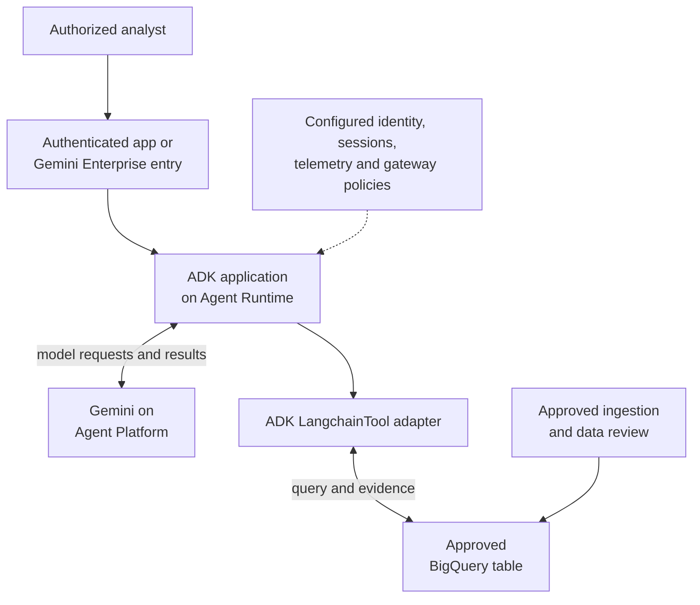
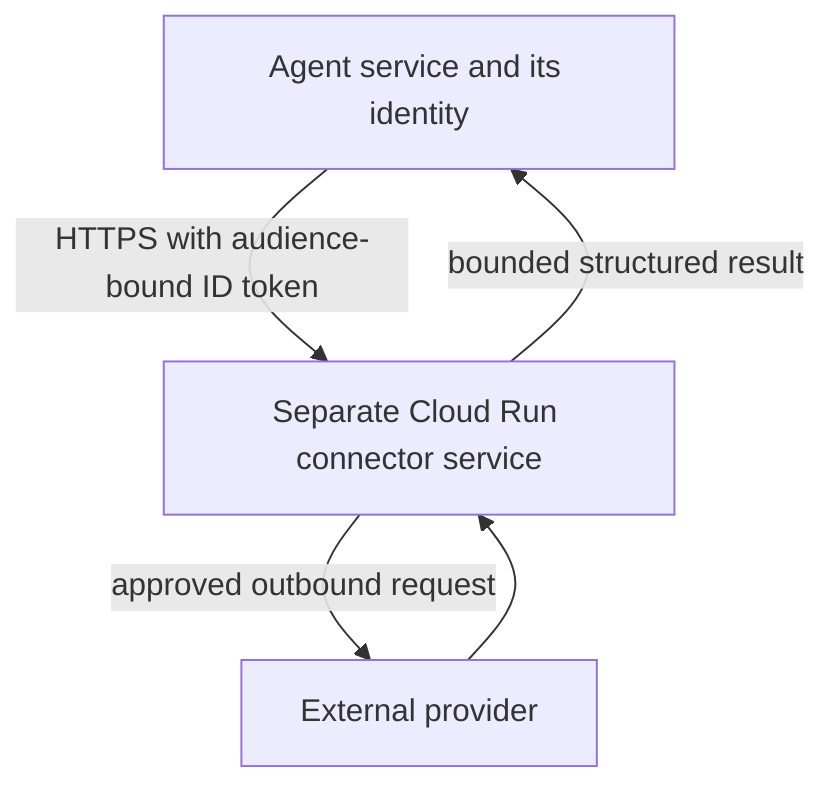

# Module 14 Enterprise Playbook: Customer Discovery to Delivery

## A design proposal is not production evidence

This playbook explains what the bank must arrange before putting the LangChain-to-ADK example into use. The executable example demonstrates a narrow, read-only tool; this page identifies the additional controls and evidence needed to operate it for a customer.

Use [Gemini Enterprise Agent Platform](https://docs.cloud.google.com/gemini-enterprise-agent-platform/agents) terminology in new designs. Some SDK symbols, environment variables, IAM roles, and resource names retain historical Vertex AI or Agent Engine names. A product rename is not a reason to invent new API identifiers.

## State the bank employee's expected result first

The analyst needs a short introduction to one company before a customer meeting. The answer must show the source record and review date. A missing, old or unusable record must lead to an explanation of the problem, not an invented profile.

The technology team has a separate reuse requirement: call its existing LangChain lookup from an ADK agent. The main lab implements this with LangchainTool. The source record lives in BigQuery; the adapter connects tool interfaces and does not approve the source itself. See the [plain-English task](./README.md#first-understand-the-bank-employees-task) before considering the deployment choices below.

## 1. Conduct discovery in the customer's language

Start with: “What decision will an analyst make after reading the profile?” Then resolve the questions that change the implementation.

| Ask the customer | Why the answer changes the design | Example exercise assumption |
|---|---|---|
| Which sources may support a claim? | Public encyclopedia, filings, and approved internal research have different authority and licensing | A reviewed profile table maintained by a data owner |
| How do we identify the exact company? | Names collide and subsidiaries differ | A canonical ID supplied by the analyst |
| How fresh must evidence be? | A company history and a sanctions result need different refresh rules | No more than 90 days old for background only |
| Who may see which records? | Service-account access is not end-user authorization | All authorized analysts may read the same non-sensitive profile corpus |
| Is public-web access permitted? | Changes egress, query privacy, sources, and operating terms | No public-web calls during lookup |
| What must the agent never decide? | Sets authority boundaries and evaluation cases | No loan approval or sanctions clearance |
| What does a useful failure look like? | Determines abstention and recovery behavior | Distinguish missing, stale, invalid, and unavailable evidence |
| Where may data and logs reside? | Model, runtime, dataset, and telemetry locations must be chosen deliberately | Customer-approved locations; no universal default |
| How will success be measured? | Prevents unsupported ROI claims | Analyst acceptance, source fidelity, latency, and cost measured in a pilot |

Capture answers in a short decision record: **requirement → chosen design → rejected alternative → evidence needed → owner**. The assumptions above belong to the exercise; confirm them before applying this design to a real bank.

## 2. Propose alternatives and justify the choice

| Candidate | Benefits | Trade-offs | Decision for this brief |
|---|---|---|---|
| Retain LangChain + Wikipedia | Reuses an existing connector | External data and dependencies; source quality and network behavior need review | Optional migration study only |
| Google Search grounding | Public research with grounding metadata | Query data leaves the internal corpus; terms, suggestions, model support, and freshness need evaluation | Separate requirement if the customer wants public news |
| Agent Search over approved documents | Managed retrieval over a document corpus | Requires ingestion, indexing, access-control design, and retrieval evaluation | Good when evidence is primarily documents |
| Narrow BigQuery lookup | Explicit schema, fixed query, scoped IAM, review date and provenance | Requires a maintained structured corpus; no free-form discovery | Data source used by the existing LangChain lookup in this module |

The selected teaching path uses ADK’s LangchainTool around the existing company lookup, with BigQuery as its data source. LangChain Core is therefore a runtime dependency; Wikipedia is not. It still depends on reviewed data; moving text into BigQuery does not establish its truth.

## 3. Separate preparation, runtime, and governance

The diagram is a **target deployment**, not a claim that the lab has provisioned these services. Solid arrows show requests or data flow. Dashed arrows show supporting services or policies that require configuration.

The Python example implements the lookup, result checks, and agent configuration. It does not implement the entry application's authentication, data ingestion, managed sessions, gateway policies, deployment, or telemetry configuration. The platform provides services for these concerns; selecting a service does not enable it automatically.

The supporting configuration means a dedicated runtime identity with IAM, a selected session backend such as Agent Platform Sessions, Cloud Logging/Trace/Monitoring instrumentation, and Agent Gateway binding if required. These have distinct configuration and authorization requirements; the combined diagram node is not a single automatically enabled feature.

[Agent Runtime deployment](https://docs.cloud.google.com/gemini-enterprise-agent-platform/scale/runtime/deploy-an-agent) supports several packaging paths. Choose one supported path and test its runtime contract. [Agent Gateway](https://docs.cloud.google.com/gemini-enterprise-agent-platform/govern/gateways/agent-gateway-overview) requires explicit setup and binding; putting its name on a diagram does not govern traffic.

## 4. Make identities and permissions explicit

| Identity | Purpose | Access boundary |
|---|---|---|
| Analyst | Use the application | Verified by the entry application or enterprise entry point |
| Runtime identity | Call Gemini and submit/read profile queries | Only the approved model/service and BigQuery resources |
| Data ingestion identity | Publish reviewed records | Separate write access to the evidence corpus |
| Deployment identity | Build and deploy revisions | Separate from the runtime's data permissions |

For the BigQuery lookup, a typical starting point is `roles/bigquery.jobUser` on the query project and `roles/bigquery.dataViewer` on the approved table or an appropriately scoped dataset. Grant model invocation permissions separately. Validate the exact permissions for your project and organization policies using [BigQuery IAM documentation](https://docs.cloud.google.com/bigquery/docs/access-control).

Use Application Default Credentials locally and the configured workload identity in production. Do not distribute service-account private key files. Do not assume `gcloud auth login` also configures local ADC.

**Per-user confidential records change the design.** A shared runtime service account can read everything its IAM grants permit. User-specific row filtering must derive from verified application identity or a reviewed access mechanism, never a model-supplied `user_id` or tenant name. This example intentionally uses a corpus readable by every authorized analyst.

## 5. Define controls by what they actually enforce

| Control | Implemented in the example | Production evidence still needed |
|---|---|---|
| Narrow authority | One company ID; fixed read-only query | IAM denial tests and no alternative broad-access tools |
| SQL injection resistance | Company ID is a query parameter; table identifier is validated deployment configuration | Review ingestion/config ownership and any future dynamic queries |
| Source freshness | UTC date check; stale evidence returns no summary | Refresh owner, refresh SLA, and policy agreement |
| Provenance | Source URI and review date retained | Accessible source records, retention, licensing, and source quality |
| Bounded output | Summary character cap, metadata caps, serialized UTF-8 byte cap | Whole-conversation token budget and model cost measurements |
| Query resource control | Maximum billed bytes, one result, SDK timeout settings, automatic query retries disabled | Workload tests, query plans, quotas, and endpoint concurrency |
| Error handling | Stable statuses; no raw exception messages returned | Alert routing, runbook, and recovery verification |
| Supply chain | Exact direct pins plus transitive versions and hashes in `uv.lock` | Vulnerability review, update policy, build provenance and artifact scanning |
| Prompt-injection resistance | No arbitrary SQL, URL, shell command, or write capability exposed | Adversarial model tests and any approved content screening |
| Logging minimization | Tool logs only failure category | Review ADK/model tracing configuration, payload collection, retention, and reader IAM |

The timeout is not a guaranteed whole-request deadline. BigQuery's `wait_timeout` governs query waiting and attempts cancellation; transport calls, scheduling, and model turns have their own behavior. A maximum billed-bytes limit is useful for on-demand query cost control, not a universal cap on every service charge.

This example uses a synchronous BigQuery call for a readable first implementation. Do not assume that an asynchronous ADK runner makes blocking I/O concurrent. Verify the selected runtime's execution behavior and load-test it; introduce a bounded worker strategy or separately managed connector when required. Setting an SDK timeout does not provide queue limits or backpressure.

If adding [Model Armor](https://docs.cloud.google.com/model-armor/overview), configure and test its inspection path, blocking behavior, and failure policy. It does not replace IAM or establish that prompt injection is impossible. This example does not enable Model Armor.

## 6. Know when to isolate a third-party connector

When retaining a foreign dependency, determine whether its code can share the agent process and identity. A separate service offers a stronger independently managed boundary, at the cost of authentication, deployment, networking, and failure handling.

This is **two services**, not a sidecar. Use [Cloud Run service-to-service authentication](https://docs.cloud.google.com/run/docs/authenticating/service-to-service), grant invocation permission to the caller, and configure ingress and outbound controls. HTTPS plus an identity token is not automatically mutual TLS. An `OpenAPIToolset` does not mint the correct identity token merely because the URL is private.

A true multi-container sidecar shares the Cloud Run service instance and scales with it. Separate containers can separate Python environments, but do not imply independently scaled services or complete secret isolation. See [Cloud Run container configuration](https://docs.cloud.google.com/run/docs/configuring/services/containers).

Neither pattern is needed for the primary BigQuery example. Introduce it only when the dependency and trust requirements justify it.

## 7. Review the legacy Wikipedia integration honestly

Before reusing the earlier prototype, inspect the currently selected library's source and test its request path.

| Question | Required evidence |
|---|---|
| Does it send an identifiable client header? | Actual outbound User-Agent with real application/contact information |
| Can it enforce a request timeout? | Configured transport timeout, including retries and cancellation behavior |
| Does it return provenance? | Stable page URL/title and retrieval time, not only an unattributed string |
| Are ambiguous or missing pages handled? | Explicit disambiguation and no-result cases |
| Does truncation hide qualifying facts? | A truncation flag and access to source evidence |
| Could queries disclose customer information? | Minimized arguments and a reviewed egress policy |
| Does a library error expose credentials or request bodies? | Error-path tests and protected operational diagnostics |

The [Wikimedia User-Agent policy](https://meta.wikimedia.org/wiki/User-Agent_policy) is an identification requirement, not authentication. A JSON decoding error may indicate an HTML error page, throttling, proxy behavior, or another upstream problem. Do not promise that one header fixes every failure, and do not blindly retry a permanent policy denial.

The old regex approach removed phrases such as “ignore previous instructions.” This neither neutralizes instructions hidden in retrieved pages nor preserves every legitimate company name. Validate the business input you actually need and treat all retrieved text as untrusted data.

## 8. Evaluate before deployment

Use three separate evidence layers:

| Layer | Example cases | What a passing result establishes |
|---|---|---|
| Deterministic tests | Invalid IDs, empty result, old/future dates, missing fields, SQL parameterization, timeout errors, native/adapter parity | The tested Python branches and SDK contracts behave as intended |
| Model evaluation | Known ID, name without ID, no evidence, attempted loan approval, malicious retrieved instructions | Observed agent behavior for the evaluated model and prompts |
| Staging integration | IAM denial, supported model/location, real query, refresh job, client citations, concurrency, telemetry | Tested deployment behavior in that environment |

The example includes `eval/cases.evalset.json` and `eval/eval_config.json` using ADK's evaluation schemas and rubric-based criteria. Schema validation is not a scored evaluation. Select an approved judge model/location, run the evaluation against controlled fixtures, and retain scores and traces.

Additional adversarial scenarios should include an approved test row whose text asks the agent to reveal secrets, run a new tool, or drop its source citation. Verify the **agent's response**, not a regex's output. Use synthetic content and a development dataset.

Suggested acceptance targets are proposals, not measured outcomes: all deterministic checks pass; every displayed claim has matching evidence; no scope-violating action succeeds in the test set; missing evidence produces abstention. Agree latency, cost, and availability targets with the customer and measure them under representative load.

## 9. Prepare a deployable release

1. **Choose locations and the model.** Verify runtime, model, dataset, and telemetry availability and residency requirements. Keep `BIGQUERY_LOCATION` separate from `GOOGLE_CLOUD_LOCATION`; they configure different services.
2. **Create reviewed infrastructure.** Use the organization's IaC process for the evidence table, identities, IAM, runtime, managed session service, and telemetry. The fixture SQL is not a full ingestion pipeline.
3. **Build reproducibly.** Use the committed lock, a supported patched Python base image, and an immutable release artifact. The adapted release must include LangChain Core as well as ADK and the BigQuery client; all three are declared project dependencies.
4. **Package for Agent Runtime.** Follow the current [deployment guide](https://docs.cloud.google.com/gemini-enterprise-agent-platform/scale/runtime/deploy-an-agent). Add the required server/entrypoint and health behavior for the chosen source/container path; the example directory alone is not a production server.
5. **Configure identity and controls.** Bind the runtime identity, scoped IAM, managed sessions, and any required gateway/content policies. Validate how the entry point authenticates callers.
6. **Deploy to a development environment.** Run the integration and model evaluations. Confirm that unauthorized calls fail and citations can be opened by intended readers.
7. **Promote through a reviewed release process.** Use Cloud Build and Artifact Registry where appropriate, retain the previous artifact/configuration, and rehearse rollback.
8. **Publish if needed.** Register the tested deployment with the organization's Gemini Enterprise entry point using its supported registration flow. Deployment and publication are separate steps.

If your team uses Google's `agents-cli`, enhance a **separate deployment checkout**, inspect the generated changes, and configure `agent_runtime`. Do not run infrastructure commands against a teaching directory without reviewing their effects. This module intentionally does not provision a project or publish an agent.

## 10. Operate and improve

Monitor request counts, tool status rates, evidence age, query bytes/cost, latency, model tokens, and citation failures. Log correlation IDs and error categories; decide separately whether prompts/results may be retained.

| Symptom | Investigate first | Recovery |
|---|---|---|
| `unavailable` after a release | Configuration, IAM changes, dataset location, dependency changes | Roll back the known artifact/configuration or repair the missing permission |
| Increase in `stale` | Ingestion and review job health | Refresh evidence; do not quietly extend the freshness limit |
| Query budget failures | Table growth, clustering, query plan, pricing mode | Adjust the design/budget using measured costs |
| Unsupported company ID | Entity-directory coverage and usability | Add a reviewed resolver; preserve ambiguity handling |
| Unsourced model statements | Prompt, model version, test coverage, client rendering | Stop promotion, expand evaluation, and fix the observed failure |
| Provider warning/deprecation | Dependency changelog and supported Python versions | Review and test an upgrade; do not suppress all warnings |

Deliver a customer handover containing the architecture, source ownership, identity map, tested versions, evaluation results, SLO definitions, runbook, and rollback procedure. Do not replace this evidence with claims of “100% secure,” “audit-ready,” or invented savings.

## Capstone

A customer changes the request: “We need private, per-region supplier risk data and the latest adverse news.”

Identify which assumptions no longer hold. Explain the new authorization boundary, approved public-query inputs, source comparison policy, regional deployment decisions, and evaluation cases. Then propose a staged delivery plan and measurable acceptance criteria before adding tools.

<!-- © 2026 Inder Chauhan (https://github.com/inderanz/google-adk-training). All rights reserved. Ref: IC-ADK-module14-third-party-tools-enterprise-playbook -->
