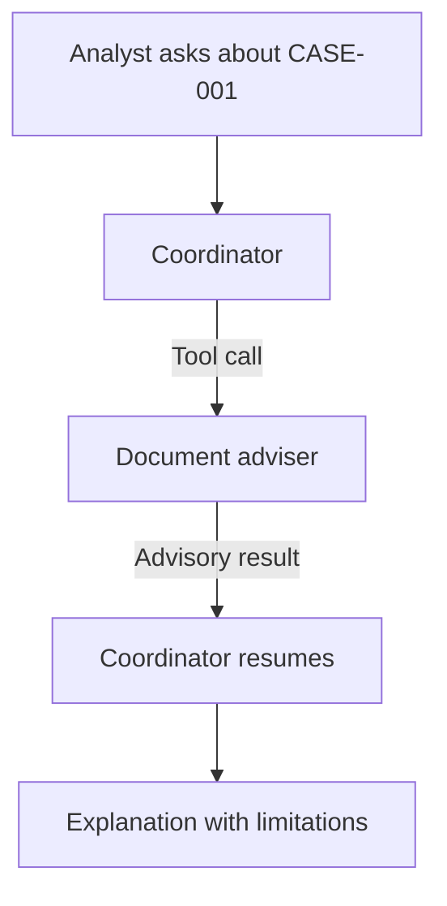

# Module 15: Introduction to Multi-Agent Systems

## Before you begin: what this module teaches

**ADK concept: agent composition and specialist consultation.**

A single agent can answer questions and call tools. Sometimes part of a request benefits from a separate, narrowly defined reasoning role. In Google’s **Agent Development Kit (ADK)**, you can create that specialist as an `Agent` and expose it to a coordinating agent through `AgentTool`. This is the first multi-agent pattern in the sequence.

The important idea is **call and return**. The coordinator can ask the document adviser a question. ADK runs the adviser and makes its result available to the coordinator, which continues preparing the user-facing answer. You will follow that execution rather than treating “a team of agents” as a black box. Adding a specialist is a design choice: exact arithmetic or a fixed validation rule may still be better expressed as an ordinary Python function.

**Where you would use this in real work.**

Meera, the analyst in our fictional banking story, now asks: “Why do we need financial statements and the ownership register? Give me one explanation I can use in the customer meeting.” A document adviser can concentrate on explaining those two document types, while the coordinator keeps the answer coherent for Meera.

Now change the question to “Have those documents arrived?” Explaining a document’s purpose does not reveal its receipt status. This module’s adviser has no current-case lookup. You will learn to preserve that limitation, so a specialist’s confident explanation cannot be mistaken for a verified bank fact.

**Connection to Gemini Enterprise Agent Platform and Google Cloud.**

Gemini supplies the language reasoning used by the coordinator and adviser. ADK defines their instructions, exposes the specialist through AgentTool and runs the consultation. The agents can be part of one application; they do not each need a separate hosted service.

Gemini Enterprise Agent Platform Agent Runtime is the managed hosting path introduced later in the sequence. Here you first inspect local execution with scripted replies, then use the configured live Gemini path to evaluate whether the coordinator chooses useful consultations. A role name such as “document adviser” does not grant access to the bank’s records.

**By the end, you should be able to:**

- **Explain the pattern:** draw the analyst → coordinator → adviser → coordinator path and identify who answers the analyst.
- **Make a design choice:** justify when a separate reasoning agent helps and when a normal function tool is sufficient.
- **Build and trace:** create the adviser, wrap it with AgentTool, and inspect the call and returned result through Runner.
- **Recognize a limitation:** respond appropriately to a receipt-status request when no current-case lookup is available.
- **Transfer the pattern:** propose a different advisory specialist with a clear responsibility, allowed capabilities and evaluation target.

**How this moves the story forward.** Consultation lets the coordinator seek advice. Module 16 handles the stronger requirement Meera may make next: “Both checks must run every time.”

Read the detailed customer task below, then follow the [guided lab](./lab.md). Build one checkpoint at a time and compare your explanation with the observed result.

[Previous module](../module14-third-party-tools/README.md) · [Lab](./lab.md) · [Solution](./lab-solution.md) · [Enterprise playbook](./enterprise-playbook.md) · [Next module](../module16-static-orchestration/README.md)

## The banking story

Module 14 taught an ADK agent to use an existing LangChain company-lookup tool. Here, the callable capability is another agent that explains documents. Module 16 will then show how to make required checks run every time.

Sovereign Horizon Bank and Acme Robotics are fictional teaching organizations. We follow the same commercial-review case, **CASE-001**, through the sequence. Monetary thresholds are teaching fixtures, not lending policy.

## Customer problem statement

### Read this as a bank employee's task

A relationship manager is preparing to meet Acme Robotics. The analyst helping with the meeting needs to explain why the bank asks for financial statements and an ownership register. Financial statements describe a business’s finances; an ownership register identifies its owners.

In this course, an analyst is the employee who gathers and checks information for a review. Picture a business banking team preparing for a company meeting. The bank, company and records are fictional.

> Help me explain why these documents are needed. I want one clear answer. If you cannot check whether the documents have arrived, say that clearly.

| What you need to understand first | This exercise's answer |
|---|---|
| What information starts the task? | A question about the purpose of the two documents. |
| What should the employee receive? | An explanation from the coordinator, using advice from a document specialist when it calls that specialist. |
| What should happen when it cannot be completed? | A receipt question must not receive an invented status; this example has no current-case lookup. |

### New words, explained using this task

| Term | Meaning here |
|---|---|
| Coordinator | The agent responsible for combining advice and answering the user. |
| Specialist | An agent given one narrower reasoning task. |
| AgentTool | The ADK wrapper that lets one agent ask another agent for a result. |

The next technical table connects these requirements to ADK objects and checks. Read one row at a time: the employee's need comes first, then the coding choice, then the result that would show it works.


## Match each customer requirement to code and a check

| Customer requirement | Implementation choice | Acceptance check |
| --- | --- | --- |
| Explain required evidence | A narrowly instructed document adviser | The explanation covers financial statements and an ownership register. |
| Keep one conversational owner | AgentTool call-and-return | The coordinator receives the specialist result and produces the response. |
| Do not invent case status | No case-read capability in this example; state the limitation | A receipt/status question results in a request for an authorized lookup. |
| Do not approve or execute | No approval or payment tool | No state-changing banking operation is available. |

**Result of this module:** A coordinator consults a document adviser and then answers the analyst. Both roles are advisory; neither reads current case status.

## Work through the concept as a customer problem

### The Pune branch: ask a colleague, then answer the customer

Meera is preparing a company meeting. She asks Arjun, a colleague who understands document requirements, “How should I explain the ownership register?” Arjun gives advice to Meera. Meera still answers the relationship manager. This is **consultation**: the person coordinating the work keeps responsibility for the final explanation.

In this module, `case_coordinator` plays Meera's role and `document_adviser` plays the advisory role. These are software roles, not independent employees with their own bank permissions. Both use Gemini; ADK coordinates their execution.

### Separate six objects that beginners often call “the agent”

| Object | Meaning in the example | What it does not establish |
|---|---|---|
| Model | Gemini generates a response or requests a capability. | It does not itself own the bank's records. |
| `Agent` | Instructions, model selection and available tools for one role. | Constructing it does not run a conversation. |
| `AgentTool` | Makes the adviser callable by the coordinator. | Registering it does not force every request to call it. |
| `App` | Identifies the application and its entry composition. | It is not a deployed server. |
| `Runner` | Drives execution using configured services. | It does not authenticate a web user for you. |
| Session | One scoped conversation and its recorded events/state. | It is not the current case database. |

The agent's **description** is like the sign outside Arjun's desk: it helps the caller decide whether to consult him. Its **instruction** is like Arjun's work brief: it guides his own response. Its **tools** are the operations he can request. Neither the sign nor the brief creates an authorization policy.

### Read the decisive Python expression

<!-- TEACHER_NOTE_START -->
**Teacher's note (ADK instructor view):**
- **Learning goal:** Explain the concept clearly from beginner to advanced, with a simple mental model first.
- **Why it matters:** Connect the concept to real Google agentic workflows, Python engineering habits, and production-ready decisions.
- **Version watch:** Validate against the latest official ADK / Google docs before teaching; call out deprecations or migration notes when needed.
- **Module linkage:** Connect this idea to the previous and next modules so learners see the progression across the course.
<!-- TEACHER_NOTE_END -->
```python
# document_adviser is the Agent object constructed earlier in build_agent().
# The wrapper turns that agent into a capability the coordinator can request.
tools=[AgentTool(agent=document_adviser)]
```

Square brackets create a list. `AgentTool(...)` constructs one wrapper. `agent=document_adviser` passes the existing object as a named argument. The coordinator receives this list during construction; later its model may request the adviser. ADK runs the adviser and supplies a tool response, after which the coordinator can continue. A user turn can therefore contain several model calls; “one question” does not imply “one Gemini request.”

**When to use it:** a focused reasoning task benefits from separately maintained instructions, tools or evaluation. **When to keep one agent:** the extra role adds no measurable benefit. **When to use Module 16 instead:** both operations are compulsory and their execution must not depend on the model's choice.

### Three reviews before accepting the design

- **Beginner:** point to the adviser, wrapper and coordinator in the source. Predict who answers after the adviser returns. Check tool-call and tool-response events, rather than judging only the final text.
- **Experienced engineer:** compare one-agent and two-agent versions on the same held-out questions. Measure unsupported status claims, explanation quality, latency and model calls. Keep the specialist only when the separation earns its cost.
- **Bank FDE:** ask “Do you need advice about a document, or proof it was received?” Advice fits this example. Receipt requires the authorized case lookup from Module 13.5. The acceptance scenario is an uploaded-document claim for which the assistant must acknowledge that it cannot verify receipt.

**Carry forward:** retain consultation as an optional capability. Next, learn how mandatory work changes the design in [Module 16](../module16-static-orchestration/README.md).

## Follow the execution

<!-- TEACHER_NOTE_START -->
**Teacher's note (ADK instructor view):**
- **Learning goal:** Explain the concept clearly from beginner to advanced, with a simple mental model first.
- **Why it matters:** Connect the concept to real Google agentic workflows, Python engineering habits, and production-ready decisions.
- **Version watch:** Validate against the latest official ADK / Google docs before teaching; call out deprecations or migration notes when needed.
- **Module linkage:** Connect this idea to the previous and next modules so learners see the progression across the course.
<!-- TEACHER_NOTE_END -->


## First decide whether another agent is useful

An **agent** combines instructions, a model and optional tools. A **multi-agent system** gives more than one agent a role in the same application. A normal Python function is still the best fit for exact arithmetic or validation. A second agent is useful when it has a distinct reasoning task, instruction set, tool boundary or evaluation target.

For this tiny checklist, one agent could do the job. We deliberately split the roles to learn composition. In a customer design, measure whether the extra specialist improves quality enough to justify another model call, latency and failure mode. An organizational chart is not sufficient reason to create an agent per department.

| Building block | What it does | Who chooses the next step? |
|---|---|---|
| `Agent` / `LlmAgent` | Reasons and may request tools or transfers | The model, within available capabilities |
| `AgentTool` | Exposes an agent as a callable tool | Calling model chooses whether to call; control returns |
| `sub_agents` | Defines a parent/child agent hierarchy and delegation targets | Depends on the parent and child mode |
| `SequentialAgent`, `ParallelAgent`, `LoopAgent` | Supported template workflows | Framework control logic |
| `Workflow` | Composes functions and agents through graph edges | Declared graph and node routing |

`Workflow` is an option, not a mandatory container around every ADK agent. `sub_agents` is more than a telemetry registration list: it establishes hierarchy used by delegation. It does not mean “execute every child.”

## Distinguish a role from an authorization boundary

The adviser’s `description` tells the caller when to consult it. Its `instruction` tells its own model how to behave. The tool list determines which operations the model can request. Actual case authorization belongs in a trusted service, using the verified user identity introduced in Module 13.5. Two local agents normally run in the same process and do not gain separate IAM identities merely because they have different names.

The bank’s business record stays in its case service. The coordinator’s conversation stays in an ADK session. A specialist’s text is an advisory result, not a database update or evidence that a document arrived.

## ADK execution model: Agent composition and execution ownership

An Agent object is configuration plus executable behavior; it is not a conversation, a deployed server or an answer. The factory constructs the specialist first because AgentTool needs that object to wrap. The coordinator owns its own instruction and tools list. App identifies the application; Runner connects it to execution services; a session identifies one conversation. Calling the factory does not contact Gemini.

On invocation, the coordinator model receives a declaration for the specialist tool. If it emits a function call, ADK resolves that name, validates/converts supported arguments and executes the wrapper. The specialist performs its own agent run; its returned result becomes a tool response available to the coordinator. The coordinator can then produce the analyst-facing answer. Inspect function-call and function-response parts rather than counting printed sentences. One user request can require multiple model calls.

The specialist description helps the caller choose it; the specialist instruction guides the specialist's own behavior. Neither field authorizes a case read. A tool result is additional model context, not an instruction with higher authority. An agent boundary also does not guarantee that sensitive context is isolated; inspect the actual requests before treating it as a security boundary.

### Derive the code from the customer's words

The customer wants one explanation with specialist advice, so use call-and-return. If the requirement changes to direct dialogue with the specialist, reconsider delegation. If the checklist explanation fits one instruction, compare the simpler one-agent baseline before paying for a second reasoning step.

### Predict, observe and explain

Predict the tool name, the responding agent and which model runs next after an adviser returns. Use the scripted AgentTool test to check that prediction; then compare a live run where Gemini chooses not to consult.

### Worked design discussion for experienced learners

Design a second adviser whose output conflicts with the first. State which source is authoritative and how the coordinator should report disagreement.

Before accepting a solution, identify its input owner, exact ADK boundary, output consumer and failure evidence. Read the function comments in the lab alongside the corresponding source; comments explain design intent, while the executed events establish behavior.

## Learn this concept from first principles

From Module 14, you already know a tool wraps an operation. Here the operation happens to be another agent. Start with that familiar tool boundary before introducing a team hierarchy.

### Build the simplest mental model first

An ordinary function can calculate a total from numbers. A function tool makes such an operation available to a model. An agent tool makes another agent's reasoning available in the same callable way. The outer coordinator chooses a capability; ADK executes it; the coordinator receives a result. Another agent is useful only when that reasoning responsibility is worth separating.

The model does not execute Python source generated in its reply. It requests a named capability with arguments. ADK matches the name to an existing tool object and executes the application code. That is why tool construction, descriptions and allowed operations matter.

`build_agent()` is a factory: calling it creates a coordinator and adviser. It does not ask Gemini a question. The Runner starts execution later. Two Agent instances normally mean two configured roles in one application, not two deployed services or two IAM identities.

### Advance the design without multiplying agents unnecessarily

Compare a single agent containing the checklist guidance with this two-role design. Hold the customer questions constant and measure omitted facts, invented status, model calls and latency. Retain the second role when it contributes a useful independently maintained capability. A three-line explanation may not need a specialist in a production design.

### Trace one concrete request

| Step | Value or operation | Reasoning |
| --- | --- | --- |
| Analyst input | “Why does CASE-001 need an ownership register?” | A question about purpose, not a claim about receipt. |
| Coordinator decision | Calls document_adviser with a focused request | The model chooses consultation; Python does not force this call. |
| Specialist work | Explains what ownership evidence contributes | The specialist has its own instructions but no live case tool. |
| Return boundary | AgentTool returns the specialist result | The coordinator can now use the result in its own response. |
| Analyst answer | Explanation plus the live-status limitation | This is advisory text, not a case update. |

### Check your understanding

The analyst says “I uploaded it; confirm it was received.” Can the adviser confirm receipt?

**Expected reasoning:** No. A user statement and an explanatory role do not establish an authoritative case update. Add an authorized lookup capability only when that requirement is in scope.

### Foundation and advanced learning paths

**Foundation:** reproduce the trace above, explain the Python and ADK objects involved, and predict one changed input before running the lab. You should be able to identify which part is configuration and which part executes work.

**Advanced:** Propose a one-agent baseline and an independently maintained specialist alternative. Define a held-out question set and explain what measured improvement would justify the extra model call.

### Google service choice for this lesson

ADK and Gemini implement the two reasoning roles. The local Runner is not Agent Runtime hosting. A live receipt capability would reuse Module 13.5’s authorized case adapter; this example has none.

The [banking FDE learning guide](./fde-learning-guide.md) connects the customer discovery questions, Google service map and integration boundaries across the sequence. It distinguishes implemented examples from customer integration and deployment work.

## What you should be able to explain

- Translate the bank request into inputs, operations, outputs and failure outcomes.
- Point to the code that enforces each acceptance condition.
- Explain which facts are synthetic and which production services would own them.
- State what the local checks prove and what still needs a live integration or model evaluation.

## Verified baseline and limits

See the [course review and verification record](../module15-intro-to-multi-agent-systems/review-notes.md) for the cross-module checks and the evidence still required from a customer deployment.

Reviewed on **3 October 2026** against **google-adk 2.11.0** and its installed public APIs. Examples require Python 3.12+ and were exercised with **Python 3.14.7**. Python 3.14.8 is the current stable patch release; it was not the local test interpreter. Use the supplied lockfile for the verified dependency resolution, and repeat the checks before upgrading.

Sources: [ADK release](https://pypi.org/project/google-adk/2.11.0/) and [Python 3.14.8 release](https://www.python.org/downloads/release/python-3148/). “Current” is dated verification, not a promise that a dependency will never change.

2 offline tests passed, including a scripted model call through the real ADK AgentTool and Runner. Live Gemini response quality has not been evaluated.

## Official sources

- [ADK workflow choices](https://adk.dev/workflows/)
- [Function tools and agent tools](https://adk.dev/tools-custom/function-tools/)
- [Collaborative workflows](https://adk.dev/workflows/collaboration/)

## Continue the course story

Previous: [Module 14](../module14-third-party-tools/README.md) · Next: [Module 16](../module16-static-orchestration/README.md) · [See how the concepts build](../learning-journey.md)

Before continuing, explain one input, one ADK execution boundary and one failure outcome from this module. Use the next chapter to add a new customer requirement, not merely another component.

<!-- © 2026 Inder Chauhan (https://github.com/inderanz/google-adk-training). All rights reserved. -->
---

## Official References

- Google ADK docs (latest): https://google.github.io/adk-docs/
- Google AI / Gemini docs: https://ai.google.dev/
- Google GenAI Python SDK reference: https://googleapis.github.io/python-genai/
- Context7 / current SDK lookup for the exact installed version and API signatures
- Related module path: review the surrounding modules for continuity, prerequisites, and follow-on concepts

