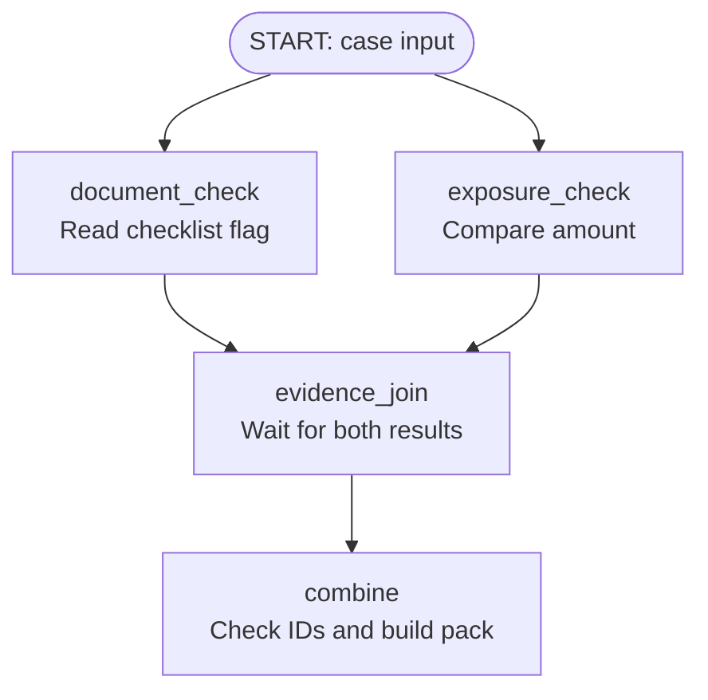

# Module 16: Static Orchestration: Collecting Independent Evidence

## Before you begin: what this module teaches

**ADK concept: static workflows, fan-out and joins.**

Some work must happen because the business process requires it. In Google’s **Agent Development Kit (ADK)**, a `Workflow` can declare those operations and their dependencies. **Static** means the required graph is defined in advance. A **node** performs a step, and an **edge** describes how execution moves between steps.

This module introduces **fan-out** and a **join**. Fan-out sends the input to independent checks. A `JoinNode` collects the required results before the next operation combines them. You will inspect the data at each boundary, including the named results presented to the join consumer. Completion order must not determine which result is treated as the document check or amount check.

**Where you would use this in real work.**

Meera needs two checks before preparing a review: whether the documents are complete, and whether the requested amount falls into the exercise’s specialist-review category. Neither check needs the other’s answer. The final summary needs both answers for the same case.

Her request becomes: “Run both checks and show me the combined result only when both are available.” You will turn “both,” “independent” and “only when” into graph structure. If one result refers to another case, combining the two would produce misleading evidence, so the example rejects that mismatch.

**Connection to Gemini Enterprise Agent Platform and Google Cloud.**

The workflow runs inside the ADK application. It can become part of an application hosted on Gemini Enterprise Agent Platform Agent Runtime. The local lesson deliberately uses Python function nodes and a synthetic case so the required execution can be observed without a model or cloud account.

For a customer implementation, the document check would obtain authorized records from its owning service, such as the Firestore adapter introduced in Module 13.5. An actual lending amount or exposure needs the bank’s approved source. Google hosting does not make a user-supplied fixture into verified business data.

**By the end, you should be able to:**

- **Explain the dependency:** identify what each check needs and why the combining step must wait for both.
- **Build the graph:** connect the input, two required branches, one join and the final combining operation.
- **Follow the values:** predict each returned dictionary and locate both results in the join output.
- **Handle a failure:** demonstrate that mismatched case IDs cannot become one successful evidence pack.
- **Transfer the pattern:** identify two independent checks in another bank process and specify their real data owners.

**How this moves the story forward.** Meera now has combined evidence. Module 17 uses that evidence to choose the next step from explicit business rules.

Read the detailed customer task below, then follow the [guided lab](./lab.md). Build one checkpoint at a time and compare your explanation with the observed result.

[Previous module](../module15-intro-to-multi-agent-systems/README.md) · [Lab](./lab.md) · [Solution](./lab-solution.md) · [Enterprise playbook](./enterprise-playbook.md) · [Next module](../module17-structured-routing/README.md)

## The banking story

Module 15 separated roles. This module makes required collection explicit. Module 17 will use the collected facts to select the next review step.

Sovereign Horizon Bank and Acme Robotics are fictional teaching organizations. We follow the same commercial-review case, **CASE-001**, through the sequence. Monetary thresholds are teaching fixtures, not lending policy.

## Customer problem statement

### Read this as a bank employee's task

Before reviewing a case, a bank analyst needs two pieces of information: whether the documents are complete and whether the requested amount requires specialist review under the fictional exercise rule. Neither check needs the other’s answer.

In this course, an analyst is the employee who gathers and checks information for a review. Picture a business banking team preparing for a company meeting. The bank, company and records are fictional.

> Do both checks every time. Show me the combined result only after both finish. Make sure both results belong to the same case.

| What you need to understand first | This exercise's answer |
|---|---|
| What information starts the task? | A case ID, a document-complete flag and the requested amount in the exercise’s integer units. |
| What should the employee receive? | One result containing both completed checks, with their source labels. |
| What should happen when it cannot be completed? | A failed check or mismatched case ID must not become a complete-looking result. |

### New words, explained using this task

| Term | Meaning here |
|---|---|
| Orchestration | The code that decides which operations run and in what order. |
| Fan-out | Starting separate pieces of work from the same input. |
| Join | Waiting for the required results and collecting them for the next operation. |

The next technical table connects these requirements to ADK objects and checks. Read one row at a time: the employee's need comes first, then the coding choice, then the result that would show it works.


## Match each customer requirement to code and a check

| Customer requirement | Implementation choice | Acceptance check |
| --- | --- | --- |
| Run both checks for every request | Static fan-out from START | The completed pack contains both results. |
| Combine only matching cases | Compare case IDs at the join consumer | Mismatched evidence raises an error. |
| Use exact money and explicit booleans | Strict Pydantic contract; integer cents | Strings, floats and boolean amounts are rejected. |
| Do not turn collection into approval | Result describes evidence and required review | The output makes no credit decision. |

**Result of this module:** An ADK Workflow schedules two checks, joins their named results, and produces a synthetic evidence pack.

## Understand the workflow through a bank branch in Pune

Imagine Meera works at the Pune branch of our fictional bank. Before a company review meeting, she needs two answers about **CASE-001**:

1. The document desk must report whether the required documents are complete.
2. The amount-review desk must report whether the requested amount crosses this exercise's specialist-review threshold.

Both desks receive the same case details. The document desk does not need the amount desk's answer to do its work. The amount desk does not need the document desk's answer either. Meera can therefore ask both desks to start without making one wait for the other.

However, Meera must wait for **both replies** before preparing the combined evidence pack. When the replies arrive, she checks that they concern the same case. An incomplete document checklist is a useful answer: it tells her what needs attention. A desk that never replies is a different situation: she has not received the required evidence.

This small story contains the entire design. We will now give each part its technical name and connect it to the actual Python implementation.

**Where the analogy stops:** the desks represent operations. In this lab they are Python functions, not human workers or Gemini agents. The code reads synthetic inputs; it does not inspect uploaded documents or contact a bank system. The word `exposure_check` in the code names the amount-threshold exercise; it does not calculate a customer's total financial exposure.

## Nodes, edges and graphs: read the process before the code

### A node is one identifiable step

A **node** is a unit of work in the workflow. Think of a labelled box on a process diagram: “read the document status” or “check the amount.” To understand a node, ask three questions: **What does it receive? What does it do? What does it return?**

In our ADK implementation, these are the four executable nodes:

| Node | Bank-branch analogy | Input → responsibility → output |
|---|---|---|
| `document_check` | Document desk | Case details → read the supplied checklist flag → document result with case ID and source label. |
| `exposure_check` | Amount-review desk | Case details → compare amount with the teaching threshold → specialist-review flag with case ID and source label. |
| `evidence_join` | Collection point waiting for both replies | Two branch results → wait for all required predecessors → a dictionary containing the named results. |
| `combine` | Meera assembling the review pack | Joined dictionary → compare case IDs → one evidence pack and a message for the analyst. |

The first, second and fourth nodes come from ordinary Python functions. The third comes from ADK's `JoinNode`. Passing functions into `Workflow` lets ADK adapt them into executable nodes. You do not need to write a custom scheduler or subclass an internal ADK class.

**A node does not automatically mean an AI agent.** A function can perform an exact calculation without a model. An agent node can use Gemini when its task requires language understanding or reasoning. Here, checking a boolean and comparing two integers are ordinary code operations. This module's example is a multi-node workflow; having several nodes does not make it a multi-agent system.

### An edge states a dependency

An **edge** is a connection from one node to another. In this lesson, read `A → B` as: “B receives the output of A and depends on it before doing its work.” A is B's **predecessor**; B is A's **successor**. **Upstream** means earlier along that dependency path; **downstream** means later.

For Meera, the combining operation is downstream of the join because she cannot assemble the pack until the collected replies exist. The two desks have no edge between them because neither needs the other's output.

An arrow describes required execution and data flow. It does not represent a network cable, an IAM permission or a promise that two databases contain matching records. Those are separate concerns when the functions call real services.

### A graph is the complete map of nodes and edges

A **graph** puts the steps and their connections together. **Orchestration** is the coordination of those steps according to the graph. In this example, the ADK `Workflow` declares the graph; the ADK runtime executes it when a request arrives.

**Static orchestration** means we define this required structure in advance: every valid request must go through both checks, the join and the combiner. It does not mean the input or answer stays the same. Changing the requested amount can change the returned flag while leaving the required route unchanged. Module 17 introduces choosing a route from explicit conditions.

### Follow the execution

<!-- TEACHER_NOTE_START -->
**Teacher's note (ADK instructor view):**
- **Learning goal:** Explain the concept clearly from beginner to advanced, with a simple mental model first.
- **Why it matters:** Connect the concept to real Google agentic workflows, Python engineering habits, and production-ready decisions.
- **Version watch:** Validate against the latest official ADK / Google docs before teaching; call out deprecations or migration notes when needed.
- **Module linkage:** Connect this idea to the previous and next modules so learners see the progression across the course.
<!-- TEACHER_NOTE_END -->


Read the diagram from top to bottom. `START` is ADK's special entry point, not another function you must implement. The two arrows leaving it form the **fan-out**. The two branches meet at the **join**. The final node produces the evidence pack; there is no hidden approval operation after it.

## Fan-out, concurrency and joins: why this shape fits the request

### Fan-out: give independent work a common starting point

**Fan-out** means one starting point leads to several branches. Meera distributes the case details to both desks. In the code, both checks receive the validated case input.

The reason to fan out is independence. Ask: “Could the document check finish correctly without knowing the amount-check result?” Yes. Ask the reverse question: also yes. That is the design justification. If a later task needed the document check's output—for example, extracting a value from a document retrieved by that check—it would need a dependency edge instead.

Treat the input as read-only and let each branch return its own result. Do not assume a fan-out creates an isolated deep copy of every Python object. Having two branches overwrite a shared `state["result"]` would make ownership unclear; separate returned dictionaries keep the source of each answer visible.

### Concurrency: independent work can overlap

**Concurrency** means several tasks can be in progress over the same period. A desk waiting for a records service need not prevent another desk from starting its independent request. **Parallel execution** can also mean work literally running at the same instant on different processors; drawing two branches does not guarantee that.

For an illustrative pair of network reads taking two and three seconds, sequential execution takes roughly five seconds, while overlapping waits could take roughly three seconds, plus orchestration overhead. This is an explanation of the opportunity, not a measured promise about our lab.

Our checks are tiny synchronous Python functions. They do not demonstrate a network speed improvement or multicore CPU execution. In the verified ADK version, these plain synchronous functions are called directly; putting a slow blocking call inside one does not automatically move it to another thread. For real independent network operations, choose supported asynchronous clients and await their calls. Measure the complete workflow with realistic service limits before promising lower latency.

### Fan-in and join: collect the required replies

**Fan-in** describes branches converging. A **join** adds a synchronization requirement: this operation needs the required branch results before it can proceed. Simply drawing two arrows into an ordinary function is not a substitute for declaring that requirement with `JoinNode`.

In our graph, `JoinNode(name="evidence_join")` waits for `document_check` and `exposure_check`. If the document result arrives first, that does not give `combine` permission to create a one-result pack. When both required results are available, the join provides a dictionary keyed by their predecessor names.

Think of two labelled trays on Meera's desk: “documents” and “amount.” Meera reads each tray by its label, not by whichever desk replied first. Similarly, `node_input["document_check"]` identifies the document result even if the amount check finished earlier.

### Joining and combining are different responsibilities

The join answers: **“Have the required results arrived, and which node produced each one?”** The combiner answers: **“Can these results belong in the same pack, and what should that pack contain?”**

ADK supplies the first mechanism. Our application supplies the case-ID comparison and output structure. `JoinNode` does not know the bank's meaning of “same customer,” “recent enough” or “approved source.” It also is not a SQL join, database transaction or lock.

For example, two replies might both say `CASE-001`, while one describes yesterday's case version and the other today's version. The join can collect them and the existing ID check can pass. A real implementation needs an agreed version/freshness rule if those differences matter. The lab checks identity, not that stronger consistency requirement.

## Derive the ADK code from the customer's words

Before choosing an API, underline the important phrases in the request:

| Customer's words | Design question | Coding decision |
|---|---|---|
| “Do both checks every time” | Can either check be optional? | Make both branches required in the graph. |
| “Neither check needs the other's answer” | Must one wait for the other? | Fan out from the common input. |
| “Only after both finish” | What must the next step wait for? | Connect both predecessors to a `JoinNode`. |
| “Both results belong to the same case” | What would make the pack misleading? | Compare the returned case IDs in `combine`. |
| “Show me the combined result” | What should the caller receive? | Return one structured evidence pack and a readable message. |

This is how the business requirement becomes an implementation. The graph expresses scheduling requirements; function bodies express the business calculations and checks.

### Read the actual graph definition, one line at a time

The following is an annotated excerpt from [the working agent](./example/bank_case/agent.py). It belongs in that module, where `CaseRequest` and the three functions are already defined; it is not a standalone script.

<!-- TEACHER_NOTE_START -->
**Teacher's note (ADK instructor view):**
- **Learning goal:** Explain the concept clearly from beginner to advanced, with a simple mental model first.
- **Why it matters:** Connect the concept to real Google agentic workflows, Python engineering habits, and production-ready decisions.
- **Version watch:** Validate against the latest official ADK / Google docs before teaching; call out deprecations or migration notes when needed.
- **Module linkage:** Connect this idea to the previous and next modules so learners see the progression across the course.
<!-- TEACHER_NOTE_END -->
```python
from google.adk.workflow import JoinNode, Workflow


def build_agent():
    # Create the collection point. Its predecessors are declared in edges below.
    joined = JoinNode(name="evidence_join")

    # Build the workflow object now; the Runner executes it for a request later.
    return Workflow(
        name="evidence_pipeline",  # A name for this whole composition.
        input_schema=CaseRequest,  # Validate and structure the incoming case.
        timeout=30,  # Bound workflow execution time in seconds.
        edges=[
            # Give both checks the entry input; neither depends on the other.
            ("START", (document_check, exposure_check)),
            # The join needs outputs from both named predecessor functions.
            ((document_check, exposure_check), joined),
            # Only the collected result map becomes the combiner's input.
            (joined, combine),
        ],
    )
```

There are several Python ideas here worth separating from the ADK ideas:

- `def build_agent():` defines a function. Calling it constructs and returns a workflow object. It does not itself process a case.
- `joined` is a Python variable holding the `JoinNode` object. `"evidence_join"` is that object's ADK name; they need not have identical spellings.
- `edges=[...]` passes a Python list. Each `(source, destination)` item is a tuple describing a connection.
- In the first edge, the destination is itself a tuple: `(document_check, exposure_check)`. This compactly declares two outgoing branches.
- In the second edge, the source is a tuple. Both functions feed the same explicit join.
- `"START"` is a quoted string because it is ADK's reserved entry marker. `document_check` is an unquoted reference to a function defined in Python.
- `document_check` has no trailing `()`: we are handing ADK a function to call later. Writing `document_check(...)` there would call it while constructing the graph and pass its return value instead.

The source file calls the builder `build_agent` because the surrounding runner accepts the composition as its root agent. This name does not mean an LLM is involved. The `Workflow` can run these functions without Gemini calls.

## Follow one case through every data boundary

### 1. Receive and validate the case

The example's [input contract](./example/bank_case/contracts.py) defines a `CaseRequest` using Pydantic, a Python validation library. Here is the sample input as a Python dictionary:

<!-- TEACHER_NOTE_START -->
**Teacher's note (ADK instructor view):**
- **Learning goal:** Explain the concept clearly from beginner to advanced, with a simple mental model first.
- **Why it matters:** Connect the concept to real Google agentic workflows, Python engineering habits, and production-ready decisions.
- **Version watch:** Validate against the latest official ADK / Google docs before teaching; call out deprecations or migration notes when needed.
- **Module linkage:** Connect this idea to the previous and next modules so learners see the progression across the course.
<!-- TEACHER_NOTE_END -->
```python
{
    "case_id": "CASE-001",
    "requested_cents": 25_000_000,
    "documents_complete": False,
}
```

Curly braces create a dictionary of keys and values. `False` is a Python boolean, meaning “no” in the document-complete field. Underscores in `25_000_000` only make the integer easier to read; they do not change its value. JSON uses lowercase `false`, which is why the printed JSON looks slightly different.

The contract accepts only the teaching case `CASE-001`, an integer amount from 1 through 100,000,000, and a boolean document flag. Strict validation rejects inputs such as the string `"false"`, an amount written as a floating-point number, or unexpected extra fields. Valid structure is not proof that the customer's claim is true: the lab accepts supplied synthetic facts.

The field is named `requested_cents` in the existing example. The Pune setting does not convert it into rupees. For an INR implementation, explicitly define the currency and use an agreed integer unit such as paise throughout the contract and policy; do not silently relabel this fixture's numbers as a bank lending rule.

In [runtime.py](./example/runtime.py), `json.dumps(payload)` converts the dictionary into JSON text inside a `types.Content` user message. The Runner starts the workflow, and `input_schema=CaseRequest` provides the entry validation/conversion. Each check then receives a `CaseRequest` object through its `node_input` parameter.

Python type hints describe expected types; plain Python does not enforce them just because an annotation is present. ADK and Pydantic use the schema information at the execution boundary. Calling a function directly while bypassing that boundary is a different path.

### 2. Produce one result from each function

The document function reads `node_input.documents_complete` and returns a new dictionary with the same case ID and a source label. The amount function evaluates this expression:

<!-- TEACHER_NOTE_START -->
**Teacher's note (ADK instructor view):**
- **Learning goal:** Explain the concept clearly from beginner to advanced, with a simple mental model first.
- **Why it matters:** Connect the concept to real Google agentic workflows, Python engineering habits, and production-ready decisions.
- **Version watch:** Validate against the latest official ADK / Google docs before teaching; call out deprecations or migration notes when needed.
- **Module linkage:** Connect this idea to the previous and next modules so learners see the progression across the course.
<!-- TEACHER_NOTE_END -->
```python
# Strictly greater than: the exact threshold does not require specialist review.
node_input.requested_cents > 20_000_000
```

The `>` operator returns a boolean. With the sample amount, the answer is `True`; at exactly `20_000_000`, it is `False`. The threshold is fictional. The source labels identify teaching fixtures, not authenticated records from a production bank.

Neither function modifies the input. Each returns evidence for one responsibility. That makes it possible to check the calculations independently before investigating orchestration behavior.

### 3. Inspect the joined dictionary

For this request, the combiner receives the following value through `node_input`. This is the complete joined data, including the source fields:

<!-- TEACHER_NOTE_START -->
**Teacher's note (ADK instructor view):**
- **Learning goal:** Explain the concept clearly from beginner to advanced, with a simple mental model first.
- **Why it matters:** Connect the concept to real Google agentic workflows, Python engineering habits, and production-ready decisions.
- **Version watch:** Validate against the latest official ADK / Google docs before teaching; call out deprecations or migration notes when needed.
- **Module linkage:** Connect this idea to the previous and next modules so learners see the progression across the course.
<!-- TEACHER_NOTE_END -->
```python
{
    "document_check": {
        "case_id": "CASE-001",
        "documents_complete": False,
        "source": "training-fixture:document-checklist-v1",
    },
    "exposure_check": {
        "case_id": "CASE-001",
        "specialist_review": True,
        "source": "training-fixture:review-threshold-v1",
    },
}
```

This is a **nested dictionary**: the outer keys name the producing nodes; each outer value is that node's result dictionary. `node_input["document_check"]["case_id"]` means “find the document result, then read its case ID.” These keys are a contract between the producers and the consumer. Renaming a predecessor requires checking the corresponding lookup in the combiner.

### 4. Check identity and build the final result

Read this annotated version of the actual combiner alongside the joined value above:

<!-- TEACHER_NOTE_START -->
**Teacher's note (ADK instructor view):**
- **Learning goal:** Explain the concept clearly from beginner to advanced, with a simple mental model first.
- **Why it matters:** Connect the concept to real Google agentic workflows, Python engineering habits, and production-ready decisions.
- **Version watch:** Validate against the latest official ADK / Google docs before teaching; call out deprecations or migration notes when needed.
- **Module linkage:** Connect this idea to the previous and next modules so learners see the progression across the course.
<!-- TEACHER_NOTE_END -->
```python
from google.adk.events import Event


def combine(node_input: dict) -> Event:
    # Select answers by producer name, never by which branch finished first.
    documents = node_input["document_check"]
    exposure = node_input["exposure_check"]

    # != means "not equal". Stop instead of publishing a mixed-case pack.
    if documents["case_id"] != exposure["case_id"]:
        raise ValueError("Cannot combine evidence from different cases")

    # [] creates a list. We intentionally put documents first in the final pack.
    result = {"case_id": documents["case_id"], "evidence": [documents, exposure]}

    # Keep structured data and the explanation for the user in separate fields.
    return Event(
        output=result,
        message="Evidence collected; analyst review is required.",
    )
```

`raise ValueError(...)` stops this function with an error; it does not return an evidence pack. On the successful path, the `evidence` list contains the two complete dictionaries in the order chosen by the combiner. That order is independent of branch completion order.

The resulting pack says the documents are incomplete and specialist review is required under the exercise rule. Both checks have completed successfully. **“Evidence collection completed” does not mean “documents complete,” “loan approved,” or “human review performed.”** This example produces a message requesting analyst review; it does not implement an approval queue or a resumable human-review step.

### 5. Distinguish output, messages and session state

In this example, the channels have different jobs:

| Channel | Concrete use here | How to think about it |
|---|---|---|
| Node return value / `Event.output` | Branch dictionaries, joined results and final evidence pack | Structured information the workflow passes onward or exposes to the caller. |
| `Event(message=...)` | “Evidence collected; analyst review is required.” | An explanation for the user; it does not replace the evidence dictionary. |
| Session state | Not used to exchange these branch results | Scoped working values for a session when the design needs them; not an automatic substitute for explicit node inputs. |

The local display helper prints events with outputs and readable content. You may see intermediate branch and join outputs as well as the final result. A product UI should deliberately select what to show an analyst. Printing every event is useful for learning, but it is not a finished banking interface.

## What happens when the process cannot finish normally?

Return to Meera's two desks. “The documents are missing” is an answer. “The document system could not be reached” means a required answer is unavailable. Mixing these situations creates misleading packs.

| Situation | Meaning in this example | Expected outcome |
|---|---|---|
| `documents_complete=False` | The check returned a valid negative finding. | Include it in the evidence pack after both checks complete. |
| An invalid amount type reaches the input boundary | The request violates `CaseRequest`. | Reject it before the checks process the case. |
| A check raises an unhandled exception | The required operation failed. | This lab has no recovery route; the invocation fails rather than producing the intended complete pack. |
| The two returned case IDs differ | The evidence cannot be combined safely. | `combine` raises `ValueError`. |
| Both IDs match, but source versions differ | A possible consistency problem the current fixture does not model. | A customer implementation needs an explicit consistency rule and validation. |

`timeout=30` sets the workflow deadline in seconds. The local runner also has an outer 60-second bound around the invocation. These are limits at different scopes, not extra evidence or permission to produce a partial pack. Async timeout handling also cannot forcibly interrupt arbitrary blocking Python code or undo an external write. Real service calls need their own supported timeouts.

If a bank wants partial results, first define what an incomplete result means, who may see it and whether it may trigger another operation. Then implement and test that explicit behavior. A join by itself does not create a recovery policy.

## Choose an ADK composition and connect it to Google services

`Workflow` is the graph API used throughout this example. ADK also offers `SequentialAgent` and `ParallelAgent` for template-based agent arrangements. These choices solve related orchestration needs, but their data exchange must be designed for the API being used.

| Situation | Composition to consider | Reason |
|---|---|---|
| Explicit function/agent dependencies with structured values between nodes | `Workflow` with edges | The dependency and input/output boundaries are visible in the graph. |
| A fixed ordered sequence of sub-agents | `SequentialAgent` | The sequence determines which sub-agent executes next; define how later agents obtain earlier results. |
| Independent sub-agents executed concurrently | `ParallelAgent` | It coordinates the agent branches; define distinct outputs/state keys and the later combining step. |

Our workflow uses ADK's graph and join mechanisms directly. Gemini is useful when a later task needs language interpretation or a grounded explanation; it is not required to compare integers. Google Cloud's **Workflows** service is a separate product from the Python ADK `Workflow` class used here.

To adapt Meera's example for a customer, keep the business dependencies and replace the fixtures with authorized integrations. Module 13.5 introduces a Firestore case-record pattern; Module 14 introduces a bounded BigQuery profile pattern that could supply an additional evidence branch. An actual requested amount still needs its bank-owned source. Decide who owns each fact, what identifies its version and when it is too old to use.

Hosting the ADK application on Gemini Enterprise Agent Platform Agent Runtime is a deployment decision. It does not automatically grant access to Firestore or BigQuery, enforce case-level authorization, or certify a financial decision. Those requirements belong in the integration and deployment work. The local `InMemoryRunner` in this lab is a learning runtime, not evidence of deployed persistence or production access controls.

Use the [enterprise playbook](./enterprise-playbook.md) for this module's customer adaptation questions and the [banking FDE learning guide](../module15-intro-to-multi-agent-systems/fde-learning-guide.md) for the story across modules.

## Check your understanding before writing the lab

Try answering each question before reading its explanation.

1. **The amount desk replies first. Does Meera have a complete pack?** No. The join still requires the document result. Arrival order does not change which named result the combiner reads.
2. **Documents are incomplete. Did the workflow fail?** No. `False` is a valid finding. Collection can succeed while the findings still require follow-up.
3. **Both dictionaries exist. Can the join guarantee they describe the same case version?** No. Required-output collection and business consistency are separate responsibilities.
4. **Why is there no edge from `document_check` to `exposure_check`?** The amount calculation does not use the document result. Adding that dependency would impose unnecessary ordering.
5. **Why pass `document_check` instead of calling `document_check(...)` in `edges`?** ADK needs a callable to execute when the request reaches that node. Construction and execution are different moments.
6. **Would using two Gemini agents make the exact threshold comparison more correct?** No. The arithmetic is deterministic; adding a model is not a substitute for the explicit rule and validation.

**Beginner practice:** write the expected outputs for an amount exactly at `20_000_000` and a document flag of `True`, then follow the [guided lab](./lab.md) to run that case. Identify the line that changes each value and explain why the graph shape stays the same.

**Experienced learner practice:** sketch a third branch that reads an approved company profile. Specify its input, output schema, source owner, timeout and freshness rule. Explain which fan-out, join-predecessor and combiner declarations must change. Before implementing it, define the observable result when the profile service is unavailable.

You are ready for Module 17 when you can say: “We now have two identified findings about one case. The next problem is deciding which review path should receive them.” That is the transition from collecting required evidence to structured routing.


## Review the design through three perspectives

**Beginner:** name the four executable nodes and the special START entry. Explain each returned dictionary, then predict the result at exactly the amount threshold. Use the diagram to explain why branch completion order cannot change which evidence the combiner reads.

**Experienced engineer:** replace the fast fixture checks on paper with two authorized remote reads. Specify nonblocking I/O, individual timeouts, overall deadline and evidence-version checks. Measure concurrency rather than assuming two arrows imply multicore execution. Explain the partial-result policy before implementing one.

**Bank FDE:** ask “Must both checks run, do they use the same case version, and what should happen if one owner is unavailable?” Record the agreed answers as acceptance scenarios. This is the customer justification for fan-out, the join and the combining guard. Agent Runtime hosts the application; it does not establish the freshness of the records being joined.

## What you should be able to explain

- Translate the bank request into inputs, operations, outputs and failure outcomes.
- Point to the code that enforces each acceptance condition.
- Explain which facts are synthetic and which production services would own them.
- State what the local checks prove and what still needs a live integration or model evaluation.

## Verified baseline and limits

See the [course review and verification record](../module15-intro-to-multi-agent-systems/review-notes.md) for the cross-module checks and the evidence still required from a customer deployment.

Reviewed on **3 October 2026** against **google-adk 2.11.0** and its installed public APIs. Examples require Python 3.12+ and were exercised with **Python 3.14.7**. Python 3.14.8 is the current stable patch release; it was not the local test interpreter. Use the supplied lockfile for the verified dependency resolution, and repeat the checks before upgrading.

Sources: [ADK release](https://pypi.org/project/google-adk/2.11.0/) and [Python 3.14.8 release](https://www.python.org/downloads/release/python-3148/). “Current” is dated verification, not a promise that a dependency will never change.

4 offline tests passed using the real ADK graph runtime, including both joined results, strict boundaries and mismatched-case rejection. The fixture does not call Firestore or a ledger.

## Official sources

- [Graph routes and joins](https://adk.dev/graphs/routes/)
- [Graph data handling](https://adk.dev/graphs/data-handling/)
- [Supported workflow choices](https://adk.dev/workflows/)

## Continue the course story

Previous: [Module 15](../module15-intro-to-multi-agent-systems/README.md) · Next: [Module 17](../module17-structured-routing/README.md) · [See how the concepts build](../learning-journey.md)

Before continuing, explain one input, one ADK execution boundary and one failure outcome from this module. Use the next chapter to add a new customer requirement, not merely another component.

<!-- © 2026 Inder Chauhan (https://github.com/inderanz/google-adk-training). All rights reserved. -->
---

## Official References

- Google ADK docs (latest): https://google.github.io/adk-docs/
- Google AI / Gemini docs: https://ai.google.dev/
- Google GenAI Python SDK reference: https://googleapis.github.io/python-genai/
- Context7 / current SDK lookup for the exact installed version and API signatures
- Related module path: review the surrounding modules for continuity, prerequisites, and follow-on concepts

