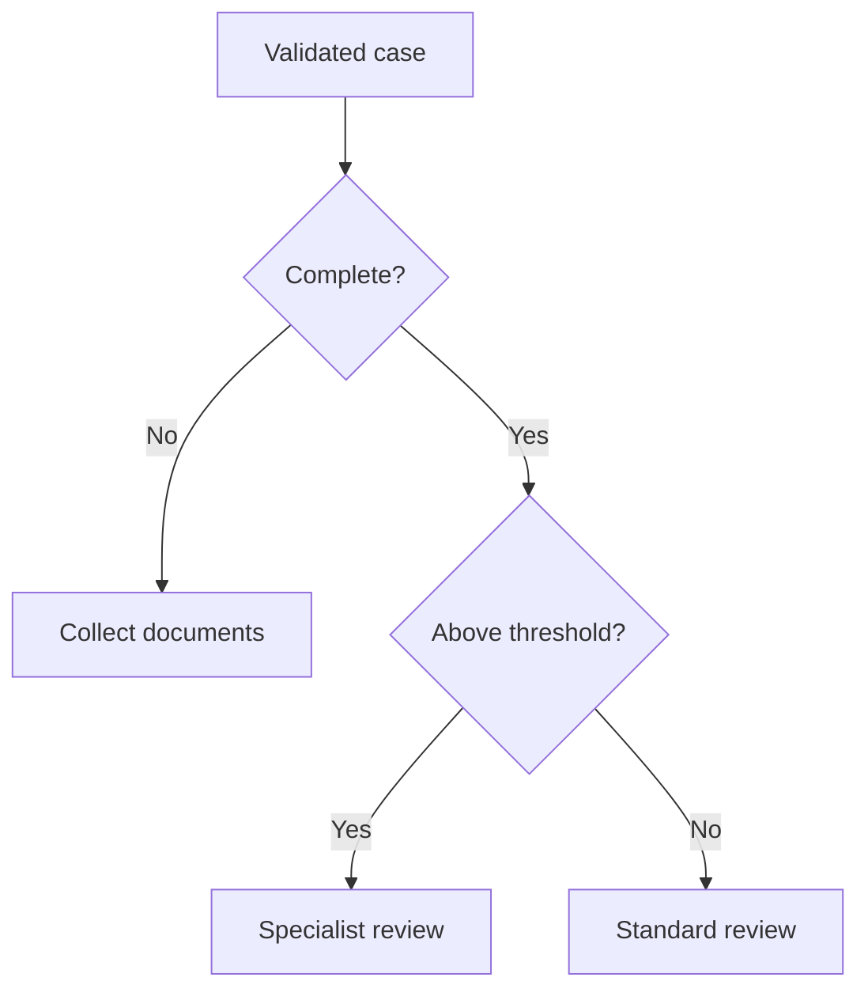

# Module 17: Structured Routing: Turning Bank Rules into Edges

## Before you begin: what this module teaches

**ADK concept: structured routing and explicit control signals.**

Once evidence is available, an application may need to choose a next step. Google’s **Agent Development Kit (ADK)** supports workflow routes for that purpose. You will learn the distinction between `Event.output`, which carries business data, and `Event.route`, which selects a configured destination.

The bank’s rule is expressed as ordered Python conditions. ADK then follows the corresponding graph path. This separation makes the decision inspectable: the facts say what is known, the rule says which condition takes precedence, and the route says what runs next. Writing a dictionary containing a field called “route” is not automatically the same as setting ADK’s routing signal.

**Where you would use this in real work.**

Meera asks what to do next with the case. The fictional rule says missing documents take priority. Only when the checklist is complete should the amount determine whether standard or specialist review is next.

Consider a case with a high amount and a missing ownership register. Both facts are true, but document collection must come first under this exercise’s rule. You will translate that priority into code and examine the exact threshold. Returning “specialist review” describes the selected next step; it does not approve credit or create an actual work-queue item.

**Connection to Gemini Enterprise Agent Platform and Google Cloud.**

This routing logic remains part of the ADK application when hosted on Gemini Enterprise Agent Platform Agent Runtime. Gemini may interpret a question or explain a result, while Python applies the exact rule taught here. The routing lesson itself needs no model call.

In a real bank, the input must come from authorized systems, and a policy owner must provide the rule and its version. Hosting, model access and deterministic routing solve different parts of the solution. The lab keeps them visible so the rule can be tested before a cloud integration is added.

**By the end, you should be able to:**

- **Derive the rule:** explain why the document condition is checked before the amount condition.
- **Use the ADK contract:** distinguish Event.route from Event.output and map each named route to its destination.
- **Predict boundaries:** determine the route at the threshold and just above it before running the example.
- **Handle unexpected routing:** explain the fallback destination and why an unrecognized route must not imply approval.
- **Transfer the pattern:** write a new ordered rule in plain English, identify its data owner, and derive its boundary checks.

**How this moves the story forward.** Module 17 chooses one destination. Module 18 asks a related but different question: which collection of checks does this particular case need?

Read the detailed customer task below, then follow the [guided lab](./lab.md). Build one checkpoint at a time and compare your explanation with the observed result.

[Previous module](../module16-static-orchestration/README.md) · [Lab](./lab.md) · [Solution](./lab-solution.md) · [Enterprise playbook](./enterprise-playbook.md) · [Next module](../module18-dynamic-orchestration/README.md)

## The banking story

Module 16 collected evidence. This module chooses a step from fixed rules. Module 18 will schedule a varying set of checks without hiding business logic inside a prompt.

Sovereign Horizon Bank and Acme Robotics are fictional teaching organizations. We follow the same commercial-review case, **CASE-001**, through the sequence. Monetary thresholds are teaching fixtures, not lending policy.

## Customer problem statement

### Read this as a bank employee's task

The bank analyst has the document status and requested amount. The next task is to identify what should happen next. In this fictional exercise, missing documents must be dealt with before the amount-based review rule is considered.

In this course, an analyst is the employee who gathers and checks information for a review. Picture a business banking team preparing for a company meeting. The bank, company and records are fictional.

> If documents are missing, tell me to collect them first. Otherwise, tell me whether the case needs specialist review or standard review. Do not describe either route as loan approval.

| What you need to understand first | This exercise's answer |
|---|---|
| What information starts the task? | A validated case snapshot: the case ID, document status and requested amount. |
| What should the employee receive? | Exactly one next step: collect documents, specialist review or standard review. |
| What should happen when it cannot be completed? | Malformed input is rejected. An unexpected routing label goes to manual checking. |

### New words, explained using this task

| Term | Meaning here |
|---|---|
| Route | The next operation selected by the application. |
| Precedence | Which rule is checked first when more than one could apply. |
| Structured output | Data in named fields, so code does not have to guess its meaning from a sentence. |

The next technical table connects these requirements to ADK objects and checks. Read one row at a time: the employee's need comes first, then the coding choice, then the result that would show it works.


## Match each customer requirement to code and a check

| Customer requirement | Implementation choice | Acceptance check |
| --- | --- | --- |
| Missing documents take precedence | First branch in choose_route | A high amount with missing documents still goes to document collection. |
| Define the threshold precisely | Integer cents and > 20_000_000 | The exact threshold stays in standard review; one cent above goes to specialist review. |
| Handle unexpected routing values | Explicit __DEFAULT__ edge | Unsupported routes lead to manual triage. |
| Reject malformed input before routing | Workflow input_schema | Unknown cases, booleans as money and extra approval fields are rejected. |

**Result of this module:** Exactly one route handler produces a next-step instruction from a validated synthetic snapshot.

## Work through the concept as a customer problem

### A branch reception desk sends a file to the right team

Imagine a Pune branch has three trays: missing documents, specialist review and standard review. Meera must first check whether the file is complete. A large requested amount does not let an incomplete file skip that first rule. The branch manager writes this order down before anyone automates it.

This is **routing**: choosing the next operation from available destinations. **Precedence** means deciding which rule wins when several conditions could apply. **Deterministic** means the same validated facts and rule version select the same destination. None of these words means the credit application has been approved.

### From the branch rule to Python, then to ADK

```python
# Inside choose_route(node_input): evaluate the bank's teaching rules in order.
if not node_input.documents_complete:
    route = "documents"  # First priority: missing evidence.
elif node_input.requested_cents > 20_000_000:
    route = "specialist"  # Consider amount only after completeness passes.
else:
    route = "standard"  # Remaining valid cases still need analyst review.
```

`if` tests the first condition. `not` reverses a boolean, so `not False` is `True`. `elif` means “otherwise, if”; it is considered only when the earlier condition failed. `else` covers the remaining valid inputs. Indentation tells Python which assignment belongs to each branch. The spelling `20_000_000` is an integer with visual separators, not a special money type.

The function then returns `Event(output=node_input.model_dump(), route=route)`. `model_dump()` converts the validated Pydantic object into a dictionary. `output` carries that case data; `route` carries the control label. In the graph's mapping, the string `"documents"` selects the callable `request_documents`. Returning ordinary data with a key named `route` would not make that same routing request.

### Work the decision table before running the program

| Documents complete? | Requested cents | First matching condition | Selected route |
|---|---:|---|---|
| No | 25,000,000 | Missing evidence | `documents` |
| Yes | 25,000,000 | Above the threshold | `specialist` |
| Yes | 20,000,000 | Neither earlier condition | `standard` |
| Yes | 1 | Neither earlier condition | `standard` |

These four rows expose two common mistakes: testing the amount first, and writing `>=` when the agreed word was “above.” They also show why a model should not invent a lending rule from an informal request. Gemini may help extract intent, but current case facts and approved rules belong to trusted application/service boundaries.

**Use routing** when a result must select a destination. **Use fan-out** when all independent operations are required. **Use a dynamic node** when code must build an applicable sequence of child work; that is the next module.

### Three reviews before accepting the design

- **Beginner:** predict all four rows and point to the winning assignment. Explain why the handler's `next_step` dictionary does not send a real email or create a queue item.
- **Experienced engineer:** separate invalid input, an unmatched route and a handler exception. `__DEFAULT__` handles an unmatched label; it is not a universal exception handler. Add a policy-version requirement before adapting the rule to a real bank.
- **Bank FDE:** ask who owns the rule, what currency it uses, when it becomes effective and which exception has priority. Obtain signed-off examples at both sides of every boundary. If the bank also wants a task created, specify an authorized, duplicate-safe queue write as a separate operation.

**Carry forward:** routing chooses where evidence goes; [Module 18](../module18-dynamic-orchestration/README.md) chooses which additional evidence work is necessary.

## Follow the execution



This shows the three supported business routes. Invalid input is rejected before this diagram; an unexpected emitted route uses the separately configured default handler. The handlers return next-step data, not real queue writes.

## A route is a control signal

A dictionary returned from a classifier is just data until code turns a field into a routing signal. `Event(output=payload, route="documents")` carries two separate things: the payload for the next node and the label used to select an edge. The handler does not need to parse a sentence like “please collect documents” to discover the route.

| Rule priority | Condition | Route label | Meaning |
|---|---|---|---|
| 1 | Checklist incomplete | `documents` | Collect missing evidence |
| 2 | Complete and amount above 20,000,000 cents | `specialist` | Specialist analyst review |
| 3 | Complete and amount at or below threshold | `standard` | Standard analyst review |
| Fallback | Unexpected routing label | `__DEFAULT__` | Manual triage |

These are fictional training rules. A real bank supplies its policy, currency, effective dates, exception handling and policy owner. This lab assumes one currency and never performs conversion. Routing is neither approval nor an authorization check.

## Translate English into ordered conditions

The word **first** determines precedence. “Above” means `>`, not `>=`. “Otherwise” becomes `else`. “Send to” means choosing a destination, not executing a payment. Those distinctions are requirements, not coding style preferences.

Current ADK accepts a route mapping such as `(choose_route, {"documents": request_documents, ...})`. The mapping’s keys must match emitted route values. An ordinary edge connects nodes directly. A terminal node simply has no outgoing edge; do not invent an `"END"` function node to make execution stop.

## Where a model can help

If the request is plain English, a Gemini classifier can extract an intent using a Pydantic `output_schema` with `Literal` choices, including an unknown/clarification outcome. Its proposed case ID must still pass authorization and an authoritative lookup. A model’s parsed amount or assertion that “all documents are present” is not a bank record.

Keep semantic intent extraction separate from policy routing. A validated JSON shape does not prove the extracted fact is true. The runnable lab starts after authoritative lookup, with an explicitly synthetic snapshot, so the routing guarantee is inspectable without a model.

## ADK execution model: Control signals are separate from business data

The entry schema validates the synthetic snapshot before routing begins. choose_route then evaluates ordinary Python conditions in order. Only after selecting a label does it construct an Event. The event carries the case payload in output and the chosen control label in route. The route mapping connects that label to a handler function.

Consider two values: `{"route": "documents"}` as a plain dictionary and Event(output=payload, route="documents"). The first is business data with a key called route; the second explicitly instructs the graph's routing mechanism. A downstream function should receive the case data, not parse the analyst-facing sentence to discover which rule won.

There are three different failures to understand. Invalid input fails at the schema boundary before any rule executes. An unexpected emitted label selects the configured default route. An exception within a selected handler fails that execution unless recovery is explicitly implemented. A default edge is not a universal exception handler.

A Gemini output_schema can constrain the shape of an extracted intent. It cannot establish that an extracted amount is current or that the caller owns the case. Language understanding, record authorization, current lookup and exact policy routing belong to separate boundaries.

### Derive the code from the customer's words

Translate “missing documents first” into the first if. Translate “above” into >, including a boundary case at equality. The fallback represents an unrecognized control label, not permission to guess the bank policy.

### Predict, observe and explain

Before execution, fill four rows: incomplete/high; complete/high; complete/equal; complete/low. Predict label and handler. Then intentionally misspell one emitted label and inspect the default outcome.

### Worked design discussion for experienced learners

Add a policy version and effective date to an authoritative input contract. Show how a change from above to at-least affects both the condition and its boundary test.

Before accepting a solution, identify its input owner, exact ADK boundary, output consumer and failure evidence. Read the function comments in the lab alongside the corresponding source; comments explain design intent, while the executed events establish behavior.

## Learn this concept from first principles

A tool result is data. This module adds an explicit decision about where that data goes next. Keep that decision separate from how an LLM phrases an explanation.

### Work through the same function twice

With incomplete documents, Python selects the first branch even when the amount is high. Change only `documents_complete` to true and the first branch no longer applies; the amount comparison selects specialist review. Change the amount to exactly 20,000,000 cents and the comparison is false, so standard review is selected.

A dictionary key such as `"documents"` is a label you chose. It must match the event's route. A function name such as `request_documents` is executable code. Returning `{"route": "documents"}` as ordinary output is not the same as setting the Event route field.

The fallback handles a supported graph receiving an unexpected route label. It does not rescue a malformed input that failed the schema first. These are different failure stages: input rejection versus an unmatched control signal.

### Add language understanding before facts, not instead of facts

A model can identify that “help me prepare Acme's review” is a preparation request. It may extract a proposed case identifier. Trusted code must then resolve ambiguity, verify access and load current facts. Only those verified facts should enter the bank-rule router. This separates model uncertainty about intent from exact execution of an approved rule.

An advanced rule set also needs currency, policy version, effective dates and exception precedence. If the bank changes “above” to “at least,” update the comparison and exact-boundary acceptance case together.

### Trace one concrete request

| Step | Value or operation | Reasoning |
| --- | --- | --- |
| Validated input | CASE-001, 25,000,000 cents, documents_complete=false | A large amount does not bypass missing evidence. |
| First condition | not documents_complete is true | The if branch wins; elif and else are skipped. |
| Routing event | route=documents plus a dumped case dictionary | Control signal and payload are distinct fields. |
| Route mapping | documents selects request_documents | The destination is a Python function object. |
| Handler result | next_step=collect_documents | Nothing has been placed on a real queue. |

### Check your understanding

What changes if a developer returns route="document" instead of "documents"?

**Expected reasoning:** No named route matches; the __DEFAULT__ mapping selects manual triage. That result is deliberately different from a successful standard route.

### Foundation and advanced learning paths

**Foundation:** reproduce the trace above, explain the Python and ADK objects involved, and predict one changed input before running the lab. You should be able to identify which part is configuration and which part executes work.

**Advanced:** Add a policy-version field and propose migration behavior for sessions started under an older rule set. Explain how the audit record identifies the actual applied rule.

### Google service choice for this lesson

The route is native ADK control flow. Bank policy and current case facts remain outside the model. A Pub/Sub or case-queue write would be a separate authorized operation; emitting next_step does not perform it.

The [banking FDE learning guide](../module15-intro-to-multi-agent-systems/fde-learning-guide.md) connects the customer discovery questions, Google service map and integration boundaries across the sequence. It distinguishes implemented examples from customer integration and deployment work.

## What you should be able to explain

- Translate the bank request into inputs, operations, outputs and failure outcomes.
- Point to the code that enforces each acceptance condition.
- Explain which facts are synthetic and which production services would own them.
- State what the local checks prove and what still needs a live integration or model evaluation.

## Verified baseline and limits

See the [course review and verification record](../module15-intro-to-multi-agent-systems/review-notes.md) for the cross-module checks and the evidence still required from a customer deployment.

Reviewed on **3 October 2026** against **google-adk 2.11.0** and its installed public APIs. Examples require Python 3.12+ and were exercised with **Python 3.14.7**. Python 3.14.8 is the current stable patch release; it was not the local test interpreter. Use the supplied lockfile for the verified dependency resolution, and repeat the checks before upgrading.

Sources: [ADK release](https://pypi.org/project/google-adk/2.11.0/) and [Python 3.14.8 release](https://www.python.org/downloads/release/python-3148/). “Current” is dated verification, not a promise that a dependency will never change.

3 offline tests passed, including a real ADK run for all four decision-table scenarios and strict input checks. No live queue or credit-decision service is connected.

## Official sources

- [ADK graph routing](https://adk.dev/graphs/routes/)
- [Structured graph data](https://adk.dev/graphs/data-handling/)
- [Pydantic strict mode](https://docs.pydantic.dev/latest/concepts/strict_mode/)

## Continue the course story

Previous: [Module 16](../module16-static-orchestration/README.md) · Next: [Module 18](../module18-dynamic-orchestration/README.md) · [See how the concepts build](../learning-journey.md)

Before continuing, explain one input, one ADK execution boundary and one failure outcome from this module. Use the next chapter to add a new customer requirement, not merely another component.

<!-- © 2026 Inder Chauhan (https://github.com/inderanz/google-adk-training). All rights reserved. -->
