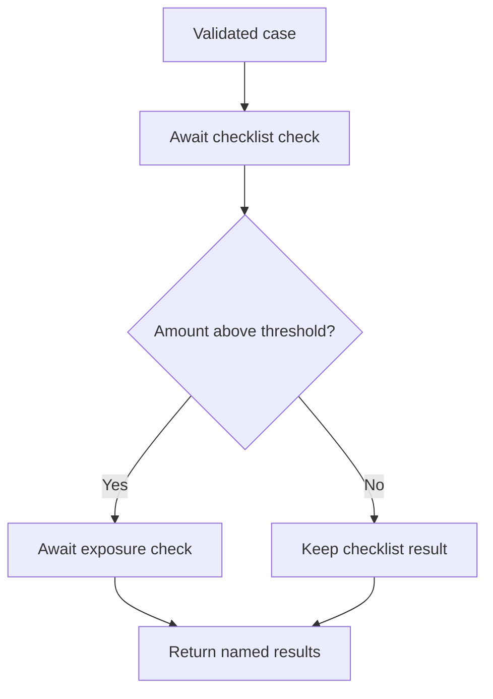

# Module 18: Dynamic Orchestration: Scheduling the Checks a Case Needs

## Before you begin: what this module teaches

**ADK concept: dynamic workflows and child-node execution.**

Not every case needs the same work. In Google’s **Agent Development Kit (ADK)**, a dynamic node can select and execute known child nodes while processing its input. You will use `@node`, the runtime-supplied `Context`, and `await ctx.run_node(...)` to express that selection in readable Python.

The important distinction is between constructing a fixed graph and choosing child work during execution. The example always requests a checklist check, then conditionally requests an additional check. `await` waits for each selected child; it does not make the sequence parallel. Running a child through Context also gives it an ADK execution boundary, rather than hiding all the work inside an ordinary helper call.

**Where you would use this in real work.**

Meera’s team does not want to run an extra review check for cases that do not need it. They still require the document checklist every time. Their request is: “Always check the documents, then do the additional amount-related check only when the rule says it applies.”

You will compare two inputs on either side of the threshold and inspect which children actually ran. The changing work list is the point of the lesson. A natural-language instruction that says “skip unnecessary work” would not give the same explicit scheduling rule.

**Connection to Gemini Enterprise Agent Platform and Google Cloud.**

Dynamic scheduling is provided by ADK inside the application. A hosted solution can run on Gemini Enterprise Agent Platform Agent Runtime and use managed Sessions where appropriate. Those services address hosting and persistence; they are not created by decorating a Python function.

You will also learn why `rerun_on_resume=True` deserves care. A resumable execution may re-enter orchestration code. Durable sessions, application configuration and safe external writes need their own design. The supplied child checks have no bank side effects, allowing you to learn scheduling before designing recovery for mutations.

**By the end, you should be able to:**

- **Explain the selection:** identify the always-required child and the condition controlling the optional child.
- **Read the Python:** describe what the decorator, supplied Context and await each contribute.
- **Observe execution:** compare child outputs for a case that needs one check and a case that needs both.
- **Reason about recovery:** identify an external write that would need protection if orchestration were re-entered.
- **Transfer the pattern:** design a bounded, developer-defined set of checks for a different case type.

**How this moves the story forward.** The required checks are now explicit. Module 19 returns to conversational work, where Meera may need advice from several specialists or a specialist-led discussion.

Read the detailed customer task below, then follow the [guided lab](./lab.md). Build one checkpoint at a time and compare your explanation with the observed result.

[Previous module](../module17-structured-routing/README.md) · [Lab](./lab.md) · [Solution](./lab-solution.md) · [Enterprise playbook](./enterprise-playbook.md) · [Next module](../module19-collaborative-teams/README.md)

## The banking story

Module 17 selected a single destination. This module schedules a variable set of known checks. Module 19 will let a conversational coordinator consult advisory specialists.

Sovereign Horizon Bank and Acme Robotics are fictional teaching organizations. We follow the same commercial-review case, **CASE-001**, through the sequence. Monetary thresholds are teaching fixtures, not lending policy.

## Customer problem statement

### Read this as a bank employee's task

Some cases need an additional specialist check and others do not. The analyst wants the checklist checked for every case, with the extra check performed only when the exercise’s amount rule requires it.

In this course, an analyst is the employee who gathers and checks information for a review. Picture a business banking team preparing for a company meeting. The bank, company and records are fictional.

> Always check the documents. Add the specialist check only for cases above the agreed threshold. Tell me which checks actually ran.

| What you need to understand first | This exercise's answer |
|---|---|
| What information starts the task? | The same validated case information used by the earlier routing exercise. |
| What should the employee receive? | A list containing the required checklist result and, when applicable, the exposure-check result. |
| What should happen when it cannot be completed? | A check that was skipped must not be described as completed. A failed required check must remain visible. |

### New words, explained using this task

| Term | Meaning here |
|---|---|
| Dynamic workflow | A workflow whose selected work can change according to input values while it runs. |
| Child node | A smaller operation scheduled by another operation through ADK. |
| Await | Pause this function until the requested asynchronous operation returns, allowing other scheduled work to run meanwhile. This does not automatically run all surrounding operations in parallel. |

The next technical table connects these requirements to ADK objects and checks. Read one row at a time: the employee's need comes first, then the coding choice, then the result that would show it works.


## Match each customer requirement to code and a check

| Customer requirement | Implementation choice | Acceptance check |
| --- | --- | --- |
| Checklist always runs | Unconditional awaited child call | Every result contains documents. |
| Extra check only when required | Python if around ctx.run_node | The exact threshold runs one check; one cent above runs two. |
| Bound the work | Finite allowlisted children and workflow timeout | There is no model-generated function name or unbounded task list. |
| Keep execution visible to ADK | Use ctx.run_node for child work | Child outputs appear in the event stream. |

**Result of this module:** A dynamic ADK node performs the required checklist check and conditionally runs one exposure check, returning their explicit results.

## Work through the concept as a customer problem

### Meera prepares a checklist of work for this particular case

At the branch, every file needs a checklist review. Only some files need an additional amount-related check. Meera first obtains the checklist result, then decides whether the extra desk needs to be consulted. She is choosing from known operations, not inventing a new employee or a new program.

That is this module's meaning of **dynamic orchestration**: the child work scheduled during execution depends on the input. The choice is ordinary Python here. Dynamic does not mean random, model-generated, or automatically parallel.

### Read an awaited child call without treating it as magic

<!-- TEACHER_NOTE_START -->
**Teacher's note (ADK instructor view):**
- **Learning goal:** Explain the concept clearly from beginner to advanced, with a simple mental model first.
- **Why it matters:** Connect the concept to real Google agentic workflows, Python engineering habits, and production-ready decisions.
- **Version watch:** Validate against the latest official ADK / Google docs before teaching; call out deprecations or migration notes when needed.
- **Module linkage:** Connect this idea to the previous and next modules so learners see the progression across the course.
<!-- TEACHER_NOTE_END -->
```python
# Excerpt inside collect_required_checks; ADK supplies ctx and node_input.
results = []  # A new list for this request, not a shared class register.
payload = node_input.model_dump()  # Turn the validated object into a dictionary.
results.append(await ctx.run_node(checklist_check, node_input=payload))
if node_input.requested_cents > 20_000_000:
    results.append(await ctx.run_node(exposure_check, node_input=payload))
```

`ctx` is ADK's workflow execution context. `run_node` asks ADK to execute a known child and track it as part of the workflow. `await` pauses this function until that operation returns; it permits other asynchronous work to progress during supported waits. `append` adds the returned result to the end of the list. The second child is inside the `if`, so it is never scheduled when the condition is false.

The order is deliberate: first checklist, then possibly exposure. There is no fan-out in this function. Writing `async def` allows waiting; it does not make two successive awaited calls simultaneous. For two required independent branches, revisit Module 16's graph.

`@node(rerun_on_resume=True)` is a **decorator**: Python applies it to the following function, and ADK uses the attached execution options. It is required for this child-scheduling pattern. A **resume** may re-enter the orchestrator to reconstruct progress; ordinary local variables are rebuilt. This does not automatically configure persistent sessions or make an external operation execute exactly once.

### Distinguish skipped, failed and completed work

At exactly `20_000_000`, the returned checks list has one item: documents. At `20_000_001`, it has documents and exposure. The one-item answer is complete under the first case's rule: the additional check was **not applicable**. That is different from an applicable check that was attempted and failed.

For a real bank, make that distinction observable. An unavailable required service should not look like a deliberately skipped service. If the workflow later includes writes, give the destination an idempotency rule: repeating the same authorized operation must not apply the business effect twice.

### Three reviews before accepting the design

- **Beginner:** count the child calls at equality and one unit above it. Explain each line of the excerpt using “create,” “convert,” “wait,” “append” and “test.”
- **Experienced engineer:** identify the re-entry points and write down what would happen if the process stopped before or after a child. Do not infer durable recovery from a successful ordinary invocation.
- **Bank FDE:** ask which checks always apply, which conditions add work, how many cases may be processed and what the caller should see if one required service fails. Keep real service credentials and callable selection outside model-generated text.

**Carry forward:** Python has controlled required work. [Module 19](../module19-collaborative-teams/README.md) revisits when a model may instead choose advisory collaboration.

## Follow the execution

<!-- TEACHER_NOTE_START -->
**Teacher's note (ADK instructor view):**
- **Learning goal:** Explain the concept clearly from beginner to advanced, with a simple mental model first.
- **Why it matters:** Connect the concept to real Google agentic workflows, Python engineering habits, and production-ready decisions.
- **Version watch:** Validate against the latest official ADK / Google docs before teaching; call out deprecations or migration notes when needed.
- **Module linkage:** Connect this idea to the previous and next modules so learners see the progression across the course.
<!-- TEACHER_NOTE_END -->


## Dynamic describes scheduling, not randomness

This workflow is dynamic because Python selects child work at runtime. Its decision is deterministic: the same validated amount leads to the same scheduled checks. A dynamic workflow does not require an LLM planner, and it does not grant the model permission to execute arbitrary Python.

`@node` is a Python decorator. It gives ADK options for running the function. `async def` allows the function to pause while a child runs. `await ctx.run_node(...)` asks ADK to execute a child and waits for its output. Calling a helper directly is normal Python, but does not create that same child-node execution record.

## Why rerun_on_resume matters

An orchestrator using `ctx.run_node()` requires `rerun_on_resume=True`. On a resumable path, execution may re-enter the orchestrator and reconstruct progress through ADK’s runtime. Do not place an unprotected external write before a child call and assume it executes only once. The lab’s children calculate fixture results and have no external side effects.

`rerun_on_resume=True` is not sufficient by itself to make an application durable across process loss. Application resumability settings, session persistence, infrastructure and idempotent external operations are separate concerns. Module 13.5 covers persistence; deployment modules address the hosting lifecycle.

## Choose a readable representation

| Requirement | Useful representation |
|---|---|
| Both checks always required and independent | Module 16 static fan-out and join |
| One of several destinations | Module 17 route mapping |
| Conditional sequence or a bounded per-item work list | This module’s dynamic node |
| Pure arithmetic helper | Plain Python function |
| Open-ended advisory delegation | Module 19 agent team, evaluated separately |

Dynamic code is not universally superior to template agents or graph edges. Use the form that makes the customer’s rule easiest to inspect. Explicitly `await` child calls; the installed ADK warns against wrapping `ctx.run_node()` in unsupervised `asyncio.create_task()`.

## ADK execution model: Dynamic nodes, await and re-entry

The decorator attaches ADK node options to a Python function. ADK supplies Context when running that node. Context is an execution interface; it is not the user message and should not be created by the model. The validated CaseRequest is supplied separately as node_input.

ctx.run_node schedules a known child through ADK. await suspends the orchestrator until that child supplies its output. The returned object is appended to a new local list. This creates visible child execution while preserving ordinary Python branching. Calling checklist_check(payload) directly would execute a helper without the same child-node scheduling boundary.

The example awaits the checklist before testing the amount and then optionally awaiting exposure. It is deliberately sequential dynamic scheduling. async def does not automatically run those children simultaneously. Do not wrap native child scheduling in unmanaged background tasks to imitate graph parallelism.

rerun_on_resume=True permits ADK to re-enter the orchestration function when reconstructing resumable execution. Local variables are rebuilt; external effects are not automatically undone. The option does not itself configure durable sessions or enable an entire application for recovery. A resume exercise needs application resumability, a persistent provider, a captured invocation and a defined interruption point.

### Derive the code from the customer's words

“Always” places checklist outside the if. “Only above the threshold” puts exposure inside it. “A bounded list of checks” means the callables are developer-defined; no model-generated import or function name is accepted.

### Predict, observe and explain

Compare child event outputs at 20,000,000 and 20,000,001 cents. Then add a print before the awaited child in a disposable resume experiment: treat re-entry as possible until actual event evidence establishes the path.

### Worked design discussion for experienced learners

Before implementing resumability, write an interruption matrix: before child, after child, before external commit, after commit with lost response. Give each external write a destination-enforced idempotency key; do not claim resume verification from the ordinary lab run.

Before accepting a solution, identify its input owner, exact ADK boundary, output consumer and failure evidence. Read the function comments in the lab alongside the corresponding source; comments explain design intent, while the executed events establish behavior.

## Learn this concept from first principles

Module 17 selected one destination using edges. Here a Python function decides which known child operations to schedule and awaits their results.

### A decorator is configuration, not mysterious business logic

`@node(rerun_on_resume=True)` sits above the orchestrator function and gives ADK execution options for it. `async def` defines work that can await child operations. ADK supplies the workflow Context named `ctx`; you do not ask the model to invent one.

`await ctx.run_node(checklist_check, node_input=payload)` schedules a known callable through ADK and gives the result back to this function. `results.append(...)` runs after that awaited result arrives. This example executes its two selected checks sequentially; an async function is not automatically a parallel loop.

The amount rule changes which work occurs, so the workflow is dynamic even though no model chooses it. Passing a user-provided function name, module path or URL would create a very different and unsafe capability boundary. The sample's children are fixed by the developer.

### Re-entry changes how you design side effects

The node is configured to rerun on resume because it schedules child nodes. A local variable is not a durable checkpoint. If you add a payment or case mutation before a child call, you must define what happens when the parent is re-entered. Put business writes behind an authorized, idempotent operation; a workflow event does not create that guarantee for the destination service.

For a larger task list, cap item count and concurrency. Use native graph/worker capabilities when parallel execution is needed; do not create untracked background tasks around child execution and assume ADK can supervise them.

### Trace one concrete request

| Step | Value or operation | Reasoning |
| --- | --- | --- |
| Validated input | CASE-001 with requested_cents=20,000,000 | The exact threshold does not trigger the optional check. |
| Fresh local list | results=[] | It belongs to this invocation only. |
| First child call | await checklist_check through ctx.run_node | One documents result is appended. |
| Condition | 20,000,000 > 20,000,000 is false | exposure_check is never scheduled. |
| Final output | checks contains only documents | At 20,000,001 it contains documents and exposure. |

### Check your understanding

Would a module-level results list be equivalent to results=[] inside the function?

**Expected reasoning:** No. Shared mutable state could retain another request’s results. This function intentionally constructs a fresh per-invocation list.

### Foundation and advanced learning paths

**Foundation:** reproduce the trace above, explain the Python and ADK objects involved, and predict one changed input before running the lab. You should be able to identify which part is configuration and which part executes work.

**Advanced:** Extend the requirement to a bounded list of subsidiaries. Define authorization per subsidiary, maximum item count, concurrency budget and whether one failed child invalidates the whole pack.

### Google service choice for this lesson

ADK owns child scheduling and events. Real read-only children can call Google-backed evidence adapters. Agent Runtime hosting and durable Sessions remain separate configuration; @node alone does not deploy or persist the application.

The [banking FDE learning guide](../module15-intro-to-multi-agent-systems/fde-learning-guide.md) connects the customer discovery questions, Google service map and integration boundaries across the sequence. It distinguishes implemented examples from customer integration and deployment work.

## What you should be able to explain

- Translate the bank request into inputs, operations, outputs and failure outcomes.
- Point to the code that enforces each acceptance condition.
- Explain which facts are synthetic and which production services would own them.
- State what the local checks prove and what still needs a live integration or model evaluation.

## Verified baseline and limits

See the [course review and verification record](../module15-intro-to-multi-agent-systems/review-notes.md) for the cross-module checks and the evidence still required from a customer deployment.

Reviewed on **3 October 2026** against **google-adk 2.11.0** and its installed public APIs. Examples require Python 3.12+ and were exercised with **Python 3.14.7**. Python 3.14.8 is the current stable patch release; it was not the local test interpreter. Use the supplied lockfile for the verified dependency resolution, and repeat the checks before upgrading.

Sources: [ADK release](https://pypi.org/project/google-adk/2.11.0/) and [Python 3.14.8 release](https://www.python.org/downloads/release/python-3148/). “Current” is dated verification, not a promise that a dependency will never change.

3 offline tests passed, including real ADK dynamic scheduling on both sides of the threshold. External retries and durable human approval are design extensions, not implemented by this fixture.

## Official sources

- [Dynamic workflows](https://adk.dev/graphs/dynamic/)
- [Graph data handling](https://adk.dev/graphs/data-handling/)
- [Resume agents](https://adk.dev/runtime/resume/)

## Continue the course story

Previous: [Module 17](../module17-structured-routing/README.md) · Next: [Module 19](../module19-collaborative-teams/README.md) · [See how the concepts build](../learning-journey.md)

Before continuing, explain one input, one ADK execution boundary and one failure outcome from this module. Use the next chapter to add a new customer requirement, not merely another component.

<!-- © 2026 Inder Chauhan (https://github.com/inderanz/google-adk-training). All rights reserved. -->
---

## Official References

- Google ADK docs (latest): https://google.github.io/adk-docs/
- Google AI / Gemini docs: https://ai.google.dev/
- Google GenAI Python SDK reference: https://googleapis.github.io/python-genai/
- Context7 / current SDK lookup for the exact installed version and API signatures
- Related module path: review the surrounding modules for continuity, prerequisites, and follow-on concepts

