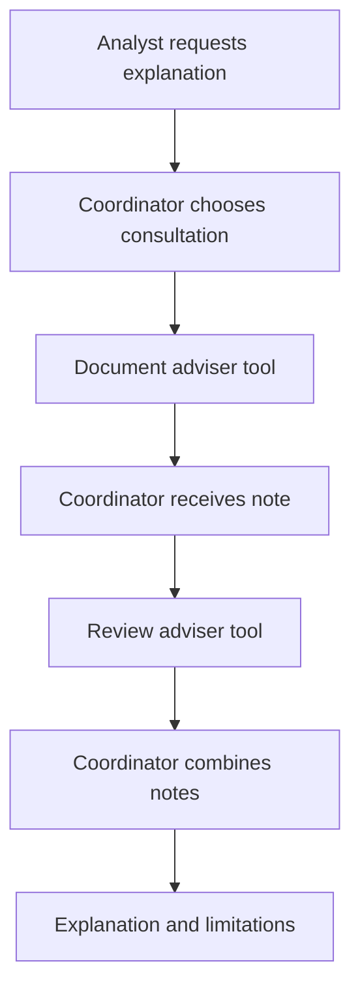

# Module 19: Collaborative Teams: Calls, Returns and Handoffs

## Before you begin: what this module teaches

**ADK concept: collaboration, delegation and conversation ownership.**

Google’s **Agent Development Kit (ADK)** supports more than one collaboration pattern. `AgentTool` lets a coordinator obtain a specialist result and continue. A hierarchy built with `sub_agents` supports delegation, where the specialist’s mode affects how the interaction proceeds. You will compare `chat`, `task` and `single_turn` rather than treating every agent interaction as the same kind of call.

The guiding question is: **who is responsible for the next response?** A short advisory result, a delegated task and a continuing specialist conversation create different user experiences. You will inspect the actual capability calls and responding agent, then relate those observations to the selected pattern. A role diagram alone cannot establish conversation ownership.

**Where you would use this in real work.**

Meera asks for one explanation combining document advice and the reminder that a human owns the credit decision. In that situation, the coordinator should gather advisory results and combine them. If Meera instead needs a continuing discussion about the checklist, specialist-led conversation may be appropriate.

The advisers in this exercise explain their topics; they do not verify document receipt or retrieve real lending policy. You will preserve those limits when combining their output. If one adviser fails, a polished answer must not conceal that the requested advice is incomplete.

**Connection to Gemini Enterprise Agent Platform and Google Cloud.**

Gemini provides the language reasoning used by the cooperating agents. ADK supplies their composition and delegation behaviour. These agents can share one application hosted on Gemini Enterprise Agent Platform Agent Runtime; separate reasoning roles do not automatically require separate deployments.

The live Gemini path is where you evaluate whether the chosen interaction is useful to the analyst. Scripted local checks first establish the mechanics of tool return and handoff. Module 21 introduces the additional network and identity responsibilities when a specialist is actually operated as a separate service.

**By the end, you should be able to:**

- **Choose the interaction:** match short consultation, delegated work or continuing conversation to the analyst’s need.
- **Build both forms:** identify the AgentTool wiring and the parent/child wiring used for delegation.
- **Trace ownership:** show which agent receives the specialist result and which agent answers next.
- **Evaluate completeness:** check that combined advice retains limitations and exposes missing specialist input.
- **Transfer the pattern:** justify whether another banking assistant needs one coordinator, multiple advisers or a direct specialist conversation.

**How this moves the story forward.** Useful collaboration can still produce a draft that needs correction. Module 20 introduces feedback, repeated attempts and a clear stopping rule.

Read the detailed customer task below, then follow the [guided lab](./lab.md). Build one checkpoint at a time and compare your explanation with the observed result.

[Previous module](../module18-dynamic-orchestration/README.md) · [Lab](./lab.md) · [Solution](./lab-solution.md) · [Enterprise playbook](./enterprise-playbook.md) · [Next module](../module20-cyclic-workflows/README.md)

## The banking story

Modules 16–18 controlled required work in code. This module introduces flexible advisory consultation. Module 20 will bound attempts when a generated memo needs revision.

Sovereign Horizon Bank and Acme Robotics are fictional teaching organizations. We follow the same commercial-review case, **CASE-001**, through the sequence. Monetary thresholds are teaching fixtures, not lending policy.

## Customer problem statement

### Read this as a bank employee's task

An analyst needs a single explanation covering both document requirements and how the review process works. One specialist can explain documents; another can explain the review process. The analyst should not have to combine their replies manually.

In this course, an analyst is the employee who gathers and checks information for a review. Picture a business banking team preparing for a company meeting. The bank, company and records are fictional.

> Use the relevant specialists to help explain how to prepare this case. Give me one answer, and keep any statements about what the specialists cannot verify.

| What you need to understand first | This exercise's answer |
|---|---|
| What information starts the task? | A question about preparing the fictional case. |
| What should the employee receive? | A coordinator response that combines the consulted specialists’ advice and preserves their limitations. |
| What should happen when it cannot be completed? | If a required consultation is missing, record that as a behaviour failure or choose a workflow that forces the consultation. |

### New words, explained using this task

| Term | Meaning here |
|---|---|
| Call-and-return | Ask a specialist for a result, then continue answering as the caller. |
| Handoff | Let another agent become responsible for the conversation. |
| Output schema | The named fields an agent’s result is expected to contain; it does not prove the facts are correct. |

The next technical table connects these requirements to ADK objects and checks. Read one row at a time: the employee's need comes first, then the coding choice, then the result that would show it works.

## Match each customer requirement to code and a check

| Customer requirement | Implementation choice | Acceptance check |
| --- | --- | --- |
| Coordinator combines advisory results | Two AgentTool capabilities | Each consulted specialist returns to the coordinator. |
| Make limitations explicit | AdvisoryNote output_schema | Every specialist result has summary and limitation fields. |
| Do not imply required collection is guaranteed | Evaluate tool selection; use static workflow for mandatory checks | Missing consultations are visible as an evaluation failure. |
| Distinguish dialogue ownership | Separate single_turn sub-agent example | Learners can explain why this differs from tools=[...]. |

**Result of this module:** A local coordinator has two AgentTools with structured advisory outputs. A separate factory demonstrates a single-turn delegation team.

## Work through the concept as a customer problem

### A quick internal call and a transferred customer call are different

Imagine Meera phones the document desk while the relationship manager waits. She gets an explanation, ends the internal call and answers the manager herself. Now imagine she introduces the manager directly to the document expert for a longer discussion. Both involve a specialist, but the next speaker and the conversation history differ.

That difference is the central design question: **who owns the next response?** A team diagram with three boxes cannot answer it. You must select the ADK interaction contract and then observe its events.

### Map the customer's conversation to the supported contract

| Customer need | ADK configuration | What to observe |
|---|---|---|
| “Get advice and give me one combined answer.” | `AgentTool` objects in the coordinator's `tools` | Specialist tool result followed by coordinator work. |
| “Delegate one bounded explanation.” | Local child in `sub_agents`, `mode="single_turn"` | Child task result and return to its caller. |
| “Let me continue talking to that specialist.” | Appropriate local `chat` delegation | Active responding agent across successive user turns. |
| “Let the specialist ask questions until this task is finished.” | Appropriate local `task` delegation | Clarification turns, task completion and subsequent ownership. |

`tools=[...]` is a list of callable capabilities. `sub_agents=[...]` defines a parent/child relationship. They are not interchangeable lists, and neither means “run every member in order.” This module supplies separate builders so you can compare the mechanics without changing several things at once.

### A structured answer is a form with labelled boxes

In an Indian branch, an internal note might have two boxes: “advice” and “what was not checked.” Our `AdvisoryNote` has `summary` and `limitation` string fields. Pydantic bounds their lengths. The schema helps software locate the limitation without guessing which sentence contains it.

For example, `{"summary": "The ownership register identifies owners.", "limitation": "Receipt has not been verified."}` has the right shape. If a specialist instead writes an invented receipt claim in `summary`, matching the schema will not make that claim true. The coordinator must preserve limitations, and evaluation must inspect factual support.

The two specialist calls in the diagram are one possible execution, not a schedule enforced by the graph. “Consult both” in an instruction is behavior to evaluate. If collection is mandatory, use Module 16's explicit dependencies and then let an agent explain the collected findings.

### Three reviews before accepting the design

- **Beginner:** follow one function-call event, its result and the next responding author. Repeat with delegation. Use one continuing session for follow-up questions; a fresh session cannot demonstrate ownership across turns.
- **Experienced engineer:** make two structurally valid advisers disagree. Specify which evidence wins, when the coordinator must show uncertainty, and what happens when one adviser is unavailable. AgentTool is not a guaranteed context-isolation boundary.
- **Bank FDE:** ask “Should the analyst hear one synthesized answer or converse directly with the specialist?” Then ask whether the specialist is a separately operated service. Local role separation alone does not require A2A, a separate deployment or a new IAM principal.

**Carry forward:** once the analyst has a draft, [Module 20](../module20-cyclic-workflows/README.md) shows how to request corrections with a budget and a stopping rule.

## Follow the execution

The diagram shows one successful consultation sequence, not an enforced order. The coordinator’s model may choose a different order or omit a call. If both checks are mandatory business prerequisites, use Module 16’s static graph instead.

## Call-and-return and handoff solve different problems

With `AgentTool`, an agent is exposed through a tool interface. The caller receives the result and can continue. This works with local agents as well as remote agents; it is not exclusively an A2A feature. A narrow output schema makes the return value easier to inspect, but does not guarantee its truth.

With `sub_agents`, a parent establishes delegation relationships. A local child’s mode affects the interaction:

| Local mode | Intended interaction | Appropriate bank example |
|---|---|---|
| `chat` | Specialist can own the conversation and use allowed transfers | Analyst talks directly to a document-support specialist |
| `single_turn` | Specialist completes a task without a user dialogue, then returns | One advisory explanation |
| `task` | Specialist can talk with the user while pursuing a task, then signal completion | Collecting clarifications over several turns |

A chat handoff is not inherently permanent or one-way. Local transfer behavior depends on hierarchy and transfer configuration. Conversely, you should not assume every remote endpoint can transfer back into the caller’s local agent tree.

## Remote modes are a separate contract

In the verified ADK version, `RemoteA2aAgent.mode` accepts `task` or `None`, not the entire local-mode vocabulary. Its task-completion path requires the compatible remote finish-task signal and matching output schema for correct unwrapping. Module 21 starts with a simpler request/response specialist. Do not copy local mode configuration onto an arbitrary A2A peer.

## Shared process does not mean isolated security

Narrow tools reduce available operations. They do not establish separate IAM principals, guaranteed context isolation or independent scaling. `AgentTool` can propagate state deltas; do not use it as a secret boundary. Inspect actual model requests and the versioned ADK contract when sensitive context must be restricted.

The two advisers here have no live retrieval tools. Their results describe the training checklist and review ownership. They cannot establish document receipt, current bank policy or a credit outcome.

## ADK execution model: Specialist results versus conversational delegation

AgentTool appears in tools and gives the caller a callable reasoning capability. sub_agents establishes a hierarchy used by delegation. Both can involve a specialist, but their configuration and conversation ownership differ. Construct fresh child instances for a new team rather than attaching one child object to competing parents.

A structured AdvisoryNote is a return contract: Pydantic fields specify summary and limitation. The schema makes the result easier to consume; it does not prove factual support. Follow the returned limitation into the coordinator's final response. A structurally valid note that drops uncertainty can still fail the banking requirement.

For a local single_turn child, the coordinator delegates a bounded task and can resume with its result. A chat transfer makes another agent the conversational responder. A task child can obtain clarification before finishing its task. To learn the last two, keep the same session for a follow-up message; starting a fresh CLI session discards the very continuity being demonstrated.

A useful trace records invocation, event author, function-call name, function response and final responder. Two final-looking text events are not sufficient evidence that control returned in the intended way. The coordinator may select a different consultation order, so do not encode an illustrative order as a mandatory workflow unless the customer requires it.

### Derive the code from the customer's words

One combined explanation suggests a coordinator receiving notes. A sustained conversation with an expert suggests delegation. Mandatory evidence collection belongs in deterministic scheduling even if the final explanation uses advisers.

### Predict, observe and explain

Use one continuing ADK Web session: request document help, ask a follow-up, then ask for another specialist. Record the responding author at each turn for chat and task modes; compare with an AgentTool return.

### Worked design discussion for experienced learners

Supply a valid structured note with an unsupported assertion. Design a quality criterion that rejects it despite schema success.

Before accepting a solution, identify its input owner, exact ADK boundary, output consumer and failure evidence. Read the function comments in the lab alongside the corresponding source; comments explain design intent, while the executed events establish behavior.

## Learn this concept from first principles

You know function tools from Module 14 and scheduling from Modules 16–18. Now compare model-selected consultation with explicit dialogue delegation; both involve agents, but their control contracts differ.

### Separate three control contracts

With explicit `AgentTool`, you place a wrapper in `tools`. The caller asks for that capability and receives the result. With a `single_turn` child in `sub_agents`, ADK exposes a named delegation capability and returns control after the task. These both support returning to the coordinator, though their configuration and runtime paths differ. Do not teach single-turn delegation as a permanent chat transfer.

With a `chat` child, `transfer_to_agent` changes the active conversational agent. The tested specialist answers the current turn; permitted future transfers depend on the hierarchy and configuration. With `task`, the specialist can obtain user clarification while working toward completion. A single CLI invocation is not enough to demonstrate that multi-turn interaction; use the lab's ADK Web exercise with one continuing session.

### Read a structured specialist result as data

An illustrative note is `{"summary": "An ownership register identifies the ownership structure.", "limitation": "I cannot verify receipt."}`. `AdvisoryNote` requires both string fields and bounds their maximum lengths. The current schema does not enforce nonempty text or factual support. The coordinator must preserve the limitation, and evaluation must check that it did.

The variable named `policy` holds the review-process adviser, not a policy database. No policy retrieval capability exists in this example. An expert learner should notice that distinction before assuming the output reflects current credit policy.

### Choose control based on the customer's guarantee

“Consult advisers where useful” permits model-selected calls. “Always fetch two required records before routing” requires deterministic scheduling. Use Module 16 for the latter, and place a reasoning agent after verified collection if the analyst needs an explanation. Neither an extra model nor an output schema makes the facts authoritative.

### Trace one concrete request

| Step | Value or operation | Reasoning |
| --- | --- | --- |
| Analyst request | “Explain how to prepare CASE-001.” | Advisory reasoning, not a compulsory evidence transaction. |
| First consultation | document_adviser(request=...) | The adviser returns summary and limitation fields. |
| Second consultation | review_adviser(request=...) | The order is illustrative; the prompt does not enforce scheduling. |
| Coordinator resumes | Receives both notes as tool results | It can combine the notes and their limitations. |
| Alternative single_turn path | checklist_specialist(request=...) | ADK supplies a named delegation capability for this child mode. |
| Alternative chat path | transfer_to_agent(agent_name="checklist_specialist") | The specialist becomes the responding agent in the tested turn. |

### Check your understanding

If the full explanation arrives without a review_adviser call, has the runtime violated its tool interface?

**Expected reasoning:** No. The interface executed the calls the model selected. The agent failed the behavioral consultation requirement; use evaluation or change the architecture if the consultation must be guaranteed.

### Foundation and advanced learning paths

**Foundation:** reproduce the trace above, explain the Python and ADK objects involved, and predict one changed input before running the lab. You should be able to identify which part is configuration and which part executes work.

**Advanced:** Replace optional consultation with compulsory collection in a design variant. Compare control guarantees, number of model calls, error handling and evidence completeness. Explain when each design is appropriate.

### Google service choice for this lesson

ADK supplies AgentTool and delegation modes; Gemini supplies reasoning. Current case facts would come from authorized Google-backed adapters. Agent Platform hosting, shared memory and service IAM are not automatically created by sub_agents.

The [banking FDE learning guide](../module15-intro-to-multi-agent-systems/fde-learning-guide.md) connects the customer discovery questions, Google service map and integration boundaries across the sequence. It distinguishes implemented examples from customer integration and deployment work.

## What you should be able to explain

- Translate the bank request into inputs, operations, outputs and failure outcomes.
- Point to the code that enforces each acceptance condition.
- Explain which facts are synthetic and which production services would own them.
- State what the local checks prove and what still needs a live integration or model evaluation.

## Verified baseline and limits

See the [course review and verification record](../module15-intro-to-multi-agent-systems/review-notes.md) for the cross-module checks and the evidence still required from a customer deployment.

Reviewed on **3 October 2026** against **google-adk 2.11.0** and its installed public APIs. Examples require Python 3.12+ and were exercised with **Python 3.14.7**. Python 3.14.8 is the current stable patch release; it was not the local test interpreter. Use the supplied lockfile for the verified dependency resolution, and repeat the checks before upgrading.

Sources: [ADK release](https://pypi.org/project/google-adk/2.11.0/) and [Python 3.14.8 release](https://www.python.org/downloads/release/python-3148/). “Current” is dated verification, not a promise that a dependency will never change.

3 offline tests passed, covering two explicit AgentTool calls, a single-turn delegation that returns to the coordinator, and a chat transfer whose specialist responds. All model replies are scripted fixtures. Live consultation quality remains unevaluated.

## Official sources

- [Collaborative workflows and modes](https://adk.dev/workflows/collaboration/)
- [Agent tools](https://adk.dev/tools-custom/function-tools/)
- [Remote A2A consumption](https://adk.dev/a2a/quickstart-consuming/)

## Continue the course story

Previous: [Module 18](../module18-dynamic-orchestration/README.md) · Next: [Module 20](../module20-cyclic-workflows/README.md) · [See how the concepts build](../learning-journey.md)

Before continuing, explain one input, one ADK execution boundary and one failure outcome from this module. Use the next chapter to add a new customer requirement, not merely another component.

<!-- © 2026 Inder Chauhan (https://github.com/inderanz/google-adk-training). All rights reserved. -->
