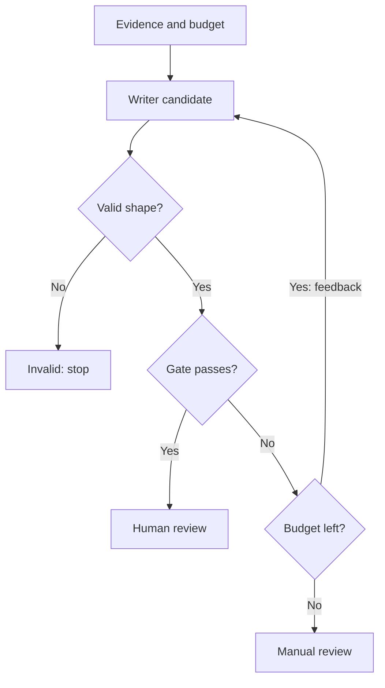

# Module 20: Cyclic Workflows: Bounded Memo Revision

## Before you begin: what this module teaches

**ADK concept: bounded revision loops and stopping conditions.**

An agent may need to revise an answer after a check finds a defect. In Google’s **Agent Development Kit (ADK)**, you can express that process as repeated child work inside a workflow. This lesson uses a dynamic node, a memo schema and a Python checker, while discussing the related loop workflow choices.

The cycle is visible: produce a candidate, validate its shape, check the required evidence references, return specific feedback, and either try again or finish. An attempt limit makes the stopping behaviour explicit. The model supplies a candidate; the application decides whether the candidate meets the particular checks implemented here. Correct structure and citations still leave factual quality to be evaluated.

**Where you would use this in real work.**

Meera wants a short memo supported by two supplied evidence references. The first draft might mention only one reference. She should not have to keep asking “please try again” without knowing whether the assistant is making progress.

The exercise makes the first fixture draft incomplete, then shows feedback reaching the next attempt. A satisfactory candidate is prepared for human review. If the attempt budget is exhausted, the result says manual review is needed. Neither result authorizes a loan.

**Connection to Gemini Enterprise Agent Platform and Google Cloud.**

The live writer uses Gemini through the configured enterprise backend; ADK schedules the work, and Python checks the memo contract and bounds the attempts. You first use a deterministic writer so you can predict the cycle and see exactly why a revision occurs.

When the application is hosted on Gemini Enterprise Agent Platform Agent Runtime, the attempt budget remains application logic. Model-call limits, workflow deadlines and service timeouts address different limits. The lesson introduces those distinctions so repeated generation does not become unlimited work merely because it runs on a managed platform.

**By the end, you should be able to:**

- **Describe one cycle:** follow the candidate, validation result, defect list and feedback into the next attempt.
- **Build a stopping rule:** distinguish an accepted memo, invalid output and an exhausted attempt budget.
- **Observe improvement:** explain why the supplied first draft fails and the revised fixture passes its citation check.
- **Evaluate the right claim:** separate reference presence from actual factual support in a live Gemini draft.
- **Transfer the pattern:** define a bounded correction process for another generated banking document.

**How this moves the story forward.** The application can now coordinate and revise local work. Module 21 changes the ownership boundary by calling a capability run by another team.

Read the detailed customer task below, then follow the [guided lab](./lab.md). Build one checkpoint at a time and compare your explanation with the observed result.

[Previous module](../module19-collaborative-teams/README.md) · [Lab](./lab.md) · [Solution](./lab-solution.md) · [Enterprise playbook](./enterprise-playbook.md) · [Next module](../module21-distributed-graphs/README.md)

## The banking story

Module 19 composed advisory results. This module bounds revision of an evidence memo. Module 21 moves one specialist behind a real protocol boundary.

Sovereign Horizon Bank and Acme Robotics are fictional teaching organizations. We follow the same commercial-review case, **CASE-001**, through the sequence. Monetary thresholds are teaching fixtures, not lending policy.

## Customer problem statement

### Read this as a bank employee's task

The analyst wants a short review note using two supplied records. A first draft might omit one record reference. The application should allow a few corrections, but should not continue forever.

In this course, an analyst is the employee who gathers and checks information for a review. Picture a business banking team preparing for a company meeting. The bank, company and records are fictional.

> Draft a note for this case and include both record references. Allow at most three drafts. If it still fails the checks, tell me that manual review is needed.

| What you need to understand first | This exercise's answer |
|---|---|
| What information starts the task? | The case ID, two evidence records and any feedback from the previous attempt. |
| What should the employee receive? | A note that passed the taught case-ID and citation checks, ready for a human to review. |
| What should happen when it cannot be completed? | An invalid draft or an exhausted attempt limit must not be labelled successful. |

### New words, explained using this task

| Term | Meaning here |
|---|---|
| Iteration | One pass through repeated work, such as one draft and its check. |
| Stopping rule | The exact condition that ends the repetition. |
| Citation | A reference identifying the record used; its presence alone does not prove the sentence is supported. |

The next technical table connects these requirements to ADK objects and checks. Read one row at a time: the employee's need comes first, then the coding choice, then the result that would show it works.

## Match each customer requirement to code and a check

| Customer requirement | Implementation choice | Acceptance check |
| --- | --- | --- |
| Bound attempts | range(1, 4) | No fourth writer attempt occurs. |
| Validate the writer contract | Memo.model_validate | Malformed output produces invalid_model_output. |
| Check supplied evidence identifiers | Deterministic defects function | Wrong case IDs and missing/extra citation IDs fail the gate. |
| Be honest at exhaustion | needs_manual_review without an accepted memo | A failing third draft is not labeled successful. |
| Keep human ownership | ready_for_human_review status | Passing structural checks never means credit approval. |

**Result of this module:** A dynamic node calls a writer, validates its structured output and checks citations. It stops after acceptance or three attempts. A live Gemini writer is optional.

## Work through the concept as a customer problem

### A senior analyst returns a draft with specific corrections

At Meera's branch, a senior analyst returns a memo: “You included the checklist reference, but not the company-profile reference. Add the missing evidence identifier.” The analyst does not say “keep trying forever.” The team agrees on at most three drafts, after which a person must resolve the problem.

A **loop** repeats work. **Feedback** tells the next attempt what was wrong. An **exit condition** determines when repetition stops. A **budget** limits attempts, time or resources. These four concepts belong together: repeating an LLM call without a clear exit and budget is not a complete process design.

### The writer proposes; the orchestrator checks and counts

The outer `build_agent(writer=None)` selects a writer. A **fixture** is a controlled substitute: here it intentionally omits one citation on its first attempt so you can see correction happen. The optional live writer is an ADK `Agent` using Gemini. The inner `revise` function remembers the selected writer through a Python **closure**—a function retaining access to a variable from its enclosing function.

`for attempt in range(1, 4)` produces 1, 2 and 3. Each iteration constructs a new payload with evidence and previous defects, then awaits the writer through `ctx.run_node`. Validation first asks whether the returned value fits `Memo`; the `defects` function then checks case identity and citation identifiers. These are two different questions.

| Candidate | Structural validation | Citation/case check | Outcome |
|---|---|---|---|
| An unrelated dictionary | Fails | Not evaluated | `invalid_model_output`; stop. |
| Valid memo missing one required identifier | Passes | Fails | Give defects to another attempt, if budget remains. |
| Valid memo with matching case and required identifier set | Passes | Passes | `ready_for_human_review`; stop. |
| Three valid but unacceptable candidates | Passes each time | Never passes | `needs_manual_review`; no accepted memo. |

The gate compares **sets**, so order and duplicate occurrences do not affect identifier membership. It does not prove that the prose accurately represents either source. A lender must not interpret `ready_for_human_review` as approval or as completed semantic evaluation.

### Correction is not the same as retrying a failed request

A revision changes the next writer input by adding feedback. A transport retry may repeat the same service request after a transient failure. A model tool-repair loop may ask the model to correct bad arguments. These mechanisms have different limits and risks. Three drafts are not necessarily three HTTP attempts; service retries may happen inside each draft attempt.

### Three reviews before accepting the design

- **Beginner:** trace why the fixture needs two drafts. Find the `return` inside the loop and the `return` after it; explain why only one becomes the final outcome.
- **Experienced engineer:** test an always-defective writer separately from a malformed-output writer. Design elapsed-time and total-call limits, and decide how evidence versions behave if a run resumes later.
- **Bank FDE:** ask what counts as an acceptable memo, who reviews it and which faults should trigger immediate escalation. Turn “good quality” into sample passing/failing memos and a business-owned rubric, then evaluate prose separately in Module 24.

**Carry forward:** [Module 21](../module21-distributed-graphs/README.md) adds another failure boundary: the specialist may be owned by a different team and run across a network.

## Follow the execution

<!-- TEACHER_NOTE_START -->
**Teacher's note (ADK instructor view):**
- **Learning goal:** Explain the concept clearly from beginner to advanced, with a simple mental model first.
- **Why it matters:** Connect the concept to real Google agentic workflows, Python engineering habits, and production-ready decisions.
- **Version watch:** Validate against the latest official ADK / Google docs before teaching; call out deprecations or migration notes when needed.
- **Module linkage:** Connect this idea to the previous and next modules so learners see the progression across the course.
<!-- TEACHER_NOTE_END -->

The diagram shows revision of schema-valid drafts. A malformed writer response exits immediately with `invalid_model_output`; it does not take another revision pass.

## A loop needs a business stopping rule

“Keep improving until good” is not an executable requirement. This lab defines what is checked, the maximum number of drafts and the failure result. The model may write prose; Python counts attempts and decides whether the exact gate passed.

`range(1, 4)` produces 1, 2 and 3: Python excludes the upper bound. Each iteration sends the case, evidence, attempt number and previous defects to the writer. A successful check returns immediately. Falling out of the loop produces manual review.

## What the gate proves—and what it does not

The deterministic gate checks the case ID and the set of citation identifiers. It does not establish that the prose is factually supported, complete, safe or suitable for a credit decision. A memo can name both sources and still misrepresent them. Human review and model evaluation remain necessary.

The input evidence is fictional. One fixture identifies the checklist status; the other identifies Acme Robotics as a fictional borrower. `fixture_writer` intentionally omits a citation on the first pass, then includes both. This creates an observable correction without Gemini access. `live_writer()` substitutes an ADK Agent with a `Memo` output schema at the same orchestration boundary.

## Supported loop representations

ADK supports `LoopAgent`, graph cycles with conditional routes, and Python loops inside dynamic nodes. None is universally superior. This lab uses a Python loop because the attempt budget and feedback payload are easy to read. A literal graph cycle must have a conditional exit; an unbounded unconditional cycle is not the intended pattern.

Store consequential progress through ADK events and a persistent session service, rather than mutating a nested `ctx.session.state` list and assuming persistence. The local history here is returned in the final output. It is not a durable cross-process job record or a banking audit ledger.

## ADK execution model: A revision loop has several independent budgets

The orchestrator owns the attempt counter; the writer owns only a candidate memo. selected_writer is captured by the inner function's closure, allowing a fixture or an ADK Agent at the same child boundary. Each iteration builds a new payload containing evidence, attempt and previous defects.

The awaited child returns a value. Memo.model_validate checks its shape; defects checks case identity and citation membership. These are distinct gates. return inside the loop exits the entire function on acceptance. The return after the loop reports exhaustion. A malformed returned candidate has its own invalid-output branch; an exception before a candidate returns may instead fail the invocation.

The iteration budget is three candidate drafts, not necessarily three HTTP requests. Provider retries, elapsed time and token usage are separate budgets. A structural gate can accept misleading prose with correct citation IDs, which is why semantic evaluation is still required.

LoopAgent repeats its configured sub-agents with its native iteration/exit controls. Graph cycles express recurrence through edges and routes. The dynamic Python loop is appropriate here because the feedback payload and attempt history are explicit. Choosing it does not make ADK's other supported representations obsolete.

### Derive the code from the customer's words

“Up to three” becomes range(1, 4). “Identify this case” becomes an equality check. “Cite both records” becomes a set comparison. “Return for manual review” becomes an explicit exhaustion status, never reuse of the last failed draft as accepted.

### Predict, observe and explain

Write the attempt/defects table before running the fixture. Then compare a writer that always omits one citation and a writer that returns malformed data: the exit statuses should explain different failures.

### Worked design discussion for experienced learners

Design a semantic gate for contradicted evidence. Decide whether its failure consumes a revision attempt and how the bank reviews disagreement between structural and semantic checks.

Before accepting a solution, identify its input owner, exact ADK boundary, output consumer and failure evidence. Read the function comments in the lab alongside the corresponding source; comments explain design intent, while the executed events establish behavior.

## Learn this concept from first principles

Module 18 taught awaited child execution. A bounded Python loop now repeats that child call with feedback. The stopping rule belongs to code; the writer supplies a candidate.

### Count drafts rather than saying “retry until good”

`range(1, 4)` produces 1, 2 and 3. Every pass builds a fresh payload and awaits the selected writer. `return` inside the loop ends the entire orchestrator function; reaching the return after the loop means no pass succeeded. Those two return locations encode distinct business outcomes.

`Memo.model_validate(raw)` checks structure before the gate reads fields. `defects()` then checks the case ID and citation membership. A validation exception raised by this explicit validation is handled as invalid output. A provider or ADK failure that occurs before a writer returns can instead fail the invocation; do not describe every failure as a rejected memo.

The orchestrator's inner function remembers the `selected_writer` chosen by its outer factory. Python calls this a closure. It lets the same loop invoke the deterministic fixture, a deliberately failing test writer or a Gemini Agent without rebuilding the orchestration framework.

### Understand the limits of self-correction

The gate can reject missing identifiers with certainty. It cannot prove that the prose faithfully represents those sources. Two models can agree on a wrong statement, and correct citations can accompany an unsupported conclusion. Use evidence-based model evaluation and the bank's review process for semantic correctness.

Three drafts are not necessarily three provider HTTP requests: each model call may have its own retry behavior. Track iteration count, total model calls, elapsed time and token cost separately. Define which evidence version a resumed run is allowed to use.

### Trace one concrete request

| Step | Value or operation | Reasoning |
| --- | --- | --- |
| Attempt 1 | fixture_writer returns only checklist-v1 | Memo shape is valid but a citation is missing. |
| Deterministic gate | defects contains “Cite exactly checklist-v1 and profile-v1.” | The feedback is explicit data for the next attempt. |
| Attempt 2 | Both evidence IDs are returned | The ID set now matches the required set. |
| Success path | ready_for_human_review with memo and two history entries | It passes the taught structural gate, not a lending decision. |
| Exhaustion alternative | Always-incomplete writer fails three times | needs_manual_review has no accepted memo. |
| Invalid alternative | Writer returns an unrelated mapping | invalid_model_output exits instead of using malformed data. |

### Check your understanding

Can a memo with both required citation IDs still be wrong?

**Expected reasoning:** Yes. The deterministic check proves membership and case alignment, not whether the prose is supported. That is a separate evaluation and human-review responsibility.

### Foundation and advanced learning paths

**Foundation:** reproduce the trace above, explain the Python and ADK objects involved, and predict one changed input before running the lab. You should be able to identify which part is configuration and which part executes work.

**Advanced:** Add a semantic evaluation rubric for contradicted evidence and misleading citations. Keep it separate from the exact gate, and justify whether a failing semantic check should trigger revision, human review or rejection.

### Google service choice for this lesson

ADK runs the bounded workflow, and the optional Gemini Agent drafts text. Durable Sessions can preserve conversation events; they do not provide a transaction that reverses an externally published memo.

The [banking FDE learning guide](../module15-intro-to-multi-agent-systems/fde-learning-guide.md) connects the customer discovery questions, Google service map and integration boundaries across the sequence. It distinguishes implemented examples from customer integration and deployment work.

## What you should be able to explain

- Translate the bank request into inputs, operations, outputs and failure outcomes.
- Point to the code that enforces each acceptance condition.
- Explain which facts are synthetic and which production services would own them.
- State what the local checks prove and what still needs a live integration or model evaluation.

## Verified baseline and limits

See the [course review and verification record](../module15-intro-to-multi-agent-systems/review-notes.md) for the cross-module checks and the evidence still required from a customer deployment.

Reviewed on **3 October 2026** against **google-adk 2.11.0** and its installed public APIs. Examples require Python 3.12+ and were exercised with **Python 3.14.7**. Python 3.14.8 is the current stable patch release; it was not the local test interpreter. Use the supplied lockfile for the verified dependency resolution, and repeat the checks before upgrading.

Sources: [ADK release](https://pypi.org/project/google-adk/2.11.0/) and [Python 3.14.8 release](https://www.python.org/downloads/release/python-3148/). “Current” is dated verification, not a promise that a dependency will never change.

5 offline tests passed, including successful revision, three-attempt exhaustion and malformed output. The optional Gemini writer and semantic memo quality have not been evaluated live.

## Official sources

- [Dynamic workflows](https://adk.dev/graphs/dynamic/)
- [Graph cycles and routes](https://adk.dev/graphs/routes/)
- [ADK evaluation criteria](https://adk.dev/evaluate/criteria/)

## Continue the course story

Previous: [Module 19](../module19-collaborative-teams/README.md) · Next: [Module 21](../module21-distributed-graphs/README.md) · [See how the concepts build](../learning-journey.md)

Before continuing, explain one input, one ADK execution boundary and one failure outcome from this module. Use the next chapter to add a new customer requirement, not merely another component.

<!-- © 2026 Inder Chauhan (https://github.com/inderanz/google-adk-training). All rights reserved. -->
---

## Official References

- Google ADK docs (latest): https://google.github.io/adk-docs/
- Google AI / Gemini docs: https://ai.google.dev/
- Google GenAI Python SDK reference: https://googleapis.github.io/python-genai/
- Context7 / current SDK lookup for the exact installed version and API signatures
- Related module path: review the surrounding modules for continuity, prerequisites, and follow-on concepts

