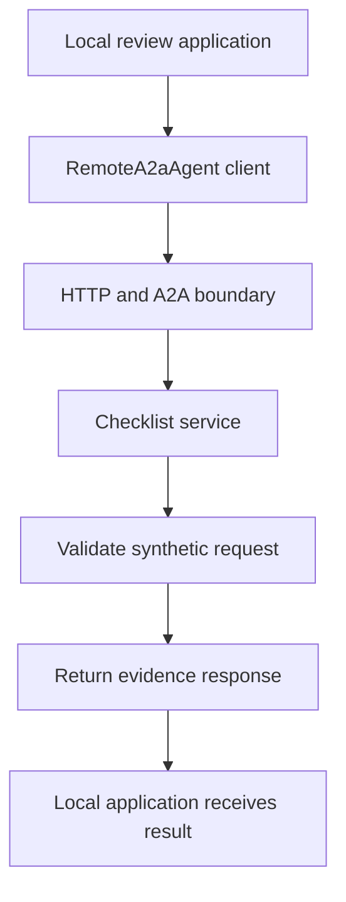

# Module 21: Distributed Graphs: A2A Service Boundaries

## Before you begin: what this module teaches

**ADK concept: remote agents and the A2A protocol.**

An agent running inside your application can be called through local code. A capability owned by another team needs an agreed network interface. Google’s **Agent Development Kit (ADK)** provides `to_a2a` to expose an agent and `RemoteA2aAgent` to call a remote one using the **Agent-to-Agent (A2A)** protocol.

You will follow discovery through an **agent card**, a description of capabilities and connection details, and then follow a request and response across two processes. The card is not an access credential. The protocol connects applications, while each service still needs its own rules for allowed inputs, authorization, timeouts and returned data.

**Where you would use this in real work.**

The document-operations team now owns the checklist capability used by Meera’s review assistant. They need to release changes independently. Copying their implementation into the assistant would make the two teams coordinate code changes whenever that implementation evolves.

The request becomes: “Ask the document team’s service for its result, and tell me when it cannot be reached.” You will run a server and client separately on your computer, inspect discovery and observe an actual protocol response. You will then stop the service and distinguish that failure from a completed check.

**Connection to Gemini Enterprise Agent Platform and Google Cloud.**

A customer version needs an authenticated Google Cloud hosting arrangement for the service and credentials for its caller. The ADK application may participate in the Gemini Enterprise Agent Platform architecture, but the supplied exercise deliberately establishes the protocol using a local endpoint first.

ADK’s A2A adapter is experimental in the reviewed release. The A2A protocol and its SDK are separate from that adapter’s maturity. The playbook explains the additional decisions around hosted endpoints, trusted user scope and durable task recovery; a successful local round trip does not complete those decisions.

**By the end, you should be able to:**

- **Explain the boundary:** distinguish another local agent object from a separately operated agent service.
- **Build discovery and invocation:** expose the small workflow, inspect its card and call it through RemoteA2aAgent.
- **Observe a real exchange:** identify the request and deterministic response across separate local processes.
- **Handle unavailability:** show that an unreachable endpoint cannot become an all-clear checklist result.
- **Transfer the pattern:** specify endpoint ownership, authentication, payload limits and recovery requirements for a bank-owned remote capability.

**How this moves the story forward.** You now have several possible designs. Module 21.5 asks you to defend which ones the bank actually needs, instead of combining every pattern by default.

Read the detailed customer task below, then follow the [guided lab](./lab.md). Build one checkpoint at a time and compare your explanation with the observed result.

[Previous module](../module20-cyclic-workflows/README.md) · [Lab](./lab.md) · [Solution](./lab-solution.md) · [Enterprise playbook](./enterprise-playbook.md) · [Next module](../module21_5-mas-knowledge-milestone/README.md)

## The banking story

Module 20 bounded local iterative work. This module introduces a remote ownership boundary. Module 21.5 asks you to justify the simplest architecture for the complete case.

Sovereign Horizon Bank and Acme Robotics are fictional teaching organizations. We follow the same commercial-review case, **CASE-001**, through the sequence. Monetary thresholds are teaching fixtures, not lending policy.

## Customer problem statement

### Read this as a bank employee's task

A separate document-operations team runs the checklist service. That team needs to update its service independently. The review assistant should call the service instead of keeping a copy of the team’s implementation.

In this course, an analyst is the employee who gathers and checks information for a review. Picture a business banking team preparing for a company meeting. The bank, company and records are fictional.

> Let our assistant ask the document team for the checklist result. If their service cannot be reached, tell the analyst that the check could not be completed.

| What you need to understand first | This exercise's answer |
|---|---|
| What information starts the task? | A small request for the remote checklist capability. |
| What should the employee receive? | A response from the separate service that the local application can inspect. |
| What should happen when it cannot be completed? | A timeout or an unreachable service must not be reported as a completed check. |

### New words, explained using this task

| Term | Meaning here |
|---|---|
| A2A | Agent-to-Agent: a protocol for applications to communicate with agent services. |
| Agent card | A description of a service’s capabilities and connection details; it is not an access credential. |
| Remote | Running in another process or service, reached across a network. |

The next technical table connects these requirements to ADK objects and checks. Read one row at a time: the employee's need comes first, then the coding choice, then the result that would show it works.

## Match each customer requirement to code and a check

| Customer requirement | Implementation choice | Acceptance check |
| --- | --- | --- |
| Separate deployable ownership | Server and client are separate processes | The client depends on the endpoint contract, not a Python function import. |
| Advertise capabilities | ADK to_a2a creates the agent-card surface | The client resolves the fixed card URL. |
| Minimize transmitted data | Fresh local session containing only the synthetic snapshot | No existing banking conversation is attached. |
| Bound network work | Remote timeout and outer invocation deadline | Unavailable service does not become a successful check. |
| Make production identity explicit | Authenticated service endpoint and verified caller context | The loopback demo is not presented as production authentication. |

**Result of this module:** A loopback-only A2A server exposes a deterministic checklist workflow. A RemoteA2aAgent client discovers its card and submits a synthetic request.

## Work through the concept as a customer problem

### The specialist moves from the branch to a regional centre

Until now, Meera's “desks” have represented components in one application. Suppose the bank's regional document team owns a specialist used by many branches. It has its own release schedule and operating team. Meera now sends a request to another service rather than calling a colleague within the same process.

This justifies **distribution**: independently operated components communicate over a network. It adds timeouts, authentication, compatibility and uncertain outcomes. Use it for an ownership or deployment requirement, not merely to make a diagram look more advanced.

### Four terms at the A2A boundary

| Term | Everyday analogy | Technical responsibility |
|---|---|---|
| Agent Card | Regional team's service directory entry | Advertises capabilities and connection details. It is not proof that the service is trustworthy. |
| Endpoint | The address used to contact the team | Must come from approved configuration, not a URL invented by the model. |
| Protocol | The agreed request/reply format | A2A defines communication between agent applications. |
| Adapter | An interpreter at Meera's desk | `RemoteA2aAgent` presents the remote interaction to ADK. |

The example's card address is `http://127.0.0.1:8001/.well-known/agent-card.json`. `127.0.0.1` means this computer. It deliberately teaches the network boundary locally; it is not a deployed Google service or an authenticated bank endpoint. The server and client are separate running processes.

### Do not merge three different identities

The caller's service identity answers “which application connected?” The analyst's verified identity answers “which person is this application acting for?” The case ID answers “which business record is requested?” Knowing one does not establish the other two. The receiving service must authorize the operation using its agreed identity contract.

Likewise, the caller's ADK session ID and a remote task/context identifier serve different systems. Do not assume A2A automatically copies the local session database, user permissions or memory to the remote service. Send the minimum agreed payload and inspect the response contract.

### Three reviews before accepting the design

- **Beginner:** start the server, then the client; explain why reversing that order can fail. Trace discovery, request and response. Point out that the local `RemoteA2aAgent` object is an adapter, not the remote worker itself.
- **Experienced engineer:** distinguish discovery failure, authentication failure, an unsupported request, timeout and a remote task failure. A timeout after a write does not prove that the write never happened; a later write-capable design needs reconciliation and destination-enforced idempotency.
- **Bank FDE:** ask whether separate ownership truly requires a service boundary. Specify service authentication, analyst delegation, case authorization, deadlines and version compatibility. Cloud Run or Agent Runtime hosting is a separate decision; a valid Agent Card does not make either integration secure by itself.

**Carry forward:** [Module 21.5](../module21_5-mas-knowledge-milestone/README.md) asks you to defend which of these patterns the customer actually needs, including which complexity you should leave out.

## Follow the execution

<!-- TEACHER_NOTE_START -->
**Teacher's note (ADK instructor view):**
- **Learning goal:** Explain the concept clearly from beginner to advanced, with a simple mental model first.
- **Why it matters:** Connect the concept to real Google agentic workflows, Python engineering habits, and production-ready decisions.
- **Version watch:** Validate against the latest official ADK / Google docs before teaching; call out deprecations or migration notes when needed.
- **Module linkage:** Connect this idea to the previous and next modules so learners see the progression across the course.
<!-- TEACHER_NOTE_END -->

## A service boundary adds responsibilities

An in-process function call shares a Python runtime. A remote agent call serializes data, resolves an endpoint and crosses a network boundary. It can fail after the server starts work. The caller and server have separate sessions, task state, credentials and release cycles.

A2A is an interoperability protocol. It is not a shared-memory mechanism, an IAM system or a distributed transaction. An agent card advertises an interface and capabilities; it does not prove that an endpoint is trustworthy or that its result is true.

## Use the native adapter, understand its maturity

The example uses public `google.adk.a2a.agent.RemoteA2aAgent` and `google.adk.a2a.utils.agent_to_a2a.to_a2a`. The verified ADK 2.11.0 adapter emits an **experimental** warning. The A2A protocol and SDK are not thereby experimental. Pin and test the adapter/SDK combination; the lockfile records A2A SDK 1.2.1 for this example.

`use_legacy=False` selects the current ADK interoperability path; it is not an authentication switch. The old `google.adk.agents.remote_a2a_agent` module is a compatibility re-export, so new code here uses the A2A package’s public import.

## Read each kind of identity separately

| Identifier | Purpose | Not a substitute for |
|---|---|---|
| Local ADK session ID | Tracks the caller’s conversation | Remote task state |
| A2A task/context identifiers | Correlate remote work | A bank authorization decision |
| Service account identity | Authenticates one workload to another | End-user case entitlement |
| Verified analyst identity | Supports case-level access checks | A model-provided user name |
| Case ID and version | Identify the business record | A conversation or A2A task ID |

The demo accepts a synthetic snapshot to teach transport. In production, the remote service should authorize the caller and read authoritative checklist facts itself. Never accept `documents_complete=true` from a user as evidence of receipt.

## Control the payload, not just the prompt

The sample starts a fresh local session with one minimal request. When integrating the proxy into a larger conversation, inspect what ADK serializes and use the supported context-building configuration to send only the allowed task payload. An instruction telling a remote model to “ignore internal context” does not prevent disclosure. Agent-card and RPC destinations must be controlled and validated; never let the model choose arbitrary network URLs.

## ADK execution model: The native A2A adapter crosses an actual network boundary

to_a2a adapts an ADK agent/workflow into a protocol-serving ASGI application. Uvicorn runs that application. RemoteA2aAgent is a client-side proxy configured with the remote card location. The proxy is not the remote implementation and does not share its Python memory.

Discovery fetches a card describing the endpoint and capabilities. A request then travels to the advertised protocol endpoint; the server executes its own runtime and serializes a response. Inspect both the card origin and advertised destination. An allowed discovery URL must not silently authorize arbitrary RPC destinations.

Keep four identifiers distinct: the caller's ADK session, the local invocation, the remote context/task identifiers when present, and the bank case ID. Save them side by side when investigating a request; do not substitute one for another. An A2A task ID is not proof of case entitlement.

The loopback example proves protocol wiring without production authentication. A hosted implementation additionally authenticates workloads and enforces end-user case access. A timeout means the caller lacks a confirmed outcome; if the remote operation writes data, it may already have committed. Retry safety belongs to the destination's business operation.

### Derive the code from the customer's words

Independent ownership motivates a service interface. Reusing a Python function would not meet independent release requirements. Use the official adapter instead of hand-writing an A2A transport; keep business authorization in the remote capability.

### Predict, observe and explain

Run the server and client in separate terminals. Save the agent card and returned events. Stop the server and retry: distinguish discovery failure from a failure after work starts.

### Worked design discussion for experienced learners

Produce a correlation table from one actual request and design a response-loss scenario. Specify which operations are safe to retry and which require reconciliation.

Before accepting a solution, identify its input owner, exact ADK boundary, output consumer and failure evidence. Read the function comments in the lab alongside the corresponding source; comments explain design intent, while the executed events establish behavior.

## Learn this concept from first principles

Module 19 used local agent objects. Here the implementation belongs to another process; the caller has a proxy and a network contract rather than a Python reference to the server function.

### Read the two entry points separately

`bank_case.server:app` means import the Python module `bank_case.server` and retrieve its `app` object. Uvicorn serves that ASGI application. `to_a2a` adapts the native ADK workflow to the protocol; you do not need to implement JSON-RPC yourself.

The client imports `RemoteA2aAgent`, not `review_checklist`. Changing the remote implementation can leave the client unchanged if the service contract remains compatible. Conversely, changing a field or completion behavior can break the caller even though both Python projects still import successfully.

The public agent card is a description, not an authentication credential. Service identity, end-user entitlement and case identifiers have separate purposes. A local session ID is not a remote task ID or an idempotency key for a business mutation.

### Decide how much distribution is justified

The loopback service proves request/response interoperability with the pinned adapter, which ADK labels experimental. A customer service additionally needs authenticated ingress, allowlisted destinations, persistent task/session strategy, cancellation semantics and contract tests against the exact protocol versions.

If the server commits a business action but the reply is lost, the caller cannot infer rollback from a timeout. An advanced design needs destination-side idempotency and reconciliation. The sample avoids that problem by exposing only a deterministic read-only fixture.

### Trace one concrete request

| Step | Value or operation | Reasoning |
| --- | --- | --- |
| Construction | Build RemoteA2aAgent with a fixed card URL | No server request is required just to construct the proxy. |
| Discovery | Fetch the agent card from loopback | Check the advertised RPC destination as well as the card origin. |
| Request | Send a fresh synthetic CASE-001 snapshot | The sample does not forward an existing banking conversation. |
| Server execution | Validate input and run review_checklist | The remote process owns this function and its ADK workflow. |
| Response | CASE-001: checklist complete=False | This is the tested deterministic response, not a credit approval. |
| Failure | Server unavailable or invalid input | Absence of evidence must not become a successful check. |

### Check your understanding

Does a successful agent-card fetch prove that an analyst may read CASE-001?

**Expected reasoning:** No. Discovery and authorization are different operations. The production service must verify the caller and case entitlement before returning business facts.

### Foundation and advanced learning paths

**Foundation:** reproduce the trace above, explain the Python and ADK objects involved, and predict one changed input before running the lab. You should be able to identify which part is configuration and which part executes work.

**Advanced:** Write a versioned remote-response contract, destination allowlist and timeout/reconciliation policy. Explain how verified user identity reaches the remote case authorization layer without entering a model-visible prompt.

### Google service choice for this lesson

The local transport uses the official ADK A2A adapter. A deployed specialist may use supported Agent Runtime or Cloud Run hosting according to the deployment requirements. Loopback Uvicorn is neither managed hosting nor production authentication.

The [banking FDE learning guide](../module15-intro-to-multi-agent-systems/fde-learning-guide.md) connects the customer discovery questions, Google service map and integration boundaries across the sequence. It distinguishes implemented examples from customer integration and deployment work.

## What you should be able to explain

- Translate the bank request into inputs, operations, outputs and failure outcomes.
- Point to the code that enforces each acceptance condition.
- Explain which facts are synthetic and which production services would own them.
- State what the local checks prove and what still needs a live integration or model evaluation.

## Verified baseline and limits

See the [course review and verification record](../module15-intro-to-multi-agent-systems/review-notes.md) for the cross-module checks and the evidence still required from a customer deployment.

Reviewed on **3 October 2026** against **google-adk 2.11.0** and its installed public APIs. Examples require Python 3.12+ and were exercised with **Python 3.14.7**. Python 3.14.8 is the current stable patch release; it was not the local test interpreter. Use the supplied lockfile for the verified dependency resolution, and repeat the checks before upgrading.

Sources: [ADK release](https://pypi.org/project/google-adk/2.11.0/) and [Python 3.14.8 release](https://www.python.org/downloads/release/python-3148/). “Current” is dated verification, not a promise that a dependency will never change.

4 offline contract tests and 1 real loopback A2A transport test passed. The client received the deterministic checklist response through the local Uvicorn server. No model call or cloud deployment was involved; production authentication and remote recovery remain untested.

## Official sources

- [Expose an ADK agent through A2A](https://adk.dev/a2a/quickstart-exposing/)
- [Consume a remote agent](https://adk.dev/a2a/quickstart-consuming/)
- [Cloud Run service authentication](https://docs.cloud.google.com/run/docs/authenticating/service-to-service)
- [Official A2A SDK](https://github.com/a2aproject/a2a-python)

## Continue the course story

Previous: [Module 20](../module20-cyclic-workflows/README.md) · Next: [Module 21.5](../module21_5-mas-knowledge-milestone/README.md) · [See how the concepts build](../learning-journey.md)

Before continuing, explain one input, one ADK execution boundary and one failure outcome from this module. Use the next chapter to add a new customer requirement, not merely another component.

<!-- © 2026 Inder Chauhan (https://github.com/inderanz/google-adk-training). All rights reserved. -->
---

## Official References

- Google ADK docs (latest): https://google.github.io/adk-docs/
- Google AI / Gemini docs: https://ai.google.dev/
- Google GenAI Python SDK reference: https://googleapis.github.io/python-genai/
- Context7 / current SDK lookup for the exact installed version and API signatures
- Related module path: review the surrounding modules for continuity, prerequisites, and follow-on concepts

