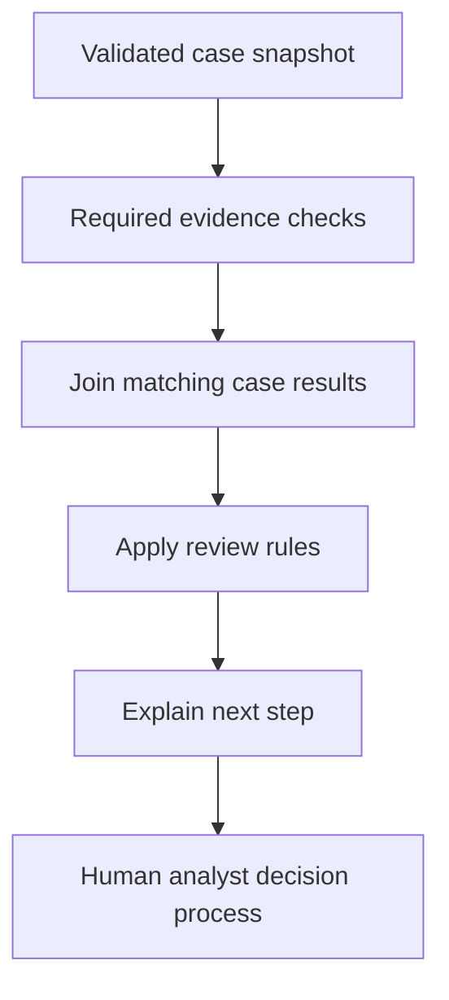

# Module 21.5: MAS Knowledge Milestone: Defend a Banking Architecture

## Before you begin: what this module teaches

**ADK concept: choosing and composing ADK patterns.**

This milestone combines the **Agent Development Kit (ADK)** concepts from Modules 15–21. You have seen consultation, required workflows, joins, routes, conditional work, revision loops and remote calls. The new skill is architectural judgment: choosing a combination from the customer’s requirements and explaining why each part exists.

The runnable checkpoint combines required evidence collection and routing over a validated synthetic case. The wider design exercise asks where reasoning belongs, where exact Python rules belong and where a separate service is justified. You will preserve input and output contracts as pieces are composed, so adding orchestration does not quietly weaken an earlier check.

**Where you would use this in real work.**

Meera’s team asks for a proposed solution: collect the necessary information, select the next review step and give the analyst a useful explanation. The bank’s technology team asks a different question: “Which systems will own the facts, which parts will you build, and how will we know the solution worked?”

An FDE must answer both. You will turn the request into a small technical specification and an architecture decision record—a written explanation of the chosen design, alternatives and trade-offs. If the bank has not supplied a ledger adapter or a reliable case-to-company mapping, the proposal must identify that missing work.

**Connection to Gemini Enterprise Agent Platform and Google Cloud.**

Map each responsibility to the appropriate capability: ADK for agent and workflow execution, Gemini for reasoning, Agent Runtime for managed hosting, Sessions for conversation persistence and Memory Bank when long-term recall is required. Firestore and BigQuery are supporting Google Cloud data services with their own responsibilities.

The course examples are separate learning checkpoints, not one already-connected bank deployment. You will learn to distinguish a component that exists, an integration still to build and a service still to configure. Module 26’s capstone later implements a deliberately limited combination of these capabilities.

**By the end, you should be able to:**

- **Translate the brief:** identify data owners, permitted operations, dependencies and failure outcomes before selecting agents.
- **Compose a small solution:** trace collection and routing through the supplied native ADK workflow.
- **Defend each choice:** explain why a function, workflow, adviser or remote service is needed for a specific requirement.
- **Identify missing work:** name the real adapters and access controls that a synthetic snapshot does not implement.
- **Present evidence:** describe the local checks, model evaluation and deployed tests needed to support the proposal.

**How this moves the story forward.** With the architecture choices explicit, Module 22 adds a personal preference that should follow Meera across conversations without changing the underlying bank facts.

Read the detailed customer task below, then follow the [guided lab](./lab.md). Build one checkpoint at a time and compare your explanation with the observed result.

[Previous module](../module21-distributed-graphs/README.md) · [Lab](./lab.md) · [Solution](./lab-solution.md) · [Enterprise playbook](./enterprise-playbook.md) · [Next module](../module22-state-and-memory/README.md)

## The banking story

Modules 15–21 introduced choices. This milestone combines and justifies them. Module 22 adds personalized continuity while keeping preferences separate from authoritative case facts.

Sovereign Horizon Bank and Acme Robotics are fictional teaching organizations. We follow the same commercial-review case, **CASE-001**, through the sequence. Monetary thresholds are teaching fixtures, not lending policy.

## Customer problem statement

### Read this as a bank employee's task

The bank now asks you to put the earlier ideas together and explain your design. The analyst still wants reliable preparation: collect the required facts, identify the next step and explain it clearly.

In this course, an analyst is the employee who gathers and checks information for a review. Picture a business banking team preparing for a company meeting. The bank, company and records are fictional.

> Show us the smallest application that completes the required checks and explains the next step. Tell us which parts are working examples and which still need a real bank-system connection.

| What you need to understand first | This exercise's answer |
|---|---|
| What information starts the task? | A customer requirement list and the case information available from agreed sources. |
| What should the employee receive? | A working preparation example plus an explanation of why each operation and service is needed. |
| What should happen when it cannot be completed? | A missing source connection must remain an open task; adding more agents does not supply the missing data. |

### New words, explained using this task

| Term | Meaning here |
|---|---|
| Architecture | How the application’s parts fit together and share responsibilities. |
| Data contract | The fields, types and meanings agreed between two operations. |
| Acceptance evidence | Observed results showing whether an agreed requirement was met. |

The next technical table connects these requirements to ADK objects and checks. Read one row at a time: the employee's need comes first, then the coding choice, then the result that would show it works.

## Match each customer requirement to code and a check

| Customer requirement | Implementation choice | Acceptance check |
| --- | --- | --- |
| Collect two required checks | Static fan-out plus join | Both named check outputs exist before routing. |
| Choose the next step by facts | Ordered route function | Incomplete evidence has precedence over amount. |
| Keep optional complexity justified | ADR compares alternatives | Each added agent/service answers a specific requirement. |
| Show verification limits | Separate local control tests and live evaluations | No claim of production readiness rests on a fixture run alone. |

**Result of this module:** An executable minimum combines static evidence collection with deterministic routing. The learner designs optional advisory, revision and remote extensions using an architecture decision record.

## Work through the concept as a customer problem

### The design review at the bank

Meera's branch manager does not ask for “six agents.” She asks for a complete case summary and the correct next review step. An FDE must justify each component using that outcome. This milestone is where you stop collecting pattern names and choose a design.

An **architecture decision record** is a short written explanation of a choice: the requirement, alternatives, selected design, consequences and evidence. It is useful when another engineer joins later or the bank changes a rule. A diagram shows connections; the decision record explains why those connections exist.

### Trace guarantees through the composition

The implementation fans out to `documents` and `exposure`, joins their named results, compares case IDs in `decide`, applies missing-document precedence and returns a next-step explanation. The route labels all lead to `explain` in this teaching composition. They do not create three real bank queues.

The guarantee “both required checks finish” comes from the fan-out/join structure. “Same case” comes from the comparison. “Missing documents first” comes from condition order. “No credit approval” comes from the absence of that operation and the stated result scope. No single prompt or diagram provides all these guarantees.

### Choose the smallest sufficient design

| Changed customer statement | Design consequence |
|---|---|
| “Always collect these two records.” | Keep deterministic scheduling. |
| “Explain the result in plain English.” | Consider a Gemini explanation step after verified collection. |
| “Ask a specialist where useful.” | Consider AgentTool; evaluate consultation quality. |
| “The regional team independently operates the specialist.” | Consider an authenticated A2A service boundary. |
| “Remember how I prefer summaries.” | Add scoped preference persistence, not a copy of the loan record in memory. |

### Three reviews before accepting the design

- **Beginner:** explain the existing graph using the branch-desk story, then predict an incomplete high-amount case. Show the exact function that chooses document collection.
- **Experienced engineer:** identify which contracts remain stable if a fixture becomes a Firestore or bank API read. Draw timeouts and failed-result paths before adding another model.
- **Bank FDE:** deliver an ownership table, one normal trace, one denied trace, one dependency-failure trace and an acceptance plan. Mark absent integrations explicitly: this sample does not fetch the bank's requested amount or issue a credit decision.

**Carry forward:** [Module 22](../module22-state-and-memory/README.md) adds continuity for the analyst while preserving the business system as the owner of current facts.

## Follow the execution

<!-- TEACHER_NOTE_START -->
**Teacher's note (ADK instructor view):**
- **Learning goal:** Explain the concept clearly from beginner to advanced, with a simple mental model first.
- **Why it matters:** Connect the concept to real Google agentic workflows, Python engineering habits, and production-ready decisions.
- **Version watch:** Validate against the latest official ADK / Google docs before teaching; call out deprecations or migration notes when needed.
- **Module linkage:** Connect this idea to the previous and next modules so learners see the progression across the course.
<!-- TEACHER_NOTE_END -->

## This is a design review, not a pattern popularity contest

The smallest working architecture is a useful baseline. The runnable example collects and routes using native ADK function nodes. It deliberately does not insert a model where exact code suffices. A real customer may need a model to understand intent or explain evidence; add that capability at an explicit boundary and evaluate its contribution.

| Customer language | Design question | Candidate pattern |
|---|---|---|
| “Both checks every time” | Are they independent? | Static fan-out and join |
| “If incomplete, collect documents first” | What is the rule precedence? | Structured routing |
| “Check only the applicable subsidiaries” | What bounds the work list? | Dynamic node |
| “Let me discuss this with an expert” | Who owns the dialogue? | Collaborative handoff |
| “Consult experts and combine their views” | Is consultation optional or mandatory? | AgentTool or fixed workflow |
| “Try a few improvements” | What passes and what is the budget? | Bounded loop |
| “Another team operates the capability” | Is a service boundary justified? | A2A |
| “Remember my preferred explanation style” | Is it a preference or a bank fact? | User state / memory in Module 22 |

Patterns can be composed, but every boundary adds a contract and a failure case. A large graph is not evidence of enterprise quality. Explain the critical path, identity propagation and failure outcome before choosing a deployment target.

## Deliver an architecture decision record

Write the customer problem, constraints, alternatives, chosen design, rejected complexity, data contracts, operational risks and verification evidence. Include a diagram whose arrows have one clear meaning. Distinguish execution order, data flow and network boundaries instead of combining all three without a legend.

Use the module’s diagram as the logical flow. A separate deployment diagram may show authenticated ingress, ADK runtime, persistent sessions, case APIs and an optional remote specialist. The logical workflow does not itself authenticate a user or create a durable transaction.

## ADK execution model: Composition preserves contracts rather than adding agent count

This milestone should be read as a requirements argument. Workflow composes known operations; input_schema protects the entry shape; JoinNode collects required results; an Event route selects the next step. A model is optional when the result can be expressed deterministically.

Composition adds a new responsibility at each boundary. The join must reject mixed cases. The router must preserve rule precedence. The renderer must not change a route into approval. A later model explanation must be evaluated against that same selected route and evidence.

An architecture decision record should connect each requirement to code and evidence. “Uses ADK” is not an acceptance condition. “An unavailable required source never produces a complete pack” is one. Ask what happens when each dependency is removed, delayed or returns malformed data.

The reference remains a synthetic orchestration baseline. The integrated exercise linked below implements a narrower, real Firestore checklist-to-artifact path. It deliberately does not invent an authoritative loan amount. Scope reduction is valid only when the customer agrees and the omitted exposure requirement remains visible.

### Derive the code from the customer's words

Start with what the bank must guarantee. Add a model for language work, a service boundary for independent ownership and persistence for required continuity. Each addition needs a specific requirement and a failure contract.

### Predict, observe and explain

Present one traceability row per requirement with the exact function, expected output and negative test. A requirement without an implementation or evidence is explicitly open.

### Worked design discussion for experienced learners

Change the customer brief to require a sanctioned ledger amount. Identify the missing adapter and entitlement contract before changing the route; a new fixture field does not complete that integration.

Before accepting a solution, identify its input owner, exact ADK boundary, output consumer and failure evidence. Read the function comments in the lab alongside the corresponding source; comments explain design intent, while the executed events establish behavior.

## Learn this concept from first principles

You have learned several patterns. The milestone is choosing the smallest combination that satisfies the bank, not demonstrating all patterns in one application.

### Defend the architecture using requirements

“Always collect” suggests explicit scheduling. “Understand this question” suggests language reasoning. “Owned by another team” may suggest a service boundary. None of those phrases alone requires a large multi-agent system. A principal-level review asks whether the architecture preserves the customer outcome when the model or a dependency fails.

The baseline combines modules without hiding their boundaries. The two functions return separate evidence; the join collects it; decide applies the ordered rule; explain renders the result. A model can be added after this exact baseline to improve usability, but it must not rewrite the selected business route.

### Name what remains an integration task

The example's `documents_complete` and amount are synthetic. The existing Module 13.5 repository supplies an authorized checklist but does not supply a ledger amount or canonical company mapping. Module 14 supplies the reviewed company profile lookup. Joining these requires a deliberately designed adapter and approved source fields, not a guessed identifier conversion.

The [banking FDE guide](../module15-intro-to-multi-agent-systems/fde-learning-guide.md) provides that integration specification. State which requirements are implemented, which are fixture assumptions and which need customer-owned services. That distinction is part of a competent handover, not an optional disclaimer.

### Trace one concrete request

| Step | Value or operation | Reasoning |
| --- | --- | --- |
| Bank requirement | Both facts are required before next-step selection | Choose static collection before considering an LLM coordinator. |
| Checks | documents.complete=false; exposure.specialist=true | Both refer to CASE-001. |
| Join and alignment | Both named results arrive and case IDs agree | Missing or mixed evidence cannot be silently treated as a complete pack. |
| Rule precedence | Incomplete documents win | The next step is collect_documents even for the larger amount. |
| Renderer | Explains that next step and no credit approval | The exact baseline works without a model. |
| Optional extension | Gemini explanation or remote service | Add it only when a new requirement justifies that boundary. |

### Check your understanding

Should the baseline fail just because a stylistic Gemini explanation is unavailable?

**Expected reasoning:** If the agreed requirement permits a deterministic explanation, the verified next step can still be shown. Define that fallback explicitly; never manufacture missing required evidence.

### Foundation and advanced learning paths

**Foundation:** reproduce the trace above, explain the Python and ADK objects involved, and predict one changed input before running the lab. You should be able to identify which part is configuration and which part executes work.

**Advanced:** Present a change-impact review for a new policy version, new data owner and unavailable model. Show which contracts and tests change and which architecture boundaries stay stable.

### Google service choice for this lesson

The runnable baseline is ADK. The customer architecture composes authorized Firestore/BigQuery adapters, Gemini where useful, and native session/memory services where required; the guide identifies which pieces are implemented versus planned.

The [banking FDE learning guide](../module15-intro-to-multi-agent-systems/fde-learning-guide.md) connects the customer discovery questions, Google service map and integration boundaries across the sequence. It distinguishes implemented examples from customer integration and deployment work.

## What you should be able to explain

- Translate the bank request into inputs, operations, outputs and failure outcomes.
- Point to the code that enforces each acceptance condition.
- Explain which facts are synthetic and which production services would own them.
- State what the local checks prove and what still needs a live integration or model evaluation.

## Verified baseline and limits

See the [course review and verification record](../module15-intro-to-multi-agent-systems/review-notes.md) for the cross-module checks and the evidence still required from a customer deployment.

Reviewed on **3 October 2026** against **google-adk 2.11.0** and its installed public APIs. Examples require Python 3.12+ and were exercised with **Python 3.14.7**. Python 3.14.8 is the current stable patch release; it was not the local test interpreter. Use the supplied lockfile for the verified dependency resolution, and repeat the checks before upgrading.

Sources: [ADK release](https://pypi.org/project/google-adk/2.11.0/) and [Python 3.14.8 release](https://www.python.org/downloads/release/python-3148/). “Current” is dated verification, not a promise that a dependency will never change.

3 offline tests passed, including real ADK execution for the four routing scenarios. The milestone is an executable architecture baseline plus a design assessment, not a deployed banking system.

## Official sources

- [ADK workflow options](https://adk.dev/workflows/)
- [Graph routes](https://adk.dev/graphs/routes/)
- [ADK safety and security](https://adk.dev/safety/)

## Continue the course story

Previous: [Module 21](../module21-distributed-graphs/README.md) · Next: [Module 22](../module22-state-and-memory/README.md) · [See how the concepts build](../learning-journey.md)

Before continuing, explain one input, one ADK execution boundary and one failure outcome from this module. Use the next chapter to add a new customer requirement, not merely another component.

<!-- © 2026 Inder Chauhan (https://github.com/inderanz/google-adk-training). All rights reserved. -->

## Continue with the integrated customer exercise

The [integrated banking lab](../module26-callbacks/integrated-lab.md) connects the authorized Firestore read, deterministic next step, versioned artifacts, Gemini explanation, evaluation, logging and Model Armor in one App. Complete its live and deployed checkpoints after the isolated lesson. Its scope excludes an unimplemented ledger adapter and credit approval.
---

## Official References

- Google ADK docs (latest): https://google.github.io/adk-docs/
- Google AI / Gemini docs: https://ai.google.dev/
- Google GenAI Python SDK reference: https://googleapis.github.io/python-genai/
- Context7 / current SDK lookup for the exact installed version and API signatures
- Related module path: review the surrounding modules for continuity, prerequisites, and follow-on concepts

