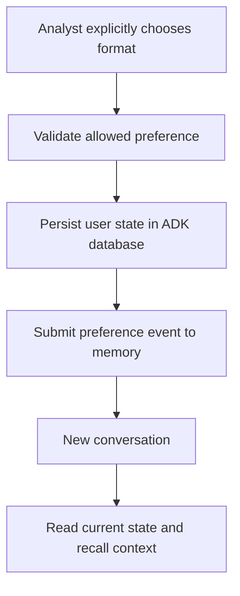

# Module 22: State and Memory: Remembering Preferences Without Rewriting Facts

## Before you begin: what this module teaches

**ADK concept: session state, memory ingestion and recall.**

“Remember this” can mean several things. In Google’s **Agent Development Kit (ADK)**, session state stores named values, while a memory service retrieves selected information from past interactions. You will learn user-scoped state, explicit memory ingestion and retrieval through `LoadMemoryTool`.

An exact setting and a retrieved recollection have different responsibilities. The example saves the chosen explanation format through an ADK event, then submits only that allowed preference event to memory. You will follow what persists, what can be recalled in a different session and what another user cannot retrieve. The sequence also makes a partial failure visible: state may be saved even if memory ingestion fails afterwards.

**Where you would use this in real work.**

Meera selects “concise” because she wants a short explanation before customer meetings. When she starts a new conversation next week, she does not want to repeat that preference. However, she expects the assistant to check the current case system before reporting whether a document has arrived.

Her two requests sound similar—remember my preference and remember my case—but require different handling. The preference can guide presentation. A recollection that the ownership register was missing last week cannot establish its status today. The same distinction matters in complaint-handling and investigation assistants.

**Connection to Gemini Enterprise Agent Platform and Google Cloud.**

The managed retrieval path uses Gemini Enterprise Agent Platform Memory Bank through `VertexAiMemoryBankService`. Conversation persistence remains the responsibility of the configured session service. The local example uses SQLite-backed sessions and in-memory retrieval so their different lifetimes are easy to observe.

The lesson also explains ADK’s native SQLite memory option. Persistent local retrieval, managed Memory Bank and session storage are distinct choices. For a customer deployment, selective ingestion, trusted user scope and correction/deletion requirements must be defined alongside the provider configuration.

**By the end, you should be able to:**

- **Classify information:** distinguish an exact preference, a conversation event, a retrieved memory and a current case fact.
- **Persist deliberately:** create a preference event and explain how its user-scoped state reaches a later session.
- **Control ingestion and recall:** submit only the allowed event and test the application/user retrieval boundaries.
- **Explain failure and restart:** show what survives provider restart and what remains saved after ingestion fails.
- **Transfer the pattern:** design one useful memory feature while identifying information that must stay in its authoritative bank system.

**How this moves the story forward.** Meera’s presentation preference can now follow her. Module 23 preserves a different output: the actual files and source versions used for a review.

Read the detailed customer task below, then follow the [guided lab](./lab.md). Build one checkpoint at a time and compare your explanation with the observed result.

[Previous module](../module21_5-mas-knowledge-milestone/README.md) · [Lab](./lab.md) · [Solution](./lab-solution.md) · [Enterprise playbook](./enterprise-playbook.md) · [Next module](../module23-artifacts/README.md)

## The banking story

Module 13.5 established durable conversations and authoritative case records. Modules 15–21.5 built the review flow. This module personalizes continuity; Module 23 will manage generated files as artifacts rather than storing large documents in state or memory.

Sovereign Horizon Bank and Acme Robotics are fictional teaching organizations. We follow the same commercial-review case, **CASE-001**, through the sequence. Monetary thresholds are teaching fixtures, not lending policy.

## Customer problem statement

### Read this as a bank employee's task

An analyst prefers short explanations and is tired of selecting that preference in every conversation. The bank wants the assistant to remember the preference without confusing past conversation with current case facts.

In this course, an analyst is the employee who gathers and checks information for a review. Picture a business banking team preparing for a company meeting. The bank, company and records are fictional.

> Remember whether I prefer concise or detailed explanations. Use that preference in a later conversation. Still read current case records when I ask whether a document has arrived.

| What you need to understand first | This exercise's answer |
|---|---|
| What information starts the task? | An explicit choice between concise and detailed. |
| What should the employee receive? | The saved preference in a new conversation, with separately retrieved past context when available. |
| What should happen when it cannot be completed? | An old memory must not override the current setting or be used as proof of document receipt. |

### New words, explained using this task

| Term | Meaning here |
|---|---|
| State | Named working values associated with an application, user or conversation. |
| Memory | A separate facility for finding relevant information from selected past interactions. |
| Durability | Whether saved information remains after the process stops or restarts. |

The next technical table connects these requirements to ADK objects and checks. Read one row at a time: the employee's need comes first, then the coding choice, then the result that would show it works.

## Match each customer requirement to code and a check

| Customer requirement | Implementation choice | Acceptance check |
| --- | --- | --- |
| Remember exact preference across sessions and restart | DatabaseSessionService and user:review_format | A fresh service instance reads the saved preference. |
| Recall prior context without a custom search store | InMemoryMemoryService locally; VertexAiMemoryBankService optionally | A different session can retrieve the preference in the same local process. |
| Keep user/app scopes separate | Provider-scoped app_name and verified user_id | A different user or app receives no preference memory. |
| Minimize ingestion | add_events_to_memory with one allowlisted event | The case conversation is not submitted. |
| Handle partial failure honestly | State commits before memory ingestion | An ingestion error does not roll back the saved preference. |

**Result of this module:** SQLite-backed ADK user state preserves an explicit format preference. ADK memory ingests only that validated preference event and supports recall in a new session. A managed Memory Bank provider is an optional configuration.

## Work through the concept as a customer problem

### Remember how Meera likes a report without remembering a false fact

Meera says, “Please give me concise explanations from now on.” That is an explicit preference. Last week's conversation also says that an ownership register was missing. That is historical context. Today's document status may have changed. A good assistant can remember the first statement while rechecking the second.

**State** is named working data, such as `user:review_format`. **History** is the sequence of conversation events. **Memory** is selected past context made available for later retrieval. **Business truth** is owned by the current case service. A customer's word “remember” does not tell you which of these four they need; discovery must establish that.

### Scope and storage answer different questions

The prefix `user:` says the preference belongs to a user across sessions within the application. It does not select a database. A durable session provider makes the value survive a process restart; an in-memory provider does not. A `temp:` value lasts only for the current invocation, so it is unsuitable for tomorrow's preference.

The code first saves the explicit preference through a state delta in an ADK event. It then submits a minimal preference event to memory. These are separate writes: memory ingestion can fail after the current preference was saved. The assistant should continue using current state and expose/recover the ingestion problem according to the agreed requirement.

`LoadMemoryTool` gives the model a recall capability. Configuring that tool does not ingest events, and recall is not guaranteed just because a provider exists. Local keyword matching and managed memory processing have different behavior; neither should be represented as a current case lookup.

### Three reviews before accepting the design

- **Beginner:** put one example into each of the four stores. Change a preference, open a new session and identify where its current value comes from.
- **Experienced engineer:** create a stale memory that conflicts with current preference state. Verify the defined precedence, app/user isolation and behavior when memory ingestion fails. Test restart separately from a new conversation in the same process.
- **Bank FDE:** ask what may be retained, for how long, who may correct/delete it and what must never be ingested. Use managed Sessions and Memory Bank for their distinct supported responsibilities; keep loan facts in the authorized record service.

**Carry forward:** [Module 23](../module23-artifacts/README.md) stores a different kind of result: the exact file/version reviewed, rather than a recollection of it.

## Follow the execution

<!-- TEACHER_NOTE_START -->
**Teacher's note (ADK instructor view):**
- **Learning goal:** Explain the concept clearly from beginner to advanced, with a simple mental model first.
- **Why it matters:** Connect the concept to real Google agentic workflows, Python engineering habits, and production-ready decisions.
- **Version watch:** Validate against the latest official ADK / Google docs before teaching; call out deprecations or migration notes when needed.
- **Module linkage:** Connect this idea to the previous and next modules so learners see the progression across the course.
<!-- TEACHER_NOTE_END -->

## Four stores answer different questions

| Information | Where it belongs | Example |
|---|---|---|
| Current business truth | Authorized case/ledger service | Whether an ownership register is received |
| Conversation events | ADK SessionService | What happened in this session |
| Exact current preference | Durable user-scoped state or preference service | `user:review_format = "concise"` |
| Relevant past context | ADK MemoryService | A recalled explanation preference |

Module 13.5 separated business records from conversation persistence. This module adds retrieval over past context. Memory does not replace Firestore, the case API or the session service.

## Scope is not durability

ADK 2.11.0 also provides `SqliteMemoryService`, a built-in local memory provider that saves events in a SQLite file and searches stored text. It is separate from `DatabaseSessionService`: one stores retrievable memory, the other stores conversations and state. This lab deliberately keeps `InMemoryMemoryService` as its default so you can observe memory disappearing on restart while session state survives. For a managed customer deployment, follow the Memory Bank path. A SQLite file in a disposable container is not a managed, shared memory service. See the [ADK release notes](https://github.com/google/adk-python/releases/tag/v2.11.0).

| State key | Scope | Durability depends on |
|---|---|---|
| `current_case_id` | One session | Session provider |
| `user:review_format` | A user within an app, across sessions | Session provider |
| `app:training_policy_version` | All users/sessions of an app | Session provider and controlled writers |
| `temp:working_note` | Current invocation | Discarded after invocation |

The `user:` prefix does not make an in-memory session provider survive restart. The runnable example uses ADK’s `DatabaseSessionService` with SQLite for local durability. Production choices include a supported database or the managed session provider; the bank’s tenancy and retention requirements still apply.

## Memory writes and reads are separate operations

`add_events_to_memory(...)` ingests selected events. `search_memory(...)` retrieves context scoped by app and user. Merely configuring a memory provider or adding a recall tool does not write memories. `LoadMemoryTool` lets the model request recall; `PreloadMemoryTool` performs recall as part of preparing the model context. Neither should be treated as an authorization layer.

The local `InMemoryMemoryService` uses keyword matching and loses memories when the process ends. It is a real ADK development provider, not semantic search. Managed `VertexAiMemoryBankService` performs managed memory processing and retrieval; generation/consolidation can be asynchronous, so immediate recall is not guaranteed.

## Current state wins over stale recollection

The preference setter accepts only concise or detailed. It appends a session event carrying the `user:` state delta, then submits only that preference event to memory. If memory ingestion fails, the preference remains saved. These writes are not one transaction. Surface the failure and use a durable retry/outbox design if production requires reliable ingestion.

Do not automatically upload a bank conversation to memory because a sample callback does so. Google’s cross-session recipe demonstrates the native ingestion and recall hooks. This lab adapts the pattern by sending a minimal validated event, avoiding unnecessary case details.

## Rewind is not business rollback

`Runner.rewind_async` can rewind an ADK session relative to an invocation. It cannot reverse a payment, delete a remote email, restore a Firestore transaction or retract already-generated external memory by itself. Correcting external effects needs the corresponding service operation and authorization. Do not teach rewind as a universal undo button.

## ADK execution model: State persistence and memory retrieval have different lifecycles

Runner receives separate session and memory providers. The session provider creates/fetches conversations and appends events. A Session contains state and history, but editing a detached Session dictionary is not the persistence API. EventActions(state_delta=...) expresses an update that append_event applies through the provider.

Within tools/callbacks, context.state is the tracked interface. At a service boundary outside an agent run, this lab explicitly builds and appends the preference event. User-scoped state is keyed within app/user scope; the prefix defines visibility, while the selected provider determines durability.

Memory ingestion submits selected events for later retrieval. LoadMemoryTool is a retrieval capability, not an ingestion trigger. Configuring a MemoryService alone neither uploads the conversation nor guarantees any useful recall. Managed processing may complete asynchronously, so a successful submission and a subsequent useful search are separate observations.

The exact preference commit occurs before memory ingestion. If ingestion fails, state already contains the new preference. Retrying both operations blindly can create redundant memory submissions. An advanced outbox records which committed preference version still needs ingestion; the consumer retries that work and records its outcome. It does not pretend two providers share a transaction.

### Derive the code from the customer's words

“Remember my explicit setting” requires exact durable state. “Recall relevant past context” motivates memory retrieval. “Do not rewrite bank facts” keeps checklist reads in the authorized case service even when memory contains a conflicting statement.

### Predict, observe and explain

Change concise to detailed, create another session, restart the process, then inspect exact state and retrieved memories separately. Repeat the managed provider checkpoint and record observed retrieval timing.

### Worked design discussion for experienced learners

Design deletion across the exact preference, source events and managed memories. Document what a successful delete from each service establishes and how stale retrieved context is handled.

Before accepting a solution, identify its input owner, exact ADK boundary, output consumer and failure evidence. Read the function comments in the lab alongside the corresponding source; comments explain design intent, while the executed events establish behavior.

## Learn this concept from first principles

Module 13.5 taught that a session records conversation and the case service owns business facts. Now add an exact analyst preference and a separate retrieval mechanism for selected past context.

### Learn the containers before learning retrieval

A session groups one conversation's events and state. User-prefixed state is shared across that user's sessions in the same app, as supported by the provider. Memory is a separate service for retrieving selected past context. A business record is a different system again. One Python dictionary should not be used as if it served all four responsibilities.

`EventActions(state_delta={...})` describes a change. `append_event()` asks the session provider to persist the event and apply that change. Merely assigning to a fetched Session object's dictionary is not the persistence API. The provider must be durable if a preference must survive process restart.

`LoadMemoryTool` allows a model to request retrieval. It does not save a preference and does not enable a cloud database automatically. The Runner needs the memory service, and the application must separately decide which events to ingest. This lab's explicit setter keeps that data-selection decision outside the model.

### Treat recall as context, not current authority

An old remembered preference may conflict with a new exact setting. Current state wins in this lesson. A remembered statement that a document arrived still does not prove current case status. Retrieve that fact from the authorized case service.

Local memory is keyword-based and process-local. Managed Memory Bank adds managed processing and retrieval, but ingestion and recall timing must be observed in the target environment. State commit and memory ingestion are two writes; if the second fails, the first remains. A production retry/outbox design must preserve that distinction.

### Trace one concrete request

| Step | Value or operation | Reasoning |
| --- | --- | --- |
| Explicit choice | Analyst selects concise | Only an allowed preference is accepted. |
| Session event | user:review_format=concise in state_delta | The database provider commits exact user-scoped state. |
| Memory ingestion | One validated preference event | The full banking conversation is not submitted. |
| Second session | Current state contains concise | Different session, same app/user scope. |
| Recall | Local keyword search returns the preference | This uses the same in-process memory provider. |
| Restart | SQLite keeps state; a new local memory provider is empty | State scope and memory durability are different properties. |

### Check your understanding

If user:review_format exists in SQLite but recall returns no memories after restart, is persistence necessarily broken?

**Expected reasoning:** No. SQLite state and an in-memory memory provider have different lifecycles. The exact preference can persist while the new local retrieval store is empty.

### Foundation and advanced learning paths

**Foundation:** reproduce the trace above, explain the Python and ADK objects involved, and predict one changed input before running the lab. You should be able to identify which part is configuration and which part executes work.

**Advanced:** Specify correction and deletion across session state, managed memories and source records. Design an ingestion failure retry record and prove that a recalled malicious instruction cannot grant access to a banking tool.

### Google service choice for this lesson

The local path uses native ADK DatabaseSessionService and InMemoryMemoryService. The optional managed path uses VertexAiMemoryBankService with an existing Memory Bank-enabled resource. Managed Sessions configuration is taught in Module 13.5; Firestore still owns checklist truth.

The [banking FDE learning guide](../module15-intro-to-multi-agent-systems/fde-learning-guide.md) connects the customer discovery questions, Google service map and integration boundaries across the sequence. It distinguishes implemented examples from customer integration and deployment work.

## What you should be able to explain

- Translate the bank request into inputs, operations, outputs and failure outcomes.
- Point to the code that enforces each acceptance condition.
- Explain which facts are synthetic and which production services would own them.
- State what the local checks prove and what still needs a live integration or model evaluation.

## Verified baseline and limits

See the [course review and verification record](../module15-intro-to-multi-agent-systems/review-notes.md) for the cross-module checks and the evidence still required from a customer deployment.

Reviewed on **3 October 2026** against **google-adk 2.11.0** and its installed public APIs. Examples require Python 3.12+ and were exercised with **Python 3.14.7**. Python 3.14.8 is the current stable patch release; it was not the local test interpreter. Use the supplied lockfile for the verified dependency resolution, and repeat the checks before upgrading.

Sources: [ADK release](https://pypi.org/project/google-adk/2.11.0/) and [Python 3.14.8 release](https://www.python.org/downloads/release/python-3148/). “Current” is dated verification, not a promise that a dependency will never change.

7 offline tests passed using real ADK SQLite and in-memory memory providers, including new-session recall, user/app isolation, provider restart, minimal ingestion, partial failure and LoadMemoryTool execution through Runner with a scripted model. Managed Memory Bank and live Gemini recall were not executed.

## Official sources

- [ADK state scopes](https://adk.dev/sessions/state/)
- [ADK memory services and tools](https://adk.dev/sessions/memory/)
- [Google cross-session memory recipe](https://github.com/google/adk-samples/tree/main/core/python/cross-session-memory)
- [Session rewind](https://adk.dev/sessions/session/rewind/)
- [Memory Bank setup](https://docs.cloud.google.com/agent-builder/agent-engine/memory-bank/set-up)

## Continue the course story

Previous: [Module 21.5](../module21_5-mas-knowledge-milestone/README.md) · Next: [Module 23](../module23-artifacts/README.md) · [See how the concepts build](../learning-journey.md)

Before continuing, explain one input, one ADK execution boundary and one failure outcome from this module. Use the next chapter to add a new customer requirement, not merely another component.

<!-- © 2026 Inder Chauhan (https://github.com/inderanz/google-adk-training). All rights reserved. -->
---

## Official References

- Google ADK docs (latest): https://google.github.io/adk-docs/
- Google AI / Gemini docs: https://ai.google.dev/
- Google GenAI Python SDK reference: https://googleapis.github.io/python-genai/
- Context7 / current SDK lookup for the exact installed version and API signatures
- Related module path: review the surrounding modules for continuity, prerequisites, and follow-on concepts

