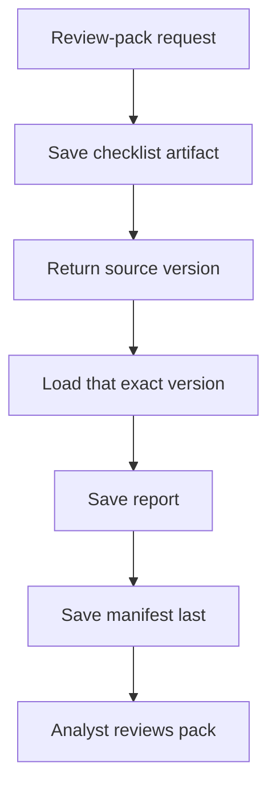
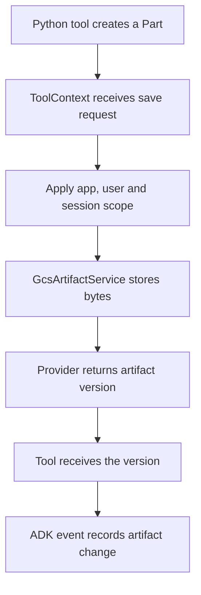

# Module 23: Artifacts: Reproducible Banking Review Packs

## Before you begin: what this module teaches

**ADK concept: artifacts, versions and storage providers.**

A useful agent may produce a report, a saved checklist or another file that someone needs later. Google’s **Agent Development Kit (ADK)** represents such stored items as **artifacts**. A tool uses `ToolContext.save_artifact()` or `load_artifact()`, and the configured artifact service performs the storage operation.

You will follow the saved content, its filename, its application/user/session scope and the version returned by ADK. Then you will create a **manifest**: a small record linking the source version to the generated report version. The source artifact’s version is not the same number as the bank case’s version. Keeping those identities explicit lets another person inspect exactly what the report used.

**Where you would use this in real work.**

Meera prepares a report showing that the ownership register is missing. A colleague opens the report later, after the bank’s checklist has changed, and asks: “What information did you use when you wrote this?” The final chat answer alone cannot answer that question reliably.

The task is to save the input used, build the report from that exact saved version and retain the connection between them. If the requested version cannot be loaded, the assistant must say the evidence is unavailable instead of quietly substituting a newer checklist.

**Connection to Gemini Enterprise Agent Platform and Google Cloud.**

ADK’s `GcsArtifactService` implements artifact storage using Google Cloud Storage. The cloud lab combines it with Gemini Enterprise Agent Platform Agent Runtime and managed Sessions. Sessions preserve the interaction; the artifact provider preserves the report-related content under its own scope.

You first exercise the API with an in-memory provider, then use a fresh GCS client for live readback. Version references and a digest help check the relationship between files; retention, access control and protection against unwanted changes still need explicit storage configuration for the customer.

**By the end, you should be able to:**

- **Explain the object:** identify an artifact’s content, MIME type, filename, scope and returned version.
- **Build the evidence chain:** save a source, generate a report from its explicit version and link both in a manifest.
- **Observe persistence:** load the referenced versions through a fresh configured provider and compare the source digest.
- **Handle missing evidence:** reject a missing or invalid source without silently switching to the latest version.
- **Transfer the pattern:** design saved inputs and outputs for another report that a bank employee must be able to check later.

**How this moves the story forward.** The report is now traceable to its saved input. Module 24 asks whether the agent actually uses its capabilities correctly across a meaningful set of requests.

Read the detailed customer task below, then follow the [guided lab](./lab.md). Build one checkpoint at a time and compare your explanation with the observed result.

[Previous module](../module22-state-and-memory/README.md) · [Lab](./lab.md) · [Solution](./lab-solution.md) · [Enterprise playbook](./enterprise-playbook.md) · [Next module](../module24-evaluation/README.md)

## Continue the banking story

Modules 15–22 built orchestration and continuity for a fictional commercial-review assistant. This sequence prepares that assistant for a measured pilot. Sovereign Horizon Bank, Acme Robotics and CASE-001 are teaching fixtures; no lending policy or customer engagement is being asserted.

## The customer request

### Read this as a bank employee's task

An analyst reviews a checklist and a generated report today. Tomorrow the checklist may change. The bank needs to retrieve the exact input and report used for today’s review.

In this course, an analyst is the employee who gathers and checks information for a review. Picture a business banking team preparing for a company meeting. The bank, company and records are fictional.

> Save the checklist used for each report. Keep a way to find the exact saved version later, even after the case changes.

| What you need to understand first | This exercise's answer |
|---|---|
| What information starts the task? | A checklist snapshot and the explicit saved source version used to prepare the report. |
| What should the employee receive? | A saved checklist, report and small linking record identifying their versions. |
| What should happen when it cannot be completed? | Missing or invalid source content must not produce a successful report. Failed saves may need later cleanup. |

### New words, explained using this task

| Term | Meaning here |
|---|---|
| Artifact | A file-like item saved through ADK, such as a JSON checklist or Markdown report. |
| Manifest | A small record listing which saved input and output belong together. |
| Digest | A value calculated from bytes to detect a change; it does not prove who supplied them. |

The next technical table connects these requirements to ADK objects and checks. Read one row at a time: the employee's need comes first, then the coding choice, then the result that would show it works.

**What you build:** A source artifact, Markdown report and manifest identifying exact versions; managed Sessions and Cloud Storage on the real-service path.

## Match each customer requirement to code and a check

| Customer requirement | Implementation decision | Acceptance evidence |
|---|---|---|
| Preserve the reviewed input | Save a named JSON artifact and retain the returned integer version | An older version remains readable after a later save. |
| Link report to evidence | Load the requested source version and record a SHA-256 digest | The manifest names that input version and the report version. |
| Handle missing/invalid input | Return explicit failure before writing the report | Missing evidence does not produce a success-shaped report. |
| Persist across processes | Use GcsArtifactService and managed Sessions | A new client can retrieve the saved version in the same scope. |

## Start with a file, then add scope and version

A Python string is text. `encode("utf-8")` turns it into bytes suitable for storage. A MIME type says how those bytes should be interpreted: JSON, Markdown and PNG are different formats. `types.Part` is the Google GenAI message-part representation used by ADK's artifact APIs; it can carry those bytes plus their MIME type.

An artifact is identified by more than its filename. Application, user and usually session scope participate in locating it. Saving the same filename again produces another version. In this pinned implementation the first version is 0. Always use the version returned by the service; a concurrent writer can change which version comes next.

| Concept | Example | Meaning |
|---|---|---|
| Filename | CASE-001-checklist.json | A logical name, not a local filesystem path |
| Version | 0 | A particular saved instance of that name |
| Scope | bank_review / analyst / session | The namespace used by the provider |
| MIME type | application/json | How to interpret the stored bytes |
| Digest | SHA-256 of the saved bytes | Detects a change in bytes; does not authenticate who supplied them |
| Manifest | Source and report references | A small document linking the output to its input |

## Choose the correct storage responsibility

Session state holds small working values such as an artifact reference. Memory supports later retrieval of selected information. An artifact stores the review pack. Firestore remains the owner of the case checklist in the integrated banking design; a stored copy is evidence observed at a point in time, not the current bank record.

`InMemoryArtifactService` is useful in software tests and loses data with the process. `GcsArtifactService` is the native ADK adapter for durable Cloud Storage artifacts. Session persistence does not automatically make an in-memory artifact durable. User-scoped names, such as the documented `user:` namespace, change scope; they do not authorize cross-user sharing.

## Why an explicit source version matters

Suppose version 0 says the ownership register is missing. Later, version 1 says it has arrived. A report prepared from version 0 must continue to point to version 0. Loading “latest” when replaying that report would silently change the evidence behind it.

The lab saves the manifest last. This is a useful completion convention, but three artifact saves are not a transaction: a storage failure can leave an unreferenced report. A customer design needs an idempotency policy, reconciliation and a committed business record if it requires transactional completion. Artifact versioning alone is not tamper-proof retention, legal hold, author attribution or a complete audit trail.

## Required work versus agent choice

Gemini chooses the tools from the instruction. The report tool enforces its input contract even when called out of order. If the customer requires every stage to execute in a guaranteed sequence, use the native orchestration patterns from Module 16. A prompt describing an order is not a scheduling guarantee.

## Work through the concept as a customer problem

### The numbered copy in the review file

Meera reviews a checklist in the morning. Someone updates it in the afternoon. When the manager asks “Which copy did you use for this memo?”, “the latest checklist” is not a reproducible answer. She needs the exact saved version.

An **artifact** is a file-like object managed through ADK's artifact service. A **version** identifies a saved revision under a filename and scope. A **manifest** is a record linking the report to its inputs. A **digest** is a computed fingerprint of bytes; it can help compare content, but by itself does not identify an authorized signer or establish legal retention.

### From a Python value to stored bytes

The tool starts with a dictionary, serializes it as JSON text, encodes that text as UTF-8 bytes and wraps the bytes in a Google GenAI `Part` with a MIME type. The MIME type describes how to interpret the content. `Part` is the representation passed to ADK; the configured artifact provider performs storage.

`await tool_context.save_artifact(...)` returns the saved version. Capture that actual return value. Version `0` is valid, so “if version” is the wrong way to ask whether the save produced a version. When later loading a source, pass the explicit version instead of silently substituting the newest one.

The report and manifest are separate saves. If the report save succeeds and the manifest save fails, an unreferenced report may remain. The provider's versioning does not create a transaction across all those writes. A customer may need a committed business record and reconciliation before calling the pack complete.

### Three reviews before accepting the design

- **Beginner:** save two versions, load version zero and show that it still contains the original bytes. Explain filename, version and session/user scope separately.
- **Experienced engineer:** inject a failure between report and manifest saves. Define whether an orphan is permitted, how to find it and how a repeated request avoids publishing duplicate business results.
- **Bank FDE:** ask whether the customer needs a convenient attachment, a reproducible evidence pack or regulated archival retention. The lab teaches the second pattern's file lineage, not automatic compliance. `GcsArtifactService` provides the Google Cloud Storage-backed artifact path; access and retention requirements still need their own design.

**Carry forward:** [Module 24](../module24-evaluation/README.md) asks whether the assistant used these records correctly, not merely whether files were saved.

## ADK execution model: Follow save_artifact from the tool to its provider

Runner is configured with an artifact_service. ADK creates ToolContext for an actual tool call and supplies it to the Python tool; Gemini proposes the business arguments, not this context object. The context carries the application/user/session scope and delegates artifact operations to the configured provider.

A dictionary becomes JSON text, UTF-8 bytes and then a types.Part with a MIME type. Part is a Google GenAI representation used by ADK; it is not a Cloud Storage client. await tool_context.save_artifact(...) performs the asynchronous save and returns an integer version. Keep that returned value: calculating the next version yourself races with other writers.

The provider stores the bytes under its supported scope. ADK also records artifact changes through its event actions. An artifact delta identifies a changed filename/version; it does not embed the complete document as session state. load_artifact(filename, version=...) returns the selected Part or a missing result. The lab checks inline_data and MIME type before decoding.

Version zero is valid. A missing object is checked with is None, not a truthiness test on its version. The tool's source_version comes from the model-visible tool arguments, so validate it even though the instruction tells Gemini to use the previously returned value. The exact stored source is then validated again before generating any report.

### Derive the code from the customer's words

“The exact input reviewed” requires an explicit version. “Which report used it” requires a manifest. “Survive restart” selects GcsArtifactService. “Still retrieve earlier evidence” means never silently substitute latest during replay.

### Predict, observe and explain

Save once, retain version 0, save changed bytes again, then load both explicit versions. Inspect the artifact delta in the saved events and compare it with the complete loaded Part.

### Worked design discussion for experienced learners

Choose recovery for a report saved before a failed manifest save: permit an orphan and reconcile it, or coordinate a committed business record. Explain why neither a digest nor three successful writes creates a transaction.

Before accepting a solution, identify its input owner, exact ADK boundary, output consumer and failure evidence. Read the function comments in the lab alongside the corresponding source; comments explain design intent, while the executed events establish behavior.

## Follow the control and data flow

<!-- TEACHER_NOTE_START -->
**Teacher's note (ADK instructor view):**
- **Learning goal:** Explain the concept clearly from beginner to advanced, with a simple mental model first.
- **Why it matters:** Connect the concept to real Google agentic workflows, Python engineering habits, and production-ready decisions.
- **Version watch:** Validate against the latest official ADK / Google docs before teaching; call out deprecations or migration notes when needed.
- **Module linkage:** Connect this idea to the previous and next modules so learners see the progression across the course.
<!-- TEACHER_NOTE_END -->

The arrows show the lesson’s control/data dependencies, not a promise that every model-selected action always occurs. Inspect the lab trace to establish the actual execution.

## Inspect the framework boundary

<!-- TEACHER_NOTE_START -->
**Teacher's note (ADK instructor view):**
- **Learning goal:** Explain the concept clearly from beginner to advanced, with a simple mental model first.
- **Why it matters:** Connect the concept to real Google agentic workflows, Python engineering habits, and production-ready decisions.
- **Version watch:** Validate against the latest official ADK / Google docs before teaching; call out deprecations or migration notes when needed.
- **Module linkage:** Connect this idea to the previous and next modules so learners see the progression across the course.
<!-- TEACHER_NOTE_END -->

The arrows show the save operation and returned reference, not network RPC count. The provider operation is abstracted here; do not infer a single storage RPC or a multi-file transaction. In-memory contract tests replace the provider, while the live exercise uses GcsArtifactService.

## Work through one request

| Stage | Observed value or action | Reasoning |
|---|---|---|
| save_checklist | Synthetic checklist has ownership_register=false | Storage returns source version 0 in a fresh scope. |
| create_review_pack(0) | Load and validate the exact saved bytes | Missing ownership_register is derived in Python. |
| Save report | Markdown names the input version | Storage returns a report version. |
| Save manifest | Link source digest and both versions | Return prepared_for_human_review, never approved. |

## Learn at two depths

**Foundation:** explain each stage above in ordinary English, run the supplied case and predict one changed input before executing it. Point to the line that enforces the requirement.

**Advanced:** Replace the source fixture with the authorized Module 13.5 repository adapter. Preserve its case version and observation timestamp, specify idempotency for retries, and describe how partially saved packs are reconciled.

## Google service boundary

Use the [shared cloud setup and deployed verification guide](../module23-artifacts/google-cloud-lab-guide.md). The native services have different responsibilities: Gemini performs model reasoning, Agent Runtime hosts the deployed application, managed Sessions persists conversations, Cloud Storage stores artifacts, and Model Armor inspects configured content in Module 25.5. Cloud Logging and Cloud Trace provide operational evidence. A configured local runner is distinct from an agent executing on Agent Runtime.

## Verified baseline and remaining evidence

See the [course review and verification record](../module15-intro-to-multi-agent-systems/review-notes.md) for the cross-module checks and the evidence still required from a customer deployment.

The implementation targets **google-adk 2.11.0** and uses its installed public interfaces, reviewed on **3 October 2026**. Python support is 3.11+; the local verification interpreter is **3.14.7**. Python **3.14.8** is the current stable patch release; it is not claimed as the test interpreter. The existing Gemini model default is preserved as `gemini-3.5-flash` and is configurable; confirm availability in your project and location.

The lockfile fixes the resolved local dependencies. Contract tests use scripted model/inspection replies with real ADK execution. They establish software behavior, not Gemini quality, Model Armor detection quality or a deployed-service result. The lab requires separate live evaluation and deployed verification evidence before calling the cloud exercise complete.

## Official references

- [ADK artifacts](https://adk.dev/artifacts/)
- [Cloud Storage retention](https://docs.cloud.google.com/storage/docs/bucket-lock)
- [Pinned ADK release](https://pypi.org/project/google-adk/2.11.0/)
- [Python 3.14.8 release](https://www.python.org/downloads/release/python-3148/)

## Continue the course story

Previous: [Module 22](../module22-state-and-memory/README.md) · Next: [Module 24](../module24-evaluation/README.md) · [See how the concepts build](../learning-journey.md)

Before continuing, explain one input, one ADK execution boundary and one failure outcome from this module. Use the next chapter to add a new customer requirement, not merely another component.

<!-- © 2026 Inder Chauhan (https://github.com/inderanz/google-adk-training). All rights reserved. -->

## Continue with the integrated customer exercise

The [integrated banking lab](../module26-callbacks/integrated-lab.md) connects the authorized Firestore read, deterministic next step, versioned artifacts, Gemini explanation, evaluation, logging and Model Armor in one App. Complete its live and deployed checkpoints after the isolated lesson. Its scope excludes an unimplemented ledger adapter and credit approval.
---

## Official References

- Google ADK docs (latest): https://google.github.io/adk-docs/
- Google AI / Gemini docs: https://ai.google.dev/
- Google GenAI Python SDK reference: https://googleapis.github.io/python-genai/
- Context7 / current SDK lookup for the exact installed version and API signatures
- Related module path: review the surrounding modules for continuity, prerequisites, and follow-on concepts

