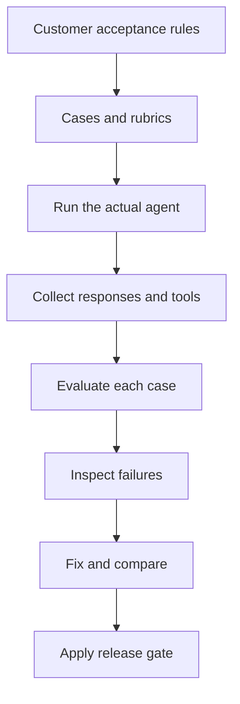

# Module 24: Evaluation: Evidence for a Banking Release Decision

## Before you begin: what this module teaches

**ADK concept: agent evaluation and release evidence.**

Running an agent once shows one response. **Evaluation** asks how it behaves against defined scenarios and pass conditions. Google’s **Agent Development Kit (ADK)** supplies a native `EvalSet` format, configurable criteria, the `adk eval` command and structured result files. You will learn what each contributes to the evaluation process.

Two questions require different evidence: did the agent use the expected capability, and was its answer useful and supported? A tool-path check and an answer-quality rubric address different parts of those questions. You will also distinguish deterministic software tests from real model and judge calls. The release gate reads the resulting evidence; it does not create a quality score by itself.

**Where you would use this in real work.**

Meera’s demonstration of the assistant looked convincing. Before a pilot, the bank asks for more: try a known case, an unknown ID, a question without a case ID and a request to approve a loan. These scenarios reveal different ways an apparently helpful assistant can fail.

You will turn each request into an expected outcome and inspect the individual results. A good average must not conceal an unknown case being replaced with someone else’s record. When a scenario fails, the next task is to understand and fix the cause, then rerun it without simply lowering the acceptance bar.

**Connection to Gemini Enterprise Agent Platform and Google Cloud.**

The live native ADK evaluation uses the configured agent model and judge model through the Google enterprise backend. The judge has its own configuration. A local evaluation of the application and a request sent to an Agent Runtime deployment are separate experiments and must be recorded separately.

The module places those exercises within the wider Gemini Enterprise Agent Platform evaluation approach. You will keep dataset, code, model and result identities together, and recognize that different evaluation interfaces may use different dataset schemas. The bank needs traceable evidence of the version being considered for release.

**By the end, you should be able to:**

- **Derive a scenario:** translate one customer requirement into a prompt, expected behaviour and measurable criterion.
- **Read the native format:** explain the important EvalSet and configuration fields rather than copying unexplained JSON.
- **Interpret evidence:** locate a failed case and distinguish tool-path failure, answer-quality failure and missing evaluation.
- **Apply the gate:** reject incomplete, duplicate, unevaluated or failing results before calling a run acceptable.
- **Transfer the method:** propose held-out and multi-turn cases for the bank’s actual workload and explain how you will compare changes.

**How this moves the story forward.** Evaluation helps decide whether a version is ready to try. Module 25 helps the operations team understand what happened during a particular request after it is running.

Read the detailed customer task below, then follow the [guided lab](./lab.md). Build one checkpoint at a time and compare your explanation with the observed result.

[Previous module](../module23-artifacts/README.md) · [Lab](./lab.md) · [Solution](./lab-solution.md) · [Enterprise playbook](./enterprise-playbook.md) · [Next module](../module25-observability/README.md)

## Continue the banking story

Modules 15–22 built orchestration and continuity for a fictional commercial-review assistant. This sequence prepares that assistant for a measured pilot. Sovereign Horizon Bank, Acme Robotics and CASE-001 are teaching fixtures; no lending policy or customer engagement is being asserted.

## The customer request

### Read this as a bank employee's task

The bank is considering a pilot of the assistant. A successful answer to one question is not enough: the team needs to check known cases, missing cases, unclear requests and requests the assistant must not fulfil.

In this course, an analyst is the employee who gathers and checks information for a review. Picture a business banking team preparing for a company meeting. The bank, company and records are fictional.

> Show us how the assistant behaves on an agreed set of questions. When we change it, show which answers improved and which became worse.

| What you need to understand first | This exercise's answer |
|---|---|
| What information starts the task? | Example questions, expected tool activity where relevant, and written rules for judging answers. |
| What should the employee receive? | Individual case results that can be inspected before a release decision. |
| What should happen when it cannot be completed? | Missing results, failed cases or unscored required checks must not count as a pass. |

### New words, explained using this task

| Term | Meaning here |
|---|---|
| Evaluation | Running scenarios and assessing whether the observed behaviour meets the agreed requirements. |
| Rubric | Written rules explaining what makes an answer acceptable or unacceptable. |
| Trajectory | The sequence of actions and tool calls observed while answering a request. |

The next technical table connects these requirements to ADK objects and checks. Read one row at a time: the employee's need comes first, then the coding choice, then the result that would show it works.

**What you build:** A runnable banking agent, four native ADK evaluation cases, a quality rubric, a separate trajectory exercise and an explicit result gate.

## Match each customer requirement to code and a check

| Customer requirement | Implementation decision | Acceptance evidence |
|---|---|---|
| Explain the known case | Provide a source-backed missing-document response | The ownership register is missing; credit remains a human decision. |
| Handle unknown cases | Return not_found without substituting a record | CASE-999 never becomes CASE-001. |
| Ask for missing context | Include a request with no case ID | The assistant asks a clarifying question. |
| Decide whether to release | Require all expected cases and configured metrics | Missing, failed, non-finite or unevaluated results do not pass. |

## What does “works” mean for an agent?

A Python function can return the correct dictionary while the model ignores it. The model can write a fluent answer while using the wrong case. An evaluator can report a high average while one critical case fails. Evaluate those different claims separately.

| Layer | Question | Evidence |
|---|---|---|
| Software contract | Does read_case reject an unknown ID? | Deterministic tests |
| Tool selection | Did the agent request the right lookup and arguments? | Actual tool trajectory |
| Answer quality | Did it explain the returned evidence faithfully? | Customer rubric and human review |
| Service integration | Did the deployed app reach its real services? | Authenticated deployed checks |
| Release decision | Did the required cases meet the agreed bar? | Complete results tied to the tested version |

The supplied four cases are a starting dataset, not a statistically sufficient bank release benchmark. Add real failure categories using sanitized examples approved for evaluation.

## Translate customer language into observable criteria

“Trustworthy” becomes: do not invent document status; cite the provided source; distinguish unavailable evidence from an empty checklist; never describe preparation as approval. A rubric is a written scoring rule, not just the word “good”. Have the business owner review representative passing and failing answers before accepting its threshold.

A reference response is one acceptable answer. It is not the only valid wording. ROUGE measures textual overlap and cannot establish that a numerical amount, case identifier or policy claim is correct. Use exact code checks for exact facts and a suitable rubric for explanatory quality.

## Understand native ADK evaluation objects

`EvalSet` groups cases. An `eval_id` identifies a case; `conversation` contains its turns. Each turn has `user_content` in the Google Content/Part format. `intermediate_data.tool_uses` can specify an expected tool trajectory. `EvalConfig.criteria` selects metrics and their criteria. The result records each metric's score and status.

A filename suffix alone does not turn a model evaluation into a deterministic unit test. The native ADK JSON schema and the Agents CLI evaluation schema are different interfaces; do not exchange their files without an explicit conversion.

## Match the trajectory to the requirement

The installed ADK `ToolTrajectoryCriterion.MatchType` exposes `EXACT`, `IN_ORDER` and `ANY_ORDER`. Use the documented enum values in this evaluator, not a list of unrelated metrics presented as equivalent configuration options.

Exact matching is useful for the narrow single-lookup exercise. Flexible consultation needs a different criterion: valid helper calls or parallel ordering should not fail merely because a recorded example took another route. Conversely, passing a trajectory score is not runtime authorization; permissions must already be enforced when the tool executes.

## Judge scores have limits

The supplied quality criterion uses three judge samples and an explicit judge model. This may reduce some variability; it does not make the result a mathematical guarantee. The agent model and judge model are configured separately. Record both, the dataset revision, prompt/code revision and regional endpoint with the results.

Do not tune the prompt repeatedly on every evaluation example and then report the same examples as independent validation. Keep development cases and a held-out acceptance set. Review false passes and false failures with a domain expert. User simulation can extend scenario exploration, but it does not replace curated critical cases.

## Separate evaluation from release mechanics

`check_eval.py` reads a native EvalSetResult and checks coverage plus each required metric. It rejects missing results even if a command completed without error. The teaching threshold of 1 is a course choice; a bank must choose and justify its own release criteria. Latency, cost, access-control tests and integration results remain separate gates.

## Work through the concept as a customer problem

### A branch rehearsal before the assistant is released

The manager does not approve a new assistant because one demonstration sounded convincing. She gives Meera several situations: a known case, an unknown case, a missing case ID and a request that must not become credit approval. The team agrees what success means before running them.

An **evaluation case** records an input and expected behavior. A **trajectory** describes the tool actions taken along the way. A **rubric** states how to judge the answer. A **metric** expresses a measured result. A **release gate** checks whether the required evidence meets the agreed criteria. These are different objects; a completed command is not automatically a passing release gate.

### Follow one promise into a testable case

Customer promise: “If the record does not exist, say so; do not replace it with a different customer.” The scenario requests `CASE-999`. The expected tool arguments identify `CASE-999`. The expected answer reports no record. A response that invents CASE-001 details fails even if it is polite, fluent and similar in wording to a reference response.

Exact argument checks answer one question; a human-calibrated answer rubric answers another. A reference answer is an example of acceptable wording, not the only valid sentence. An LLM judge supplies another measurement, not a guarantee of truth. Keep examples used for tuning separate from a held-out set used to assess generalization.

The course uses native ADK `EvalSet`, `EvalConfig` and result objects. The supplied result-checking script verifies expected cases and required metrics; it does not run the model or manufacture scores. Missing or non-finite scores cannot establish success. Agents CLI has its own evaluation interface, so do not assume its JSON files are interchangeable with native ADK evaluation files.

### Three reviews before accepting the design

- **Beginner:** write an input, expected lookup and acceptable answer in plain English before opening the JSON. Identify which assertion would catch the wrong-case substitution.
- **Experienced engineer:** separate deterministic contract tests, scripted runtime tests, live model evaluation and deployed integration checks. Record code, model, dataset and rubric versions so another person can reproduce the assessment.
- **Bank FDE:** agree critical failures with operations and business owners. Ask what failure rate, latency and cost are acceptable and what evidence is needed before expanding access. Four teaching cases are a starting point, not a bank-wide statistical benchmark.

**Carry forward:** evaluation finds known failures before release. [Module 25](../module25-observability/README.md) helps investigate what happened during a particular real execution.

## ADK execution model: Build an evaluation from one observable banking promise

Start with one promise: an unknown case must never be replaced by CASE-001. Write the user message, expected lookup arguments and acceptable explanation before configuring a metric. The tool trajectory and answer quality are separate evidence; selecting only a quality metric does not automatically enforce recorded tool calls.

EvalSet owns dataset identity and eval_cases. Each case has an eval_id and conversation turns. A turn's user_content is Content containing Parts; intermediate_data.tool_uses describes expected tool activity when the selected evaluator uses it. EvalConfig.criteria selects the scoring contracts. The generated EvalSetResult contains case results, metric results, statuses and scores. These are different objects with different responsibilities.

The reference response illustrates acceptable behavior, not mandatory wording. A rubric should penalize invented facts even if the prose resembles the reference. Inspect one failing answer and its tool arguments before changing an instruction: the cause may be missing evidence, wrong capability selection, misunderstood data or poor explanation.

The result gate consumes scores; it does not generate them. Coverage, dataset identity and missing/non-finite metrics are checked before release acceptance. Three judge samples do not prove statistical reliability. Calibrate the rubric against human-reviewed pass/fail examples and retain a held-out set that prompt tuning does not consume.

### Derive the code from the customer's words

“Never substitute a case” becomes a negative scenario. “Explain the evidence” becomes an answer rubric. “Look it up first” becomes a trajectory criterion where required. “Before release” becomes a gate over a complete, identified result set.

### Predict, observe and explain

Open only the unknown case first. Label each nested field, predict the tool arguments and write one passing and one failing explanation. Run the evaluator; locate that eval_id and explain its metric result before running the gate.

### Worked design discussion for experienced learners

Compare two valid tool trajectories for the same customer outcome. Decide whether EXACT, IN_ORDER or ANY_ORDER matches the requirement, then document what that criterion still fails to establish.

Before accepting a solution, identify its input owner, exact ADK boundary, output consumer and failure evidence. Read the function comments in the lab alongside the corresponding source; comments explain design intent, while the executed events establish behavior.

## Follow the control and data flow

The arrows show the lesson’s control/data dependencies, not a promise that every model-selected action always occurs. Inspect the lab trace to establish the actual execution.

## Work through one request

| Stage | Observed value or action | Reasoning |
|---|---|---|
| Customer asks about CASE-001 | Agent calls read_case with that identifier | Tool returns missing ownership_register and a source. |
| Model explains the result | Judge sees the customer rubric | Quality is assessed against the business contract. |
| Customer asks about CASE-999 | Tool returns not_found | Substituting another case fails the contract. |
| Release gate reads results | Every expected case and criterion must exist | A missing case is not a passing case. |

## Learn at two depths

**Foundation:** explain each stage above in ordinary English, run the supplied case and predict one changed input before executing it. Point to the line that enforces the requirement.

**Advanced:** Add a multi-turn case where evidence becomes unavailable, maintain a held-out set, and compare repeated baseline/candidate runs. Explain how judge disagreement affects the release decision.

## Google service boundary

Use the [shared cloud setup and deployed verification guide](../module23-artifacts/google-cloud-lab-guide.md). The native services have different responsibilities: Gemini performs model reasoning, Agent Runtime hosts the deployed application, managed Sessions persists conversations, Cloud Storage stores artifacts, and Model Armor inspects configured content in Module 25.5. Cloud Logging and Cloud Trace provide operational evidence. A configured local runner is distinct from an agent executing on Agent Runtime.

## Verified baseline and remaining evidence

See the [course review and verification record](../module15-intro-to-multi-agent-systems/review-notes.md) for the cross-module checks and the evidence still required from a customer deployment.

The implementation targets **google-adk 2.11.0** and uses its installed public interfaces, reviewed on **3 October 2026**. Python support is 3.11+; the local verification interpreter is **3.14.7**. Python **3.14.8** is the current stable patch release; it is not claimed as the test interpreter. The existing Gemini model default is preserved as `gemini-3.5-flash` and is configurable; confirm availability in your project and location.

The lockfile fixes the resolved local dependencies. Contract tests use scripted model/inspection replies with real ADK execution. They establish software behavior, not Gemini quality, Model Armor detection quality or a deployed-service result. The lab requires separate live evaluation and deployed verification evidence before calling the cloud exercise complete.

## Official references

- [ADK evaluation](https://adk.dev/evaluate/)
- [ADK criteria](https://adk.dev/evaluate/criteria/)
- [ADK user simulation](https://adk.dev/evaluate/user-sim/)
- [Pinned ADK release](https://pypi.org/project/google-adk/2.11.0/)
- [Python 3.14.8 release](https://www.python.org/downloads/release/python-3148/)

## Continue the course story

Previous: [Module 23](../module23-artifacts/README.md) · Next: [Module 25](../module25-observability/README.md) · [See how the concepts build](../learning-journey.md)

Before continuing, explain one input, one ADK execution boundary and one failure outcome from this module. Use the next chapter to add a new customer requirement, not merely another component.

<!-- © 2026 Inder Chauhan (https://github.com/inderanz/google-adk-training). All rights reserved. -->

## Continue with the integrated customer exercise

The [integrated banking lab](../module26-callbacks/integrated-lab.md) connects the authorized Firestore read, deterministic next step, versioned artifacts, Gemini explanation, evaluation, logging and Model Armor in one App. Complete its live and deployed checkpoints after the isolated lesson. Its scope excludes an unimplemented ledger adapter and credit approval.
