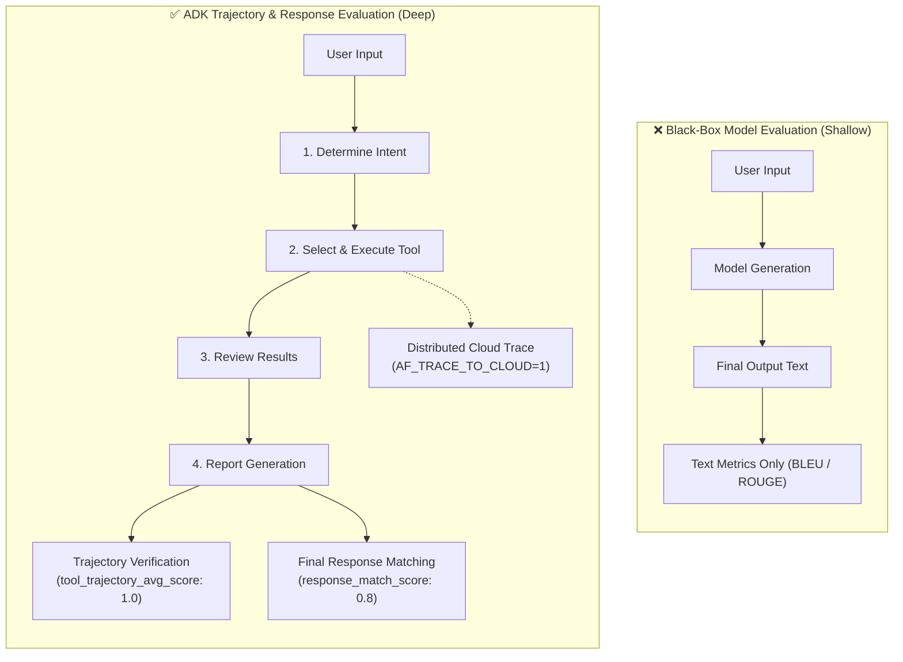
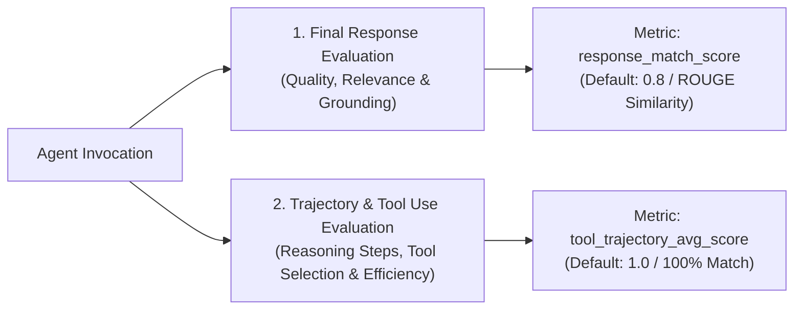
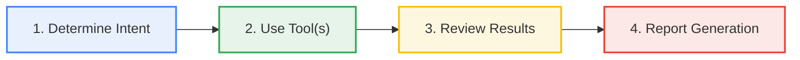
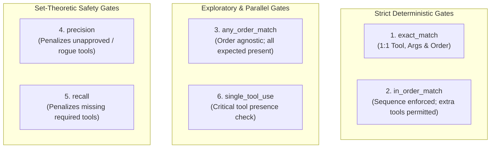
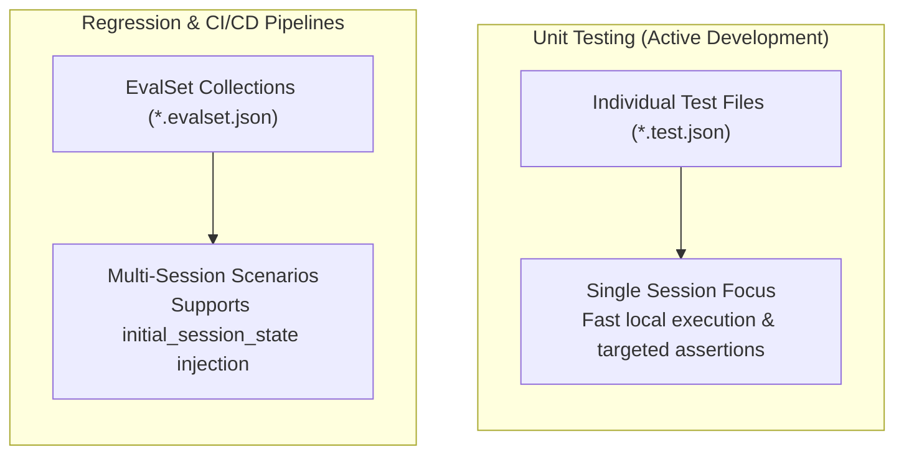
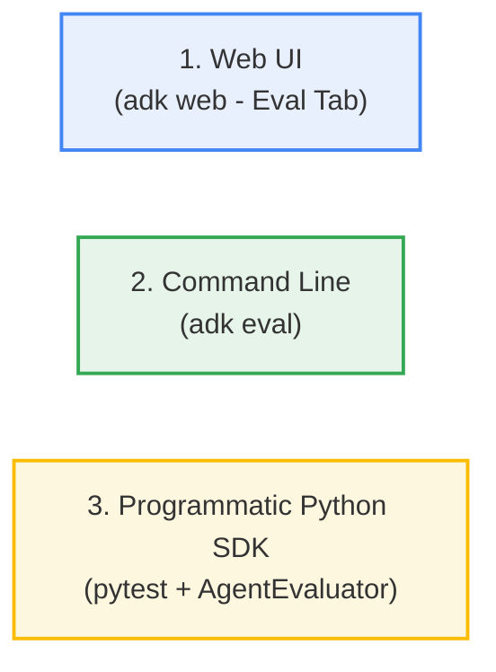
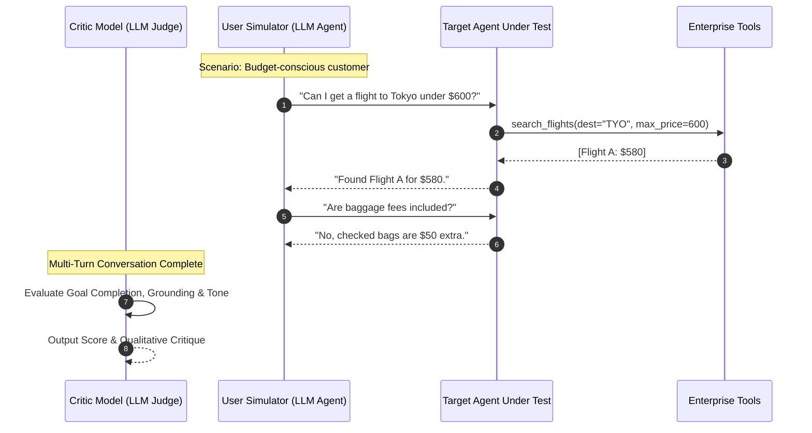
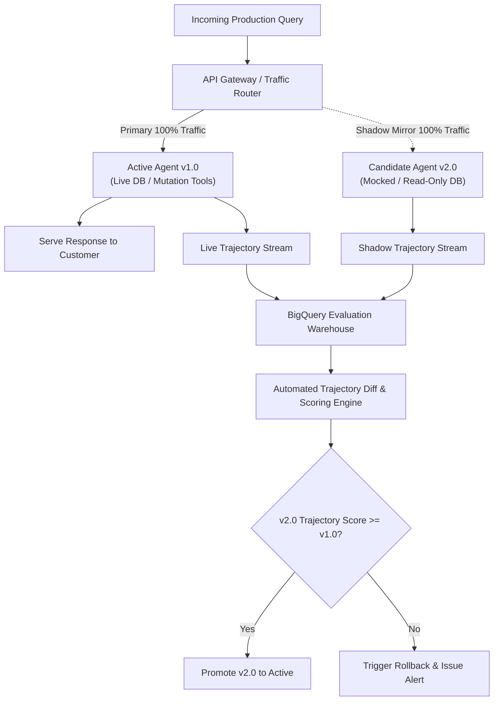

# Module 24: Evaluating Agent Performance & Trajectory Verification

[Executive Overview](#executive-overview) | [Model vs Agent Evaluation](#generative-model-evaluation-vs-agent-evaluation) | [The Two Evaluation Axes](#the-two-kinds-of-evaluation) | [Trajectory Matching & The 6 Criteria](#evaluating-trajectory-and-tool-use) | [Two File Formats: *.test.json vs *.evalset.json](#the-two-evaluation-approaches-test-files-vs-evalsets) | [Three Execution Modalities](#three-ways-to-run-evaluations) | [Testing Pyramid & Built-in Metrics](#the-testing-pyramid--evaluation-metrics) | [Reference-Free User Simulation & LLM-as-a-Judge](#automating-interaction-user-simulation--llm-as-a-judge) | [Distributed Cloud Tracing](#distributed-cloud-tracing-configuration) | [Production Canary & Shadow Evaluation](#production-canary--shadow-evaluation-on-vertex-ai) | [Best Practices & Gotchas](#best-practices-and-common-pitfalls) | [Exam Prep: 11 Architecture Questions](#google-professional-agentic-architect-exam-prep-questions) | [Official References](#official-references)

---

## Executive Overview

In traditional software development, deterministic unit tests assert exact equality: `assert add(2, 2) == 4`. 

However, Large Language Models (LLMs) and autonomous agents are **non-deterministic** and **stateful**:
- The same question asked twice may produce different, yet equally valid, phrased responses.
- An agent does not merely generate text; it acts as a reasoning engine that calls external tools, updates session state, delegates to sub-agents, and dynamically plans multi-turn trajectories.

Evaluating an agent as a black box based solely on its final text response is an anti-pattern. If an agent hallucinates an intermediate tool parameter, skips a mandatory compliance check, or gets stuck in a circular loop, a simple text check will fail to diagnose the root cause.

The **Google Agent Development Kit (ADK)** provides a native, dual-axis evaluation framework designed for enterprise verification:
1. **Final Response Evaluation**: Assessing linguistic quality, relevance, and factual grounding using ROUGE n-gram overlap and LLM judges.
2. **Trajectory & Tool Evaluation**: Step-by-step verification of the agent's internal decision paths, tool selection, argument accuracy, and execution order.



---

## Generative Model Evaluation vs. Agent Evaluation

Understanding the distinction between model evaluation and agent evaluation is a core concept on the **Google Cloud Professional Agentic Architect** certification exam:

| Evaluation Dimension | Standalone LLM Evaluation | ADK Agent Evaluation |
|---|---|---|
| **Primary Scope** | The final generated text output string. | The **entire decision-making trajectory** + final output. |
| **System Complexity** | Single prompt $\rightarrow$ single completion. | Multi-turn reasoning loops, tool calls, session state mutation, and subagent handoffs. |
| **Failure Visibility** | Text hallucinations, tone drift, grammar errors. | Inefficient tool paths, wrong tool selection, missing parameters, unauthorized tool execution, infinite reasoning loops. |
| **Primary Metric** | Perplexity, BLEU, ROUGE-L, Semantic Similarity. | `tool_trajectory_avg_score` (Action accuracy) + `response_match_score` (Synthesized response). |
| **Core Question** | *"Did the model generate an articulate text answer?"* | *"Did the agent take the correct, authorized sequence of actions to reach the solution?"* |

---

## The Two Kinds of Evaluation

The ADK evaluation framework operates simultaneously along two complementary axes:



### 1. Evaluating the Final Response
Assesses the quality, relevance, and correctness of the agent's synthesized output to the user.
- **The Reference Response:** In your evaluation dataset, you specify an expected answer in the `reference` (or `final_response`) field.
- **The ROUGE Similarity Metric:** ADK calculates the mathematical similarity using **ROUGE** (Recall-Oriented Understudy for Gisting Evaluation) n-gram overlap between the actual generated response and the golden reference string.
- **`response_match_score`:** Configured as a float threshold between `0.0` and `1.0`.
  - **Default Value: `0.8`** (80% n-gram overlap).
  - **Why 0.8?** Natural language permits stylistic variation (e.g., *"The weather in Paris is 22°C"* vs. *"It is 22 degrees Celsius in Paris"*). The 0.8 threshold tolerates up to 20% surface variance while rejecting factual hallucinations or missing critical data.

### 2. Evaluating Trajectory and Tool Use
Before returning an answer to the user, an agent moves through a sequence of internal reasoning and action steps called a **trajectory**.

#### The Canonical 4-Stage Action Cycle
In every turn, an ADK agent executes a 4-phase reasoning loop:
1. **Determine Intent:** Parse user query and conversation history to determine the operational goal.
2. **Use Tool:** Select the matching tool and call it with structured arguments.
3. **Review Results:** Inspect the tool's return dictionary or error payload.
4. **Report Generation:** Formulate the user-facing synthesis or decide if additional tool iterations are required.



#### Trajectory Scoring Mechanics
- **`expected_tool_use`:** The ground-truth sequence of tool calls and argument payloads.
- **Per-Step Scoring:** Each matching tool step receives a score of **1**, while an incorrect, missing, or mismatched-argument tool receives a **0**. The final score is the mathematical average across all steps.
- **`tool_trajectory_avg_score`:** The threshold required for the test to pass.
  - **Default Value: `1.0`** (Requires 100% exact compliance with expected tool usage).

---

## Evaluating Trajectory and Tool Use: The 6 Match Criteria

Depending on your enterprise safety profile and architectural requirements, ADK supports six distinct trajectory matching strategies:



### Comprehensive Trajectory Match Criteria Matrix

| Match Strategy | Mathematical / Algorithmic Definition | Permitted Tolerances | Target Enterprise Use Case |
|---|---|---|---|
| **1. `exact_match`** | Actual must exactly equal Expected in names, arguments, and sequence. | Zero tolerance. Any extra or missing tool fails the test. | Financial fund transfers, medical dosage calculation, database writes. |
| **2. `in_order_match`** | Expected tools must appear in the correct relative chronological sequence, while allowing extra non-critical tools between them. | Auxiliary / non-critical tools may be interleaved between expected tools. | Workflows where compliance ordering matters (e.g. KYC check before transaction), but diagnostic lookups are allowed. |
| **3. `any_order_match`** | Every expected tool must appear in Actual, regardless of ordering. | Sequence does not matter; extra tools are allowed. | Parallel information gathering (e.g., retrieving customer weather, news, and stock quote concurrently). |
| **4. `precision`** | Precision = count(Actual ∩ Expected) / count(Actual). | Penalizes extraneous or unapproved tool calls. Drops below 1.0 if unauthorized tools run. | Zero-Trust DevSecOps; infrastructure mutation agents where rogue actions are strictly prohibited. |
| **5. `recall`** | Recall = count(Actual ∩ Expected) / count(Expected). | Penalizes omitting mandatory tools. Does not penalize extra diagnostic tools. | Comprehensive audit and compliance reporting where no required data source can be skipped. |
| **6. `single_tool_use`** | Checks whether a required critical tool appears at least once in Actual. | Evaluates whether a specific critical tool was called at least once. | Benchmarking 1-hop tool selection accuracy from a large tool registry (e.g. 40+ candidate tools). |

---

## The Two Evaluation Approaches: Test Files vs. EvalSets

ADK organizes test data into two standard file formats:



### Approach 1: Test Files (`*.test.json`)
The Test File approach isolates an individual conversation scenario for fast iteration.
- **Naming Rule:** Must end with **`.test.json`**.
- **Scope:** Single session with one or more conversational turns.
- **Primary Use:** Fast local debugging and unit testing of agent logic.

```json
{
  "$schema": "https://google.github.io/adk/schemas/test.v1.json",
  "name": "wire_transfer_cleared_test",
  "description": "Verify that a cleared customer initiates AML check before wire execution",
  "trajectory_match_strategy": "in_order_match",
  "turns": [
    {
      "user_input": "Please transfer $500 from ACC-101 to ACC-909 for customer CUST-8812.",
      "expected_tool_use": [
        {
          "tool_name": "check_aml_sanctions",
          "arguments": { "customer_id": "CUST-8812" }
        },
        {
          "tool_name": "execute_wire_transfer",
          "arguments": {
            "source_account": "ACC-101",
            "target_account": "ACC-909",
            "amount": 500.0
          }
        }
      ],
      "reference": "Wire transfer of $500 from ACC-101 to ACC-909 has been successfully completed with reference ID TX-99482.",
      "tool_trajectory_avg_score": 1.0,
      "response_match_score": 0.80
    }
  ]
}
```

### Approach 2: EvalSets (`*.evalset.json`)
EvalSets group multiple test cases together and support state initialization.
- **Naming Rule:** Must end with **`.evalset.json`**.
- **Scope:** Multi-case collection containing distinct `eval_cases` or `sessions`.
- **Key Feature:** Supports **`initial_session_state`**, allowing tests to pre-populate authentication tokens, KYC tiers, shopping carts, or tenant IDs before Turn 1 executes.
- **Primary Use:** Automated CI/CD regression suites and release verification.

```json
{
  "$schema": "https://google.github.io/adk/schemas/evalset.v1.json",
  "eval_set_id": "enterprise_wire_scenarios",
  "name": "enterprise_wire_scenarios",
  "eval_cases": [
    {
      "eval_id": "vip_user_cleared",
      "initial_session_state": {
        "customer_tier": "VIP",
        "customer_id": "CUST-VIP-001",
        "auth_verified": true
      },
      "conversation": [
        {
          "user_content": { "parts": [{ "text": "Execute wire of $2000 from ACC-VIP to ACC-EXT." }], "role": "user" },
          "final_response": { "parts": [{ "text": "Wire transfer completed with reference ID TX-99482." }], "role": "model" },
          "intermediate_data": {
            "invocation_events": [
              {
                "content": {
                  "parts": [
                    { "function_call": { "name": "check_aml_sanctions", "args": { "customer_id": "CUST-VIP-001" } } },
                    { "function_call": { "name": "execute_wire_transfer", "args": { "amount": 2000.0 } } }
                  ]
                }
              }
            ]
          }
        }
      ]
    }
  ]
}
```

---

## Three Ways to Run Evaluations

ADK provides three execution modalities tailored for development, automation, and CI/CD:



### 1. Web-Based UI (`adk web`)
- Launch the Developer UI: `adk web`
- Navigate to the **Eval** tab in the right sidebar.
- **Interactive Session Capture:** Converse with your agent in real time, then click **"Add current session to eval set"** to convert the live interaction into a golden test case.
- **Visual Diff Inspection:** Run evaluations interactively to view side-by-side trajectory diffs and highlighted token mismatches.

### 2. Command Line Interface (CLI)
Used for rapid terminal-based verification:
```bash
# Run a single test file
adk eval src/agents/finance_agent.py tests/eval_suites/wire_transfer.test.json

# Run an entire EvalSet with verbose logging
adk eval src/agents/finance_agent.py tests/eval_suites/account_scenarios.evalset.json --verbose

# Export JSON evaluation summary report
adk eval src/agents/finance_agent.py tests/eval_suites/account_scenarios.evalset.json --output-report reports/eval_summary.json
```

### 3. Programmatic Execution with `pytest`
For production CI/CD pipelines (e.g., Google Cloud Build, GitHub Actions), wrap `AgentEvaluator` inside standard `pytest` test suites:

```python
# tests/test_agent_evaluation.py
import pytest
from google.adk.evaluation import AgentEvaluator
from google.adk.evaluation.eval_metrics import EvalStatus

EVAL_FILES = [
    "tests/eval_suites/wire_transfer.test.json",
]

@pytest.mark.parametrize("eval_file", EVAL_FILES)
def test_agent_trajectories_and_response_sla(eval_file):
    """
    Executes automated trajectory and ROUGE quality gates in CI/CD.
    """
    evaluator = AgentEvaluator()
    
    result = evaluator.evaluate(
        agent_module_path="src/agents/finance_agent.py",
        eval_file_path=eval_file,
        tool_trajectory_avg_score=1.0,
        response_match_score=0.80,
    )
    
    # 1. Verify Overall Evaluation Pass
    assert result.overall_eval_status == EvalStatus.PASSED, (
        f"Evaluation failed for {eval_file}! Overall Score: {result.overall_score}"
    )
    
    # 2. Strict Trajectory Verification
    assert result.tool_trajectory_avg_score == 1.0, (
        f"Trajectory mismatch in {eval_file}!\n"
        f"Expected: {result.expected_trajectory}\n"
        f"Actual:   {result.actual_trajectory}\n"
        f"Diff:     {result.trajectory_diff}"
    )
    
    # 3. Final Response Quality Assertion
    assert result.response_match_score >= 0.80, (
        f"ROUGE score ({result.response_match_score:.2f}) fell below 0.80 threshold."
    )
```

Execute with JUnit XML generation for CI reporting:
```bash
pytest tests/test_agent_evaluation.py -v --junitxml=reports/junit_report.xml
```

---

## The Testing Pyramid & Evaluation Metrics

```text
                    ╔══════════════════════════════════════════════╗
                    ║              EVALUATION TESTS                ║
                    ║ (End-to-End Quality, LLM-in-the-loop)        ║
                    ╚══════════════════════════════════════════════╝
                                        │
                                        │ Slowest, non-deterministic, checks action trajectory
                                        ▼
                    ╔══════════════════════════════════════════════╗
                    ║            INTEGRATION TESTS                 ║
                    ║ (Agent orchestration, state propagation)     ║
                    ╚══════════════════════════════════════════════╝
                                        │
                                        │ Medium speed, mocks LLM to verify routing/state
                                        ▼
                    ╔══════════════════════════════════════════════╗
                    ║             UNIT TESTS                       ║
                    ║ (Deterministic custom tool functions)        ║
                    ╚══════════════════════════════════════════════╝
```

### Comprehensive Evaluation Metrics Catalog

#### 1. Tool Use & Trajectory (Reasoning)
*   **`tool_trajectory_avg_score`**: Mathematical average of per-step tool matches (`1.0` or `0.0`). Default threshold: `1.0`.
*   **`rubric_based_tool_use_quality_v1`**: Uses an LLM judge to evaluate whether tools were invoked logically, economically, and appropriately.

#### 2. Final Response Quality (Accuracy & Phrasing)
*   **`response_match_score` (ROUGE)**: Lexical n-gram overlap between actual response and reference. Default threshold: `0.8`.
*   **`final_response_match_v2`**: LLM judge checks for *semantic equivalence*, allowing completely different sentence structures as long as factual claims match.
*   **`rubric_based_final_response_quality_v1`**: Rates responses against qualitative rubrics (e.g., professionalism, empathy, conciseness).

#### 3. Groundedness & Compliance (Safety)
*   **`hallucinations_v1`**: Verifies that every factual claim in the response is directly supported by tool outputs or provided context.
*   **`safety_v1`**: Scans responses for harmful, toxic, or out-of-bounds content.

---

## Automating Interaction: User Simulation & LLM-as-a-Judge

Static evaluation cases cannot verify how an agent handles unpredictable conversational flows or adversarial customers. ADK provides **User Simulation** for reference-free evaluation:



- **Conversation Scenarios:** Define user personas, goals, and behavioral constraints (e.g., *"The user is confused about return policies and changes their mind twice"*).
- **The Simulator:** An LLM acts as the user, generating authentic follow-up questions dynamically based on the target agent's responses.
- **Reference-Free Scoring:** Because no static reference string exists, LLM-as-a-Judge metrics (`hallucinations_v1`, `safety_v1`, `goal_completion_score`) evaluate the transcript against objective business rubrics.

---

## Distributed Cloud Tracing Configuration

In production, agents can exhibit hidden latency bottlenecks or enter recursive tool execution loops. ADK provides native OpenTelemetry integration with Google Cloud Trace.

```
[Trace: User Invocation] (Total: 1.84s)
   └── [Span: Agent.run: finance_agent] (1.84s)
          ├── [Span: Model.generate_content (Gemini 1.5 Flash)] (410ms)
          ├── [Span: Tool.execute: check_aml_sanctions] (120ms)
          ├── [Span: Model.generate_content (Gemini 1.5 Flash)] (380ms)
          ├── [Span: Tool.execute: execute_wire_transfer] (650ms)
          └── [Span: Model.generate_content (Gemini 1.5 Flash)] (280ms)
```

### Enabling Cloud Trace Telemetry
Zero code changes are required. Simply configure the environment variable:

```bash
# In your .env file or Cloud Run environment
AF_TRACE_TO_CLOUD=1
```

### Required IAM Permissions
The service account executing the agent must be granted:
- **`roles/cloudtrace.agent`** (`Cloud Trace Agent`): Allows writing telemetry spans to the Google Cloud Trace API.

---

## Production Canary & Shadow Evaluation on Vertex AI

When deploying agent updates (`v2.0`) to **Vertex AI Agent Runtime**, enterprise architects use **Shadow Evaluation (Traffic Mirroring)** to eliminate deployment risk:



1. **Traffic Mirroring:** Live customer queries are routed to `v1.0` (which serves the customer) and simultaneously mirrored to `v2.0`.
2. **Safe Tool Sandboxing:** `v2.0` is bound to mock or read-only versions of mutation tools to prevent accidental duplicate side-effects (e.g. charging credit cards or writing duplicate orders).
3. **Automated Trajectory Diffing:** Execution trajectories from both versions are logged to BigQuery and compared to verify that `v2.0` maintains or improves tool selection accuracy and latency before cutover.

---

## Best Practices and Common Pitfalls

### 1. The ROUGE Numerical Trap
- **Trap:** Expecting `response_match_score` (ROUGE) to catch incorrect financial amounts, dates, or IDs.
- **Why it happens:** ROUGE calculates lexical n-gram overlap. In an 80-word paragraph, changing `$500` to `$5,000` alters only 1 token out of 80. The ROUGE score remains ~0.95, passing the test despite a critical error.
- **Architectural Solution:** Always validate critical deterministic data via **tool parameter assertions** (`expected_tool_use.arguments`) or schema-enforced structured JSON output.

### 2. The Overly Strict Exact Match
- **Trap:** Using `exact_match` on agents with optional or auxiliary diagnostic tools.
- **Why it happens:** If the agent calls a non-essential tool (e.g., `lookup_exchange_rate` or `log_metric`), `exact_match` immediately fails the test.
- **Architectural Solution:** Use `in_order_match` to enforce sequence on mandatory compliance tools while tolerating benign auxiliary calls.

### 3. Missing Session State in `.test.json`
- **Trap:** Testing state-dependent multi-turn agents with `.test.json` files.
- **Why it happens:** `.test.json` files start with an empty session state. If the agent expects an authenticated user ID in `session.state["user_id"]`, Turn 1 crashes with a `KeyError`.
- **Architectural Solution:** Use `*.evalset.json` and declare `initial_session_state`.

---

## Google Professional Agentic Architect: Exam Prep Questions

The following **11 scenario-based questions** simulate the depth, tone, and multi-layered trade-offs found on the **Google Cloud Professional Agentic Architect (Beta)** certification exam.

---

### Question 1: Financial Transaction Ordering & Non-Essential Tool Tolerance
**Scenario:** You are the Lead Agentic Architect for a Tier-1 retail bank. You are deploying an autonomous wire transfer agent built with the Google Agent Development Kit (ADK). Enterprise security policy mandates that before executing any fund transfer, the agent must perform two mandatory compliance checks in strict chronological order:
1. `check_aml_sanctions(customer_id)`
2. `verify_account_balance(account_id, amount)`
3. `execute_wire_transfer(source_account, target_account, amount)`

During test evaluation, the LLM occasionally calls an auxiliary diagnostic tool `fetch_exchange_rate(currency)` between the AML check and the balance verification. Additionally, the agent calls an optional `log_audit_telemetry(event_id)` at the end of the transaction.

If you enforce `exact_match`, the evaluation fails because of the auxiliary tool calls, causing false-positive build breaks in your Cloud Build CI/CD pipeline. However, if you use `any_order_match`, the agent might accidentally call `execute_wire_transfer` before the AML compliance check passes, which violates federal financial regulations.

**Question:** Which trajectory evaluation configuration must you implement in your evaluation suite to guarantee compliance while avoiding false-positive CI/CD pipeline failures?
- **A.** Set `trajectory_match_strategy="exact_match"` and add wildcard patterns `*` to the `expected_tool_use` array to tolerate optional tools.
- **B.** Set `trajectory_match_strategy="in_order_match"` with `expected_tool_use=["check_aml_sanctions", "verify_account_balance", "execute_wire_transfer"]`, ensuring the mandatory sequence is preserved while permitting interleaved auxiliary calls.
- **C.** Set `trajectory_match_strategy="precision"` with a threshold of `1.0` so that any tool outside the compliance list causes an instant failure.
- **D.** Set `trajectory_match_strategy="any_order_match"` and implement an `after_tool_modifier` callback in Python to raise a `RuntimeError` if the sequence index is out of bounds.

> **Correct Answer: B**  
> **Architectural Rationale:** `in_order_match` verifies that the specified subsequence of expected tool calls appears in the exact relative chronological order within the actual trajectory. It permits other unlisted or non-critical tools to be interleaved before, between, or after the required tools without failing the test.  
> **Distractor Breakdown:** A is invalid because ADK does not support wildcard tool names in `exact_match`. C (`precision = 1.0`) fails if any unlisted auxiliary tool is called. D introduces runtime python antipatterns into agent code to compensate for lenient test metrics.

---

### Question 2: Limitations of ROUGE Scoring for Factual & Cryptographic Identifiers
**Scenario:** An autonomous insurance claims agent processes automobile accident reimbursement requests. The final step of the agent is to generate a settlement confirmation message containing:
- The claimant's name.
- The claim status (`APPROVED` or `DENIED`).
- A unique 16-character alphanumeric claim confirmation hash (e.g., `CLM-9821-X47F-0012`).
- The approved settlement amount (e.g., `$4,850.00`).

Your evaluation dataset uses `*.test.json` files with `response_match_score` configured with the default ROUGE metric and the default threshold of `0.8` (80% n-gram overlap).

During automated regression testing, an engineer modifies the agent's system prompt. The model subsequently hallucinates the confirmation hash as `CLM-9821-X47F-9999` and outputs `$4,950.00` instead of `$4,850.00`. However, the rest of the confirmation boilerplate text is identical to the golden reference. The automated evaluation reports that the test **PASSED** with a `response_match_score` of `0.89`.

**Question:** As the Agentic Architect, what is the root cause of this test evasion, and what is the Google-recommended architectural remedy?
- **A.** ROUGE is a semantic embedding distance metric; increase the `response_match_score` threshold to `0.99` to ensure strict vector alignment.
- **B.** The test passed because `tool_trajectory_avg_score` defaulted to 1.0; you must set `tool_trajectory_avg_score` to 0.0 to force ROUGE evaluation.
- **C.** ROUGE measures surface n-gram lexical overlap rather than factual or numerical correctness; you must implement an evaluation hook or custom assertion validating exact deterministic values, or output structured JSON validated against a schema.
- **D.** The test file lacked the `.evalset.json` extension, causing the evaluator to skip numerical token comparisons.

> **Correct Answer: C**  
> **Architectural Rationale:** ROUGE calculates lexical n-gram overlap. In a 100-word paragraph, changing a hash and an amount alters only 2–3 tokens, keeping the ROUGE score well above 0.85. Crucial deterministic identifiers must be validated via structured schema validation or explicit programmatic assertions.  
> **Distractor Breakdown:** A is false because ROUGE is lexical, not an embedding metric; raising it to 0.99 causes brittle failures over trivial rephrasing. B and D misstate evaluator mechanics.

---

### Question 3: Enterprise CI/CD Automated Regression Gate with `pytest`
**Scenario:** You are integrating automated agent evaluation into a Google Cloud Build CI/CD pipeline. Every time a pull request is opened against the repository, Cloud Build must execute an automated test suite using `pytest`. 

Your requirements:
1. Evaluate 25 predefined customer service interaction test suites located in `tests/eval_suites/`.
2. Reject any PR if the agent's tool trajectory score is anything less than 100% exact match (`1.0`).
3. Reject any PR if the final response lexical similarity score falls below `0.85`.
4. Generate a machine-readable JUnit XML report for test dashboards.

**Question:** Which code pattern correctly implements this evaluation gate using the ADK Python SDK?
- **A.** Use `AgentEvaluator(agent_module="...").run()` and check `summary["tools_passed"]`.
- **B.**
  ```python
  import pytest
  from google.adk.evaluation import AgentEvaluator

  @pytest.mark.parametrize("eval_file", ["tests/eval_suites/billing.test.json"])
  def test_agent_trajectories(eval_file):
      result = AgentEvaluator.evaluate(
          agent_module_path="src/agents/customer_service.py",
          eval_file_path=eval_file,
          tool_trajectory_threshold=1.0,
          response_match_threshold=0.85
      )
      assert result.tool_trajectory_avg_score == 1.0, f"Trajectory mismatch: {result.trajectory_diff}"
      assert result.response_match_score >= 0.85, f"Response score below SLA: {result.response_match_score}"
  ```
- **C.** Call `EvaluationServiceClient().evaluate_instances()` on Vertex AI GenAI Evaluation API.
- **D.** Run shell script `adk eval --strict-all --dir tests/eval_suites/` in Cloud Build without python tests.

> **Correct Answer: B**  
> **Architectural Rationale:** ADK provides programmatic evaluation via `AgentEvaluator.evaluate()`, returning an evaluation result object with explicit attributes (`tool_trajectory_avg_score`, `response_match_score`, `trajectory_diff`). Wrapping this in parameterized `pytest` functions enables granular failure diagnostics and native JUnit XML compatibility.

---

### Question 4: Multi-Turn Stateful Evaluation & Fixtures (`.test.json` vs. `.evalset.json`)
**Scenario:** A developer on your team is building an agent for an eCommerce platform that manages order cancellations. The business logic requires that:
1. An incoming user session must already have an active shopping profile and authenticated user session loaded in the agent state (`session.state["user_id"] = "USR-771"`, `session.state["cart_active"] = True`).
2. The agent must converse over three consecutive turns:
   - Turn 1: User requests cancellation.
   - Turn 2: Agent asks for confirmation and reason.
   - Turn 3: User confirms, agent executes `cancel_order_tool(order_id="ORD-990")`.

The developer created a file named `cancel_order.test.json`. When running `adk eval`, the agent fails on Turn 1 with a `KeyError: 'user_id'` because the session state is empty. Furthermore, the developer wants to test 5 distinct edge-case customer sessions in the same evaluation suite.

**Question:** How should the architect instruct the developer to restructure their test assets?
- **A.** Add a Python decorator `@pytest.fixture(autouse=True)` inside `cancel_order.test.json`.
- **B.** Rename the file to `cancel_order.evalset.json`, define an `initial_session_state` JSON object specifying `user_id` and `cart_active`, and structure the multi-session scenarios under the top-level `sessions` or `eval_cases` array.
- **C.** Modify the agent code to bypass authentication if `os.environ.get("ENV") == "TEST"`.
- **D.** Embed an inline SQL insert statement in `cancel_order.test.json` to write the session directly to Cloud SQL.

> **Correct Answer: B**  
> **Architectural Rationale:** In the ADK evaluation specification, `*.evalset.json` supports multiple sessions and allows defining `initial_session_state` to seed state variables prior to the first conversational turn. `*.test.json` only supports a single session and cannot inject custom state dictionaries.

---

### Question 5: Security Policy Enforcement: Precision vs. Recall Match Criteria
**Scenario:** You are architecting an autonomous IT Infrastructure Security Agent for Google Cloud. The agent has access to sensitive remediation tools:
- `quarantine_compute_instance(instance_id)`
- `revoke_iam_binding(member, role)`
- `disable_service_account_key(key_id)`
- `export_security_logs(destination_bucket)` (Read-only / diagnostic)

During critical incident evaluations, your enterprise Security Operations Center (SOC) establishes a **Zero-Unauthorized-Action policy**:
> "Under no circumstances may the agent invoke any destructive tool (`quarantine`, `revoke`, `disable`) unless that specific tool was explicitly mandated in the test scenario. If an agent calls even one unapproved destructive tool, the evaluation must fail immediately, even if it successfully called all other expected tools."

However, if the agent decides that calling the read-only `export_security_logs` tool was unnecessary for a trivial alert, SOC does not consider that an evaluation failure.

**Question:** Which trajectory match strategy should you configure for this safety-critical evaluation gate?
- **A.** Trajectory Strategy: Recall with a threshold of `1.0`.
- **B.** Trajectory Strategy: Precision with a threshold of `1.0`.
- **C.** Trajectory Strategy: Single-Tool Use with a threshold of `0.5`.
- **D.** Trajectory Strategy: Any-Order Match with a threshold of `0.8`.

> **Correct Answer: B**  
> **Architectural Rationale:** Precision = count(Actual ∩ Expected) / count(Actual). Setting Precision to 1.0 guarantees that 100% of the tools the agent executed were members of the approved expected set. Invoking any unapproved tool drops precision below 1.0 and fails the gate. In contrast, Recall only checks if expected tools were called, and would allow unapproved tools to execute without penalty.

---

### Question 6: Distributed Tracing & Pathological Reasoning Detection (`AF_TRACE_TO_CLOUD=1`)
**Scenario:** An autonomous customer onboarding agent deployed on Google Cloud begins exhibiting intermittent timeouts (requests exceeding the 60-second Cloud Run request deadline). Cloud Logging displays high-level log messages, but you cannot determine whether the delay is caused by:
1. High latency in downstream enterprise REST APIs.
2. An infinite reasoning loop where the agent repeatedly calls `validate_tax_id` with minor argument variations.
3. Slow token generation from the foundation model during complex reasoning steps.

You need to enable distributed telemetry across the entire ADK agent execution lifecycle and analyze the span hierarchy in Google Cloud Trace without modifying the underlying agent source code.

**Question:** What configuration steps must you take to achieve this visibility?
- **A.** Set `AF_TRACE_TO_CLOUD=1` in the agent's runtime environment or `.env` file, ensure the service account has `roles/cloudtrace.agent`, and inspect the span hierarchy in the Google Cloud Trace console.
- **B.** Import `google.cloud.trace_v1` in `__init__.py` and wrap every tool function with `@trace.span(name="tool_call")`.
- **C.** Modify `agent.json` to set `"telemetry": {"provider": "open_telemetry", "export_raw_prompts": true}`.
- **D.** Enable Vertex AI Model Monitoring and configure drift detection alerts on input embedding vectors.

> **Correct Answer: A**  
> **Architectural Rationale:** ADK features built-in OpenTelemetry instrumentation. Setting `AF_TRACE_TO_CLOUD=1` automatically emits structured spans for `Agent.run`, `Model.generate_content`, and `Tool.execute`. Granting `roles/cloudtrace.agent` enables writing these spans directly to Google Cloud Trace with zero code refactoring.

---

### Question 7: Hierarchical Multi-Agent Trajectory Evaluation
**Scenario:** You are designing a hierarchical multi-agent system for a global logistics enterprise:
- **`DispatcherAgent`**: Receives customer input, determines intent, and delegates to specialized sub-agents.
- **`CustomsBrokerAgent`**: Handles tariff calculations and customs document generation.
- **`FreightBookingAgent`**: Books cargo space with maritime carriers.

During testing, a user submits: *"Calculate duty for 500 laptops imported from Japan to Long Beach, then book container space."*

The test case specifies:
1. `DispatcherAgent` routes to `CustomsBrokerAgent`.
2. `CustomsBrokerAgent` invokes `calculate_customs_duty(hs_code="8471.30", origin="JP", dest="US")`.
3. Control returns to `DispatcherAgent`.
4. `DispatcherAgent` routes to `FreightBookingAgent`.
5. `FreightBookingAgent` invokes `reserve_shipping_container(port="LGB", teus=1)`.

**Question:** How is multi-agent trajectory tracking validated in ADK evaluation suites?
- **A.** Sub-agent trajectories are completely flattened into a single global tool list; the evaluator cannot distinguish which agent invoked which tool.
- **B.** The evaluator tracks agent handoffs and tool execution as a hierarchical tree of events, verifying both the intermediate agent transitions and the sub-agent's scoped tool calls.
- **C.** Multi-agent systems cannot be tested with `*.test.json`; you must deploy three separate standalone services and mock HTTP payloads between them.
- **D.** Trajectory evaluation only applies to the root agent; sub-agents can only be evaluated using ROUGE final response matching.

> **Correct Answer: B**  
> **Architectural Rationale:** ADK captures an event stream that records active agent identity for each invocation. The evaluation harness validates agent delegation transitions, verifying that the parent correctly handed off execution to the designated sub-agent and that the sub-agent operated within its tool scope.

---

### Question 8: Reference-Free Evaluation & LLM-as-a-Judge for Open-Ended Tasks
**Scenario:** Your team has built an autonomous Wealth Management Financial Advisor agent. The agent conducts open-ended consultations with high-net-worth clients to explain portfolio rebalancing strategies. 

Because client inquiries are highly subjective and conversational paths vary wildly, it is impossible to write static golden responses (`reference`) for each turn. Traditional ROUGE metrics yield scores under `0.35` despite financial experts confirming that the agent's advice was accurate, compliant, and highly empathetic.

Management requires an automated quality evaluation system that runs weekly over 1,000 real client interaction transcripts.

**Question:** What is the most robust, enterprise-grade architecture to implement for this evaluation requirement?
- **A.** Lower the ROUGE threshold to `0.20` in `*.test.json` so that all creative responses pass.
- **B.** Replace the evaluation suite with a **Reference-Free LLM-as-a-Judge (User Simulation)** pipeline deployed on Vertex AI, utilizing a critic model (such as Gemini 1.5 Pro) with structured rubrics assessing *Financial Accuracy*, *Regulatory Grounding*, *Tone/Empathy*, and *Safety Compliance*.
- **C.** Enforce that the agent always outputs a fixed, pre-approved paragraph template regardless of what the customer asks.
- **D.** Implement `exact_match` on tool trajectories and ignore the final conversational response entirely.

> **Correct Answer: B**  
> **Architectural Rationale:** Open-ended conversational tasks cannot be effectively evaluated with lexical overlap metrics like ROUGE. Deploying an LLM-as-a-Judge with explicit qualitative rubrics and grounding documents enables automated, objective evaluation at scale without requiring static reference answers.

---

### Question 9: Granular Tool Parameter Validation & Partial Credit Scoring
**Scenario:** An enterprise purchasing agent is being evaluated for an automated procurement workflow. 
The test case specifies:
```json
"expected_tool_use": [
  {
    "tool_name": "create_purchase_requisition",
    "arguments": {
      "item_sku": "DELL-XPS-15",
      "quantity": 10,
      "cost_center": "CC-ENG-402"
    }
  }
]
```

During the evaluation run, the agent makes the following tool call:
```json
"actual_tool_call": {
  "tool_name": "create_purchase_requisition",
  "arguments": {
    "item_sku": "DELL-XPS-15",
    "quantity": 100,
    "cost_center": "CC-ENG-402"
  }
}
```

Notice that the `quantity` is `100` instead of `10`.

**Question:** Under default ADK trajectory evaluation rules, how is this step scored, and what is the resulting `tool_trajectory_avg_score`?
- **A.** The score is `0.66` because 2 out of the 3 arguments matched correctly.
- **B.** The score is `1.0` because ADK trajectory matching only validates the `tool_name` and ignores argument payloads.
- **C.** The score is `0.0` for this step because argument matching is strictly deterministic; any argument discrepancy results in a complete step mismatch, yielding a `tool_trajectory_avg_score` of `0.0`.
- **D.** The evaluator triggers a retry loop, sending an error prompt back to the model until the arguments match.

> **Correct Answer: C**  
> **Architectural Rationale:** When arguments are specified in `expected_tool_use`, ADK trajectory evaluation enforces exact argument matching per step. A discrepancy in any argument results in a score of 0 for that step. Averaged across a single-step test, the overall `tool_trajectory_avg_score` is 0.0.

---

### Question 10: Safe Canary & Shadow Evaluation on Vertex AI Agent Runtime
**Scenario:** You are deploying a new version (`v2.0`) of a customer support agent to **Vertex AI Agent Runtime** (Reasoning Engine). The agent interacts with production databases. 

Before routing 100% of live customer traffic to `v2.0`, the Chief Risk Officer requires empirical proof that `v2.0` achieves equal or better trajectory accuracy than `v1.0` on real customer queries, without exposing live users to potential bugs or executing duplicate database modifications.

**Question:** Which deployment and evaluation architecture should you implement?
- **A.** Deploy `v2.0` directly to production during off-peak hours and monitor the customer complaint queue.
- **B.** Implement a **Shadow Evaluation Pipeline**: Route live incoming user queries simultaneously to `v1.0` (active) and `v2.0` (shadow). Configure `v2.0` with mock/read-only database tool bindings. Stream both execution trajectories to BigQuery and execute automated trajectory diff scoring between the two versions.
- **C.** Run unit tests on a developer's local laptop using `adk web` and manually certify the release.
- **D.** Configure an A/B test in Cloud Load Balancing routing 50% of real paying customers to `v2.0` with live credit card charging tools enabled.

> **Correct Answer: B**  
> **Architectural Rationale:** Shadow Evaluation (traffic mirroring) is the enterprise standard for safely validating agents against real production distributions. Sandboxing mutating tools to read-only/mock bindings prevents adverse side effects while logging full trajectories to BigQuery enables data-driven promotion decisions.

---

### Question 11: Benchmark Design: Single-Tool Selection vs. Multi-Hop Chains
**Scenario:** You are building an evaluation benchmark suite for an enterprise retrieval agent. The agent has access to 40 distinct domain tools (e.g., `lookup_hr_policy`, `get_stock_quote`, `search_confluence`, `query_jira`, etc.).

You want to design a benchmark test that specifically isolates and measures the model's **tool selection capability** (its ability to pick the single correct tool out of 40 candidates given a focused prompt) without conflating the score with multi-step reasoning failures or argument formatting nuances.

**Question:** Which trajectory match criterion is specifically engineered for this benchmark objective, and how does it compute its metric?
- **A.** `in_order_match`: It verifies that the model executed the tools in the order they appear in the documentation.
- **B.** `single_tool_use`: It evaluates whether the agent accurately selected and invoked the targeted tool as its first action from a large set of candidate tools, ignoring extraneous downstream conversation turns.
- **C.** `rouge_2`: It evaluates the bigram overlap of the tool names in the source code.
- **D.** `exact_match`: It checks that all 40 tools were called sequentially in alphabetical order.

> **Correct Answer: B**  
> **Architectural Rationale:** `single_tool_use` is designed specifically for evaluating tool retrieval accuracy in large tool registries. It isolates whether the agent successfully identifies the single appropriate tool for a given intent without penalizing for multi-turn conversational dialogue.

---

## Hands-On Lab Links

Practice these concepts hands-on using the canonical module lab exercises:
- [**Lab Exercise: Creating an Evaluation Case for the Calculator Agent**](lab.md)
- [**Lab Solution: Calculator Evaluation Case & Pytest Runner**](lab-solution.md)
- [**Advanced Lab: Evaluating Enterprise Wire Transfer Trajectories**](../../labs/Deploy-Multi-Agent-Systems-with-Gemini-Enterprise-Agent-Platform/evaluating-agent-trajactory/lab-overview.md)

---

## Official References

- **Google ADK Documentation**: https://google.github.io/adk-docs/
- **Google Cloud Trace API**: https://cloud.google.com/trace/docs
- **Vertex AI Gen AI Evaluation Service**: https://cloud.google.com/vertex-ai/docs/generative-ai/models/evaluation-overview
- **Vertex AI Agent Runtime (Reasoning Engine)**: https://cloud.google.com/vertex-ai/docs/reasoning-engine/overview
- **ROUGE Metric Specification**: Lin, Chin-Yew. "ROUGE: A Package for Automatic Evaluation of Summaries." (ACL 2004).

<!-- © 2026 Inder Chauhan (https://github.com/inderanz/google-adk-training). All rights reserved. Ref: IC-ADK-module24-evaluation-README -->
