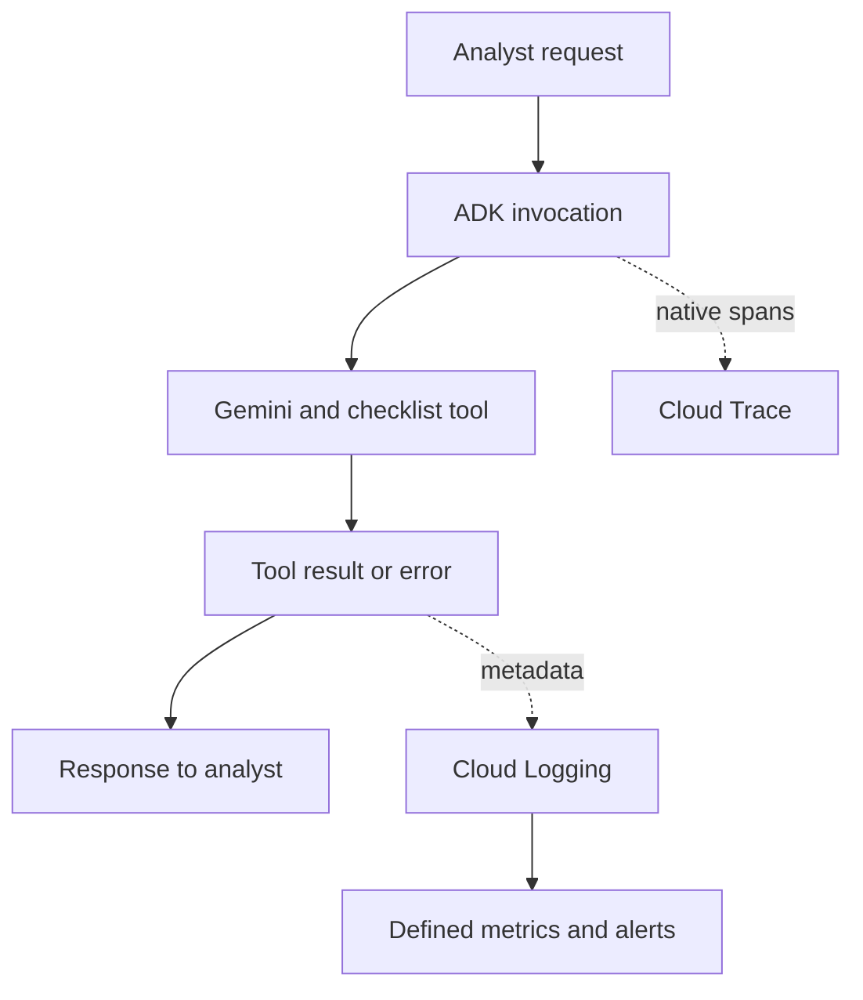

# Module 25: Observability: Investigating a Banking Agent Request

## Before you begin: what this module teaches

**ADK concept: observability, execution traces and App plugins.**

A single user request can trigger several agent, model and tool operations. **Observability** means retaining enough information to investigate that execution. Google’s **Agent Development Kit (ADK)** provides a native tracing path. You will also register a `BasePlugin` on an `App` to record selected tool outcomes at supported execution hooks.

A **trace** connects operations belonging to an execution; a **log entry** records an observation such as an unavailable lookup. The lesson shows why technical completion and a successful business result are different. A tool can return normally with “not found.” Conversely, the example’s error hook can return an unavailable result after an exception, which is recovery behaviour rather than passive logging.

**Where you would use this in real work.**

Meera reports: “The assistant could not prepare the case this morning.” The operations engineer needs to find that request, identify the affected tool and determine whether the record was missing, a dependency failed or another part of the execution stopped.

Copying the whole banking conversation into a log would expose unnecessary information and still might not explain the failure. You will record selected metadata, such as invocation identity, tool name and outcome, and relate it to the execution trace. The goal is an investigation someone can repeat.

**Connection to Gemini Enterprise Agent Platform and Google Cloud.**

The hosted path uses Gemini Enterprise Agent Platform Agent Runtime with Google Cloud Trace and Cloud Logging. Native ADK instrumentation supplies execution observations; the small plugin adds the application’s selected outcome metadata. The runtime identity and export configuration determine whether that evidence reaches its destination.

You will first inspect the local behaviour, then follow the cloud guide to find corresponding exported evidence. Content-capture settings and log access need deliberate configuration. A local structured log proves that a record was emitted, not that it was exported or that every operational destination is free of sensitive content.

**By the end, you should be able to:**

- **Follow execution:** distinguish an invocation, its component operations and the observed business outcome.
- **Register the observer:** explain how the App invokes plugin hooks around relevant tool activity.
- **Record useful evidence:** select diagnostic fields and explain why raw arguments, results and exception text are excluded from the custom log.
- **Investigate a failure:** connect an unavailable outcome to the relevant request and explain the error-recovery path.
- **Verify the hosted path:** locate corresponding Cloud Trace and Logging evidence and inspect actual capture settings.

**How this moves the story forward.** The operations team can investigate requests. Module 25.5 adds an active content-inspection policy at the points where supported data enters and leaves the agent.

Read the detailed customer task below, then follow the [guided lab](./lab.md). Build one checkpoint at a time and compare your explanation with the observed result.

[Previous module](../module24-evaluation/README.md) · [Lab](./lab.md) · [Solution](./lab-solution.md) · [Enterprise playbook](./enterprise-playbook.md) · [Next module](../module25_5-rai-safety-plugins/README.md)

Read the [ADK lifecycle primer](../module25-observability/lifecycle-primer.md) before implementing the hooks below. It introduces registration, runtime arguments, App scope and replacement behavior.

## Continue the banking story

Modules 15–22 built orchestration and continuity for a fictional commercial-review assistant. This sequence prepares that assistant for a measured pilot. Sovereign Horizon Bank, Acme Robotics and CASE-001 are teaching fixtures; no lending policy or customer engagement is being asserted.

## The customer request

### Read this as a bank employee's task

An analyst reports that the assistant sometimes takes too long or cannot finish a checklist lookup. The support team needs to find which operation was slow or failed.

In this course, an analyst is the employee who gathers and checks information for a review. Picture a business banking team preparing for a company meeting. The bank, company and records are fictional.

> Help us find the failed operation and understand what the analyst was told. Do not routinely copy company records into our diagnostic logs.

| What you need to understand first | This exercise's answer |
|---|---|
| What information starts the task? | A request identifier and observations recorded while the request runs. |
| What should the employee receive? | Related timing and outcome information that helps an operator locate the problem. |
| What should happen when it cannot be completed? | A normal HTTP response must not hide an incomplete business task. Duplicate hook records must not be counted as separate requests. |

### New words, explained using this task

| Term | Meaning here |
|---|---|
| Observability | Recorded information that helps people understand what a running application did. |
| Span | A timed operation, such as one tool execution. |
| Trace | Related spans that show the work performed for a request. |
| Log | A recorded observation, such as a lookup returning unavailable. |

The next technical table connects these requirements to ADK objects and checks. Read one row at a time: the employee's need comes first, then the coding choice, then the result that would show it works.

**What you build:** Native ADK tracing plus a small structured business-outcome plugin, with an explicit outage experiment and deployed investigation steps.

## Match each customer requirement to code and a check

| Customer requirement | Implementation decision | Acceptance evidence |
|---|---|---|
| Locate the failing operation | Use ADK native spans and bounded structured outcome fields | Find the tool operation and its invocation/trace identifiers. |
| Keep requests separate | No mutable request counters on a shared plugin | Concurrent invocations retain distinct identifiers. |
| Make failure visible | Map the controlled tool exception to unavailable | The model reports incomplete preparation rather than invented evidence. |
| Control sensitive logging | Log metadata only in the custom plugin | No prompt, checklist payload or exception message is logged by that plugin. |

## Follow one request before studying a dashboard

A request starts an invocation. The invocation can call a model more than once and can execute several tools. A tool may fail while the overall assistant still returns a helpful explanation. Therefore “HTTP 200” and “bank task completed” are different observations.

| Term | Plain-English meaning | Banking example |
|---|---|---|
| Event | A discrete ADK execution record | Tool result or state change |
| Log | An observation written for investigation | Checklist lookup returned unavailable |
| Span | A timed operation inside a trace | A particular tool execution |
| Trace | Related spans showing one execution journey | Request, model calls and lookup |
| Metric | An aggregate measurement over time | Rate of unavailable checklist results |
| Alert | A rule that requests operational attention | Sustained dependency failures above the agreed threshold |

ADK supplies runtime instrumentation. Configure its supported Google exporter rather than recreating standard spans in every callback. A custom plugin is justified here because `business_failure` is a domain outcome that may not be an exception.

## Understand what the plugin observes

`after_tool_callback` records whether the returned dictionary reports success. `on_tool_error_callback` records an exception outcome and replaces that failed tool result with a bounded `unavailable` dictionary. Returning that dictionary is a deliberate recovery decision, not passive logging. The model can then explain the incomplete outcome.

The plugin has no per-request mutable counter. Cloud Monitoring should aggregate observations over a defined window; three failures inside one process are not a reliable fleet-wide incident rule. Restarting or scaling that process would reset or split such a counter.

`StructuredLogHandler` writes the custom record in Google's structured logging format. The hosted runtime collects that output. Locally, seeing JSON in the terminal does not prove it reached Cloud Logging. The optional local trace exporter similarly requires credentials and permission; an imported telemetry module alone sends nothing.

## Correlate without copying the bank record

The custom record contains invocation ID, agent, tool and outcome, plus the current trace ID when available. These fields help find related runtime observations. User identity and case identifiers may themselves be sensitive; introduce them only when the operational need and capture policy justify them.

The plugin's metadata-only behavior does not control every other exporter or platform log. Review prompt/response capture, trace attributes, exceptions, log sinks and access separately. A full evaluation transcript and a routine operational log serve different purposes and need different retention policies.

## From one failure to an operational rule

Start with the outage experiment and identify its observation. Next define a numerator (unavailable lookups), denominator (attempted lookups), time window and minimum traffic. Only then choose an alert threshold with the service owner. Track latency separately and distinguish model latency from dependency latency using spans.

Treat recovered tool errors carefully: ADK may also invoke the after-tool hook on a replacement error result. The custom records describe hook outcomes; do not sum every record as if each were a distinct incoming request. Use a deliberately defined metric/filter and inspect the trace when establishing counting semantics.

## Work through the concept as a customer problem

### Track a file's journey through the branch

Meera says, “The assistant took too long and then could not find the checklist.” An engineer needs to know whether time was spent in Gemini, in the records service or elsewhere. Reading the final answer alone cannot answer that question.

Imagine a case file carrying a journey number as it visits desks. A **trace** connects timed operations; each operation is a **span**. A **log** records a particular observation. A **metric** aggregates observations across a defined interval. An **alert** asks an operator to act when a defined condition is met. The journey number helps correlate records; it is not a reason to copy the entire confidential case into every log.

### A technically successful response can describe a failed business task

A lookup may return `unavailable` in an ordinary dictionary, after which the agent politely explains the problem. The HTTP response can be successful while evidence collection failed. The custom plugin records that business outcome; native ADK spans supply the execution timings. Recreating every native span in callback code would duplicate responsibilities.

An exporter sends telemetry to a backend. Printing JSON locally is not proof of delivery to Cloud Logging. A trace ID also does not prove every desired span was exported. For deployed testing, find one invocation in the configured Google observability service and follow its model/tool operations.

The error hook here can substitute an `unavailable` result. That is recovery behavior as well as observation. A recovered operation may subsequently pass through another hook, so counting every emitted log as a unique request can double-count failures. Define the unit you measure before setting an alert.

### Three reviews before accepting the design

- **Beginner:** locate one invocation's model and tool operations and explain which consumed time. Distinguish an ADK event printed by the runner from an exported trace.
- **Experienced engineer:** specify the failure numerator, attempted-operation denominator, time window and minimum traffic. Test concurrent requests so a shared plugin cannot mix their identifiers.
- **Bank FDE:** ask who investigates incidents, what information they need and which fields may be captured. Agree a response owner and runbook for unavailable dependencies. Metadata-only custom logs do not control separate prompt capture, trace attributes or external log sinks.

**Carry forward:** [Module 25.5](../module25_5-rai-safety-plugins/README.md) introduces a plugin that makes a content decision; [Module 26](../module26-callbacks/README.md) explains the lifecycle hooks behind that behavior.

## ADK execution model: Read the native trace before adding domain observations

An ADK invocation may contain multiple model and tool operations. Native instrumentation produces spans; exporters send those spans to the selected tracing backend. A span has timing and trace context. An ADK Event is a separate execution record; printing events does not automatically export an OpenTelemetry trace.

The plugin receives tool lifecycle callbacks from the App's execution. after_tool records a business outcome from the result dictionary. on_tool_error supplies a replacement unavailable result after recording an exception outcome. That replacement is an execution decision, so the final assistant response must be evaluated for honest incompleteness.

StructuredLogHandler formats a log record for Google's logging pipeline. The json_fields mapping holds structured metadata. invocation_id helps join ADK observations; trace_id is available only with a valid current span. A successful local JSON print is not proof of Cloud Logging ingestion.

After recovery, another after-tool observation may occur. Count chosen outcomes rather than every log line. For example, define a failed-tool-attempt numerator from exception observations and a compatible attempt denominator; do not sum exception and business_failure for the same recovered attempt. Native spans help verify what was actually timed.

### Derive the code from the customer's words

“Which operation?” requires operation-level spans. “What happened to the bank task?” requires a bounded domain outcome. “Without logging documents” restricts the fields the custom logger emits; it does not configure every other exporter.

### Predict, observe and explain

Run normal and injected-outage requests. For each, record invocation ID, trace ID if present, tool span duration, domain outcome and final response. Explain why HTTP success can coexist with incomplete preparation.

### Worked design discussion for experienced learners

Work through 100 attempted lookups with 5 recovered exceptions. A correct failure rate is 5/100, not 10/100 because each failure produced two hook records. Choose and document the exact filter before creating an alert.

Before accepting a solution, identify its input owner, exact ADK boundary, output consumer and failure evidence. Read the function comments in the lab alongside the corresponding source; comments explain design intent, while the executed events establish behavior.

## Follow the control and data flow

The arrows show the lesson’s control/data dependencies, not a promise that every model-selected action always occurs. Inspect the lab trace to establish the actual execution.

## Work through one request

| Stage | Observed value or action | Reasoning |
|---|---|---|
| Normal request | read_checklist returns status=ok | Plugin records metadata; Gemini explains the missing item. |
| Injected outage | Tool raises a synthetic TimeoutError | Error hook records exception and returns unavailable. |
| Recovered answer | Gemini receives the unavailable dictionary | The analyst should be told preparation is incomplete. |
| Investigation | Find invocation_id and trace_id | Correlate logs with the timed native tool span. |

## Learn at two depths

**Foundation:** explain each stage above in ordinary English, run the supplied case and predict one changed input before executing it. Point to the line that enforces the requirement.

**Advanced:** Define a logs-based metric and an alert for sustained unavailable outcomes. Document the denominator and avoid double-counting recovered tool events. Reproduce a slow dependency and identify its span.

## Google service boundary

Use the [shared cloud setup and deployed verification guide](../module23-artifacts/google-cloud-lab-guide.md). The native services have different responsibilities: Gemini performs model reasoning, Agent Runtime hosts the deployed application, managed Sessions persists conversations, Cloud Storage stores artifacts, and Model Armor inspects configured content in Module 25.5. Cloud Logging and Cloud Trace provide operational evidence. A configured local runner is distinct from an agent executing on Agent Runtime.

## Verified baseline and remaining evidence

See the [course review and verification record](../module15-intro-to-multi-agent-systems/review-notes.md) for the cross-module checks and the evidence still required from a customer deployment.

The implementation targets **google-adk 2.11.0** and uses its installed public interfaces, reviewed on **3 October 2026**. Python support is 3.11+; the local verification interpreter is **3.14.7**. Python **3.14.8** is the current stable patch release; it is not claimed as the test interpreter. The existing Gemini model default is preserved as `gemini-3.5-flash` and is configurable; confirm availability in your project and location.

The lockfile fixes the resolved local dependencies. Contract tests use scripted model/inspection replies with real ADK execution. They establish software behavior, not Gemini quality, Model Armor detection quality or a deployed-service result. The lab requires separate live evaluation and deployed verification evidence before calling the cloud exercise complete.

## Official references

- [ADK Cloud Trace](https://adk.dev/integrations/cloud-trace/)
- [Cloud Logging Python setup](https://docs.cloud.google.com/logging/docs/setup/python)
- [ADK plugins](https://adk.dev/plugins/)
- [Pinned ADK release](https://pypi.org/project/google-adk/2.11.0/)
- [Python 3.14.8 release](https://www.python.org/downloads/release/python-3148/)

## Continue the course story

Previous: [Module 24](../module24-evaluation/README.md) · Next: [Module 25.5](../module25_5-rai-safety-plugins/README.md) · [See how the concepts build](../learning-journey.md)

Before continuing, explain one input, one ADK execution boundary and one failure outcome from this module. Use the next chapter to add a new customer requirement, not merely another component.

<!-- © 2026 Inder Chauhan (https://github.com/inderanz/google-adk-training). All rights reserved. -->

## Continue with the integrated customer exercise

The [integrated banking lab](../module26-callbacks/integrated-lab.md) connects the authorized Firestore read, deterministic next step, versioned artifacts, Gemini explanation, evaluation, logging and Model Armor in one App. Complete its live and deployed checkpoints after the isolated lesson. Its scope excludes an unimplemented ledger adapter and credit approval.
