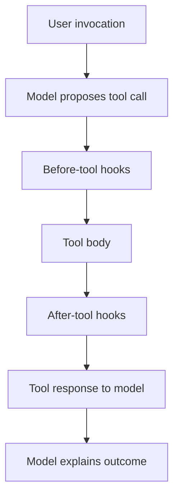

# Before plugins: understand the ADK lifecycle

The bank wants to investigate a failed checklist lookup. Start by observing one completed tool operation; do not begin by writing a safety framework. A callback is a function that ADK calls at a defined execution boundary. You register a function object, then ADK supplies the runtime arguments later.

## Start with one agent callback

This minimal illustration belongs beside the agent construction in a practice copy. It uses only synthetic diagnostic metadata.

<!-- TEACHER_NOTE_START -->
**Teacher's note (ADK instructor view):**
- **Learning goal:** Explain the concept clearly from beginner to advanced, with a simple mental model first.
- **Why it matters:** Connect the concept to real Google agentic workflows, Python engineering habits, and production-ready decisions.
- **Version watch:** Validate against the latest official ADK / Google docs before teaching; call out deprecations or migration notes when needed.
- **Module linkage:** Connect this idea to the previous and next modules so learners see the progression across the course.
<!-- TEACHER_NOTE_END -->
```python
from google.adk.tools import ToolContext
from google.adk.tools.base_tool import BaseTool


def observe_result(tool: BaseTool, args: dict, tool_context: ToolContext,
                   tool_response: dict) -> dict | None:
    # The customer needs to know which operation returned which business status.
    # Do not print args or the whole response: they can contain banking records.
    print(tool.name, tool_response.get("status", "unclassified"))
    # No replacement is needed for observation; preserve the original result.
    return None

# Register on the Agent constructor: after_tool_callback=observe_result
# Do not write observe_result(): ADK supplies its arguments during execution.
```

`args` contains proposed tool inputs. `tool_response` contains the result at this boundary. `ToolContext` identifies the invocation and exposes tracked state and configured services. These objects have different owners; they are not interchangeable dictionaries. Type annotations explain their contracts, but they do not turn the print into an exporter or an authorization check.

## Move an observation to App scope

An agent callback belongs to the configured agent. A BasePlugin instance registered in App.plugins participates across that application's execution, including local child agents. Plugin method names resemble callback names, but the tool arguments are named `tool_args` and `result`. Use the exact documented interface for the chosen extension point.

The Module 25 plugin adds structured logging to this observation. Its error hook also returns an unavailable result; that is recovery behavior. Keep observation and recovery conceptually separate even when they are methods on the same class.

## Predict the normal path

<!-- TEACHER_NOTE_START -->
**Teacher's note (ADK instructor view):**
- **Learning goal:** Explain the concept clearly from beginner to advanced, with a simple mental model first.
- **Why it matters:** Connect the concept to real Google agentic workflows, Python engineering habits, and production-ready decisions.
- **Version watch:** Validate against the latest official ADK / Google docs before teaching; call out deprecations or migration notes when needed.
- **Module linkage:** Connect this idea to the previous and next modules so learners see the progression across the course.
<!-- TEACHER_NOTE_END -->


This diagram shows the normal path. Before-tool replacement skips the resolved tool body in the pinned runtime. After-tool replacement changes what is returned after the body has executed. It cannot undo an external write. A before-model replacement has another path, covered in Module 26.

## None, replacement and callback lists

Return None to leave normal handling unchanged. Return the hook's supported result type to request replacement. For ADK 2.11.0 tool callbacks, even an empty dictionary is a replacement. Agent/model callback-list stopping rules must be checked separately; do not generalize tool behavior to every family.

The current official callback page and the pinned tool pipeline differ on this edge case. The course's `test_empty_dictionary_stops_tool_callback_list_and_body` exercises the actual Runner, two callbacks and a body that must not run. Recheck that contract on upgrade. Prefer meaningful status dictionaries in application controls so the consumer knows why work was withheld.

## Your first prediction exercise

Run Module 25's successful fixture, then its injected TimeoutError. List the hook, input status and return for each observation. Explain why a recovered error can produce both an error-hook record and an after-tool record. Count actual attempted operations before defining an alert metric.

Continue to [Module 25](./README.md), then [safety plugins](../module25_5-rai-safety-plugins/README.md) and [callback control](../module26-callbacks/README.md).

Sources: [ADK plugins](https://adk.dev/plugins/), [callback contracts](https://adk.dev/callbacks/types-of-callbacks/). The execution claim above is pinned to the tested SDK, not inferred solely from a diagram.
---

## Official References

- Google ADK docs (latest): https://google.github.io/adk-docs/
- Google AI / Gemini docs: https://ai.google.dev/
- Google GenAI Python SDK reference: https://googleapis.github.io/python-genai/
- Context7 / current SDK lookup for the exact installed version and API signatures
- Related module path: review the surrounding modules for continuity, prerequisites, and follow-on concepts

