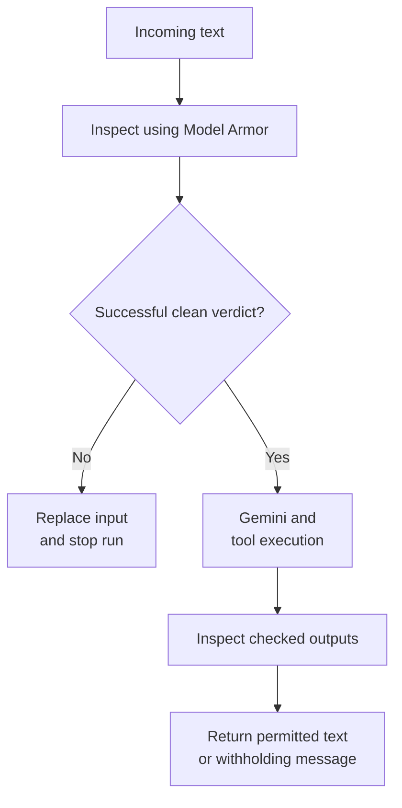
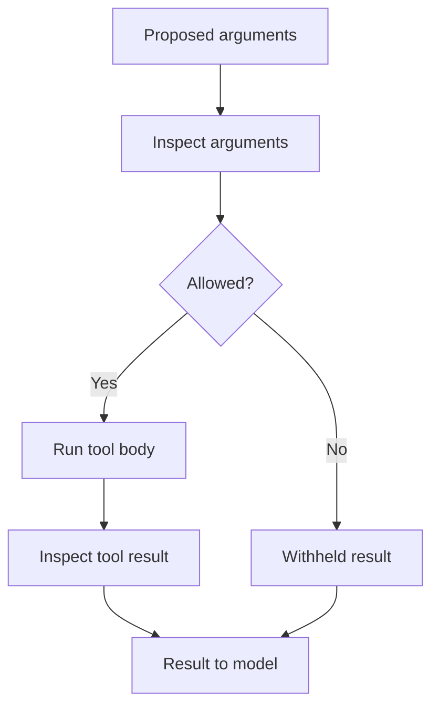
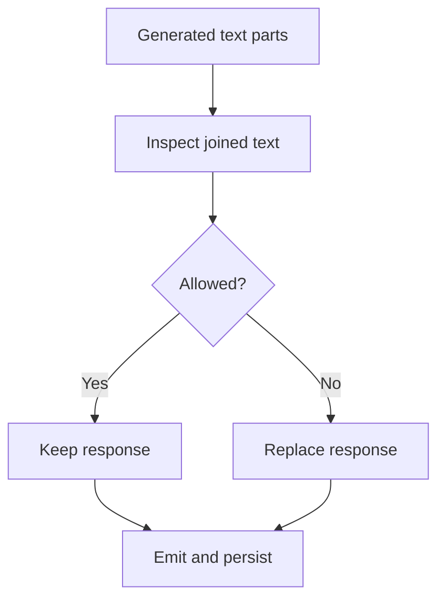

# Module 25.5: Safety Plugins: Managed Content Inspection with Model Armor

## Before you begin: what this module teaches

**ADK concept: application-wide safety hooks and content inspection.**

A plugin can do more than observe execution. Google’s **Agent Development Kit (ADK)** lets an App-level `BasePlugin` inspect supported inputs and outputs and, at defined hooks, return a replacement. This module teaches where those hooks run and how their return values affect the next operation.

You will follow user text, model text, tool arguments and tool results through the example’s inspection policy. A service response is interpreted as allow, block or unavailable. If a usable inspection result was not obtained, the example withholds the affected content. The location of the hook matters: checking arguments before a tool runs can prevent that call; inspecting its result afterwards cannot undo its side effects.

**Where you would use this in real work.**

The bank’s policy team tells Meera’s technology team which text-inspection rules to apply. They want supported content checked consistently, including content returned by tools. They also ask what will happen if the inspection service times out.

You will make those outcomes visible. A permitted message continues. A blocked message is replaced according to the application policy. An unavailable inspection produces a clear interruption. You will inspect stored session history as well as the visible reply, because withholding text from the screen alone does not prove that the original text was never retained.

**Connection to Gemini Enterprise Agent Platform and Google Cloud.**

The ADK plugin calls the official Google Cloud Model Armor asynchronous client using a configured regional template. The template defines the inspection policy. ADK supplies execution hooks and replacement behaviour; Model Armor supplies service inspection results. These responsibilities remain distinct when the application is hosted on Agent Runtime.

The supplied example supports non-streaming text and its documented tool exchanges. It does not automatically inspect every artifact, remote system or log destination. You will learn to describe the actual coverage, establish bank authorization separately, and verify real template matches and service failures on the cloud path.

**By the end, you should be able to:**

- **Map the inspection points:** identify which supported value is inspected before each relevant operation continues.
- **Interpret service results:** distinguish a completed clean inspection, a policy match and an unavailable verdict.
- **Trace replacement and storage:** show what reaches the model, the user and session history after blocking.
- **Explain the limits:** identify an earlier side effect or separate storage destination that an after-tool inspection cannot protect retroactively.
- **Verify a customer policy:** plan real allow, match and unavailable tests using the bank’s configured Model Armor template.

**How this moves the story forward.** App-level inspection introduces control over execution. Module 26 examines agent callbacks in detail and shows how these controls interact in the integrated banking exercise.

Read the detailed customer task below, then follow the [guided lab](./lab.md). Build one checkpoint at a time and compare your explanation with the observed result.

[Previous module](../module25-observability/README.md) · [Lab](./lab.md) · [Solution](./lab-solution.md) · [Enterprise playbook](./enterprise-playbook.md) · [Next module](../module26-callbacks/README.md)

Read the [ADK lifecycle primer](../module25-observability/lifecycle-primer.md) before implementing the hooks below. It introduces registration, runtime arguments, App scope and replacement behavior.

## Continue the banking story

Modules 15–22 built orchestration and continuity for a fictional commercial-review assistant. This sequence prepares that assistant for a measured pilot. Sovereign Horizon Bank, Acme Robotics and CASE-001 are teaching fixtures; no lending policy or customer engagement is being asserted.

## The customer request

### Read this as a bank employee's task

The bank has chosen rules for inspecting text sent to and produced by the assistant. It wants those checks applied at the right points, and it needs clear behaviour when the inspection service is unavailable.

In this course, an analyst is the employee who gathers and checks information for a review. Picture a business banking team preparing for a company meeting. The bank, company and records are fictional.

> Check the supported messages and tool exchanges using our configured inspection rules. If a check blocks content, or cannot finish reliably, withhold the affected content and explain the interruption.

| What you need to understand first | This exercise's answer |
|---|---|
| What information starts the task? | Supported text and tool data, plus an operator-configured Model Armor template. |
| What should the employee receive? | Allowed content continues; blocked or uninspected content produces a clear withholding outcome. |
| What should happen when it cannot be completed? | A service error must not be treated as a clean inspection. A later content check cannot undo an earlier bank operation. |

### New words, explained using this task

| Term | Meaning here |
|---|---|
| Model Armor | The Google service used here to inspect content using a configured template. |
| Plugin | An object registered with an ADK App to run at supported points in its execution. |
| Verdict | The result of inspection: allow, block or unavailable in this application. |
| Template | Saved Model Armor settings that select the checks the bank wants the service to perform. |

The next technical table connects these requirements to ADK objects and checks. Read one row at a time: the employee's need comes first, then the coding choice, then the result that would show it works.

**What you build:** A native App plugin using the official asynchronous Model Armor client, with explicit allow, block and unavailable outcomes for a text-only non-streaming lab.

## Match each customer requirement to code and a check

| Customer requirement | Implementation decision | Acceptance evidence |
|---|---|---|
| Use a managed Google inspector | Call a configured regional Model Armor template | Live validation records template, region and observed verdicts. |
| Avoid persisting blocked input | Replace the incoming user message before session append | Stored session does not contain the synthetic blocked payload. |
| Treat missing verdicts conservatively | Require successful inspection and NO_MATCH_FOUND | Timeout, partial or unspecified results withhold content. |
| State coverage precisely | Inspect text, tool arguments and tool results at native hooks | Unsupported multimodal and streaming paths are rejected in this exercise. |

## Separate policy, inspection and enforcement

The bank owns its policy. A configured Model Armor template selects the service's inspections. The client submits content and receives a result. The ADK plugin decides what execution may continue with that result. None of these steps replaces identity verification or the bank service's authorization rules.

A safety plugin has application scope when attached to App. It can affect every local agent run under that App. It does not automatically protect a separately deployed A2A service, an unrelated API endpoint, an artifact download or a logging pipeline. Those boundaries require their own controls.

## Three outcomes, not a Boolean guess

| Inspection outcome | Lab behavior | Why |
|---|---|---|
| Successful inspection, no match | Continue | The configured scan completed without a match |
| Successful inspection, match | Withhold affected content | The configured policy detected a match |
| Partial, failed, unspecified or exception | Withhold with an unavailable message | The service did not establish a clean result |

A clean result means no match under the configured inspection. It is not proof that all possible unsafe content has been detected. Template coverage, thresholds and service limitations must be evaluated using representative bank scenarios.

## Place each check at the right boundary

The user-message hook runs before ADK appends that message to the session. If blocked, the plugin replaces the stored message and sets an invocation-specific temporary flag. The before-run hook consumes the flag and returns a canned response without invoking Gemini. This avoids leaving the original blocked input in conversation history for a later turn.

Before-tool inspection can replace a proposed call with a withheld result. After-tool inspection can replace a result before it returns to the model, but cannot undo a tool side effect that already happened. After-model inspection checks generated text before the checked non-streaming result is emitted and persisted.

The implementation joins all text parts. Inspecting only parts[0] misses later content. A blocked model response is replaced in full, intentionally removing any function calls accompanying it. Permitted function-call arguments receive their own before-tool inspection.

## Why this lesson deliberately excludes streaming

Token streaming can expose a prefix before a final-response check has enough context to decide. A final event replacement cannot retract already delivered content. This lab requires StreamingMode.NONE and uses the deployed /run endpoint. A production streaming design needs an explicitly tested buffering/inspection strategy or the appropriate supported platform control.

The 16 KiB limit is a teaching bound, not a statement of the Model Armor service limit. Binary inputs and model outputs outside the supported text/function-call shape are rejected; a multimodal product needs its own supported inspection path.

## Follow the official pattern and inspect its limits

The upstream Google safety-plugins recipe teaches the user-message/before-run handshake. Its sample tests do not prove safety behavior. Here, dedicated contract tests exercise replacement, persistence, multipart output and unavailable verdicts. Those tests use an inspector fixture; separate live runs must establish actual Model Armor behavior.

## Work through the concept as a customer problem

### The inspection desk needs a result before releasing content

The bank wants submitted and generated text inspected against an approved content policy. Think of a document inspection desk: “checked with no match,” “checked with a match,” and “could not check” are three distinct outcomes. A service outage must not be recorded as a clean inspection.

**Policy** states what the bank permits. A Model Armor **template** configures supported inspections. An **inspection result** reports what the service found. **Enforcement** decides whether execution continues. Our ADK `BasePlugin` implementation connects those stages at defined runtime boundaries; the plugin class is course code, not a built-in class called `ModelArmorPlugin`.

### Location determines what a check can protect

A before-tool check can prevent a tool body from executing. An after-tool check can withhold returned content from the model, but a write already performed by that tool has happened. An after-model check can replace a supported non-streaming response before it is emitted. It cannot retract tokens already shown to a user in an earlier stream.

The lab therefore has an explicit text/function-call, non-streaming contract. Its input hook replaces blocked user content before session persistence; an invocation-scoped flag tells the before-run hook to respond without calling Gemini. These two hooks solve separate problems: preventing a model call and preventing the original blocked text from entering the stored conversation.

**Fail closed** here means block when the required inspection did not establish an allowed result. It does not mean every policy violation is detectable, or that every boundary in a larger application is covered. Artifact downloads, remote A2A applications and unrelated APIs require their own consideration.

### Three reviews before accepting the design

- **Beginner:** predict behavior for allow, block and unavailable. Show both what the user receives and what the session stores.
- **Experienced engineer:** test multipart responses, function-call arguments, exceptions and partial/unspecified service results. Trace short-circuit behavior when other plugins or callbacks also run.
- **Bank FDE:** ask who owns the inspection policy, what content types are in scope and what the user should do during an inspection outage. Configure and evaluate the actual regional Model Armor service; fixture tests establish hook behavior, not live detection quality or a compliance certification.

**Carry forward:** [Module 26](../module26-callbacks/README.md) makes each hook's inputs, return value and skipped operations explicit.

## ADK execution model: Inspection, replacement and persistence are separate steps

ModelArmorInspector owns an official async service client. It constructs typed RPC requests using a configured regional template. The response describes invocation success and filter match state. verdict translates that service contract into allow, block or unavailable; it does not interpret an unspecified result as permission.

BankingSafety is our BasePlugin subclass, not a built-in ADK class named ModelArmorPlugin. App registers it once. ADK invokes its hooks at defined boundaries. The inspector can be injected in tests so the same hook logic is exercised without claiming real detection quality.

The input hook runs before session append. It replaces blocked user Content and records a temporary invocation-specific decision. before_run consumes that decision and supplies a fixed model Content without running Gemini. Returning a message at only the later hook would leave the original input persistence question unresolved.

before_tool inspects proposed arguments and can prevent the tool body. after_tool inspects a result after the operation already occurred; replacing it cannot roll back side effects. after_model examines generated text on this non-streaming path. An earlier callback replacement may bypass that hook, so combining middleware requires a tested ordering contract rather than assuming all outputs pass all hooks.

### Derive the code from the customer's words

“Before downstream use” selects the hook location. “Do not retain blocked input” requires the pre-append replacement. “Inspection unavailable” requires its own withholding result. “Text-only” requires rejection of unsupported parts rather than pretending they were inspected.

### Predict, observe and explain

Trace allow, match and service failure separately. Inspect stored session content, whether Gemini ran and whether the tool body ran. Then repeat with a real configured template and record the actual verdicts.

### Worked design discussion for experienced learners

Add a benign near-match to the acceptance set. Explain the operational tradeoff if it is blocked; changing a template threshold needs measured false positives/negatives and the policy owner’s decision.

Before accepting a solution, identify its input owner, exact ADK boundary, output consumer and failure evidence. Read the function comments in the lab alongside the corresponding source; comments explain design intent, while the executed events establish behavior.

## Follow the control and data flow

<!-- TEACHER_NOTE_START -->
**Teacher's note (ADK instructor view):**
- **Learning goal:** Explain the concept clearly from beginner to advanced, with a simple mental model first.
- **Why it matters:** Connect the concept to real Google agentic workflows, Python engineering habits, and production-ready decisions.
- **Version watch:** Validate against the latest official ADK / Google docs before teaching; call out deprecations or migration notes when needed.
- **Module linkage:** Connect this idea to the previous and next modules so learners see the progression across the course.
<!-- TEACHER_NOTE_END -->

The arrows show the lesson’s control/data dependencies, not a promise that every model-selected action always occurs. Inspect the lab trace to establish the actual execution.

## Inspect the framework boundary

The earlier diagram shows input inspection. Follow the tool boundary separately:

<!-- TEACHER_NOTE_START -->
**Teacher's note (ADK instructor view):**
- **Learning goal:** Explain the concept clearly from beginner to advanced, with a simple mental model first.
- **Why it matters:** Connect the concept to real Google agentic workflows, Python engineering habits, and production-ready decisions.
- **Version watch:** Validate against the latest official ADK / Google docs before teaching; call out deprecations or migration notes when needed.
- **Module linkage:** Connect this idea to the previous and next modules so learners see the progression across the course.
<!-- TEACHER_NOTE_END -->

After the model generates text, the output boundary is:

<!-- TEACHER_NOTE_START -->
**Teacher's note (ADK instructor view):**
- **Learning goal:** Explain the concept clearly from beginner to advanced, with a simple mental model first.
- **Why it matters:** Connect the concept to real Google agentic workflows, Python engineering habits, and production-ready decisions.
- **Version watch:** Validate against the latest official ADK / Google docs before teaching; call out deprecations or migration notes when needed.
- **Module linkage:** Connect this idea to the previous and next modules so learners see the progression across the course.
<!-- TEACHER_NOTE_END -->

Each inspection can return unavailable as well as a match. Both withhold affected content. Artifact writes performed inside a tool are outside the after-tool result replacement; inspection does not roll them back. These diagrams describe the normal model path; earlier callback replacements require the composition checks in Module 26.

## Work through one request

| Stage | Observed value or action | Reasoning |
|---|---|---|
| Incoming request | on_user_message submits text to the configured template | Only an explicit clean result continues. |
| Blocked or unavailable | Replace the stored user Content and set temporary flag | before_run returns a fixed message without Gemini. |
| Allowed tool call | Inspect serialized arguments before execution | A withheld result replaces a blocked call. |
| Generated multipart response | Inspect joined text before publishing | Replace the entire response when not allowed. |

## Learn at two depths

**Foundation:** explain each stage above in ordinary English, run the supplied case and predict one changed input before executing it. Point to the line that enforces the requirement.

**Advanced:** Create an acceptance set reviewed by the bank’s security team, include benign near-matches and service failures, and document measured false positives/negatives. Describe protection boundaries for artifacts, remote services and streaming.

## Google service boundary

Use the [shared cloud setup and deployed verification guide](../module23-artifacts/google-cloud-lab-guide.md). The native services have different responsibilities: Gemini performs model reasoning, Agent Runtime hosts the deployed application, managed Sessions persists conversations, Cloud Storage stores artifacts, and Model Armor inspects configured content in Module 25.5. Cloud Logging and Cloud Trace provide operational evidence. A configured local runner is distinct from an agent executing on Agent Runtime.

## Verified baseline and remaining evidence

See the [course review and verification record](../module15-intro-to-multi-agent-systems/review-notes.md) for the cross-module checks and the evidence still required from a customer deployment.

The implementation targets **google-adk 2.11.0** and uses its installed public interfaces, reviewed on **3 October 2026**. Python support is 3.11+; the local verification interpreter is **3.14.7**. Python **3.14.8** is the current stable patch release; it is not claimed as the test interpreter. The existing Gemini model default is preserved as `gemini-3.5-flash` and is configurable; confirm availability in your project and location.

The lockfile fixes the resolved local dependencies. Contract tests use scripted model/inspection replies with real ADK execution. They establish software behavior, not Gemini quality, Model Armor detection quality or a deployed-service result. The lab requires separate live evaluation and deployed verification evidence before calling the cloud exercise complete.

## Official references

- [Google safety-plugins recipe](https://github.com/google/adk-samples/tree/main/core/python/safety-plugins)
- [Model Armor sanitization](https://docs.cloud.google.com/model-armor/sanitize-prompts-responses)
- [ADK plugins](https://adk.dev/plugins/)
- [Pinned ADK release](https://pypi.org/project/google-adk/2.11.0/)
- [Python 3.14.8 release](https://www.python.org/downloads/release/python-3148/)

## Continue the course story

Previous: [Module 25](../module25-observability/README.md) · Next: [Module 26](../module26-callbacks/README.md) · [See how the concepts build](../learning-journey.md)

Before continuing, explain one input, one ADK execution boundary and one failure outcome from this module. Use the next chapter to add a new customer requirement, not merely another component.

<!-- © 2026 Inder Chauhan (https://github.com/inderanz/google-adk-training). All rights reserved. -->

## Continue with the integrated customer exercise

The [integrated banking lab](../module26-callbacks/integrated-lab.md) connects the authorized Firestore read, deterministic next step, versioned artifacts, Gemini explanation, evaluation, logging and Model Armor in one App. Complete its live and deployed checkpoints after the isolated lesson. Its scope excludes an unimplemented ledger adapter and credit approval.
---

## Official References

- Google ADK docs (latest): https://google.github.io/adk-docs/
- Google AI / Gemini docs: https://ai.google.dev/
- Google GenAI Python SDK reference: https://googleapis.github.io/python-genai/
- Context7 / current SDK lookup for the exact installed version and API signatures
- Related module path: review the surrounding modules for continuity, prerequisites, and follow-on concepts

