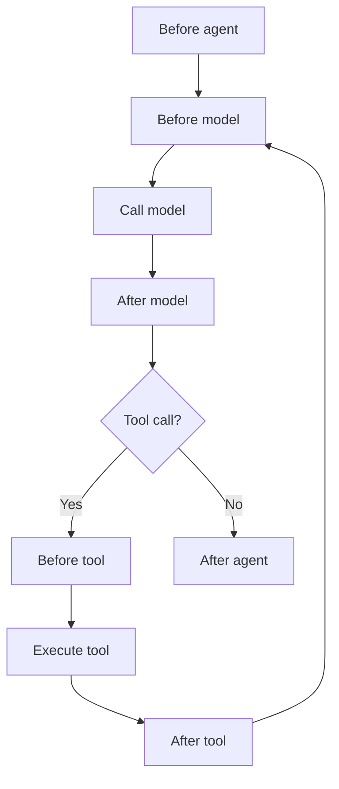
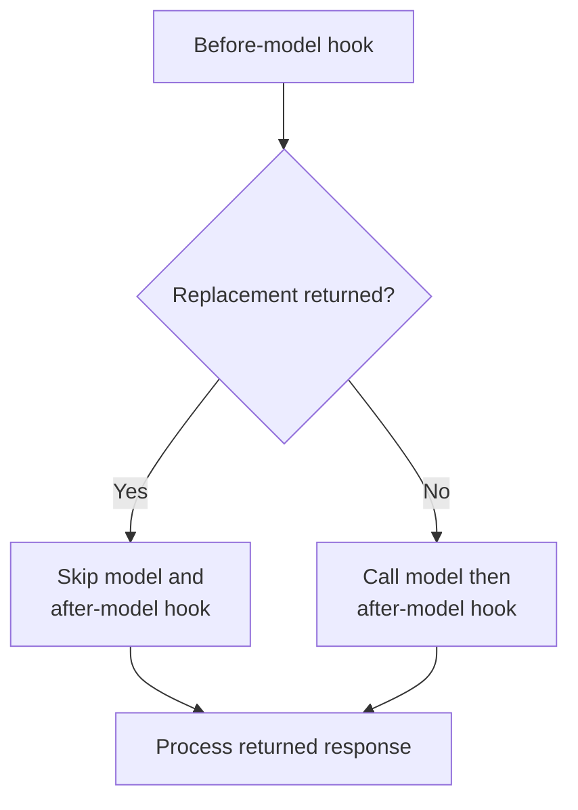
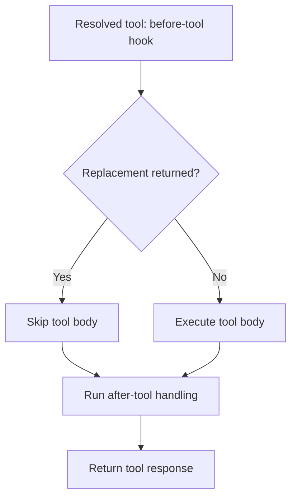

# Module 26: Callbacks: Agent Lifecycle and Banking Tool Controls

## Before you begin: what this module teaches

**ADK concept: agent callbacks and lifecycle control.**

Google’s **Agent Development Kit (ADK)** calls application-supplied functions at defined points before or after agent, model and tool work. These functions are **callbacks**. You will learn what context each receives, what it may inspect or change, and how its return value affects execution.

The lesson follows concrete questions: does the model run after a before-model replacement, does a tool body run after a before-tool replacement, and which later hooks still execute? `None`, an empty dictionary and a replacement response are not interchangeable. You will compare callbacks attached to an agent with plugins registered on the App, and use observed events to explain their ordering.

**Where you would use this in real work.**

Meera’s assistant must accept only supported case requests, keep the human-review requirement visible and preserve enough diagnostic state to explain a run. The engineer needs each control at the correct execution point. A check that happens only after a bank operation has run cannot serve as permission to perform that operation.

You first study small callback experiments. Then the integrated exercise prepares an assigned Firestore case, determines missing documents, saves the source and report, and applies the earlier inspection and telemetry components. It requests human review when the checklist is complete; it does not turn document completeness into loan approval.

**Connection to Gemini Enterprise Agent Platform and Google Cloud.**

Callbacks belong to the ADK application; they are not a separate hosted control service. In the capstone’s Google path, Gemini supplies reasoning, Agent Runtime hosts the application, managed Sessions preserve interactions, Firestore supplies the current checklist and Cloud Storage holds the artifacts. Model Armor and cloud observability add their specific inspection and operational responsibilities.

You will trace the connections using the earlier native providers and visible teaching code. The capstone does not contain a bank-ledger adapter or production end-user authentication. Those remain explicit customer integrations, while the supplied cloud procedure distinguishes local contract checks, real-service runs and hosted verification.

**By the end, you should be able to:**

- **Explain the lifecycle:** identify what happens before and after an agent, model or tool operation.
- **Prove control behaviour:** show which operation and subsequent hooks execute after a particular replacement.
- **Implement narrow checks:** keep tool validation, selected result changes and state updates explicit and explainable.
- **Trace the capstone:** follow an authorized case read into the derived next step, saved evidence and inspected explanation.
- **Prepare a customer handover:** identify the remaining identity, live evaluation, service and operational evidence required for deployment.

**How this moves the story forward.** The sequence ends with an explainable preparation capability and a clear verification plan. Use the integrated lab to demonstrate the implemented scope and the enterprise playbooks to identify the customer-specific work still needed.

Read the detailed customer task below, then follow the [guided lab](./lab.md). Build one checkpoint at a time and compare your explanation with the observed result.

[Previous module](../module25_5-rai-safety-plugins/README.md) · [Lab](./lab.md) · [Solution](./lab-solution.md) · [Enterprise playbook](./enterprise-playbook.md)

## Continue the banking story

Modules 15–22 built orchestration and continuity for a fictional commercial-review assistant. This sequence prepares that assistant for a measured pilot. Sovereign Horizon Bank, Acme Robotics and CASE-001 are teaching fixtures; no lending policy or customer engagement is being asserted.

## The customer request

### Read this as a bank employee's task

The analyst asks the assistant for checklist items. The bank wants invalid requests rejected before a lookup, and wants developers to understand exactly when they can observe or replace an operation.

In this course, an analyst is the employee who gathers and checks information for a review. Picture a business banking team preparing for a company meeting. The bank, company and records are fictional.

> Check the requested item limit before looking up the checklist. Keep the same checks when another part of the application calls the lookup directly. Show us which operation ran and which was skipped.

| What you need to understand first | This exercise's answer |
|---|---|
| What information starts the task? | A case ID and the requested maximum number of checklist items. |
| What should the employee receive? | A valid lookup result or a clear input error; the human still owns the credit decision. |
| What should happen when it cannot be completed? | An invalid request must not execute the tool body. A response change must preserve unrelated response fields. |

### New words, explained using this task

| Term | Meaning here |
|---|---|
| Callback | A function that ADK calls at a defined point while running an agent. |
| Lifecycle | The stages an operation passes through, from starting to completing or failing. |
| Replacement | A hook result that ADK uses instead of the operation or result at that particular boundary. |

The next technical table connects these requirements to ADK objects and checks. Read one row at a time: the employee's need comes first, then the coding choice, then the result that would show it works.

**What you build:** Six explained agent callbacks, real ADK short-circuit tests, validated tool inputs and multipart-preserving response modification.

## Match each customer requirement to code and a check

| Customer requirement | Implementation decision | Acceptance evidence |
|---|---|---|
| Bound requested work | Validate max_items as an integer from 1 to 5 | Booleans, strings and out-of-range values are rejected. |
| Validate at the durable boundary | Repeat the validation inside the callable tool | Direct Python calls cannot bypass the input contract. |
| Understand interception | Demonstrate None versus replacement return values | A blocked tool is not executed; the model can explain the error. |
| Preserve response structure | Copy only changed text parts and retain other fields | A later text part is changed without losing an accompanying function call. |

## A callback is a function the framework calls at a defined point

Writing `before_tool_callback=controls.before_tool` passes a function object to ADK. It does not call the function immediately. Later, ADK supplies the documented context and request objects. Your return value tells ADK whether to continue or use a replacement.

| Hook | Receives | Returning None | Replacement result |
|---|---|---|---|
| before_agent | CallbackContext | Execute the agent body | Content skips the agent body |
| after_agent | CallbackContext | Keep normal completion | Content supplies callback output; prior emissions cannot be retracted |
| before_model | CallbackContext, LlmRequest | Call the model | LlmResponse substitutes for that model call |
| after_model | CallbackContext, LlmResponse | Keep the response | LlmResponse replaces the response at this hook |
| before_tool | BaseTool, args, ToolContext | Execute the tool | Dictionary substitutes for this tool execution |
| after_tool | BaseTool, args, ToolContext, tool_response | Keep the result | Dictionary replaces the returned result |

A before-model replacement does not mean “skip every later processing stage”. A before-tool replacement does not end the conversation; the model may receive that error and continue. The lab uses actual Runner tests so these differences are observable.

## Context and state without hidden machinery

CallbackContext exposes the current user content, invocation identifier and tracked state. `temp:` keys hold invocation-scoped working values. Persistent state changes such as last_review_invocation can produce a state-only event after a text event. Never assume events[-1].content contains the answer.

Use assignments through context.state so ADK can track changes. A copy of the checks list is updated and reassigned; silently mutating a nested object is a different operation and can obscure persistence behavior. This diagnostic list is a teaching aid, not a durable authorization ledger.

## Keep tool validation authoritative

A callback can reject work early, but the tool also validates its own contract. The same function may later be called from a graph node, another API or a test. Passing the callback path cannot be the only protection. Real bank authorization must derive the analyst identity from a trusted caller and enforce record access at the backend.

Python considers True an int for many operations. The explicit type check in validate_request rejects it as a requested item count. An invalid count returns a structured error rather than being silently clamped to a different request.

## Distinguish teaching markers from safety controls

LAB:REQUEST_CREDIT_APPROVAL is an exact laboratory command used to demonstrate before-model short-circuiting. It is not a classifier for all requests to approve credit. LAB_INTERNAL_MARKER demonstrates text replacement; it is not PII detection or a substitute for Model Armor. Natural-language behavior still requires the evaluation methods from Module 24.

## Callbacks, plugins and caching

Callbacks apply to the agent on which they are registered. Plugins apply across the App execution and can also modify or block behavior; they are not limited to observation. A child agent does not automatically inherit its parent's callback configuration. When combining the two, verify ordering and short-circuit behavior against the pinned runtime.

The earlier question-only response cache is removed from the core banking lab. The same question can have a different answer after evidence, permissions, policy or conversation context changes. An advanced response cache needs scope, data/policy versions, expiry, invalidation and a safe placement relative to required checks. ADK/Gemini context caching is a different optimization: it reuses model context processing, not a previously approved business answer.

## Know the verified short-circuit paths

The diagram below shows the normal path when before hooks return None. In the pinned runtime, a before-model replacement skips both the model call and the after-model hook, then enters response processing. The test installs an after-model callback that raises if called, proving this branch. Do not rely on an after-model safety hook to inspect a replacement created earlier by another callback.

For a resolved tool, a before-tool replacement skips its body but still passes through the after-tool hooks in the pinned implementation. The test replaces the tool body with a function that raises if executed. When composing plugins and callbacks, plugin replacement at a given hook can also bypass that agent callback. These are execution contracts to recheck on upgrade, not universal assumptions about middleware.

## Work through the concept as a customer problem

### A checkpoint before work and a check after work

At the branch, a clerk can check whether a request form is complete before sending it to a records desk. After the desk replies, the clerk can format the answer. The first check can prevent the work; the second sees work that has already occurred. A callback's position has the same significance.

A **callback** is a function you register for ADK to call at a documented lifecycle point. `before_tool_callback=controls.before_tool` passes a function object; it does not execute it at construction. ADK later supplies the arguments and context. Returning `None` normally means continue at that hook; returning the documented replacement type asks ADK to use a substitute.

### “Before” and “after” are execution contracts

Before-model callbacks substitute `LlmResponse`; before-tool callbacks substitute a dictionary; before-agent callbacks can return `Content`. These types are not interchangeable. The replacement also does not imply “end the entire user conversation.” A model can receive a blocked tool result and continue explaining it.

In the pinned runtime, a before-model replacement skips the model call and the after-model hook before entering response processing. A before-tool replacement skips the resolved tool's body but can still reach after-tool processing. Read the lab's actual Runner tests for these paths; do not infer them from the hook names alone.

**Context** carries the current invocation and tracked state. Assigning a new value through `context.state` lets ADK track the update. In-place mutation of a nested list is not the same operation. A final state-only event may follow a text event, so the last event in a list is not necessarily the final answer text.

### Three reviews before accepting the design

- **Beginner:** register a callback, identify who calls it and predict the difference between `None` and a replacement. Locate the skipped model/tool operation in the trace.
- **Experienced engineer:** test plugin/callback ordering, short-circuit paths and direct calls that bypass a callback. Keep tool contract validation and backend authorization authoritative. Caching requires identity, evidence/policy versions and invalidation rules; matching only question text is insufficient.
- **Bank FDE:** ask whether the requested control applies to one agent, every agent in the App, or an independently deployed service. Choose an agent callback, App plugin or service enforcement accordingly. A lab marker demonstrating a hook is not a natural-language safety classifier.

**Carry forward:** the [integrated customer exercise](./integrated-lab.md) combines the earlier boundaries. [Module 27](../module27-intro-to-mcp/README.md) then introduces a protocol for consuming tools supplied by another process.

## ADK execution model: Callbacks are runtime contracts, not ordinary decorators

Assigning before_tool_callback=before_tool registers a callable; adding parentheses would call it during construction. ADK later supplies the tool, arguments and context. For agent callbacks use the documented argument names; plugin signatures use tool_args/result where the agent tool hooks use args/tool_response.

The returned type matters: Content at the agent boundary, LlmResponse at the model boundary, and a dictionary at the tool boundary. Returning None means no replacement. The installed 2.11.0 tool pipeline stops on a non-None value, including an empty dictionary; do not generalize that behavior to every callback family or another version. A dedicated test makes this edge case observable.

A before-model replacement skips the provider call and after-model hook in this pinned runtime. A before-tool replacement skips the resolved tool body but still enters after-tool handling. An after-agent callback cannot retract text already emitted. Thus the normal lifecycle diagram alone is insufficient to understand all paths.

Plugins are App-wide and can run before the corresponding agent callbacks. A plugin replacement can prevent that agent hook from running. A local child does not inherit the parent's agent callbacks automatically. Business authorization must therefore stay in the authoritative callable/service rather than relying on a particular conversational path.

### Derive the code from the customer's words

“Reject before lookup” motivates before_tool. “Still reject direct calls” requires validation inside the tool too. “Preserve function calls while changing text” requires copying the response parts selectively rather than rebuilding a text-only response.

### Predict, observe and explain

Observe a valid lookup, invalid limit and before-model replacement. For each, predict which body and after hook execute. Run the empty-dictionary test to distinguish None from a valid empty tool replacement.

### Worked design discussion for experienced learners

Compose a plugin and agent callback that both return replacements. Record which one wins, which hooks are skipped and whether any safety check can be bypassed by that ordering.

Before accepting a solution, identify its input owner, exact ADK boundary, output consumer and failure evidence. Read the function comments in the lab alongside the corresponding source; comments explain design intent, while the executed events establish behavior.

## Follow the control and data flow

The arrows show the lesson’s control/data dependencies, not a promise that every model-selected action always occurs. Inspect the lab trace to establish the actual execution.

## Inspect the framework boundary

These are distinct pinned-runtime paths. A tool lookup failure has separate handling; do not infer its hook order from the resolved-tool diagram.

## Work through one request

| Stage | Observed value or action | Reasoning |
|---|---|---|
| Request max_items=99 | Model proposes the requested arguments | before_tool returns invalid_limit; lookup is skipped. |
| Model receives error | Conversation can continue | It should explain the invalid input rather than claim success. |
| Exact laboratory command | before_model returns a fixed LlmResponse | The scripted model has no replies and must not be called. |
| Multipart output edit | Second text part contains the marker | Only affected text changes; function calls and response metadata survive. |

## Learn at two depths

**Foundation:** explain each stage above in ordinary English, run the supplied case and predict one changed input before executing it. Point to the line that enforces the requirement.

**Advanced:** Combine the Module 25.5 plugin with these callbacks in a practice copy. Prove the order for allowed input, denied tool arguments and unavailable inspection. If adding response caching, list every context and policy dependency before choosing a key.

## Google service boundary

Use the [shared cloud setup and deployed verification guide](../module23-artifacts/google-cloud-lab-guide.md). The native services have different responsibilities: Gemini performs model reasoning, Agent Runtime hosts the deployed application, managed Sessions persists conversations, Cloud Storage stores artifacts, and Model Armor inspects configured content in Module 25.5. Cloud Logging and Cloud Trace provide operational evidence. A configured local runner is distinct from an agent executing on Agent Runtime.

## Verified baseline and remaining evidence

See the [course review and verification record](../module15-intro-to-multi-agent-systems/review-notes.md) for the cross-module checks and the evidence still required from a customer deployment.

The implementation targets **google-adk 2.11.0** and uses its installed public interfaces, reviewed on **3 October 2026**. Python support is 3.11+; the local verification interpreter is **3.14.7**. Python **3.14.8** is the current stable patch release; it is not claimed as the test interpreter. The existing Gemini model default is preserved as `gemini-3.5-flash` and is configurable; confirm availability in your project and location.

The lockfile fixes the resolved local dependencies. Contract tests use scripted model/inspection replies with real ADK execution. They establish software behavior, not Gemini quality, Model Armor detection quality or a deployed-service result. The lab requires separate live evaluation and deployed verification evidence before calling the cloud exercise complete.

## Official references

- [ADK callbacks](https://adk.dev/callbacks/)
- [Callback types](https://adk.dev/callbacks/types-of-callbacks/)
- [ADK plugins](https://adk.dev/plugins/)
- [Pinned ADK release](https://pypi.org/project/google-adk/2.11.0/)
- [Python 3.14.8 release](https://www.python.org/downloads/release/python-3148/)

## Continue the course story

Previous: [Module 25.5](../module25_5-rai-safety-plugins/README.md) · Next: [Module 27](../module27-intro-to-mcp/README.md) · [See how the concepts build](../learning-journey.md)

Before continuing, explain one input, one ADK execution boundary and one failure outcome from this module. Use the next chapter to add a new customer requirement, not merely another component.

<!-- © 2026 Inder Chauhan (https://github.com/inderanz/google-adk-training). All rights reserved. -->

## Continue with the integrated customer exercise

The [integrated banking lab](../module26-callbacks/integrated-lab.md) connects the authorized Firestore read, deterministic next step, versioned artifacts, Gemini explanation, evaluation, logging and Model Armor in one App. Complete its live and deployed checkpoints after the isolated lesson. Its scope excludes an unimplemented ledger adapter and credit approval.
