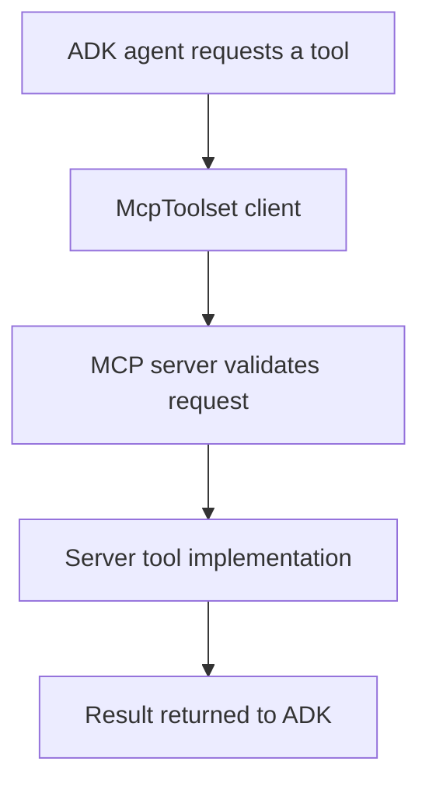

# Module 27: Introduction to MCP & Stateful Tools

## Before you begin: what this module teaches

**ADK concept: MCP discovery, tool calls and transport boundaries.**

MCP is the Model Context Protocol. A server advertises supported capabilities, and a client discovers and invokes them. McpToolset adapts that client interaction into ADK tools. Stdio connects a local process; Streamable HTTP connects compatible network endpoints. Protocol-session state is different from durable case data and authenticated user identity.

**Where you would use this in real work.**

The bank has a records capability that several assistants should share. Rather than teach each assistant a different custom interface, the service owner exposes approved operations through a protocol. The agent remains a consumer of those operations.

**Connection to Gemini Enterprise Agent Platform and Google Cloud.**

ADK supplies McpToolset; the tool provider may be a Google-hosted service or another approved integration. Choose the server, allowed tools, authentication and data contract explicitly. MCP does not require a LangChain agent or a separate LLM on the server.

**By the end, you should be able to:**

- Trace discovery separately from one actual tool call.
- Explain why ordinary Python tools can also use state.
- Choose local versus remote transport from the operating requirement.

### Review this lesson through three perspectives

- **Python/ADK beginner:** Find the tool name, argument schema and result in a trace.
- **Experienced engineer:** Test a changed schema, unavailable server and rejected operation.
- **Bank FDE:** Ask which team owns the tool and which clients/analysts may use it.

Use the [guided lab](./lab.md) to observe the mechanism, then compare with the [solution](./lab-solution.md). The banking scenario above explains how to transfer the concept; a lab using a railway, weather or shopping fixture does not implement a live bank integration.

## Theory: a standard interface to another tool provider

### Why introduce MCP after ordinary tools?

A Python function tool can already read a database, use `ToolContext` state and participate in multi-turn work. MCP is not required to make tools stateful. Its value is a common protocol for exposing capabilities to compatible clients across a process or service boundary.

The **Model Context Protocol (MCP)** specifies how a client and server discover and exchange supported capabilities, including tools, resources and prompts. This lab focuses on tools. A server may implement stateless calculations or stateful operations; durable business data remains the server application's responsibility. [ADK MCP overview](https://adk.dev/tools-custom/mcp-tools/).

### Who does what?

The agent's model can request a named capability. ADK's `McpToolset` supplies the client integration: connect, discover tool schemas and send tool calls. The server executes its registered implementation and returns a result. The LLM does not directly open a database connection or run a protocol handler.

<!-- TEACHER_NOTE_START -->
**Teacher's note (ADK instructor view):**
- **Learning goal:** Explain the concept clearly from beginner to advanced, with a simple mental model first.
- **Why it matters:** Connect the concept to real Google agentic workflows, Python engineering habits, and production-ready decisions.
- **Version watch:** Validate against the latest official ADK / Google docs before teaching; call out deprecations or migration notes when needed.
- **Module linkage:** Connect this idea to the previous and next modules so learners see the progression across the course.
<!-- TEACHER_NOTE_END -->

Discovery tells the client what a server advertises. It does not certify the server, authorize a user or guarantee that returned text is trustworthy. The bank must choose the approved server and allowed capabilities.

### Choose transport deliberately

**Stdio** uses a local subprocess's standard input/output. It fits the local lab, but the process still runs with its operating-system permissions. A configured allowed directory is an application restriction, not an OS sandbox.

**Streamable HTTP** is the current network transport for new remote integrations when supported by both ends. HTTP+SSE is an older transport retained for compatibility. An SSE response stream can also be part of Streamable HTTP; the presence of SSE does not by itself identify the old transport. Check the [MCP transport contract](https://modelcontextprotocol.io/specification/2025-11-25/basic/transports).

### Session does not mean business identity

A protocol session coordinates communication. It does not prove the identity of the analyst or authorize a case. A server-side cart or case record needs an authenticated owner and a durable store when persistence is required. Module 34 separates protocol state from business state when the server has multiple instances.

Use the filesystem lab to observe discovery and calls in a disposable allowed directory. It demonstrates protocol mechanics, not production isolation. The earlier modules supply validation, authorization, evaluation and observability patterns; connecting an MCP server does not replace them.

## Continue the course story

Previous: [Module 26](../module26-callbacks/README.md) · Next: [Module 28](../module28-building-mcp-tools/README.md) · [See how the concepts build](../learning-journey.md)

Before continuing, explain one input, one ADK execution boundary and one failure outcome from this module. Use the next chapter to add a new customer requirement, not merely another component.

<!-- © 2026 Inder Chauhan (https://github.com/inderanz/google-adk-training). All rights reserved. Ref: IC-ADK-module27-intro-to-mcp-README -->
---

## Official References

- Google ADK docs (latest): https://google.github.io/adk-docs/
- Gemini API (multimodal): https://ai.google.dev/gemini-api/docs
- Google GenAI Python SDK reference: https://googleapis.github.io/python-genai/
- Vertex AI generative guidance: https://cloud.google.com/vertex-ai/generative-ai
- Cloud Vision and OCR: https://cloud.google.com/vision

