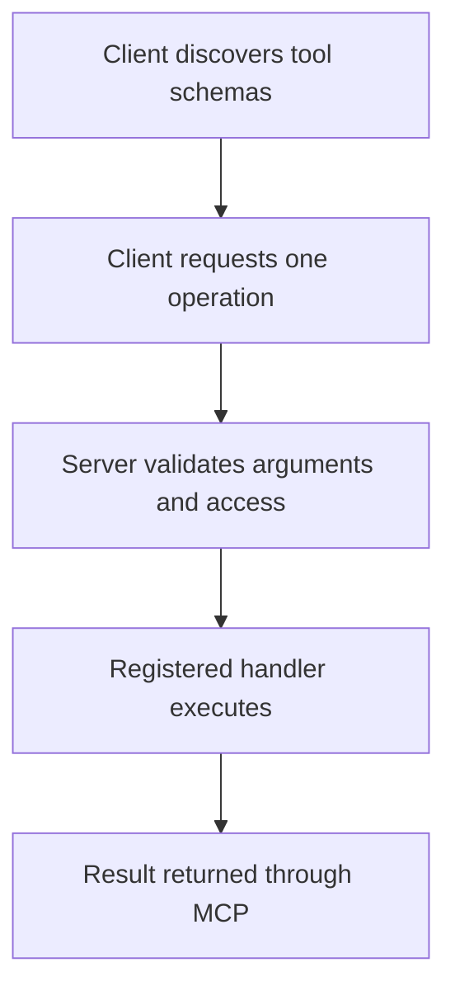

# Module 28: Building a Custom MCP Tool

## Before you begin: what this module teaches

**ADK concept: providing an MCP tool with a clear server contract.**

Tool discovery describes available operations. Tool execution receives a selected name and arguments, validates them, calls trusted code and returns a result. A decorator registers a handler with the SDK; it is not the business operation itself. Server-side state needs explicit ownership and persistence even when the transport maintains a session.

**Where you would use this in real work.**

The bank's records team wants to make one approved lookup reusable by several agent applications. It must publish an interface that is understandable without exposing unrestricted database operations.

**Connection to Gemini Enterprise Agent Platform and Google Cloud.**

Use the official compatible MCP SDK and ADK McpToolset client. A local shopping-cart exercise teaches handler/state mechanics; a banking adaptation would use an authorized case-read or document-request operation with an approved Google-backed store.

**By the end, you should be able to:**

- Explain discovery, validation, execution and response as separate stages.
- Keep server state scoped to its authenticated business owner.
- Distinguish a granular tool server from exposing an entire agent.

### Review this lesson through three perspectives

- **Python/ADK beginner:** Call the same operation directly and through MCP and compare results.
- **Experienced engineer:** Test invalid arguments, concurrent clients and SDK compatibility.
- **Bank FDE:** Agree the operation owner, allowed consumers and change/version policy.

Use the [guided lab](./lab.md) to observe the mechanism, then compare with the [solution](./lab-solution.md). The banking scenario above explains how to transfer the concept; a lab using a railway, weather or shopping fixture does not implement a live bank integration.

## Draw the execution boundary

The tool-serving path. Discovery happens before the client can select an advertised operation.

<!-- TEACHER_NOTE_START -->
**Teacher's note (ADK instructor view):**
- **Learning goal:** Explain the concept clearly from beginner to advanced, with a simple mental model first.
- **Why it matters:** Connect the concept to real Google agentic workflows, Python engineering habits, and production-ready decisions.
- **Version watch:** Validate against the latest official ADK / Google docs before teaching; call out deprecations or migration notes when needed.
- **Module linkage:** Connect this idea to the previous and next modules so learners see the progression across the course.
<!-- TEACHER_NOTE_END -->

## Theory

### Becoming a Tool Provider

In the previous module, you acted as a **consumer** of an MCP tool. Your ADK agent was the client connecting to a pre-built server. Now, we flip the roles. You will become a **provider** by building your own simple, standalone MCP server from scratch.

By exposing your application's capabilities via the Model Context Protocol, you are making them available not just to your own ADK agents, but to *any* MCP-compliant client. It turns your service into a reusable, AI-addressable component in a larger ecosystem.

### The Anatomy of an MCP Server

An MCP server is an application that listens for connections from clients and responds to requests according to the protocol. A server exposing tools supports discovery and execution. The low-level SDK exposes two handlers for these operations; higher-level SDK APIs can register them for you:

#### 1. `list_tools()`
When a client first connects, it calls `list_tools()`. The server's job is to respond with a "menu" of all the tools it provides. For each tool, it must provide a detailed schema, including:
*   The tool's `name`.
*   A `description` of what it does.
*   An `inputSchema` that defines the arguments the tool expects (names, types, etc.).

The client's LLM uses this menu to decide which tool to call.

#### 2. `call_tool()`
The model proposes a tool call; the client runtime sends the protocol request containing its name and arguments. The model does not itself implement the network protocol.

The server's `call_tool()` handler is responsible for:
*   Receiving the request.
*   Executing the corresponding logic for the requested tool.
*   Managing any state the tool needs (e.g. an in-memory cart, a database row).
*   Returning a result to the client.

### Building an MCP Server in Python

The `mcp` Python library provides a `Server` class and decorators to simplify this process.

1.  **Install the library (via ADK's compatible extra):** `uv add "google-adk[mcp]"`
2.  **Instantiate the Server:** `app = Server("my_mcp_server")`
3.  **Implement Handlers with Decorators:** You write `async` functions and use decorators to register them as handlers.
    *   `@app.list_tools()`: This decorates the function that will handle the `list_tools` request. It should return a list of `mcp.types.Tool` objects.
    *   `@app.call_tool()`: This decorates the function that will handle the `call_tool` request. It receives the tool name and arguments.
4.  **Run the Server:** You use a runner function (e.g., `mcp.server.stdio.stdio_server`) to start the server and listen for connections.

In the lab, you will build a simple MCP server that exposes a stateful "shopping cart" tool, learning the fundamentals of implementing these handlers.

### Why build an MCP Server?

Building an MCP server decouples your tool's logic from the agent, which provides significant benefits:
1.  **Independent Scalability:** You can scale the agent and the tool server separately.
2.  **Modular Maintenance:** Update tool logic without redeploying the agent.
3.  **Reusability:** Your MCP server can be consumed by *any* MCP-compliant client.
4.  **Workflow Integration:** In ADK 2.0, you can equip any `Agent` node with your custom MCP server, allowing for complex, distributed graph execution.

### Going Further: Exposing a Whole Agent as an MCP Tool (Experimental)

This module built a hand-written MCP server exposing granular tools (`add_item_to_cart`, `view_cart`) — no agent involved on the server side. ADK also offers the opposite direction: `to_mcp_server(agent)` (from `google.adk.tools.mcp_tool`, requires the `[mcp]` extra) wraps an *entire* ADK agent — its model loop and all of its own tools — as a single MCP tool that any MCP host can call, hiding the whole conversation behind one request/response. It's the MCP counterpart of `to_a2a`, which you used in Module 21 to expose an agent over A2A instead. It's still marked `@experimental` in ADK's source, so treat it as a preview rather than a pattern to build on yet.

## Continue the course story

Previous: [Module 27](../module27-intro-to-mcp/README.md) · Next: [Module 29](../module29-ui-integration-intro/README.md) · [See how the concepts build](../learning-journey.md)

Before continuing, explain one input, one ADK execution boundary and one failure outcome from this module. Use the next chapter to add a new customer requirement, not merely another component.

<!-- © 2026 Inder Chauhan (https://github.com/inderanz/google-adk-training). All rights reserved. Ref: IC-ADK-module28-building-mcp-tools-README -->
---

## Official References

- Google ADK docs (latest): https://google.github.io/adk-docs/
- Gemini API (multimodal): https://ai.google.dev/gemini-api/docs
- Google GenAI Python SDK reference: https://googleapis.github.io/python-genai/
- Vertex AI generative guidance: https://cloud.google.com/vertex-ai/generative-ai
- Cloud Vision and OCR: https://cloud.google.com/vision

