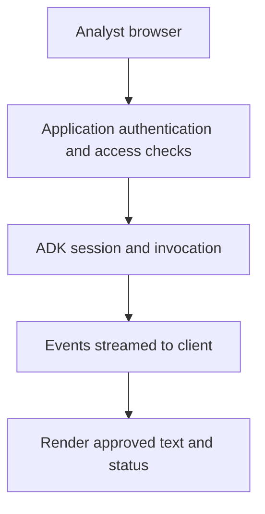

# Module 29: Introduction to UI Integration

## Before you begin: what this module teaches

**ADK concept: session-aware user interfaces and streamed ADK events.**

The browser submits input; the trusted backend binds identity and session access; ADK produces events. SSE carries a server-to-client event stream over HTTP. A network chunk is not necessarily a complete event, and an event is not necessarily a final answer. Persisting a session reference helps continuity but does not authorize access to that session.

**Where you would use this in real work.**

Meera needs a browser interface that shows whether the assistant is still working, has finished or could not retrieve a record. A spinning indicator and a text box are not enough if failures and partial answers look identical.

**Connection to Gemini Enterprise Agent Platform and Google Cloud.**

The lab teaches the native ADK API. The bank can build an approved web application or later publish a supported agent in Gemini Enterprise. Third-party UI adapters are optional integration choices, not necessary Google platform services.

**By the end, you should be able to:**

- Map request, session, invocation and displayed answer.
- Represent progress, failure and completion explicitly.
- Explain why client storage of a session ID needs backend ownership checks.

### Review this lesson through three perspectives

- **Python/ADK beginner:** Identify which received events should become visible text.
- **Experienced engineer:** Test fragmented SSE frames, disconnects, cancellation and user changes.
- **Bank FDE:** Agree the analyst experience for denied access, missing evidence and interrupted work.

Use the [guided lab](./lab.md) to observe the mechanism, then compare with the [solution](./lab-solution.md). The banking scenario above explains how to transfer the concept; a lab using a railway, weather or shopping fixture does not implement a live bank integration.

## Theory: connect an analyst interface to ADK execution

### A UI is another trust boundary

The browser presents a request and displays results. The backend authenticates the analyst, checks access to the requested session/case and invokes ADK. A browser-supplied `user_id` is not trusted identity simply because the request contains the right field names.

The lab uses the native ADK API and its `/run_sse` endpoint to make the mechanics visible. A client sends a request and reads a stream of events; not every event is final answer text. Some events describe tool work, partial output or state changes.

The diagram is a customer application design; the local teaching server/client does not implement every production boundary.

### SSE is a stream, not a complete message per network chunk

Server-Sent Events carry framed events over an HTTP response. Network chunks can split a frame or contain several frames. Buffer incomplete data, parse complete frames, and handle errors, cancellation and completion separately. A responsive interface can show progress while withholding unsupported or incomplete claims.

Persisting the session ID lets an interface resume the same conversation, but the server must verify the analyst owns that session. A cookie or localStorage value is a reference, not authorization. Clear or re-scope client state on sign-out and user change according to the application's design.

### Framework options

AG-UI means **Agent–User Interaction**. It is an interoperability option with third-party adapters and UI libraries; it is not a mandatory ADK API or the sole Google-native production path. A custom native API client, an approved application framework or a supported enterprise surface may fit the customer better. Inspect the chosen adapter's maintenance, event coverage and authentication responsibilities before adopting it.

A generated chat component does not supply case authorization, safety evaluation or operational readiness. Use the native lab to understand those responsibilities before placing a higher-level UI library around it. Module 30 then changes the transport and content requirements for bidirectional audio.

## Continue the course story

Previous: [Module 28](../module28-building-mcp-tools/README.md) · Next: [Module 30](../module30-custom-streaming-client/README.md) · [See how the concepts build](../learning-journey.md)

Before continuing, explain one input, one ADK execution boundary and one failure outcome from this module. Use the next chapter to add a new customer requirement, not merely another component.

<!-- © 2026 Inder Chauhan (https://github.com/inderanz/google-adk-training). All rights reserved. Ref: IC-ADK-module29-ui-integration-intro-README -->
---

## Official References

- Google ADK docs (latest): https://google.github.io/adk-docs/
- Gemini API (multimodal): https://ai.google.dev/gemini-api/docs
- Google GenAI Python SDK reference: https://googleapis.github.io/python-genai/
- Vertex AI generative guidance: https://cloud.google.com/vertex-ai/generative-ai
- Cloud Vision and OCR: https://cloud.google.com/vision

