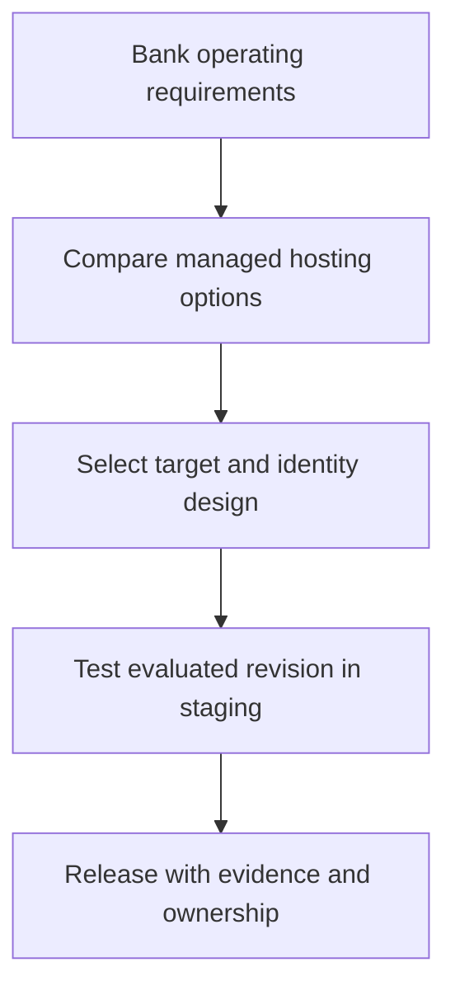

# Module 31: Production Deployment Strategies

## Before you begin: what this module teaches

**ADK concept: runtime selection and deployment acceptance evidence.**

A runtime executes the application. A deployment packages a chosen revision and configuration. A service identity grants the workload access; a user identity represents the analyst. Scaling adds or removes execution capacity; it does not make process-local state durable. A release decision needs evidence beyond a successful deployment command.

**Where you would use this in real work.**

The bank asks where the assistant should run. The useful answer begins with operating requirements: approved region, connectivity, persistent data, identity, expected load and who responds to incidents.

**Connection to Gemini Enterprise Agent Platform and Google Cloud.**

Compare Agent Runtime, Cloud Run and GKE for their supported responsibilities. Google hosting supports platform controls, but the application still enforces case authorization and business rules. Registration for employee discovery in Gemini Enterprise is a later operation.

**By the end, you should be able to:**

- Explain a target choice using requirements rather than a product slogan.
- Separate workload IAM from analyst case access.
- Define staging tests, operational ownership and rollback evidence.

### Review this lesson through three perspectives

- **Python/ADK beginner:** Draw code, runtime, model and database as separate components.
- **Experienced engineer:** Compare deadlines, concurrency, persistence and recovery on two candidate targets.
- **Bank FDE:** Document requirements and obtain the bank's platform/security decisions before release.

Use the [guided lab](./lab.md) to observe the mechanism, then compare with the [solution](./lab-solution.md). The banking scenario above explains how to transfer the concept; a lab using a railway, weather or shopping fixture does not implement a live bank integration.

## Draw the execution boundary

This is a deployment decision process, not an ADK runtime graph.

## Theory: choose a runtime from the customer's operating requirements

### Deployment is more than an endpoint

Deployment packages code and dependencies, supplies configuration and identity, and runs the application on a target platform. A successful deployment proves that those steps completed. Customer acceptance also needs authenticated invocations, real dependency access, persistence/recovery checks, evaluation and operational ownership.

### Compare supported Google targets

| Target | A reason to choose it | Questions the bank must answer |
|---|---|---|
| Agent Runtime | Managed agent hosting within Gemini Enterprise Agent Platform | Supported region/runtime contract, identity, sessions, quotas and integration requirements. |
| Cloud Run | A containerized API or tool service with managed scaling | Request/stream duration, concurrency, cold-start tolerance, durable state and ingress. |
| GKE | Kubernetes operating standards or specific cluster/workload controls | Who operates workloads, networking, scaling, upgrades and incident response? |

Choose the least operationally complex target that meets the agreed requirements. Cloud Run is not limited to prototypes; GKE is not required merely because the application has several agents. A remote A2A boundary and a hosting target are separate decisions.

### Separate service identity from analyst authorization

The platform identity grants the running application permission to call services. The analyst identity determines which case that application may disclose or change for a person. IAM permission to read a database does not automatically implement row/case authorization. The API boundary must authenticate the person and trusted application code must apply the bank's access rules.

Use attached workload/service identities and approved secret delivery rather than putting credentials into prompts. Keep dev UI endpoints private or absent from a product deployment. An HTTPS endpoint may require authentication; HTTPS alone does not define who can invoke it. [Cloud Run authentication](https://docs.cloud.google.com/run/docs/authenticating/overview).

### Ask for evidence instead of a compliance label

Do not select a platform from a blanket claim that it is the only compliant option. Assess the current service scope, region, contracts and applicable controls with the bank's responsible teams. Platform certifications do not certify your application's data access, prompt handling, retention or business decisions. Review the [Google Cloud compliance resources](https://cloud.google.com/security/compliance) for the actual requirement.

For a staging release, retain the built revision, dependency lock, configuration, evaluated model, runtime identity, access tests, service-failure results, monitoring evidence and rollback procedure. Modules 32–35 work through the hosting choices; Module 36 separates hosting from making an agent available to employees.

## Continue the course story

Previous: [Module 30](../module30-custom-streaming-client/README.md) · Next: [Module 32](../module32-deployment-cloud-run/README.md) · [See how the concepts build](../learning-journey.md)

Before continuing, explain one input, one ADK execution boundary and one failure outcome from this module. Use the next chapter to add a new customer requirement, not merely another component.

<!-- © 2026 Inder Chauhan (https://github.com/inderanz/google-adk-training). All rights reserved. Ref: IC-ADK-module31-production-deployment-strategies-README -->
---

## Official References

- Google ADK docs (latest): https://google.github.io/adk-docs/
- Gemini API (multimodal): https://ai.google.dev/gemini-api/docs
- Google GenAI Python SDK reference: https://googleapis.github.io/python-genai/
- Vertex AI generative guidance: https://cloud.google.com/vertex-ai/generative-ai
- Cloud Vision and OCR: https://cloud.google.com/vision

