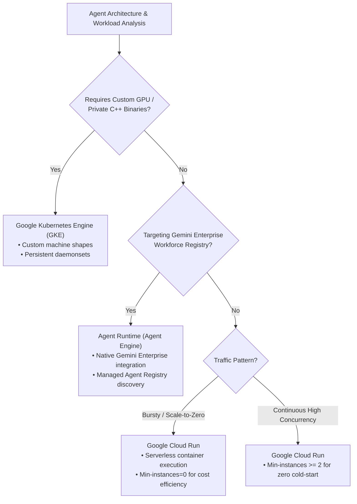

# Module 31 Enterprise Playbook: Target Selection & Production Deployment Framework

The enterprise architect needs this result: A defensible decision framework that evaluates cost, cold-start latency, compliance boundaries, and protocol support to select the optimal Google Cloud deployment target for ADK agents—comparing Cloud Run, Gemini Enterprise Agent Runtime, and Google Kubernetes Engine (GKE).

Read the [plain-English task and term explanations](./README.md) before reviewing the implementation details.

## 1. Google Cloud Target Evaluation Matrix

Selecting an agent hosting environment depends on workload characteristics, protocol requirements, and operational ownership.

| Evaluation Criterion | Google Cloud Run (Serverless) | Agent Runtime (Agent Engine) | Google Kubernetes Engine (GKE) |
|---|---|---|---|
| **Best For** | Event-driven microservices, REST/HTTP agents, lightweight scale-to-zero workloads. | Managed Gemini Enterprise integration, Agent Registry publication, zero-ops infrastructure. | Complex multi-agent topologies, long-running streaming/WebSocket pipelines, custom GPU sidecars. |
| **Operational Overhead** | Low (Serverless, fully managed container execution). | Minimal (Fully managed by Google Cloud Agent Platform). | High (Cluster maintenance, node pool sizing, ingress controllers). |
| **Scale-to-Zero Economics** | Yes (Pay per 100ms of active CPU/RAM; zero cost when idle). | Platform-managed pricing model tied to Agent Platform sessions. | No (Minimum 1 node pool unless using Autopilot with spot instances). |
| **Cold Starts** | 2–5 seconds on scale-up (mitigated via min-instances = 1). | Managed warmup; optimized for Agent Platform sessions. | Negligible once pod is scheduled and running. |
| **Protocol Support** | HTTP/1.1, HTTP/2, gRPC, WebSockets (60 min max timeout). | Native Gemini Enterprise protocols & A2A communication. | Any TCP/UDP protocol, persistent WebSockets, raw sockets. |
| **Security & Identity** | Cloud IAM, Workload Identity, Service Accounts, VPC-SC. | Agent Registry IAM, Enterprise OAuth 2.0. | Workload Identity Federation, Kubernetes RBAC, NetworkPolicies. |

## 2. Decision Tree for Deployment Targets

## 3. Production Readiness Criteria

1. **Health Checks:** Implement both liveness (`/healthz`) and readiness (`/ready`) endpoints. Ensure readiness validates access to downstream stores (Firestore, Secret Manager) before accepting traffic.
2. **Secret Management:** Never bake API keys or credentials into container images. Bind secrets dynamically using Google Secret Manager mounted as environment variables or volume mounts.
3. **Observability:** Emit OpenTelemetry traces and structured JSON logs to Google Cloud Logging with unified trace IDs to enable distributed end-to-end tracing.

<!-- © 2026 Inder Chauhan (https://github.com/inderanz/google-adk-training). All rights reserved. Ref: IC-ADK-module31-enterprise-playbook -->

