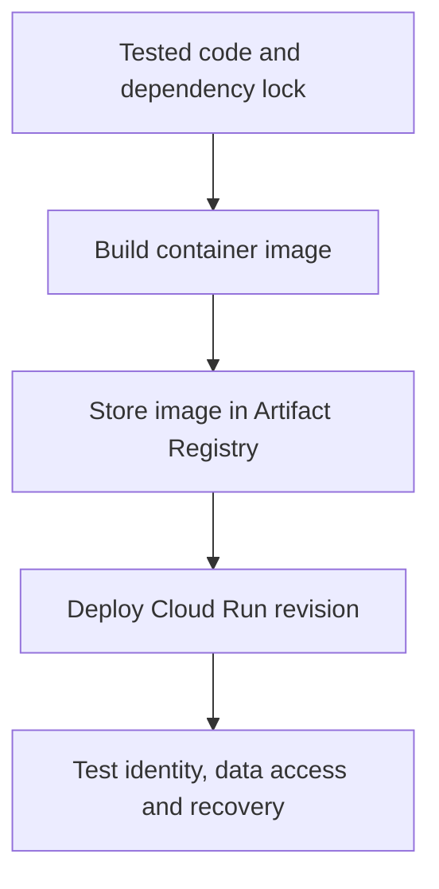

# Module 32: Deployment to Cloud Run

## Before you begin: what this module teaches

**ADK concept: containerized ADK hosting on Cloud Run.**

An image packages code and dependencies. A revision identifies a deployed configuration. An instance is a running copy that can be replaced. Concurrency describes requests handled by an instance; autoscaling changes instance count. These are different from ADK agents and sessions. A conversation cannot rely on a particular instance remaining alive.

**Where you would use this in real work.**

The bank wants a managed HTTP service for its analyst application. The same tested code should run as a packaged revision, with an attached identity and a controlled endpoint.

**Connection to Gemini Enterprise Agent Platform and Google Cloud.**

Cloud Run hosts the container; Artifact Registry stores images; the selected session/artifact providers store durable data. Configure authenticated invocation and dependency IAM explicitly. An HTTPS URL is not automatically public, and a successful deployment is not a complete banking release test.

**By the end, you should be able to:**

- Identify what the build produces and what a revision runs.
- Explain why durable state must survive instance replacement.
- Test allowed and denied callers at the deployed endpoint.

### Review this lesson through three perspectives

- **Python/ADK beginner:** Trace source → image → revision → request.
- **Experienced engineer:** Test concurrent requests, timeout and restart behavior using external storage.
- **Bank FDE:** Agree ingress, identity, cost/latency budgets, rollback and incident ownership.

Use the [guided lab](./lab.md) to observe the mechanism, then compare with the [solution](./lab-solution.md). The banking scenario above explains how to transfer the concept; a lab using a railway, weather or shopping fixture does not implement a live bank integration.

## Draw the execution boundary

Deployment lifecycle: each revision still needs authenticated integration tests.

## Theory

### From Localhost to the World

So far, you have been running your agents on your local machine using commands like `uv run adk web`. This is perfect for development and testing. However, to make your agent accessible to users or to integrate it with other applications, you need to **deploy** it to a publicly accessible, scalable, and reliable environment.

This is the final step in the agent development lifecycle: moving from a local prototype to a production-ready service.

### What is Deployment?

Deployment is the process of taking your agent's code, packaging it up with all its dependencies, and running it on a server. For modern applications, this is almost always done using **containers**.

A container (like a Docker container) is a lightweight, standalone, executable package that includes everything needed to run a piece of software: the code, a runtime (like Python), system tools, and libraries. Containerizing your application ensures that it runs the same way regardless of where it's deployed.

### Introducing Google Cloud Run

Google Cloud Run is a **fully managed, serverless platform** designed to run containers. "Serverless" doesn't mean there are no servers; it means you don't have to manage them. You simply provide your container, and Cloud Run handles everything else:

*   **Provisioning:** It automatically provides the necessary computing resources.
*   **Scaling:** It automatically scales the number of running containers up or down based on incoming traffic. It can even scale down to zero when there are no requests, which can be very cost-effective.
*   **Load Balancing:** It distributes incoming requests across your running containers.
*   **Security:** It provides a secure environment with managed SSL certificates for your service's public URL.

Cloud Run is an ideal platform for deploying ADK agents because it's simple to use, scales automatically, and you only pay for the computing resources you actually use.

### The Deployment Process with `uv run adk deploy cloud_run`

While you can manually build a container, push it to a registry, and configure a Cloud Run service, the ADK provides a powerful command-line tool that automates this entire process for you: `uv run adk deploy cloud_run`.

When you run this command, it performs a series of steps behind the scenes:

1.  **Packages Your Code:** It gathers your agent's code, your `requirements.txt` file, and any other necessary files.
2.  **Builds a Container Image:** It uses Google Cloud Build to create a container image based on a standard Python environment. This step is like running `docker build`.
3.  **Pushes the Image:** It pushes the newly created container image to Google Artifact Registry, a private repository for your project's containers.
4.  **Creates a Cloud Run Service:** It creates a new Cloud Run service (or updates an existing one).
5.  **Deploys the Image:** It configures the service to run the container image it just pushed.
6.  **Configures the Environment:** It passes necessary environment variables (like your Google Cloud Project ID) to the running container so the ADK can function correctly.

The result is a Cloud Run HTTPS service endpoint. Whether unauthenticated callers may invoke it depends on the configured access policy. A banking deployment should explicitly configure and test permitted callers, ingress and backend record authorization.

In the lab for this module, you will use the `uv run adk deploy cloud_run` command to deploy the multi-agent customer support system you'll build in this lab.

### Key Takeaways
- **Deployment** is the process of packaging an agent into a **container** and running it on a production server.
- **Google Cloud Run** is a fully managed, serverless platform that is ideal for deploying ADK agents due to its simplicity, automatic scaling (including to zero), and pay-per-use cost model.
- The `uv run adk deploy cloud_run` command automates the entire deployment workflow, including containerization, pushing to a registry, and configuring the Cloud Run service.
- The deployment command automates packaging and hosting steps. Production readiness still needs evaluation, identity, authorized data access, persistence and operational verification.
- **Scale-to-Zero Implications:** Cloud Run's ability to scale to zero instances is highly cost-effective for agents with infrequent traffic, as you are not billed for idle time. However, this comes with a performance trade-off: the first request to a scaled-down service will experience a "cold start," resulting in higher latency as a new container instance is provisioned. Subsequent requests will be fast until the instance scales down again.
- **Omitting `--with_ui` in Production:** In a headless production scenario where the agent is consumed by another application via its API, the `--with_ui` flag should be omitted. This is for two main reasons: **security** (the Dev UI exposes internal agent details like the full instruction and tool trajectory that should not be public) and **efficiency** (the UI adds unnecessary overhead to the container size and resource consumption).
- **Automation of `uv run adk deploy`:** The `uv run adk deploy cloud_run` command automates a multi-step process that would otherwise be manual and complex: packaging the code, building a container image (like `docker build`), pushing the image to a registry (like Artifact Registry), and creating/updating the Cloud Run service with the correct permissions and configuration. Without this command, each of these steps would need to be performed manually using `gcloud` or `docker` commands.

## Continue the course story

Previous: [Module 31](../module31-production-deployment-strategies/README.md) · Next: [Module 33](../module33-deployment-gke/README.md) · [See how the concepts build](../learning-journey.md)

Before continuing, explain one input, one ADK execution boundary and one failure outcome from this module. Use the next chapter to add a new customer requirement, not merely another component.

<!-- © 2026 Inder Chauhan (https://github.com/inderanz/google-adk-training). All rights reserved. Ref: IC-ADK-module32-deployment-cloud-run-README -->
---

## Official References

- Google ADK docs (latest): https://google.github.io/adk-docs/
- Gemini API (multimodal): https://ai.google.dev/gemini-api/docs
- Google GenAI Python SDK reference: https://googleapis.github.io/python-genai/
- Vertex AI generative guidance: https://cloud.google.com/vertex-ai/generative-ai
- Cloud Vision and OCR: https://cloud.google.com/vision

