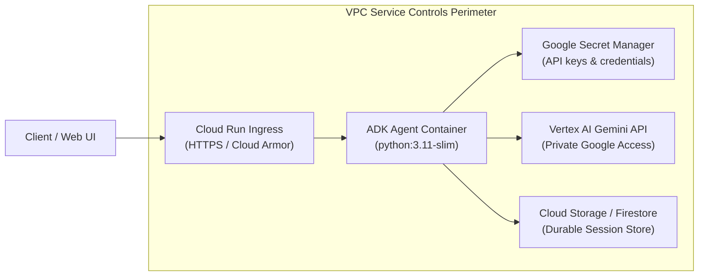

# Module 32 Enterprise Playbook: Serverless Containerization & Cloud Run Operations

The enterprise DevOps engineer needs this result: A hardened, observable Cloud Run container deployment for ADK agents that delivers rapid cold-starts (under 3 seconds), zero idle cost, secure secret injection via Secret Manager, and strict VPC service perimeter compliance.

Read the [plain-English task and term explanations](./README.md) before reviewing the implementation details.

## 1. Cloud Run Operational Specifications

Deploying an ADK agent to Cloud Run requires configuring container concurrency, CPU allocation, memory limits, and security perimeters.

| Operational Area | Production Standard | Implementation Reference |
|---|---|---|
| Container Base Image | Distroless or `python:3.11-slim` | Multi-stage build; compile wheels in builder, copy only binaries to final runtime image. Minimize attack surface. |
| CPU Allocation | `cpu-allocation: always` vs `throttled` | Use `throttled` (CPU only during request processing) for conversational bots. Use `always` if performing background session flushes or async queue consumption. |
| Concurrency Tuning | Concurrency: 40–80 requests/instance | ADK agents make async I/O calls to Gemini and tools. Concurrency of 40–80 maximizes throughput per container instance without thread starvation. |
| Memory Sizing | Minimum 1 GiB per instance | ADK runtime and fast API wrappers require ~256MB base; set 1–2 GiB to accommodate large multimodal payloads and JSON buffers. |
| Secret Injection | Secret Manager integration | Pass secrets as environment variables via `--set-secrets` rather than baking into images or passing in build arguments. |

## 2. Cloud Run Zero-Trust Architecture

<!-- TEACHER_NOTE_START -->
**Teacher's note (ADK instructor view):**
- **Learning goal:** Explain the concept clearly from beginner to advanced, with a simple mental model first.
- **Why it matters:** Connect the concept to real Google agentic workflows, Python engineering habits, and production-ready decisions.
- **Version watch:** Validate against the latest official ADK / Google docs before teaching; call out deprecations or migration notes when needed.
- **Module linkage:** Connect this idea to the previous and next modules so learners see the progression across the course.
<!-- TEACHER_NOTE_END -->

## 3. Deployment & Reliability Verification

1. **Cold-Start Optimization:** Pre-compile Python bytecode with `python -m compileall` in the Dockerfile and defer heavy tool imports until first invocation if not needed at startup.
2. **Graceful Shutdown:** Handle `SIGTERM` signals emitted by Cloud Run during instance scale-down; allow running tool executions up to 10 seconds to flush telemetry before process termination.
3. **IAM Least Privilege:** Assign the Cloud Run service a dedicated Service Account with only `roles/aiplatform.user` and `roles/secretmanager.secretAccessor`.

<!-- © 2026 Inder Chauhan (https://github.com/inderanz/google-adk-training). All rights reserved. Ref: IC-ADK-module32-enterprise-playbook -->
---

## Official References

- Google ADK docs (latest): https://google.github.io/adk-docs/
- Google AI / Gemini docs: https://ai.google.dev/
- Google GenAI Python SDK reference: https://googleapis.github.io/python-genai/
- Context7 / current SDK lookup for the exact installed version and API signatures
- Related module path: review the surrounding modules for continuity, prerequisites, and follow-on concepts

