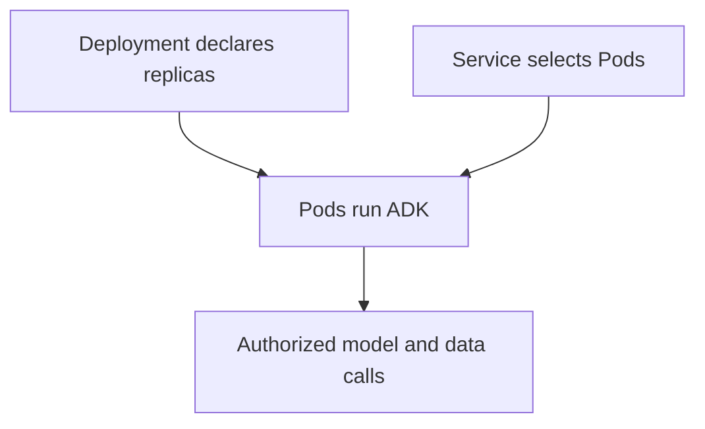

# Module 33: Deployment to Google Kubernetes Engine (GKE)

## Before you begin: what this module teaches

**ADK concept: ADK workloads on Kubernetes and GKE.**

A Pod runs containers. A Deployment maintains a desired number of Pod replicas. A Service supplies a stable network destination for selected Pods; its type and configuration determine exposure. A cluster hosts workloads. These are infrastructure objects, whereas Agent and Workflow are application objects executed inside the workload.

**Where you would use this in real work.**

The bank already operates Kubernetes and requires its workload/network controls for the assistant. The engineer must fit into that operating model without assuming that a Kubernetes deployment supplies agent quality or business authorization.

**Connection to Gemini Enterprise Agent Platform and Google Cloud.**

GKE provides managed Kubernetes capabilities; the bank still configures workloads, identities, networking and operational policies. Use supported workload identity and durable services. Cloud Run may also provide features such as private connectivity or selected accelerators; compare current requirements rather than outdated product stereotypes.

**By the end, you should be able to:**

- Read image, replicas, selectors and ports in a manifest.
- Distinguish an internal Service from public ingress.
- Explain workload identity and persistence across Pod replacement.

### Review this lesson through three perspectives

- **Python/ADK beginner:** Match a Service selector to the Pods it should reach.
- **Experienced engineer:** Test readiness, shutdown, scaling and dependency access.
- **Bank FDE:** Justify why Kubernetes-specific controls outweigh a simpler managed target for this customer.

Use the [guided lab](./lab.md) to observe the mechanism, then compare with the [solution](./lab-solution.md). The banking scenario above explains how to transfer the concept; a lab using a railway, weather or shopping fixture does not implement a live bank integration.

## Draw the execution boundary

A Service routes to selected Pods; the Deployment maintains the desired workload.

## Theory

### When You Need More Control

In the previous module, you learned how to deploy your agent to Google Cloud Run, a serverless platform that is incredibly simple and cost-effective. For many use cases, Cloud Run is the perfect deployment target.

However, as your applications become more complex, you may find you need more control and flexibility than a serverless platform can offer. You might need to:
*   Deploy agents that have specific hardware requirements (like GPUs).
*   Have fine-grained control over networking and security policies.
*   Use Kubernetes-specific workload and network controls under the bank's operating model. Private connectivity alone does not require GKE.
*   Manage complex, stateful workloads.

For these scenarios, the industry-standard solution is **Kubernetes**.

### What is Kubernetes?

Kubernetes (often abbreviated as K8s) is an open-source **container orchestration** platform. While a container platform like Docker runs a single container on a single machine, Kubernetes allows you to manage and run thousands of containers across a whole fleet of machines, known as a **cluster**.

It automates the deployment, scaling, and management of containerized applications. You tell Kubernetes the desired state of your application (e.g., "I want three copies of my agent container running at all times"), and Kubernetes works to maintain that state, automatically handling things like machine failures and load balancing.

### Google Kubernetes Engine (GKE)

Running and managing a Kubernetes cluster yourself can be incredibly complex. **Google Kubernetes Engine (GKE)** is a managed Kubernetes service provided by Google Cloud. It takes care of the heavy lifting of managing the cluster's infrastructure—like provisioning machines, managing the Kubernetes control plane, and handling upgrades—so you can focus on deploying your applications.

### Cloud Run vs. GKE: A Quick Comparison

| Feature | Google Cloud Run | Google Kubernetes Engine (GKE) |
| :--- | :--- | :--- |
| **Abstraction Level** | High (Serverless) | Medium (Managed Kubernetes) |
| **Control** | Less control, more automation | Full control over cluster configuration |
| **Use Case** | Stateless web apps, APIs, simple agents | Complex microservices, stateful apps, custom hardware |
| **Scaling** | Automatic, including scale-to-zero | Highly configurable auto-scaling |
| **Complexity** | Very low | Moderate to high |

In essence, Cloud Run prioritizes simplicity and ease of use, while GKE prioritizes flexibility and control.

### The Deployment Process to GKE

Deploying to GKE is a more involved process than deploying to Cloud Run, as it requires you to define your application's components using Kubernetes' own configuration language (which also uses YAML).

The general steps are:
1.  **Containerize your application:** Create a `Dockerfile` that specifies how to build a container image for your agent.
2.  **Build and Push the Image:** Build the container image and push it to a container registry (like Google Artifact Registry).
3.  **Create a GKE Cluster:** Provision a GKE cluster in your Google Cloud project.
4.  **Write Kubernetes Manifests:** Create YAML files that describe the desired state of your application to Kubernetes. This typically involves:
    *   A **Deployment:** Specifies which container image to run and how many replicas (copies) to maintain.
    *   A **Service:** Provides a stable network endpoint for selected Pods. The default ClusterIP is internal; public or private load balancing is a deliberate configuration choice.
5.  **Apply the Manifests:** Use the `kubectl` command-line tool to apply your manifest files to the GKE cluster, which triggers the deployment.

While the ADK provides the `uv run adk deploy gke` command to automate some of these steps, understanding the underlying concepts is crucial for managing a production deployment on Kubernetes. In the lab, you will walk through the manual process to gain a deeper understanding of how GKE works.

### Key Takeaways
- **Google Kubernetes Engine (GKE)** is a managed container orchestration platform that provides more control and flexibility than serverless options like Cloud Run.
- Choose GKE when Kubernetes-specific controls or the bank's established operating model justify its responsibilities. GPU availability and networking features must be compared against the current capabilities of all candidate services; they are not exclusive to GKE.
- The deployment process to GKE is more involved, requiring you to containerize your application with a `Dockerfile` and define its desired state using Kubernetes **Manifests** (YAML files).
- Key Kubernetes objects include the **Deployment** (manages your application's running instances) and the **Service** (exposes your application to the network).
- You interact with a GKE cluster using the `kubectl` command-line tool.
- **`api_server` vs. `web` in Production:** It is critical to use `uv run adk api_server` in a production `Dockerfile` instead of `uv run adk web`. The `api_server` command exposes a pure, headless REST API for programmatic consumption, which is what's needed for a backend service. In contrast, `uv run adk web` also includes the debug UI, which exposes sensitive internal information (like the agent's full instruction and reasoning trace) and adds unnecessary resource overhead, making it insecure and inefficient for production.
- **Deployment vs. Service Objects:** In Kubernetes, the `Deployment` and `Service` objects have distinct roles. The **Deployment** is responsible for the *execution* of the application; it defines which container image to run and how many replicas (Pods) to maintain, ensuring the agent is always running. The **Service** is responsible for *access*; it provides a stable network endpoint (like a public IP address) to the application, routing external traffic to the ephemeral Pods managed by the Deployment. You need both to run and expose an application.
- **GKE vs. Cloud Run Trade-off:** The primary trade-off between GKE and Cloud Run is **Control vs. Complexity**. GKE offers maximum control over nodes, networking, and hardware (like GPUs) but comes with higher operational complexity and slower deployment times. Cloud Run offers simplicity, rapid deployment, and a cost-effective pay-per-use model but provides less control. GKE is the right choice when the need for granular control outweighs the benefits of serverless simplicity.

## Continue the course story

Previous: [Module 32](../module32-deployment-cloud-run/README.md) · Next: [Module 34](../module34-deploying-mcp-server-cloud-run/README.md) · [See how the concepts build](../learning-journey.md)

Before continuing, explain one input, one ADK execution boundary and one failure outcome from this module. Use the next chapter to add a new customer requirement, not merely another component.

<!-- © 2026 Inder Chauhan (https://github.com/inderanz/google-adk-training). All rights reserved. Ref: IC-ADK-module33-deployment-gke-README -->
---

## Official References

- Google ADK docs (latest): https://google.github.io/adk-docs/
- Gemini API (multimodal): https://ai.google.dev/gemini-api/docs
- Google GenAI Python SDK reference: https://googleapis.github.io/python-genai/
- Vertex AI generative guidance: https://cloud.google.com/vertex-ai/generative-ai
- Cloud Vision and OCR: https://cloud.google.com/vision

