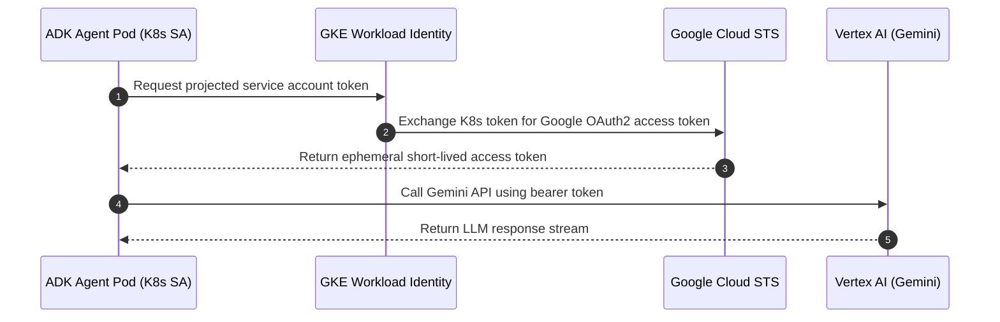

# Module 33 Enterprise Playbook: GKE Orchestration & Workload Identity Federation

The platform engineer needs this result: A scalable Kubernetes deployment on GKE Autopilot or Standard that isolates ADK agents, leverages Workload Identity Federation to eliminate service account keys, enforces Pod Security Standards (Restricted), and auto-scales on custom metrics.

Read the [plain-English task and term explanations](./README.md) before reviewing the implementation details.

## 1. Kubernetes Hardening & Production Matrix

| Production Dimension | GKE Best Practice | Rationale & Security Impact |
|---|---|---|
| Workload Identity Federation | Annotate K8s ServiceAccount with GCP SA | Completely eliminates static private keys (`key.json`) from pods, preventing credential leakage in logs or git. |
| Pod Security Standards | `enforce: restricted` | Prohibits root user (`runAsNonRoot: true`), denies privilege escalation (`allowPrivilegeEscalation: false`), and drops all Linux capabilities (`drop: ["ALL"]`). |
| Ingress & Service Topology | Internal ClusterIP + Private Ingress | Prevents exposing raw agent endpoints to the public internet; routes external traffic strictly through enterprise API gateways or Cloud Armor. |
| Autoscaling Policy | Horizontal Pod Autoscaler (HPA) | Scale on CPU utilization (70%) and custom metrics (concurrent active sessions) rather than simple connection counts. |

## 2. GKE Workload Identity Flow

<!-- TEACHER_NOTE_START -->
**Teacher's note (ADK instructor view):**
- **Learning goal:** Explain the concept clearly from beginner to advanced, with a simple mental model first.
- **Why it matters:** Connect the concept to real Google agentic workflows, Python engineering habits, and production-ready decisions.
- **Version watch:** Validate against the latest official ADK / Google docs before teaching; call out deprecations or migration notes when needed.
- **Module linkage:** Connect this idea to the previous and next modules so learners see the progression across the course.
<!-- TEACHER_NOTE_END -->

## 3. Manifest Hardening Checklist

1. **Read-Only Root Filesystem:** Configure `readOnlyRootFilesystem: true` in the container security context, mounting an `emptyDir` on `/tmp` for temporary scratch buffers.
2. **Resource Requests & Limits:** Always specify explicit `requests` and `limits` for CPU and Memory to avoid noisy-neighbor starvation and enable deterministic HPA scaling.
3. **Rolling Update Strategy:** Configure `maxSurge: 25%` and `maxUnavailable: 0` in the Deployment spec to guarantee zero-downtime rolling updates.

<!-- © 2026 Inder Chauhan (https://github.com/inderanz/google-adk-training). All rights reserved. Ref: IC-ADK-module33-enterprise-playbook -->
---

## Official References

- Google ADK docs (latest): https://google.github.io/adk-docs/
- Google AI / Gemini docs: https://ai.google.dev/
- Google GenAI Python SDK reference: https://googleapis.github.io/python-genai/
- Context7 / current SDK lookup for the exact installed version and API signatures
- Related module path: review the surrounding modules for continuity, prerequisites, and follow-on concepts

