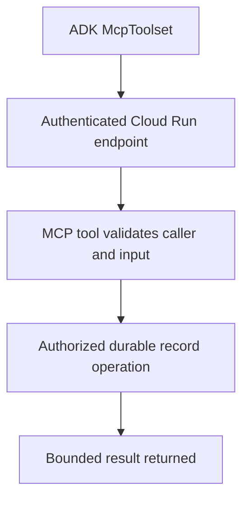

# Module 34: Deploying an MCP Server to Cloud Run

## Before you begin: what this module teaches

**ADK concept: remote MCP hosting with durable, authorized business state.**

Externalized state lives outside the replaceable process. Protocol session state coordinates MCP communication; business state belongs to an authenticated resource owner. Both need a deliberate multi-instance design. A read-modify-write operation requires concurrency control when several requests can update the same record.

**Where you would use this in real work.**

A branch tool works locally but loses its document-request list after a restart. Several server instances must see the same authorized record. The fix is a state and identity design, not merely replacing a local address with a cloud URL.

**Connection to Gemini Enterprise Agent Platform and Google Cloud.**

Cloud Run can host the MCP endpoint; Firestore or Cloud SQL can own the business record. McpToolset consumes the compatible HTTP transport. Separate endpoint authentication, protocol compatibility and case authorization; an MCP session header is not a user identity.

**By the end, you should be able to:**

- Draw transport-session state separately from business persistence.
- Explain why /tmp and process globals are not durable shared stores.
- Specify version conflicts, repeated requests and denied access.

### Review this lesson through three perspectives

- **Python/ADK beginner:** Predict what survives instance replacement in the local exercise.
- **Experienced engineer:** Test two instances and overlapping writes before claiming durable correctness.
- **Bank FDE:** Identify the owner of each record and the approved identity/token contract at both ends.

Use the [guided lab](./lab.md) to observe the mechanism, then compare with the [solution](./lab-solution.md). The banking scenario above explains how to transfer the concept; a lab using a railway, weather or shopping fixture does not implement a live bank integration.

## Theory: remote MCP, durable business data and trusted callers

### The counter and the register

An MCP server instance is like a service counter; the durable business store is the shared register. Several counters may serve the same customer. Keeping the only copy of a record in one counter's memory makes restart or instance replacement lose it. It can also mix customers if a global list is used without ownership checks.

Cloud Run may reuse an instance across requests, so memory is not necessarily erased after every request. The problem is that reuse and persistence are not guaranteed. A local file under `/tmp` is not a durable shared database either.

### Business state and protocol state are separate

A cart ID or case ID identifies a business resource. An authenticated caller must be authorized to access it. An MCP session ID coordinates protocol communication; do not use possession of that value as the only authorization check. A multi-instance design also needs the MCP server's supported strategy for protocol sessions/streams. Moving business rows to Firestore alone does not solve every transport-session problem.

This is a customer target flow, not evidence that the local cart lab implements each production boundary. For a bank adaptation, use a case-owned document-request list instead of a shopping cart, and define an exact owner, version and duplicate-request policy.

### Choose an appropriate store and write contract

Firestore or Cloud SQL can hold durable business records according to their configured guarantees. Memorystore may fit selected cache/session workloads, but durability and failover depend on product and configuration; “Redis” does not automatically mean permanent storage. A read-modify-write sequence needs concurrency control when two instances can update the same record.

Use Streamable HTTP for a compatible remote MCP endpoint. Authentication must match both the ingress and MCP server contract. ADK exposes `auth_scheme`, `auth_credential` and context-dependent `header_provider` options; there is no universal `credential=` switch that solves all token acquisition and refresh. A Cloud Run invocation ID token and an OAuth access token are different credentials. Validate the current [ADK MCP authentication guidance](https://adk.dev/tools-custom/mcp-tools/) for the selected integration.

### Approval is a complete interaction, not a blocking sentence

A before-tool callback can return a blocked result. That alone does not implement a later authorized resume. A real approval path needs a recorded request, verified approver, exact approved parameters, expiry, and validation when execution resumes. Use supported ADK confirmation/human-input mechanisms where appropriate and enforce the actual write at the backend. See Module 13 for confirmation and Module 26 for hook behavior.

## Continue the course story

Previous: [Module 33](../module33-deployment-gke/README.md) · Next: [Module 35](../module35-deployment-agent-runtime/README.md) · [See how the concepts build](../learning-journey.md)

Before continuing, explain one input, one ADK execution boundary and one failure outcome from this module. Use the next chapter to add a new customer requirement, not merely another component.

<!-- © 2026 Inder Chauhan (https://github.com/inderanz/google-adk-training). All rights reserved. Ref: IC-ADK-module34-deploying-mcp-server-cloud-run-README -->
---

## Official References

- Google ADK docs (latest): https://google.github.io/adk-docs/
- Gemini API (multimodal): https://ai.google.dev/gemini-api/docs
- Google GenAI Python SDK reference: https://googleapis.github.io/python-genai/
- Vertex AI generative guidance: https://cloud.google.com/vertex-ai/generative-ai
- Cloud Vision and OCR: https://cloud.google.com/vision

