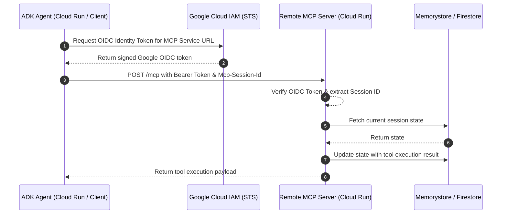

# Module 34 Enterprise Playbook: Remote MCP Server Security & Scaling

The integration architect needs this result: A scalable, secure remote Model Context Protocol (MCP) server running on Google Cloud Run that handles concurrent agent connections, externalizes shared state, protects tool invocations with OAuth 2.0 / OIDC tokens, and maintains low latency.

Read the [plain-English task and term explanations](./README.md) before reviewing the implementation details.

## 1. Remote MCP Architecture & Transport Patterns

While local MCP tools rely on `stdio` subprocess transport, enterprise-scale MCP services communicate over HTTP/SSE (`StreamableHTTP` or Server-Sent Events) across distributed cloud instances.

| Architecture Concern | Production Practice | Implementation Mechanism |
|---|---|---|
| Server Concurrency | Stateless ASGI Service | FastMCP service mounted via `mcp.streamable_http_app()`, served by Uvicorn with concurrency up to 80 requests/container. |
| Session & State Externalization | Remote Cache / Durable Store | Never store cart or conversation state in local container memory or volatile `/tmp`. Use Redis (Memorystore) or Firestore indexed by `mcp-session-id`. |
| Transport Security | Authenticated Cloud Run Service | Require authentication (`--no-allow-unauthenticated`). Client agents pass Google OIDC ID tokens in the `Authorization: Bearer <token>` header. |
| Tool Schema Governance | Versioned OpenAPI / MCP tools | Pin tool definitions and input schemas using Pydantic models with strict typing and runtime validation. |

## 2. Remote MCP Request & Authentication Flow

## 3. Production Hardening Checklist

1. **Session Timeout & Eviction:** Configure Time-to-Live (TTL) on session keys in Redis/Firestore (e.g., 2 hours) to prevent unbounded memory growth.
2. **Error Handling & Sanitization:** Ensure the MCP server never leaks internal stack traces or connection strings in tool response payloads; return structured error objects.
3. **Keepalive & Reconnects:** Configure client `StreamableHTTPConnectionParams` with connection pooling, retries, and exponential backoff.

<!-- © 2026 Inder Chauhan (https://github.com/inderanz/google-adk-training). All rights reserved. Ref: IC-ADK-module34-enterprise-playbook -->
