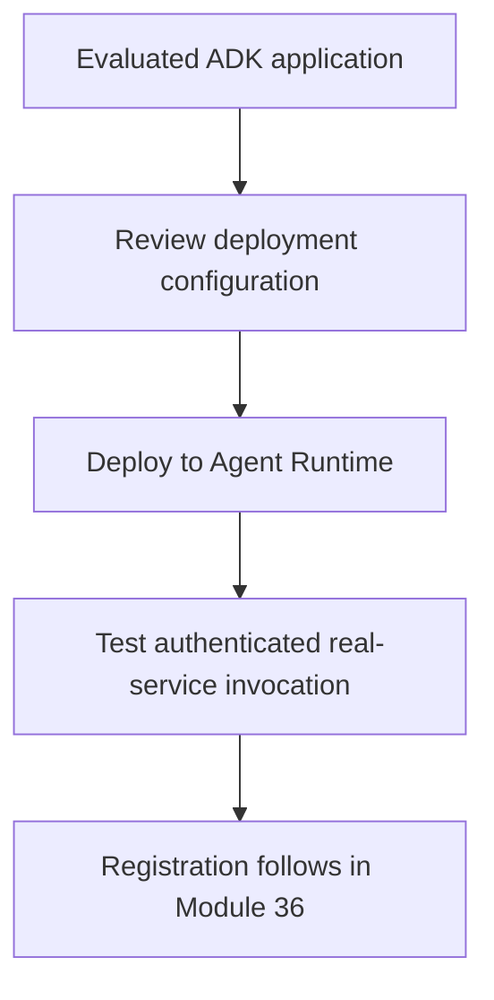

# Module 35: Deploying to Agent Runtime

## Before you begin: what this module teaches

**ADK concept: managed agent hosting and deployment lifecycle.**

Scaffolding creates project/deployment structure. Provisioning creates configured infrastructure. Deployment releases an application revision. Invocation executes a request. Evaluation measures behavior. These stages are connected but not interchangeable. Generated Terraform and CI/CD files remain reviewable code with environment-specific settings.

**Where you would use this in real work.**

The bank chooses managed agent hosting. The FDE must package the evaluated application, configure its runtime identity and dependencies, then show that the deployed service actually performs the intended task.

**Connection to Gemini Enterprise Agent Platform and Google Cloud.**

Agent Runtime supplies the managed hosting path. Agents CLI can scaffold and deploy supported project configurations; a supported SDK path is also available. Neither approach automatically implements case authorization, source freshness or a human approval process.

**By the end, you should be able to:**

- Read the generated deployment configuration before executing it.
- Explain which identity calls Gemini and each backing service.
- Retain authenticated deployed-test and rollback evidence.

### Review this lesson through three perspectives

- **Python/ADK beginner:** Separate an App object from the cloud resource hosting it.
- **Experienced engineer:** Compare the locked local runtime with the deployed dependency/configuration set.
- **Bank FDE:** Agree staging acceptance, quotas, regions, support ownership and release authority.

Use the [guided lab](./lab.md) to observe the mechanism, then compare with the [solution](./lab-solution.md). The banking scenario above explains how to transfer the concept; a lab using a railway, weather or shopping fixture does not implement a live bank integration.

## Draw the execution boundary

Managed hosting and employee registration are separate operations.

## Theory

### From Local Development to Production-Grade Deployment

Deploying an agent involves packaging its code and running it on a scalable, reliable, and managed platform. **Google Cloud's Agent Runtime** is a fully managed service in the Gemini Enterprise Agent Platform designed for this, handling server management, scaling, and security.

### Two Paths to Deployment

1.  **Accelerated Deployment (Recommended Best Practice):**
    *   **Method:** Use the **Agents CLI** (`uvx google-agents-cli`). This tool applies a production-ready template to your existing ADK project, adding all the necessary files for deployment. (This replaces the older Agent Starter Pack, now in maintenance mode.)
    *   **Key Features:** It includes pre-built CI/CD pipelines using Cloud Build, Infrastructure as Code (IaC) with Terraform, and a unified CLI for a seamless deployment process.
    *   **Best For:** All new projects. It establishes best practices for security, reliability, and maintainability from the start.

2.  **Standard Deployment (Manual):**
    *   **Method:** Write a custom Python script using the Vertex AI SDK to package and deploy your agent.
    *   **Best For:** Learning the underlying mechanics of deployment, modifying an existing deployment, or for projects where the starter pack's structure is not a good fit.

This module's lab will guide you through both methods.

### Understand the generated project before deploying

Use Agents CLI to create or enhance the deployment structure for the chosen target. Inspect the generated specification, dependency pins, Terraform, service accounts and CI/CD configuration. The generated workflow varies with the selected options and CLI version; a deploy command is not a promise that every configuration runs the same Cloud Build pipeline.

Build and evaluate locally, prepare the environment, deploy an approved revision to staging, and invoke it with the intended identity. Verify real dependency access, persistent session behavior, traces and failure outcomes. Registration in Gemini Enterprise is a later step taught in Module 36.

The supported SDK deployment path can also be automated and governed. Choose based on the existing project and operating model rather than calling one path universally superior. Follow the [current ADK Agent Runtime guide](https://adk.dev/deploy/agent-runtime/) and the generated project's instructions.

### Key Takeaways
- **Google Cloud's Agent Runtime** is a fully managed service in the Gemini Enterprise Agent Platform for deploying, scaling, and securing ADK agents.
- The **Accelerated Deployment** method, using the **Agents CLI**, is the recommended best practice for new projects, providing a pre-configured CI/CD pipeline and Infrastructure as Code.
- The **Standard Deployment** method involves writing a custom Python script with the Vertex AI SDK, which is useful for understanding the underlying mechanics.
- The Accelerated workflow follows a simple process: **Scaffold** (adds deployment files to your project) and **Deploy** (provisions infrastructure and uploads your code).
- **Agent Runtime and Complex Clients:** The architecture of Agent Runtime (a managed, scalable backend) simplifies the development of complex clients (like web or mobile apps). It handles concurrency and horizontal scaling automatically, provides a stable API for clients written in any language to connect to, and cleanly separates the UI/session management logic on the client from the heavy lifting of agent orchestration and AI logic on the backend.
- **Advantages of Accelerated Deployment:** The accelerated approach can reduce repeated project setup as it automates the creation of infrastructure as code (IaC) with Terraform and establishes a simple, repeatable deployment process. This provides a reproducible, auditable, and consistent deployment, incorporating best practices from the start, whereas the Standard Deployment is manual and better suited for learning the underlying SDK mechanics.

## Continue the course story

Previous: [Module 34](../module34-deploying-mcp-server-cloud-run/README.md) · Next: [Module 36](../module36-gemini-enterprise/README.md) · [See how the concepts build](../learning-journey.md)

Before continuing, explain one input, one ADK execution boundary and one failure outcome from this module. Use the next chapter to add a new customer requirement, not merely another component.

<!-- © 2026 Inder Chauhan (https://github.com/inderanz/google-adk-training). All rights reserved. Ref: IC-ADK-module35-deployment-agent-runtime-README -->
---

## Official References

- Google ADK docs (latest): https://google.github.io/adk-docs/
- Gemini API (multimodal): https://ai.google.dev/gemini-api/docs
- Google GenAI Python SDK reference: https://googleapis.github.io/python-genai/
- Vertex AI generative guidance: https://cloud.google.com/vertex-ai/generative-ai
- Cloud Vision and OCR: https://cloud.google.com/vision

