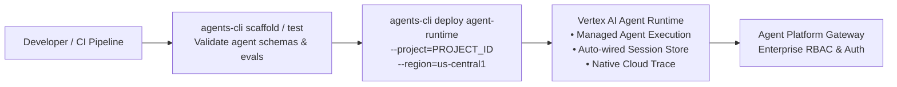

# Module 35 Enterprise Playbook: Agent Runtime & Vertex AI Agent Engine

The enterprise platform architect needs this result: Seamless deployment of ADK agents into Google Cloud's fully managed Agent Runtime (formerly Agent Engine), establishing automated CI/CD pipelines via `google-agents-cli`, managed session lifecycle, and zero-touch infrastructure scaling.

Read the [plain-English task and term explanations](./README.md) before reviewing the implementation details.

## 1. Agent Runtime Architecture & Value Drivers

Agent Runtime is Google Cloud's turnkey serverless runtime purpose-built for AI agents, abstracting container orchestration, state persistence, and telemetry.

| Feature Area | Custom Container Hosting (Cloud Run/GKE) | Vertex AI Agent Runtime |
|---|---|---|
| Infrastructure Management | Customer builds, patches, and sizes containers and K8s manifests. | Fully managed; Google orchestrates execution environment and autoscaling. |
| Session & State Backend | Customer provisions Redis, Firestore, or SQL databases. | Native managed session persistence and automatic event logging. |
| Tool Integration | Requires custom networking, VPC connectors, and auth headers. | First-class integration with Vertex AI Extensions, Agent Tools, and MCP. |
| Tooling & Deployment | Custom Dockerfiles and Cloud Build pipelines. | Standardized deployment via `agents-cli deploy` and Agent Engine SDK. |

## 2. CI/CD Lifecycle via `google-agents-cli`

<!-- TEACHER_NOTE_START -->
**Teacher's note (ADK instructor view):**
- **Learning goal:** Explain the concept clearly from beginner to advanced, with a simple mental model first.
- **Why it matters:** Connect the concept to real Google agentic workflows, Python engineering habits, and production-ready decisions.
- **Version watch:** Validate against the latest official ADK / Google docs before teaching; call out deprecations or migration notes when needed.
- **Module linkage:** Connect this idea to the previous and next modules so learners see the progression across the course.
<!-- TEACHER_NOTE_END -->

## 3. Production Deployment Guidelines

1. **Manifest Validation:** Ensure `agent.yaml` or CLI deployment configs strictly define memory limits, model endpoints, and authorized tool extensions.
2. **Session Governance:** Leverage Agent Runtime's built-in session encryption (CMEK) to meet regulatory requirements for financial and medical conversations.
3. **Automated Rollback:** Configure CI/CD pipelines to run synthetic evaluation suites (`agents-cli eval`) against canary instances before directing 100% of production traffic to newly deployed agent versions.

<!-- © 2026 Inder Chauhan (https://github.com/inderanz/google-adk-training). All rights reserved. Ref: IC-ADK-module35-enterprise-playbook -->
---

## Official References

- Google ADK docs (latest): https://google.github.io/adk-docs/
- Google AI / Gemini docs: https://ai.google.dev/
- Google GenAI Python SDK reference: https://googleapis.github.io/python-genai/
- Context7 / current SDK lookup for the exact installed version and API signatures
- Related module path: review the surrounding modules for continuity, prerequisites, and follow-on concepts

