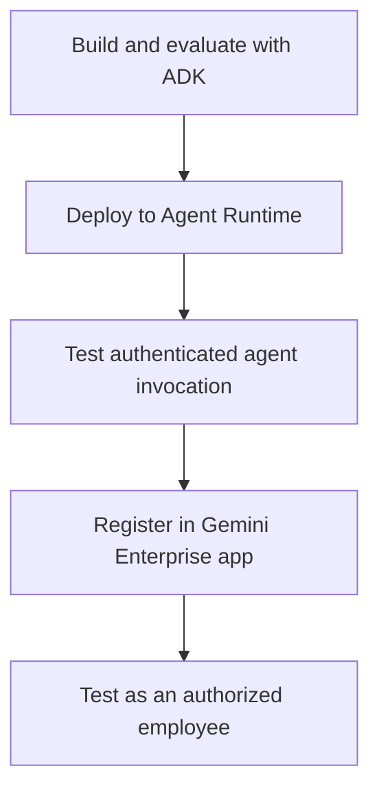

# Module 36: Gemini Enterprise (formerly AgentSpace)

## Before you begin: what this module teaches

**ADK concept: publishing a deployed ADK agent to the employee experience.**

Registration links a supported deployed agent to the enterprise application. Discovery lets permitted users find it. Invocation calls the hosted backend. Authorization must cover both use of the agent and access to the particular case. A listing or connector does not certify answer quality or grant universal data access.

**Where you would use this in real work.**

The assistant already runs in staging. Meera now needs to discover it in the bank's Gemini Enterprise application and use it with the right access. Hosting the code and making it available to employees are different tasks.

**Connection to Gemini Enterprise Agent Platform and Google Cloud.**

Agent Runtime hosts the supported ADK application; Gemini Enterprise provides the employee-facing registration/use path. Verify the current registration prerequisites and supported behavior, and test using actual allowed and denied user scopes.

**By the end, you should be able to:**

- Draw build, deploy, register and employee invocation as separate steps.
- Explain service permissions versus employee data access.
- Demonstrate discovery, invocation and revocation with test identities.

### Review this lesson through three perspectives

- **Python/ADK beginner:** Identify the hosted resource behind the registered listing.
- **Experienced engineer:** Trace a user request through registration to backend dependencies and logs.
- **Bank FDE:** Assign owners for the listing, release, data access and employee support.

Use the [guided lab](./lab.md) to observe the mechanism, then compare with the [solution](./lab-solution.md). The banking scenario above explains how to transfer the concept; a lab using a railway, weather or shopping fixture does not implement a live bank integration.

## Theory: make a deployed agent available to employees

### Build, host and publish are three different steps

ADK defines and runs the application logic. Agent Runtime is the managed hosting component of Gemini Enterprise Agent Platform used in this path. Registering a supported deployed agent with the Gemini Enterprise application makes it available through the employee experience. Registration does not upload arbitrary Python code in place of a deployment.

Use the [official ADK registration guide](https://docs.cloud.google.com/gemini/enterprise/docs/register-and-manage-an-adk-agent) for current prerequisites, permissions and supported agent behavior. A2A registration has its own contract; it is not interchangeable with the native ADK registration path.

### Discovery does not replace data authorization

The employee must be permitted to use the registered agent. The agent must also be permitted to invoke its dependencies, and the employee must be authorized for the particular case. Those are distinct checks. Granting access to an agent does not grant access to every row its service identity can read.

A data connector provides a supported route to configured enterprise content. The bank still decides which content is appropriate, how source permissions are handled and what happens when the content is missing or stale. Retrieval helps supply evidence; it cannot force every generated sentence to be true.

### What an FDE demonstrates at handover

Demonstrate discovery and invocation as an authorized test employee. Also test a user who should be denied, a case the first employee should not see, an unavailable dependency and a source change. Follow the request into the deployed agent's logs/traces, and verify the configured session and artifact scope.

Choose an owner for the agent listing, deployment, prompts, source integrations, evaluation dataset and incident response. Record how to remove access or roll back a release. Model Armor configuration on one product surface must not be assumed to inspect every custom ADK tool or remote agent boundary; verify the documented coverage.

The [Agent Platform overview](https://docs.cloud.google.com/gemini-enterprise-agent-platform/agents) describes the managed capabilities. Use each capability for its stated responsibility rather than treating “Gemini Enterprise” as a single service that automatically supplies hosting, memory, authorization and compliance.

## Continue the course story

Previous: [Module 35](../module35-deployment-agent-runtime/README.md) · Next: [Module 37](../module37-advanced-personalized-shopping-agent/README.md) · [See how the concepts build](../learning-journey.md)

Before continuing, explain one input, one ADK execution boundary and one failure outcome from this module. Use the next chapter to add a new customer requirement, not merely another component.

<!-- © 2026 Inder Chauhan (https://github.com/inderanz/google-adk-training). All rights reserved. Ref: IC-ADK-module36-gemini-enterprise-README -->
---

## Official References

- Google ADK docs (latest): https://google.github.io/adk-docs/
- Gemini API (multimodal): https://ai.google.dev/gemini-api/docs
- Google GenAI Python SDK reference: https://googleapis.github.io/python-genai/
- Vertex AI generative guidance: https://cloud.google.com/vertex-ai/generative-ai
- Cloud Vision and OCR: https://cloud.google.com/vision

