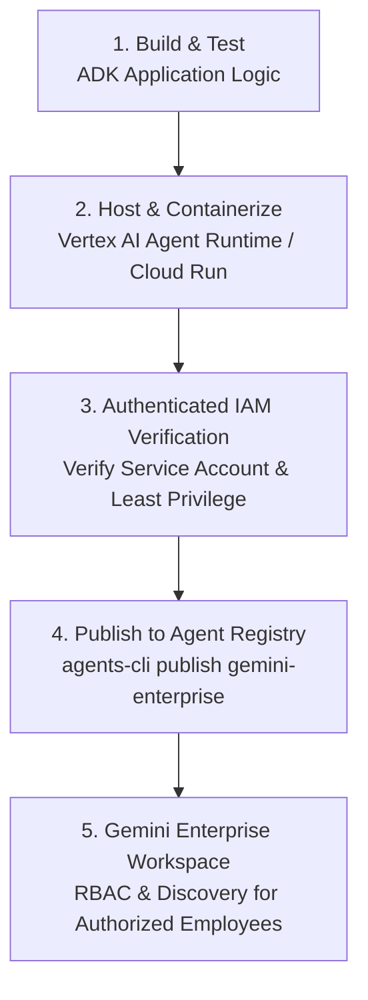

# Module 36: Gemini Enterprise (formerly AgentSpace)

## Before you begin: what this module teaches

**ADK concept: publishing a deployed ADK agent to the employee experience.**

Registration links a supported deployed agent to the enterprise application. Discovery lets permitted users find it. Invocation calls the hosted backend. Authorization must cover both use of the agent and access to the particular case. A listing or connector does not certify answer quality or grant universal data access.

**Where you would use this in real work.**

The assistant already runs in staging. Meera now needs to discover it in the bank's Gemini Enterprise application and use it with the right access. Hosting the code and making it available to employees are different tasks.

**Connection to Gemini Enterprise Agent Platform and Google Cloud.**

Agent Runtime hosts the supported ADK application; Gemini Enterprise provides the employee-facing registration/use path. Verify the current registration prerequisites and supported behavior, and test using actual allowed and denied user scopes.

**By the end, you should be able to:**

- Draw build, deploy, register and employee invocation as separate steps.
- Explain service permissions versus employee data access.
- Demonstrate discovery, invocation and revocation with test identities.

### Review this lesson through three perspectives

- **Python/ADK beginner:** Identify the hosted resource behind the registered listing.
- **Experienced engineer:** Trace a user request through registration to backend dependencies and logs.
- **Bank FDE:** Assign owners for the listing, release, data access and employee support.

Use the [guided lab](./lab.md) to observe the mechanism, then compare with the [solution](./lab-solution.md). The banking scenario above explains how to transfer the concept; a lab using a railway, weather or shopping fixture does not implement a live bank integration.

## Theory: make a deployed agent available to employees

### 1. The Scenario: The Shadow Agent Sprawl at Citadel Insurance

*Consider the reality of enterprise AI adoption across large organizations.*

Citadel Insurance rapidly embraced AI:
- The claims division spun up three independent chatbots on rogue Cloud Run instances.
- The actuarial risk team built an internal underwriter tool connected directly to production BigQuery tables without row-level security.
- The customer support team created an agent using personal API keys stored in developer laptops.

Within six months, the enterprise suffered an organizational and security crisis:
1. **Zero Visibility & Shadow Agents:** Central IT had no inventory of what AI agents existed, who built them, or what enterprise data they were touching.
2. **Permission Confusion:** An agent built for executive risk analysis was accidentally shared via an open URL, allowing junior claims adjusters to inspect unmasked executive salary claims.
3. **No Centralized Discovery:** Front-line customer service representatives had no unified place to discover approved tools; they juggled 12 different web bookmarks.

---

### 2. The Solution: Gemini Enterprise & Centralized Agent Registry

To solve this sprawl, Google provides **Gemini Enterprise (formerly AgentSpace) and the Agent Registry**.

Publishing an agent to the enterprise workforce is a disciplined progression through four distinct boundaries:

<!-- TEACHER_NOTE_START -->
**Teacher's note (ADK instructor view):**
- **Learning goal:** Explain the concept clearly from beginner to advanced, with a simple mental model first.
- **Why it matters:** Connect the concept to real Google agentic workflows, Python engineering habits, and production-ready decisions.
- **Version watch:** Validate against the latest official ADK / Google docs before teaching; call out deprecations or migration notes when needed.
- **Module linkage:** Connect this idea to the previous and next modules so learners see the progression across the course.
<!-- TEACHER_NOTE_END -->

#### The Three Core Pillars of Fleet Governance:
1. **Separation of Hosting from Publication:**
   - **Agent Runtime / Cloud Run** *hosts* the container execution environment.
   - **Gemini Enterprise** *publishes* the agent into the corporate directory. Registering an agent does not mean pasting Python scripts into a portal; it binds a hardened, running cloud endpoint into corporate identity.
2. **Discovery vs. Authorization:**
   - Just because an employee can *see* an agent listed in their Gemini Enterprise sidebar does not mean they have universal data access. 
   - When the agent runs, the employee's OAuth identity propagates to downstream data connectors (Salesforce, BigQuery, SharePoint). An unauthorized user receives a clean `403 Forbidden` at the data tier.
3. **Automated Fleet Lifecycle:**
   - Platform teams use `google-agents-cli` to register, version, deprecate, and revoke agents programmatically in CI/CD pipelines.

---

### 3. A Word of Confidence: Taking Your Code to Corporate Users

Up to Module 35, you focused on the engineering backend: writing tools, chaining multi-agent graphs, and building Docker containers.

**Module 36 is where your code meets human employees.** You transition from a developer running scripts in a terminal to an Enterprise AI Architect providing secure, governed tools to thousands of daily knowledge workers.

### Discovery does not replace data authorization

The employee must be permitted to use the registered agent. The agent must also be permitted to invoke its dependencies, and the employee must be authorized for the particular case. Those are distinct checks. Granting access to an agent does not grant access to every row its service identity can read.

A data connector provides a supported route to configured enterprise content. The bank still decides which content is appropriate, how source permissions are handled and what happens when the content is missing or stale. Retrieval helps supply evidence; it cannot force every generated sentence to be true.

### What an FDE demonstrates at handover

Demonstrate discovery and invocation as an authorized test employee. Also test a user who should be denied, a case the first employee should not see, an unavailable dependency and a source change. Follow the request into the deployed agent's logs/traces, and verify the configured session and artifact scope.

Choose an owner for the agent listing, deployment, prompts, source integrations, evaluation dataset and incident response. Record how to remove access or roll back a release. Model Armor configuration on one product surface must not be assumed to inspect every custom ADK tool or remote agent boundary; verify the documented coverage.

The [Agent Platform overview](https://docs.cloud.google.com/gemini-enterprise-agent-platform/agents) describes the managed capabilities. Use each capability for its stated responsibility rather than treating “Gemini Enterprise” as a single service that automatically supplies hosting, memory, authorization and compliance.

## Continue the course story

Previous: [Module 35](../module35-deployment-agent-runtime/README.md) · Next: [Module 37](../module37-advanced-personalized-shopping-agent/README.md) · [See how the concepts build](../learning-journey.md)

Before continuing, explain one input, one ADK execution boundary and one failure outcome from this module. Use the next chapter to add a new customer requirement, not merely another component.

<!-- © 2026 Inder Chauhan (https://github.com/inderanz/google-adk-training). All rights reserved. Ref: IC-ADK-module36-gemini-enterprise-README -->
---

## Official References

- Google ADK docs (latest): https://google.github.io/adk-docs/
- Gemini API (multimodal): https://ai.google.dev/gemini-api/docs
- Google GenAI Python SDK reference: https://googleapis.github.io/python-genai/
- Vertex AI generative guidance: https://cloud.google.com/vertex-ai/generative-ai
- Cloud Vision and OCR: https://cloud.google.com/vision

