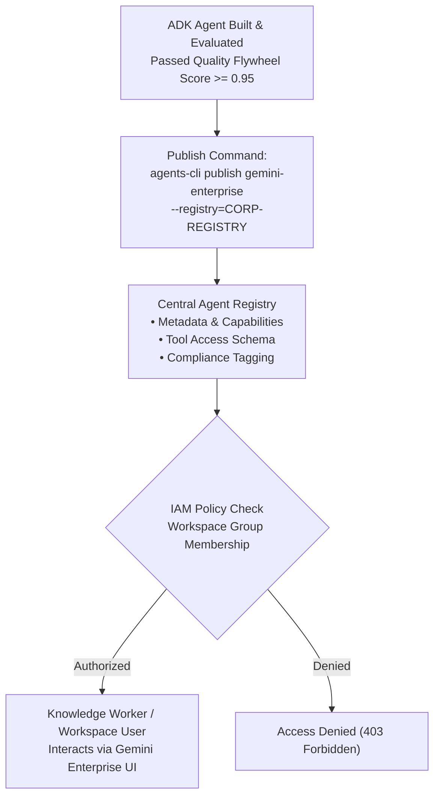

# Module 36 Enterprise Playbook: Gemini Enterprise & Agent Registry Fleet Governance

The enterprise IT administrator needs this result: A centralized, secure governance strategy for publishing, categorizing, and authorizing ADK agents within Google Workspace, Gemini Enterprise, and the centralized Agent Registry—ensuring role-based access control (RBAC), tenant isolation, and audit traceability.

Read the [plain-English task and term explanations](./README.md) before reviewing the implementation details.

## 1. Fleet Publication & Registration Modes

Gemini Enterprise allows organizations to curate internal agent catalogs, enabling knowledge workers to invoke specialized enterprise agents directly from Gemini web/chat interfaces.

| Registration Mode | Mechanism | Security & Audience |
|---|---|---|
| Native ADK Publication | `agents-cli publish gemini-enterprise` | Registers ADK agent manifest directly with tenant Agent Registry, exposing it to authorized internal users. |
| Agent-to-Agent (A2A) Federation | A2A Gateway Interconnect | Exposes external microservices or third-party agent frameworks via standardized Agent-to-Agent discovery endpoints. |
| Role-Based Access Control (RBAC) | Google Workspace Groups & Cloud IAM | Granular policy assignment: limit sensitive financial underwriting agents to the "Credit Operations" security group. |

## 2. Fleet Governance & Publication Flow

## 3. Fleet Administration Best Practices

1. **Semantic Categorization:** Tag all registered agents with domain taxonomy (`finance`, `hr`, `engineering`, `customer-service`) to optimize Gemini Enterprise agent routing.
2. **Version Pinning & Deprecation:** Support semantic versioning in Agent Registry (`v1.2.0`). Deprecate legacy models gracefully by setting a sunset date and routing fallback traffic.
3. **Usage Analytics:** Monitor fleet invocations using BigQuery Agent Analytics to evaluate token consumption, user adoption, and response latencies across corporate departments.

<!-- © 2026 Inder Chauhan (https://github.com/inderanz/google-adk-training). All rights reserved. Ref: IC-ADK-module36-enterprise-playbook -->

