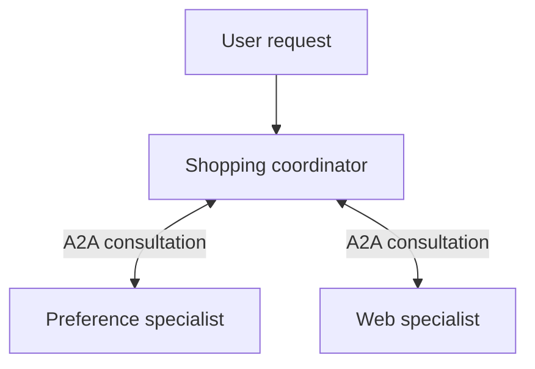

# Module 37: Advanced - Building a Personalized Shopping Agent

## Before you begin: what this module teaches

**ADK concept: combining remote specialists, preferences and action boundaries.**

A coordinator synthesizes specialist results. A remote adapter crosses a network boundary. Preference state is an exact current setting; remote conversation context is execution history. They need not share a lifetime. A prompt describing ordered actions is not the same as a graph enforcing prerequisites. A simulated purchase is not evidence of a real authorized transaction.

**Where you would use this in real work.**

The shopping scenario is a transfer exercise: the same questions arise when a bank assistant combines a preference service and a document service. Which component owns the current fact, which conversation continues remotely, and which operation changes the outside world?

**Connection to Gemini Enterprise Agent Platform and Google Cloud.**

Use ADK and supported A2A adapters for the described composition; Google hosting and durable service choices are separate integrations. The historical ADK 2.8.0 context observations below must be rechecked against the chosen version before customer use.

**By the end, you should be able to:**

- Trace one request across the local and remote responsibilities.
- Demonstrate preference continuity across two turns and process restart.
- Separate advisory browsing from an approved external write.

### Review this lesson through three perspectives

- **Python/ADK beginner:** Explain who owns the current preference and who answers the user.
- **Experienced engineer:** Test lost remote context, stale preferences and partial specialist failure.
- **Bank FDE:** Translate the pattern into a bank use case without copying shopping-specific permissions.

Use the [guided lab](./lab.md) to observe the mechanism, then compare with the [solution](./lab-solution.md). The banking scenario above explains how to transfer the concept; a lab using a railway, weather or shopping fixture does not implement a live bank integration.

## Draw the execution boundary

Illustrative model-selected consultations; arrows do not enforce that both specialists run.

## Theory

### Introduction

Welcome to **Part 7: Capstone Project & Best Practices**, and the first of the two capstone-scale projects that close out the course. This is your first real chance to put nearly everything you've learned so far to work in one system: multi-agent orchestration, distributed A2A, state, tools, and multimodal input. In this advanced module, we'll build a sophisticated AI agent capable of navigating a simulated e-commerce website to help a user find and purchase a product. This agent will demonstrate how to integrate external web environments and use a combination of tools to perform complex, multi-step tasks.

### Agent Architecture

The personalized shopping agent is a **distributed multi-agent system** composed of three specialized agents communicating via the Agent-to-Agent (A2A) protocol:

1.  **Orchestrator Agent:** The main, user-facing agent. It manages the conversation, understands user intent (including multimodal image input), and delegates tasks to the appropriate specialist.
2.  **Personalization Agent:** A remote agent responsible for managing user preferences. It uses the ADK's state management features to remember information like preferred sizes, colors, and brands. **Known limitation:** this persistence works reliably when you call `personalization_agent` directly, but it does *not* currently persist across separate turns of the `orchestrator_agent` in this lab's mandated architecture (`AgentTool` wrapping `RemoteA2aAgent`) — see "Known Limitation: Preferences Don't Persist Across Orchestrator Turns" below.
3.  **Web Agent:** A remote agent that acts as an interface to the e-commerce website. It exposes `search`/`click` as plain `FunctionTool`-wrapped Python functions, abstracting the web environment from the main orchestrator.

### Core Components

1.  **Web Environment:**
    The agent interacts with a small, self-contained mock catalog (`webshop_data.py`) vendored directly in this lab's own `web_agent` project — a handful of in-memory products with an `id`, `name`, `category`, `price`, and `description`, plus a tiny in-process "session" tracking the currently viewed product. This stands in for a real e-commerce backend without requiring any extra install: the real `web_agent_site` Gym environment used by Google's `personalized-shopping` ADK sample pulls in a heavyweight dependency chain (pyserini, torch, spacy, a multi-GB product dataset) that's disproportionate to what this lab is teaching, and the `web_agent_site` package itself doesn't exist on PyPI — see the Setup section in the lab for details.

2.  **Tools:**
    The agent is equipped with two primary tools, both plain Python functions wrapped in `FunctionTool`:
    *   **`search(keywords: str)`:** Filters the mock catalog by keyword and returns a short text listing of matching products (id, name, price).
    *   **`click(button: str)`:** Simulates clicking a product ID from the search results, or a navigation button ("Buy Now", "Back to Search"). It updates the tiny in-process session and returns a text description of the resulting page.

3.  **Prompt Engineering:**
    The agent's instruction prompt is crucial for its success. It defines a state machine-like flow that guides the agent through the shopping process:
    *   **Initial Inquiry:** Ask the user for the product they're looking for.
    *   **Search Phase:** Use the `search` tool and present the results.
    *   **Product Exploration:** Use the `click` tool to navigate to product details, descriptions, features, and reviews.
    *   **Purchase Confirmation:** Use the `click` tool to select options and confirm the purchase.
    *   **Finalization:** Inform the user that the purchase is complete.

    The prompt also includes specific instructions on how to handle the web environment's state, such as using the "`< Prev`" button to navigate back.

4.  **Artifacts (optional extension):**
    This lab's solution doesn't save artifacts — but the `web_agent`'s `click`/`search` tools are a natural place to add `tool_context.save_artifact()` calls, saving the HTML content of the current page after each action. That would let a user see the web page the agent is interacting with in the ADK's web UI, using the same pattern from Module 23.

By combining these components, we can create a powerful agent that can navigate a web environment, gather information, and interact with a user to complete a complex task.

### Known Limitation: Preferences Don't Persist Across Orchestrator Turns

This section records a historical observation made with ADK 2.8.0, not a newly verified guarantee about the course's ADK 2.11.0 baseline — worth understanding rather than hiding, since it's exactly the kind of real-world limitation you'll hit building distributed agent systems.

**What works:** if you talk to `personalization_agent` directly (bypassing the orchestrator), `save_preference` on one turn and `get_preferences` on a later, separate turn of the *same session* correctly returns the saved value. State persistence itself is fine.

**What doesn't work:** ask `orchestrator_agent` to save a preference on turn 1, then — in a **separate** turn of the same orchestrator session — ask it to retrieve that preference. It comes back empty, even though the orchestrator is wired exactly as this lab instructs (`AgentTool` wrapping `RemoteA2aAgent`).

**Why:** `AgentTool.run_async` (in `google/adk/tools/agent_tool.py`) spins up a brand-new `InMemorySessionService` and a brand-new child session on *every single invocation*, then discards it as soon as the call returns. `RemoteA2aAgent`'s mechanism for resuming the same remote A2A conversation walks that child session's `ctx.session.events` backward looking for a `context_id` stashed in a previous response's metadata (`_construct_message_parts_from_session` in `google/adk/agents/remote_a2a_agent.py`). Because the child session is thrown away after each `AgentTool` call, that event history — and the `context_id` inside it — never survives to the next orchestrator turn. Each new turn's call to `personalization_agent` therefore starts a fresh remote A2A context with no memory of the previous one.

We looked for a supported fix in `google-adk==2.8.0` and didn't find one for this exact architecture:
- `AgentTool.__init__` takes no session/context-reuse parameter (only `skip_summarization`, `include_plugins`, `propagate_grounding_metadata`).
- `RemoteA2aAgent.__init__` has no way to pin a fixed `context_id`; it only ever discovers one by reading session event history.
- The SDK does have a separate, newer "task mode" delegation path (`RemoteA2aAgent(mode="task")` wired via `sub_agents=[...]` instead of `AgentTool`), which runs through the parent's *own* session instead of a throwaway one. We tried it live: it does reach the remote agent through the shared session, but the finish-task handshake it depends on is fragile in this SDK version — one run returned no text to the user at all, and the very next call failed the task outright ("Task failed."). It is not a reliable fix in this version and isn't used in this lab's solution.

**Customer design:** give exact preferences a durable, authorized owner and test continuity across two orchestrator turns, restart and user change against the chosen SDK version. Do not derive persistence guarantees from the historical trace. Module 22 explains preference state separately from conversational recall; Module 21 explains remote context boundaries.

### Key Takeaways
- This advanced challenge project integrates many concepts from the course: distributed multi-agent systems (A2A), state management, and tool abstraction.
- The architecture separates concerns into a main **Orchestrator**, a stateful **Personalization Agent**, and a **Web Agent** that abstracts the web environment.
- The agent's `instruction` is engineered to follow a state machine-like process, guiding it through the complex, multi-step task of navigating a website.
- Artifacts aren't wired up in this lab's solution, but they're a natural optional extension for visualizing the agent's interaction with the web environment (see above).
- **Abstraction via FunctionTool:** Abstracting the website behind plain `search`/`click` functions (rather than having the orchestrator reason about raw HTML or website internals directly) is a superior design because it simplifies the orchestrator's reasoning task. The LLM only needs to know about the `search(keywords: str)` and `click(button: str)` signatures, not the complex and messy details of how the webshop is actually implemented. This improves reliability and makes the system more maintainable, as changes to the web environment's internals only require updating the Web Agent's tool implementations, not the orchestrator.
- **Observability via Callbacks:** Using a `before_tool_callback` for logging separates the concern of observability from the agent's business logic. The orchestrator's core instruction remains focused on delegation, while the callback transparently intercepts and logs the action. This makes the system more maintainable, as the monitoring logic can be updated independently of the agent's reasoning.
- **Advantages of Distributed Architecture:** This distributed A2A architecture offers significant advantages over a monolithic agent. It allows for **independent scalability** (the Web Agent can be scaled separately if it's under heavy load), **modular maintenance** (changes to the website's logic only require updating the Web Agent), and **reusability** (the Personalization Agent could be reused by other agents in the organization).
- **Known limitation — `AgentTool` resets remote A2A context every call:** preferences saved via the orchestrator do *not* currently survive across separate orchestrator turns, because `AgentTool` creates and discards a fresh session on every invocation, which breaks `RemoteA2aAgent`'s mechanism for resuming the same remote conversation. Direct calls to `personalization_agent` are unaffected. See "Known Limitation" above for the full explanation and what we checked for a fix.

## Continue the course story

Previous: [Module 36](../module36-gemini-enterprise/README.md) · Next: [Module 38](../module38-best-practices/README.md) · [See how the concepts build](../learning-journey.md)

Before continuing, explain one input, one ADK execution boundary and one failure outcome from this module. Use the next chapter to add a new customer requirement, not merely another component.

<!-- © 2026 Inder Chauhan (https://github.com/inderanz/google-adk-training). All rights reserved. Ref: IC-ADK-module37-advanced-personalized-shopping-agent-README -->
---

## Official References

- Google ADK docs (latest): https://google.github.io/adk-docs/
- Gemini API (multimodal): https://ai.google.dev/gemini-api/docs
- Google GenAI Python SDK reference: https://googleapis.github.io/python-genai/
- Vertex AI generative guidance: https://cloud.google.com/vertex-ai/generative-ai
- Cloud Vision and OCR: https://cloud.google.com/vision

