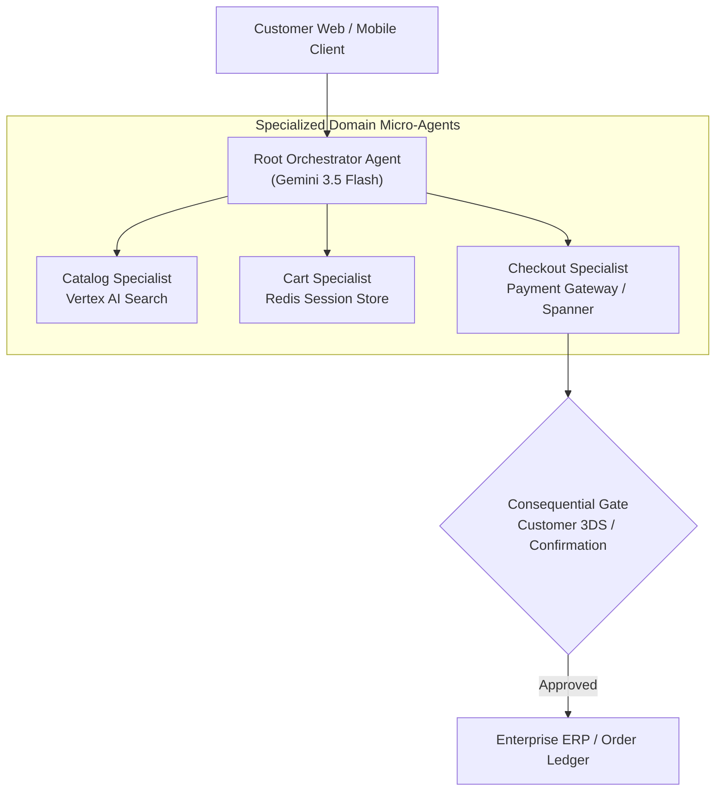

# Module 37 Enterprise Playbook: E-Commerce Capstone & Distributed Multi-Agent Topologies

The lead enterprise architect needs this result: A resilient, scalable e-commerce agent topology that coordinates specialized sub-agents (Catalog Search, Cart Manager, Recommendations, and Checkout) across distributed microservices using Agent-to-Agent (A2A) communication and decoupled session stores.

Read the [plain-English task and term explanations](./README.md) before reviewing the implementation details.

## 1. Capstone Multi-Agent Architecture

In enterprise retail platforms, a monolithic single-agent architecture fails under heavy traffic due to prompt bloat, slow tool execution, and tool selection ambiguity. Decomposing the system into specialized, autonomous domain agents solves these scaling bottlenecks.

| Agent Domain | Responsibility | Persistence & Isolation |
|---|---|---|
| Orchestrator Agent | Intent classification, session coordination, user interaction. | Ephemeral conversational memory (Agent Platform Sessions). |
| Catalog & Search Agent | Vector semantic search, inventory availability, pricing lookups. | Read-only connection to Vertex AI Vector Search & BigQuery. |
| Cart Management Agent | Session-scoped item staging, voucher application, cart calculations. | High-speed in-memory store (Cloud Memorystore Redis). |
| Checkout & Order Agent | Consequential payment processing, address verification, ERP order creation. | ACID-compliant transaction repository (Cloud SQL / Spanner). |

## 2. Distributed Agent Interaction Topology

<!-- TEACHER_NOTE_START -->
**Teacher's note (ADK instructor view):**
- **Learning goal:** Explain the concept clearly from beginner to advanced, with a simple mental model first.
- **Why it matters:** Connect the concept to real Google agentic workflows, Python engineering habits, and production-ready decisions.
- **Version watch:** Validate against the latest official ADK / Google docs before teaching; call out deprecations or migration notes when needed.
- **Module linkage:** Connect this idea to the previous and next modules so learners see the progression across the course.
<!-- TEACHER_NOTE_END -->

## 3. Resilience & Scale Best Practices

1. **Decoupled Session Lifetime:** Distinguish ephemeral conversation transcripts from persistent shopping carts. A closed browser tab or session reset must never delete an active customer cart.
2. **Circuit Breakers on Tool Calls:** Wrap external inventory and payment APIs with circuit breakers to prevent cascade failures when upstream third-party services experience latency spikes.
3. **Structured Event Routing:** Ensure inter-agent handoffs pass structured Pydantic event payloads rather than raw unstructured conversational text.

<!-- © 2026 Inder Chauhan (https://github.com/inderanz/google-adk-training). All rights reserved. Ref: IC-ADK-module37-enterprise-playbook -->
---

## Official References

- Google ADK docs (latest): https://google.github.io/adk-docs/
- Google AI / Gemini docs: https://ai.google.dev/
- Google GenAI Python SDK reference: https://googleapis.github.io/python-genai/
- Context7 / current SDK lookup for the exact installed version and API signatures
- Related module path: review the surrounding modules for continuity, prerequisites, and follow-on concepts

