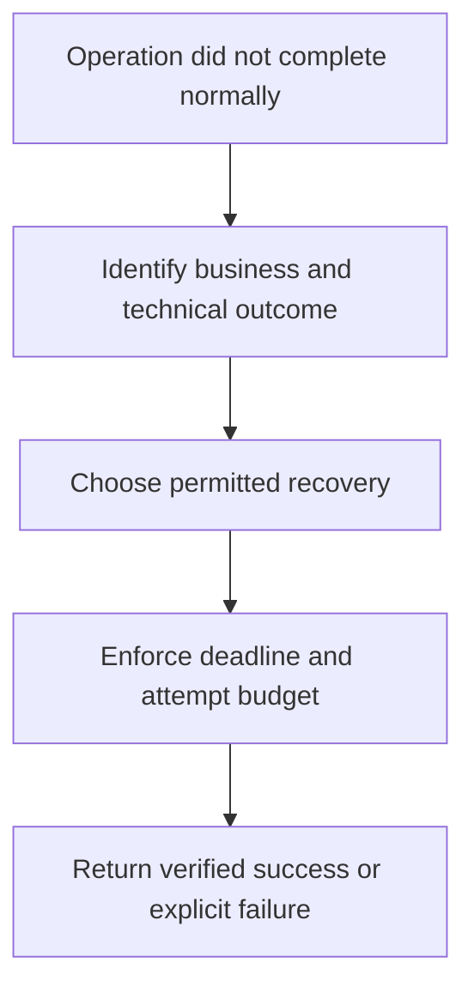

# Module 38: Best Practices & Production Patterns

## Before you begin: what this module teaches

**ADK concept: reliability budgets, failure classification and production boundaries.**

Retry repeats an operation; revision changes a candidate using feedback; model repair asks for a corrected tool call. Idempotency prevents a repeated operation from repeating its business effect. A timeout limits waiting but may leave a write outcome uncertain. These concepts must be assigned to the boundary capable of enforcing them.

**Where you would use this in real work.**

The bank asks, “What happens when a dependency fails during a busy morning?” A useful answer identifies the failed operation, whether it is safe to repeat, the waiting budget and the outcome the analyst receives.

**Connection to Gemini Enterprise Agent Platform and Google Cloud.**

Reuse ADK control mechanisms and official Google clients. Agent Runtime/Cloud Run/GKE provide hosting controls, while the bank service enforces writes and authorization. Monitoring and evaluation supply evidence; neither replaces the failure contract.

**By the end, you should be able to:**

- Classify not_found, denied, transient failure and uncertain write outcomes.
- Compute the combined attempt/deadline budget.
- Choose caching and concurrency rules that preserve authorization and freshness.

### Review this lesson through three perspectives

- **Python/ADK beginner:** Explain why three attempts means at most two retries in RetryConfig.
- **Experienced engineer:** Inject partial failures and prove no duplicate business effect.
- **Bank FDE:** Agree operational outcomes and recovery ownership with the bank before promising availability.

Use the [guided lab](./lab.md) to observe the mechanism, then compare with the [solution](./lab-solution.md). The banking scenario above explains how to transfer the concept; a lab using a railway, weather or shopping fixture does not implement a live bank integration.

## Draw the execution boundary

Classify before retrying; uncertain writes require reconciliation rather than blind repetition.



## Theory: design reliability at the boundary that can enforce it

### Choose composition from the requirement

An ordinary ADK Agent may be sufficient. Use AgentTool for a useful consultation, graph edges for required dependencies, explicit routes for policy choices and bounded loops for revisions. A more complex graph or more agents is not evidence of a better customer solution.

### Classify a failure before choosing recovery

| Failure | Appropriate question | Typical design direction |
|---|---|---|
| Unknown case | Is this an expected domain outcome? | Return `not_found`; never substitute another case. |
| Invalid credentials/denied access | Can a retry change permission? | Deny and fix authorized configuration; do not repeatedly retry. |
| Temporary read-service failure | Is the operation safe to repeat? | Bounded retry with a deadline and explicit exhausted outcome. |
| Write timeout | Could the effect already have committed? | Reconcile using a destination-enforced operation ID. |
| Bad model tool arguments | Can the model correct the request? | Bounded model repair, with tool validation still authoritative. |

The runtime can retry supported node failures when configured. It cannot make an arbitrary bank operation safe to repeat. Preserve framework interruption/resume behavior rather than catching every exception as an ordinary business error.

### Read retry configuration precisely

```python
from google.adk.workflow import RetryConfig, node


# Annotated example: the caller supplies a known read_service implementation.
# Keep the timeout/error contract in that adapter, not in model-generated code.
def make_read_node(read_service):
    @node(retry_config=RetryConfig(
        max_attempts=3,  # Includes the first attempt: at most two retries.
        initial_delay=1.0,
        exceptions=[TimeoutError],  # The adapter's explicit transient category.
    ))
    async def read_record(node_input: dict) -> dict:
        return await read_service(node_input)

    return read_record
```

This construction example does not supply a bank service. It shows where the verified `RetryConfig` belongs and why retry categories must be deliberate. Node attempts, SDK HTTP retries, model repair attempts, token limits and whole-request deadlines are different budgets. Measure the combined behavior.

### Performance with correct scope

Use supported nonblocking clients for asynchronous I/O; `async def` around blocking code still blocks. Cache only when identity, data versions, policy versions, expiry and invalidation permit reuse. A cache keyed only by the question can disclose another user's answer or reuse stale evidence. Gemini context caching is a separate optimization from caching a business answer.

### Structure, policy and authorization are separate

A Pydantic schema validates shape and configured constraints. It does not prevent all prompt injection, establish factual truth or authorize a record read. A model safety control, Model Armor inspection, callback and backend authorization each have a different boundary. Test combinations and denied/unavailable paths.

Use supported confirmation/resume mechanisms for the intended approval experience, then revalidate authorization and the exact approved operation at execution. A confirmation prompt is not a transaction, and a retry is not a rollback. These are the same principles established in Modules 13, 18, 25.5 and 26.

## Continue the course story

Previous: [Module 37](../module37-advanced-personalized-shopping-agent/README.md) · Next: [Module 39](../module39-plugins/README.md) · [See how the concepts build](../learning-journey.md)

Before continuing, explain one input, one ADK execution boundary and one failure outcome from this module. Use the next chapter to add a new customer requirement, not merely another component.

<!-- © 2026 Inder Chauhan (https://github.com/inderanz/google-adk-training). All rights reserved. Ref: IC-ADK-module38-best-practices-README -->
---


## Official References

- Google ADK docs (latest): https://google.github.io/adk-docs/
- Gemini API (multimodal): https://ai.google.dev/gemini-api/docs
- Google GenAI Python SDK reference: https://googleapis.github.io/python-genai/
- Vertex AI generative guidance: https://cloud.google.com/vertex-ai/generative-ai
- Cloud Vision and OCR: https://cloud.google.com/vision

