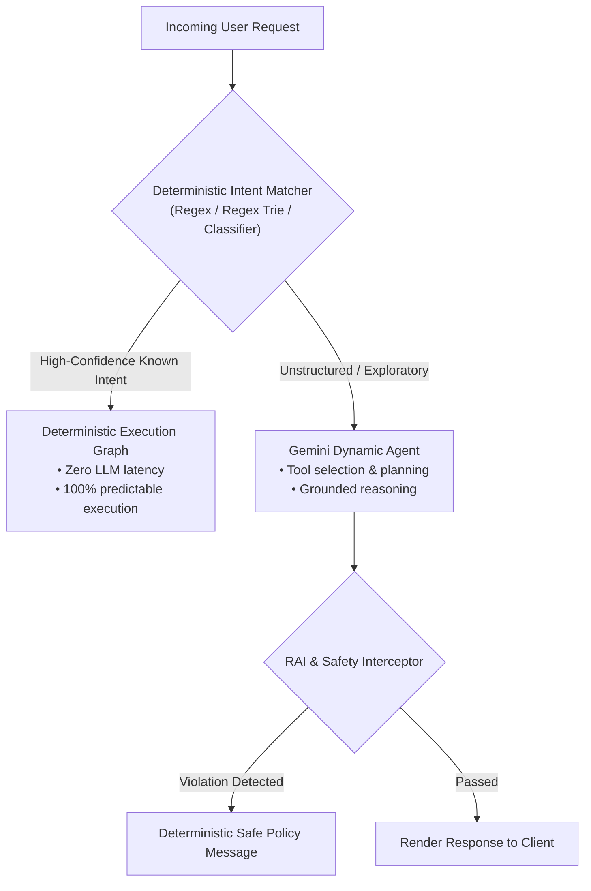

# Module 38 Enterprise Playbook: Production Engineering, SLIs/SLOs & Reliability Budgets

The Principal Reliability Engineer needs this result: Concrete Service Level Indicators (SLIs), Service Level Objectives (SLOs), error budgets, token-cost controls, and deterministic graph fallbacks to guarantee five-nines (99.99%) availability and predictable latency for enterprise ADK workloads.

Read the [plain-English task and term explanations](./README.md) before reviewing the implementation details.

## 1. Enterprise Reliability & SLO Framework

Production AI systems differ from standard CRUD applications: nondeterministic model inference and tool latency require rigorous probabilistic reliability budgets.

| Reliability Metric | Production Target (SLO) | Measurement Method (SLI) | Failure Remediation |
|---|---|---|---|
| First Token Latency (TTFT) | 95% of queries under 1200ms | OpenTelemetry `http.client.duration` | Switch to faster models (`gemini-3.5-flash`), enable prompt caching. |
| Tool Invocation Success | 99.5% successful executions | Tool execution status code tracking | Implement exponential backoff retry and circuit breaking. |
| Hallucination / Grounding Score | Under 1% ungrounded claims | LLM-as-a-judge Faithfulness score on golden eval set | Enforce strict Vertex AI Grounding checks and negative search fallbacks. |
| Error Budget Consumption | Under 0.1% unhandled exceptions | Cloud Logging structured error count | Auto-trigger rollback to previous container image revision. |

## 2. Deterministic Routing vs. Stochastic LLM Fallback

## 3. Production Cost & Token Optimization Checklist

1. **Context Window Caching:** For agents using large static system prompts or OpenAPI schemas (>32k tokens), activate Gemini Implicit / Explicit Context Caching to cut token processing costs by up to 75%.
2. **Deterministic Response Caching:** Cache idempotent read-only tool responses in Redis with a 5-minute TTL to reduce repetitive LLM and backend tool round-trips.
3. **Graceful Degradation:** When quota limits (`429 RESOURCE_EXHAUSTED`) are reached, fall back to a lightweight heuristic response queue rather than dropping user requests.

<!-- © 2026 Inder Chauhan (https://github.com/inderanz/google-adk-training). All rights reserved. Ref: IC-ADK-module38-enterprise-playbook -->
