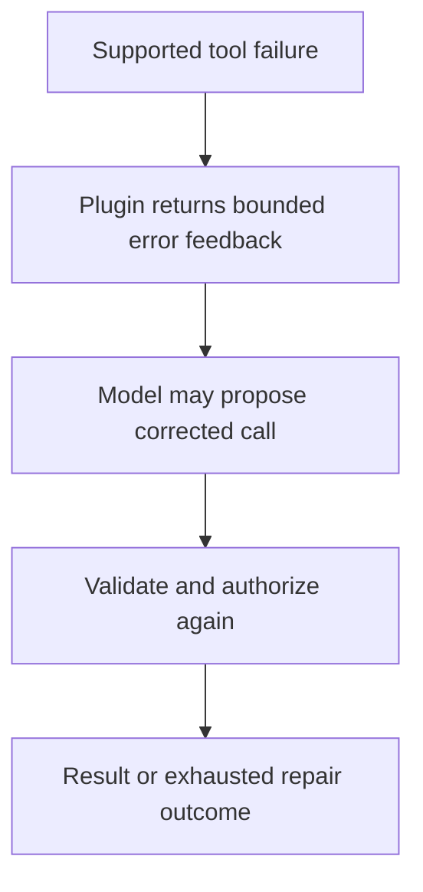

# Module 39: Advanced Recovery with Built-In Plugins

## Before you begin: what this module teaches

**ADK concept: App plugins and bounded tool-call repair.**

A plugin registers hooks across local App execution. ReflectAndRetryToolPlugin can feed supported tool failures back to the model for another attempt. The model proposes a repair; it is not guaranteed to fix the problem. Plugin scope and return contracts determine what is intercepted, replaced or allowed to continue.

**Where you would use this in real work.**

The assistant requests a tool with invalid arguments. The bank wants it to correct a recoverable request while keeping limits and validation intact. Repeating a payment because an error occurred would be a very different design.

**Connection to Gemini Enterprise Agent Platform and Google Cloud.**

Use the native ADK plugin for the supported repair behavior rather than inventing an unbounded retry loop. Keep validation and authorization in the tool/backend. Native observability can show repeated attempts; sensitive exception details must not be exposed indiscriminately.

**By the end, you should be able to:**

- Distinguish a model repair attempt from an HTTP retry.
- Identify App-level scope and the configured repair limit.
- Explain why writes need destination-enforced duplicate protection.

### Review this lesson through three perspectives

- **Python/ADK beginner:** Trace the failed call, returned feedback and subsequent call.
- **Experienced engineer:** Test exhausted repair, plugin ordering and errors outside the supported hook.
- **Bank FDE:** Agree which failures are recoverable and which require an analyst or operator.

Use the [guided lab](./lab.md) to observe the mechanism, then compare with the [solution](./lab-solution.md). The banking scenario above explains how to transfer the concept; a lab using a railway, weather or shopping fixture does not implement a live bank integration.

## Draw the execution boundary

A repair attempt is bounded and still passes tool/backend validation.



## Theory

### 1. The Scenario: The Midnight Payroll Glitch at Apex Financial

*Imagine this reality in enterprise banking operations.*

It is 11:58 PM on the final day of the financial quarter. Apex Global Logistics has scheduled its automated quarterly dividend and bonus payouts. The core automated reconciliation agent is handling thousands of employee records.

Suddenly, an exception is thrown:
The agent attempts to call a legacy ERP microservice tool. Instead of calling `execute_ledger_adjustment(account_id=..., amount=...)`, the model—under slight nondeterministic prompt drift—generates a tool call named `adjust_ledger_balance`. 

In a traditional, fragile agent architecture, this triggers an immediate fatal crash:
`ToolNotFoundException: adjust_ledger_balance is not registered`.

The execution terminates abruptly. The quarter-end batch stalls. The on-call operations engineer is paged out of sleep at midnight to fix a trivial naming discrepancy.

```mermaid
flowchart TD
    subgraph Fragile_Architecture["❌ Fragile Agent (Without Plugins)"]
        A1["LLM Hallucinates Tool Name:<br/>adjust_ledger_balance()"] --> A2["Tool Registry Lookup Fails"]
        A2 --> A3["💥 Fatal Process Crash<br/>Quarter-end pipeline aborted"]
    end

    subgraph Resilient_Architecture["✅ Self-Healing Agent (With ReflectAndRetryToolPlugin)"]
        B1["LLM Hallucinates Tool Name:<br/>adjust_ledger_balance()"] --> B2["Plugin Intercepts Exception<br/>amends conversation history"]
        B2 --> B3["Feedback to LLM:<br/>'Tool not found. Did you mean execute_ledger_adjustment?'"]
        B3 --> B4["🤖 Model Self-Corrects:<br/>execute_ledger_adjustment(...)"]
        B4 --> B5["🎉 Successful Execution<br/>Zero human intervention"]
    end
```



---

### 2. The Solution: App-Level Plugins & The Self-Healing Fabric

Rather than expecting 100% deterministic perfection from probabilistic LLM tool generation, production Google Cloud engineering builds **self-healing execution fabrics**.

In **Module 26** (Callbacks), you attached functions directly to an individual agent or a specific tool. While callbacks are excellent for task-specific logic, real-world enterprise architectures require **cross-cutting governance** that applies uniformly across an entire application without modifying dozens of agent scripts.

This is the power of the **Google ADK Plugin Architecture**.

#### Plugins vs. Callbacks: The Architectural Difference

| Dimension | ADK Callbacks (`before_turn`, `after_tool`) | ADK Plugins (`BasePlugin`) |
|---|---|---|
| **Attachment Target** | Configured on a *single agent* or a *single tool*. | Registered globally on the **`App`** object. |
| **Operational Scope** | Local to that specific agent's prompt lifecycle. | **Global** across every agent, tool, and LLM call in the workflow. |
| **Ownership** | Authored by individual application developers. | Injected by Central Platform, Security, and CISO teams. |
| **Packaging** | Python functions inside an agent declaration file. | Modular, versioned classes packaged in enterprise libraries. |

---

### 3. The Three Operational Plugin Patterns

Every ADK Plugin inherits from `google.adk.plugins.BasePlugin` and implements one or more callback hooks using one of three fundamental patterns:

1. **Observing (Return `None`):**
   - The plugin passively watches execution without altering data flow.
   - *Use cases:* Emitting OpenTelemetry traces, exporting latency metrics to Cloud Monitoring, or streaming audit logs to BigQuery.
2. **Intervening (Return an Object):**
   - The plugin halts or short-circuits standard execution and returns an immediate response.
   - *Use cases:* Returning a cached response from Redis (skipping model inference), blocking unauthorized tool calls with a security error, or screening prompts with Google Cloud Model Armor.
3. **Amending (Modify in place or return amended payload):**
   - The plugin intercepts an in-flight payload, enriches or sanitizes it, and allows execution to proceed.
   - *Use cases:* Masking PII in prompts, normalizing tool argument types, or appending error diagnostics to message history for self-correction.

---

### 4. The Complete ADK Plugin Lifecycle Hook Matrix

The ADK executes plugin hooks at precise lifecycle checkpoints across the agent workflow:

| Lifecycle Hook Method | Signature & Payload | Description & Primary Use Case |
|---|---|---|
| `before_run_callback` | `(callback_context) -> None` | Fires once when `runner.run_async()` starts. Initialize request timers or tenant sessions. |
| `after_run_callback` | `(callback_context) -> None` | Fires when the overall run completes. Emit request-level metrics and cleanup ephemeral resources. |
| `before_agent_callback` | `(agent, callback_context) -> Optional[Content]` | Intercepts agent turn entry. Return `Content` to bypass agent execution entirely. |
| `after_agent_callback` | `(agent, callback_context) -> Optional[Content]` | Intercepts agent completion. Return `Content` to replace the agent's output. |
| `before_model_callback` | `(callback_context, llm_request) -> Optional[LlmResponse]` | Intercepts prompt before sending to Gemini. Return `LlmResponse` to return cached inference. |
| `after_model_callback` | `(callback_context, llm_response) -> Optional[LlmResponse]` | Intercepts model response chunks. Redact PII or mutate generated output. |
| `before_tool_callback` | `(tool, tool_args, tool_context) -> Optional[dict]` | Intercepts tool execution. Inspect arguments, validate RBAC permissions, or return pre-computed data. |
| `after_tool_callback` | `(tool, tool_args, tool_context, result) -> Optional[dict]` | Intercepts tool response. Sanitize output, filter sensitive database columns, or transform schemas. |
| `on_tool_error_callback` | `(tool, tool_args, tool_context, error) -> Optional[dict]` | Fires when a tool raises an unhandled Exception. Intercept and replace the exception with graceful fallback. |

---

### 5. App-Level Registration (Official Contract & Deprecation Warning)

> [!WARNING]
> **Official ADK Deprecation Notice:**
> In Python, configuring the `plugins` parameter on `Runner` or `InMemoryRunner` is **deprecated** and raises a runtime `DeprecationWarning`.
> 
> Always register plugins globally on the **`App`** object (`App(name=..., root_agent=..., plugins=[...])`), and then pass that `App` to the runner: `InMemoryRunner(app=app)`. Passing `plugins` to both `App` and `Runner` raises an immediate `ValueError`.

```python
from google.adk.apps.app import App
from google.adk.runners import InMemoryRunner
from google.adk.plugins import ReflectAndRetryToolPlugin

# 1. Instantiate the plugin
retry_plugin = ReflectAndRetryToolPlugin(max_retries=3)

# 2. Register globally on App (Enterprise Best Practice)
app = App(
    name="financial_operations_app",
    root_agent=reconciliation_agent,
    plugins=[retry_plugin]  # <--- Globally protects all sub-agents and tools
)

# 3. Instantiate Runner with the App
runner = InMemoryRunner(app=app)
```

---

### 6. Deep Dive: `ReflectAndRetryToolPlugin`

The **`ReflectAndRetryToolPlugin`** is Google ADK's flagship built-in resilience plugin. When an agent experiences tool failures, it dynamically intercepts the error and instructs Gemini to reflect, correct, and retry.

#### Configuration Options:
* **`max_retries`** (int, default: `3`):
  Total number of *additional* attempts the system makes to receive a valid response. A value of `3` allows up to **4 total attempts** (1 initial attempt + 3 retries).
* **`throw_exception_if_retry_exceeded`** (bool, default: `True` in Python):
  If `True`, raises the original tool exception once retries are exhausted. If `False`, returns an error message telling the model that retries were exceeded, allowing the agent to degrade gracefully.
* **`tracking_scope`** (`TrackingScope`, default: `TrackingScope.INVOCATION`):
  * `TrackingScope.INVOCATION`: Failure counts track per-tool across a single turn/invocation. This is the recommended default.
  * `TrackingScope.GLOBAL`: Failure counts persist across all turns and users in the application session.

#### Advanced Production Pattern: Intercepting "Soft Errors" via `extract_error_from_result`
In production, enterprise REST APIs often return HTTP 200 with an error body (e.g., `{"status": "error", "message": "Account balance insufficient"}`) rather than raising a Python exception. By default, `ReflectAndRetryToolPlugin` only retries when an actual exception is raised.

You can customize this by subclassing `ReflectAndRetryToolPlugin` and overriding `extract_error_from_result`:

```python
from google.adk.plugins import ReflectAndRetryToolPlugin

class EnterpriseApiRetryPlugin(ReflectAndRetryToolPlugin):
    """Subclassed plugin that detects business-logic errors in dictionary outputs."""
    
    async def extract_error_from_result(
        self, *, tool, tool_args, tool_context, result
    ):
        # Inspect dictionary responses for 'error' keys or failure status codes
        if isinstance(result, dict) and result.get("status") == "error":
            return result.get("message", "Unknown API failure occurred")
        
        # Return None when the tool executed successfully
        return None
```

---

### 7. Prebuilt Enterprise Plugins in the Google ADK Catalog

Beyond `ReflectAndRetryToolPlugin`, Google ADK provides an ecosystem of prebuilt plugins:

1. **`Model Armor Plugin` (`ModelArmorPlugin`):**
   Integrates directly with Google Cloud Model Armor to sanitize prompt injections, hate speech, and sensitive data leakage before prompts reach Gemini.
2. **`BigQuery Agent Analytics Plugin`:**
   Captures all conversation events, tool invocation parameters, token usage, and latency metrics directly into Google Cloud BigQuery for enterprise BI dashboards.
3. **`Tool Call Integrity Plugin`:**
   Cryptographically signs tool calls stored in session history using HMAC secret keys, guaranteeing that session event states have not been tampered with.
4. **`Context Filter Plugin`:**
   Intelligently summarizes or truncates verbose multi-turn history to keep context windows lean and prevent token budget exhaustion.
5. **`Save Files as Artifacts Plugin`:**
   Automatically intercepts binary attachments, PDFs, and images from user turns and persists them into ADK’s managed `ArtifactService`.

---

### 8. A Word of Confidence: From Fragile Prompts to Self-Healing Infrastructure

Notice how this transforms your agent engineering practice:
* **Your System Prompts stay lean:** You no longer need to write 50 lines of desperate prompting pleading: *"Please make sure you call secret_calculator and not super_calc, and if you get an error try again!"*
* **Your Tool Functions stay pure:** Your tools focus strictly on clean business logic without sprawling `try/except` retry loops.
* **The Infrastructure handles reliability:** The `ReflectAndRetryToolPlugin` sits at the App boundary, quietly rescuing your agents from transient runtime discrepancies before users or on-call engineers ever notice.

---

### Key Takeaways
- **Plugins** provide global, cross-cutting functionality (logging, retries, security guardrails) across every agent and tool in your application.
- They inherit from `BasePlugin` and operate across 3 primary patterns: **Observing**, **Intervening**, and **Amending**.
- In Python ADK, always register plugins on **`App(plugins=[...])`**, never on `Runner`.
- **`ReflectAndRetryToolPlugin`** provides concurrency-safe, bounded tool repair. It can be extended via `extract_error_from_result` to intercept soft dictionary errors from enterprise APIs.
- Enterprise applications layer specialized plugins: Model Armor for safety, BigQuery for telemetry, and Reflect-and-Retry for runtime self-healing.

## Continue the course story

Previous: [Module 38](../module38-best-practices/README.md) · Next: [Module 39.5](../module39_5-agent-skills/README.md) · [See how the concepts build](../learning-journey.md)

Before continuing, explain one input, one ADK execution boundary and one failure outcome from this module. Use the next chapter to add a new customer requirement, not merely another component.

<!-- © 2026 Inder Chauhan (https://github.com/inderanz/google-adk-training). All rights reserved. Ref: IC-ADK-module39-plugins-README -->
---


## Official References

- Google ADK Plugins Guide: https://adk.dev/plugins/
- Google ADK Reflect and Retry Plugin: https://adk.dev/integrations/reflect-and-retry/
- Google ADK BigQuery Analytics: https://adk.dev/integrations/bigquery-agent-analytics/
- Google ADK Model Armor Guardrails: https://adk.dev/integrations/model-armor/
- Google GenAI Python SDK: https://googleapis.github.io/python-genai/
- Google Cloud Model Armor: https://cloud.google.com/security/products/model-armor

