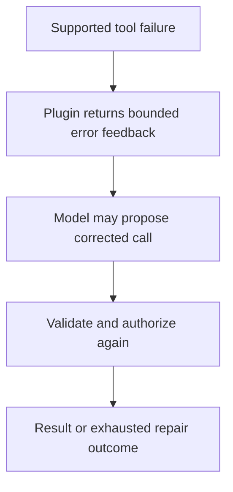

# Module 39: Advanced Recovery with Built-In Plugins

## Before you begin: what this module teaches

**ADK concept: App plugins and bounded tool-call repair.**

A plugin registers hooks across local App execution. ReflectAndRetryToolPlugin can feed supported tool failures back to the model for another attempt. The model proposes a repair; it is not guaranteed to fix the problem. Plugin scope and return contracts determine what is intercepted, replaced or allowed to continue.

**Where you would use this in real work.**

The assistant requests a tool with invalid arguments. The bank wants it to correct a recoverable request while keeping limits and validation intact. Repeating a payment because an error occurred would be a very different design.

**Connection to Gemini Enterprise Agent Platform and Google Cloud.**

Use the native ADK plugin for the supported repair behavior rather than inventing an unbounded retry loop. Keep validation and authorization in the tool/backend. Native observability can show repeated attempts; sensitive exception details must not be exposed indiscriminately.

**By the end, you should be able to:**

- Distinguish a model repair attempt from an HTTP retry.
- Identify App-level scope and the configured repair limit.
- Explain why writes need destination-enforced duplicate protection.

### Review this lesson through three perspectives

- **Python/ADK beginner:** Trace the failed call, returned feedback and subsequent call.
- **Experienced engineer:** Test exhausted repair, plugin ordering and errors outside the supported hook.
- **Bank FDE:** Agree which failures are recoverable and which require an analyst or operator.

Use the [guided lab](./lab.md) to observe the mechanism, then compare with the [solution](./lab-solution.md). The banking scenario above explains how to transfer the concept; a lab using a railway, weather or shopping fixture does not implement a live bank integration.

## Draw the execution boundary

A repair attempt is bounded and still passes tool/backend validation.



## Theory

### 1. The Scenario: The Midnight Payroll Glitch at Apex Financial

*Imagine this reality in enterprise banking operations.*

It is 11:58 PM on the final day of the financial quarter. Apex Global Logistics has scheduled its automated quarterly dividend and bonus payouts. The core automated reconciliation agent is handling thousands of employee records.

Suddenly, an exception is thrown:
The agent attempts to call a legacy ERP microservice tool. Instead of calling `execute_ledger_adjustment(account_id=..., amount=...)`, the model—under slight nondeterministic prompt drift—generates a tool call named `adjust_ledger_balance`. 

In a traditional, fragile agent architecture, this triggers an immediate fatal crash:
`ToolNotFoundException: adjust_ledger_balance is not registered`.

The execution terminates abruptly. The quarter-end batch stalls. The on-call operations engineer is paged out of sleep at midnight to fix a trivial naming discrepancy.

```mermaid
flowchart TD
    subgraph Fragile_Architecture["❌ Fragile Agent (Without Plugins)"]
        A1["LLM Hallucinates Tool Name:<br/>adjust_ledger_balance()"] --> A2["Tool Registry Lookup Fails"]
        A2 --> A3["💥 Fatal Process Crash<br/>Quarter-end pipeline aborted"]
    end

    subgraph Resilient_Architecture["✅ Self-Healing Agent (With ReflectAndRetryToolPlugin)"]
        B1["LLM Hallucinates Tool Name:<br/>adjust_ledger_balance()"] --> B2["Plugin Intercepts Exception<br/>amends conversation history"]
        B2 --> B3["Feedback to LLM:<br/>'Tool not found. Did you mean execute_ledger_adjustment?'"]
        B3 --> B4["🤖 Model Self-Corrects:<br/>execute_ledger_adjustment(...)"]
        B4 --> B5["🎉 Successful Execution<br/>Zero human intervention"]
    end
```



---

### 2. The Solution: App-Level Plugins & Bounded Self-Correction

Rather than expecting 100% deterministic perfection from probabilistic LLM tool generation, production Google Cloud engineering builds **self-healing execution fabrics**.

In **Module 25** (Observability) and **Module 25.5** (Responsible AI Guardrails), you built custom plugins inheriting from `BasePlugin`. You learned that plugins attach at the **App** level—governing the entire lifecycle across all sub-agents and runners.

The Google ADK provides powerful built-in production plugins, chief among them: **`ReflectAndRetryToolPlugin`**.

#### The Three Operational Superpowers of ReflectAndRetryToolPlugin:
1. **Name Hallucination Repair:** When an agent invents a synonym (e.g., calling `super_calc` instead of `secret_calculator`), the plugin catches the dispatch error, amends the message history with available tool candidates, and lets the model self-correct.
2. **Schema & Argument Type Recovery:** When an agent passes `"100"` as a string to a tool requiring `int`, the Pydantic validation error is bounced back to the model, which immediately re-casts the argument into a valid integer.
3. **Bounded Safety Loops (`max_retries`):** It strictly bounds recovery attempts (defaulting to 2 or 3). If an error is permanent (e.g., database connection refused), it avoids infinite token-burning loops and fails cleanly with full audit trails.

---

### 3. A Word of Confidence: Separation of Concerns

Notice the architectural beauty of this design:
* **The Agent Prompt stays clean:** You do not have to write 50 paragraphs of defensive prompting like: *"Please, I beg you, do NOT call super_calc, only call secret_calculator, and if you fail try again!"*
* **The Tools stay pure:** Your Python functions focus exclusively on business logic without messy internal retry wrappers.
* **The App enforces the safety net:** The `ReflectAndRetryToolPlugin` sits at the infrastructure boundary, quietly rescuing your agents from runtime glitches before users ever notice.

```python
from google.adk.apps.app import App
from google.adk.runners import Runner
from google.adk.plugins import ReflectAndRetryToolPlugin

# Configure the plugin
retry_plugin = ReflectAndRetryToolPlugin(
    max_retries=3  # Give agents 3 chances to fix their mistakes
)

# In ADK 2.0, plugins are registered globally on the App object
app = App(
    name="my_robust_app",
    root_agent=my_agent,
    plugins=[retry_plugin] # <--- Registered globally here
)

runner = Runner(app=app, session_service=...)
```

### Key Takeaways
- **Plugins** provide global, cross-cutting functionality (logging, retries, security) across your entire application.
- They inherit from `BasePlugin` and use three patterns: **Observing**, **Intervening**, and **Amending**.
- App plugins apply across local App execution. At overlapping supported hooks, plugin processing precedes agent callbacks and a replacement may bypass the agent callback; verify the particular hook path.
- The **`ReflectAndRetryToolPlugin`** can return supported tool failures to the model for a bounded repair attempt. It does not guarantee correction, catch every execution failure or make repeating a side effect safe.

## Continue the course story

Previous: [Module 38](../module38-best-practices/README.md) · Next: [Module 39.5](../module39_5-agent-skills/README.md) · [See how the concepts build](../learning-journey.md)

Before continuing, explain one input, one ADK execution boundary and one failure outcome from this module. Use the next chapter to add a new customer requirement, not merely another component.

<!-- © 2026 Inder Chauhan (https://github.com/inderanz/google-adk-training). All rights reserved. Ref: IC-ADK-module39-plugins-README -->
---


## Official References

- Google ADK docs (latest): https://google.github.io/adk-docs/
- Gemini API (multimodal): https://ai.google.dev/gemini-api/docs
- Google GenAI Python SDK reference: https://googleapis.github.io/python-genai/
- Vertex AI generative guidance: https://cloud.google.com/vertex-ai/generative-ai
- Cloud Vision and OCR: https://cloud.google.com/vision

