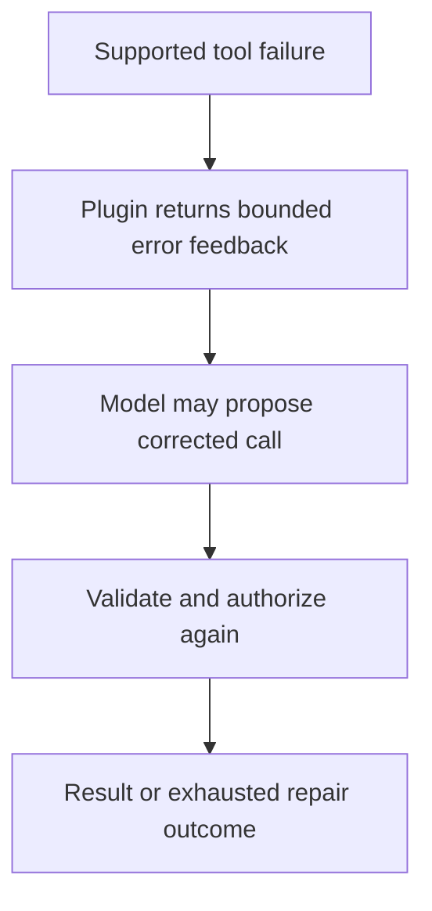

# Module 39: Advanced Recovery with Built-In Plugins

## Before you begin: what this module teaches

**ADK concept: App plugins and bounded tool-call repair.**

A plugin registers hooks across local App execution. ReflectAndRetryToolPlugin can feed supported tool failures back to the model for another attempt. The model proposes a repair; it is not guaranteed to fix the problem. Plugin scope and return contracts determine what is intercepted, replaced or allowed to continue.

**Where you would use this in real work.**

The assistant requests a tool with invalid arguments. The bank wants it to correct a recoverable request while keeping limits and validation intact. Repeating a payment because an error occurred would be a very different design.

**Connection to Gemini Enterprise Agent Platform and Google Cloud.**

Use the native ADK plugin for the supported repair behavior rather than inventing an unbounded retry loop. Keep validation and authorization in the tool/backend. Native observability can show repeated attempts; sensitive exception details must not be exposed indiscriminately.

**By the end, you should be able to:**

- Distinguish a model repair attempt from an HTTP retry.
- Identify App-level scope and the configured repair limit.
- Explain why writes need destination-enforced duplicate protection.

### Review this lesson through three perspectives

- **Python/ADK beginner:** Trace the failed call, returned feedback and subsequent call.
- **Experienced engineer:** Test exhausted repair, plugin ordering and errors outside the supported hook.
- **Bank FDE:** Agree which failures are recoverable and which require an analyst or operator.

Use the [guided lab](./lab.md) to observe the mechanism, then compare with the [solution](./lab-solution.md). The banking scenario above explains how to transfer the concept; a lab using a railway, weather or shopping fixture does not implement a live bank integration.

## Draw the execution boundary

A repair attempt is bounded and still passes tool/backend validation.



## Theory

### Building on Custom Plugins

Having previously built custom plugins for **Observability (Module 25)** and **Responsible AI Guardrails (Module 25.5)**, you are already familiar with how the ADK's plugin architecture cleanly separates cross-cutting infrastructure concerns from your core agent prompt logic. 

As a reminder, **Plugins** inherit from `BasePlugin` and register on the **App** (or Runner) to globally intercept and inspect events. They operate using three primary patterns:

1.  **Observing (Return `None`):** Watches the data flow (e.g., your custom `AlertingPlugin` from Module 25).
2.  **Intervening (Return an Object):** Blocks execution and overrides standard behavior (e.g., caching or PII blocking from Module 25.5).
3.  **Amending (Modify in place):** Amends the conversation history or configuration before execution.

In this module, we will explore one of the most powerful **built-in framework plugins** that uses a combination of *Intervening* and *Amending* to handle a critical production issue: **tool hallucination**.

### The Problem: Fragile Tool Use

One of the most common issues with LLM agents is **hallucination** or **misuse of tools**.
*   **Hallucinated Names:** The model might try to call `calculate_sum` when the tool is actually named `add_numbers`.
*   **Invalid Arguments:** The model might pass a string "five" when the tool expects the integer `5`.
*   **Transient Errors:** An API might fail temporarily with a 500 error.

Normally, these errors would cause your agent to crash or stop.

### The Solution: Reflect and Retry

The **`ReflectAndRetryToolPlugin`** is a powerful built-in plugin designed to solve this exact problem using the *Intervening* and *Amending* patterns. It acts as a safety net globally across all your tools.

**How it works:**
1.  **Intercept:** When any Agent calls a tool, the plugin watches the execution.
2.  **Detect Failure:** If the tool raises an Exception (or a specific error), the plugin catches it.
3.  **Reflect:** The plugin intercepts the error and amends the conversation history, sending the error message *back* to the LLM as an observation (e.g., *"Error: Tool 'calc' not found. Available tools: 'calculator'"*).
4.  **Retry:** The LLM, seeing this error, "reflects" on its mistake and generates a *new* tool call with the corrected name or arguments.
5.  **Loop:** This process repeats up to a configured `max_retries` limit.

### Using Plugins in ADK 2.0

To use a plugin, you instantiate it and add it to your `App` configuration.

```python
from google.adk.apps.app import App
from google.adk.runners import Runner
from google.adk.plugins import ReflectAndRetryToolPlugin

# Configure the plugin
retry_plugin = ReflectAndRetryToolPlugin(
    max_retries=3  # Give agents 3 chances to fix their mistakes
)

# In ADK 2.0, plugins are registered globally on the App object
app = App(
    name="my_robust_app",
    root_agent=my_agent,
    plugins=[retry_plugin] # <--- Registered globally here
)

runner = Runner(app=app, session_service=...)
```

### Key Takeaways
- **Plugins** provide global, cross-cutting functionality (logging, retries, security) across your entire application.
- They inherit from `BasePlugin` and use three patterns: **Observing**, **Intervening**, and **Amending**.
- App plugins apply across local App execution. At overlapping supported hooks, plugin processing precedes agent callbacks and a replacement may bypass the agent callback; verify the particular hook path.
- The **`ReflectAndRetryToolPlugin`** can return supported tool failures to the model for a bounded repair attempt. It does not guarantee correction, catch every execution failure or make repeating a side effect safe.

## Continue the course story

Previous: [Module 38](../module38-best-practices/README.md) · Next: [Module 39.5](../module39_5-agent-skills/README.md) · [See how the concepts build](../learning-journey.md)

Before continuing, explain one input, one ADK execution boundary and one failure outcome from this module. Use the next chapter to add a new customer requirement, not merely another component.

<!-- © 2026 Inder Chauhan (https://github.com/inderanz/google-adk-training). All rights reserved. Ref: IC-ADK-module39-plugins-README -->
---


## Official References

- Google ADK docs (latest): https://google.github.io/adk-docs/
- Gemini API (multimodal): https://ai.google.dev/gemini-api/docs
- Google GenAI Python SDK reference: https://googleapis.github.io/python-genai/
- Vertex AI generative guidance: https://cloud.google.com/vertex-ai/generative-ai
- Cloud Vision and OCR: https://cloud.google.com/vision

