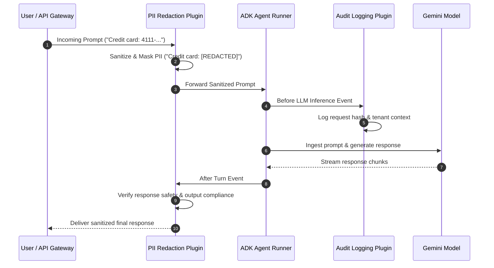

# Module 39 Enterprise Playbook: Enterprise Plugin Architecture & Lifecycle Hooks

The Chief Information Security Officer (CISO) and Lead Developer need this result: A modular, auditable plugin architecture that intercepts agent lifecycle events to enforce mandatory compliance filters, PII redactors, audit loggers, and rate limiters across an entire agent fleet without modifying individual agent code.

Read the [plain-English task and term explanations](./README.md) before reviewing the implementation details.

## 1. Plugins vs Callbacks: Architectural Comparison

Understanding the exact difference between agent callbacks and modular plugins is critical for enterprise governance.

| Architectural Dimension | ADK Callbacks (`before_turn`, `after_tool`) | ADK Plugins (`BasePlugin`) |
|---|---|---|
| Scope of Control | Local to a single agent instance. | Cross-cutting; shared across multiple agents or an entire fleet. |
| Reusability & Packaging | Coupled to agent declaration script. | Packaged as standalone Python packages or enterprise libraries. |
| Execution Order | Executes immediately adjacent to agent turns. | Can intercept application-level, runner-level, and tool-level lifecycles. |
| Enterprise Governance | Managed by individual application developers. | Mandated and injected by Central Platform / Security teams. |

## 2. Plugin Interception Lifecycle

## 3. Production Hardening Checklist

1. **Non-Blocking Telemetry:** Ensure logging and audit plugins process events asynchronously to prevent introducing latency into the user-facing response stream.
2. **Fail-Closed Security Gate:** If a compliance or safety plugin fails (e.g., regex engine crash or network timeout), configure the plugin pipeline to fail closed—blocking the transaction and logging a high-priority alert.
3. **Immutability of Audit Events:** Verify that audit plugins emit events to append-only destinations (e.g., Google Cloud Pub/Sub or BigQuery) that cannot be altered by application workloads.

<!-- © 2026 Inder Chauhan (https://github.com/inderanz/google-adk-training). All rights reserved. Ref: IC-ADK-module39-enterprise-playbook -->

