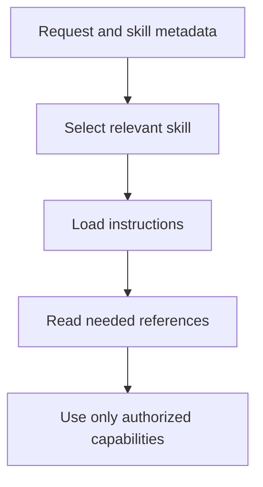

# Module 39.5: Enhancing Agents with Skills

## Before you begin: what this module teaches

**ADK concept: skills, progressive disclosure and execution permissions.**

A skill packages instructions and optional references/scripts. Progressive disclosure exposes brief discovery information first, then loads detailed content when selected. SkillToolset supplies the supported access tools. A reference teaches a procedure; a tool or code executor performs an operation. Loading a skill must not silently expand the user's authorization.

**Where you would use this in real work.**

The bank has several approved procedures, but loading every manual into every prompt makes simple questions harder to handle. The assistant should load the relevant procedure when needed, while keeping operation permissions explicit.

**Connection to Gemini Enterprise Agent Platform and Google Cloud.**

Use ADK's supported skill interfaces with pinned versions and reviewed content. Script execution needs a deliberate supported sandbox and identity; UnsafeLocalCodeExecutor is not a customer isolation boundary. A remote skill registry also needs provenance, access and lifecycle controls.

**By the end, you should be able to:**

- Distinguish discovery metadata, loaded instructions, references and executable capabilities.
- Explain the skill directory and its required frontmatter.
- Evaluate whether selecting the right skill leads to correct authorized behavior.

### Review this lesson through three perspectives

- **Python/ADK beginner:** Trace when a reference is loaded instead of assuming it is always in context.
- **Experienced engineer:** Test conflicting instructions, stale versions and unavailable references.
- **Bank FDE:** Ask who approves procedures, scripts and updates and how a withdrawn skill is removed.

Use the [guided lab](./lab.md) to observe the mechanism, then compare with the [solution](./lab-solution.md). The banking scenario above explains how to transfer the concept; a lab using a railway, weather or shopping fixture does not implement a live bank integration.

## Draw the execution boundary

Illustrative progressive disclosure. Model selection must be evaluated, and tool access stays explicit.



## Theory

### What is a Skill?

You've learned how to give agents basic tools (like calculators or weather APIs) to extend their capabilities. But what happens when an agent needs to perform a highly complex, domain-specific task? 

A **Skill** is a self-contained package that provides an agent with specialized procedural knowledge. Think of it as an "onboarding manual" for a specific job. While a basic tool is just a function, a Skill bundles together:

1.  **Instructions (`SKILL.md`):** High-level guidance on *when* and *how* to perform the task.
2.  **References (`references/`):** Domain-specific documentation (e.g., schemas, style guides) that the agent can read *if* it needs it.
3.  **Scripts (`scripts/`):** Executable code for tasks that require deterministic reliability (e.g., a Python script to parse a complex PDF, rather than trusting the LLM to write the code from scratch).
4.  **Tools (`additional_tools`):** The standard Python functions the skill relies on.

### The Problem: Context Window Bloat

If you put the instructions, schemas, and logic for every possible task directly into your agent's system prompt, you will quickly exhaust the LLM's context window. This makes the agent slow, expensive, and easily confused.

### The Solution: Progressive Disclosure

Skills solve this through **Progressive Disclosure**:
1.  The agent is only given the name and a short description of the Skill.
2.  If the user's request matches the description, the agent *activates* the Skill.
3.  Only then are the instructions (`SKILL.md`) loaded into the context window.
4.  If the instructions say to read a specific reference file, the agent uses a tool to read just that file.

This keeps the main agent incredibly lightweight, loading heavy documentation only precisely when needed.

### Using Skills in the ADK

In the modern ADK, Skills are managed using the `SkillToolset`. Note that as of ADK 2.0, the Skills feature is still marked **experimental** in the official documentation — pin the API used by the lab and recheck compatibility before adopting or upgrading it. An experimental feature is not a stability promise.

```python
import pathlib
from google.adk.agents import Agent
from google.adk.skills import load_skill_from_dir
from google.adk.tools.skill_toolset import SkillToolset
from google.adk.code_executors.unsafe_local_code_executor import UnsafeLocalCodeExecutor

# 1. Load a skill from a local directory
weather_skill = load_skill_from_dir(
    pathlib.Path(__file__).parent / "skills" / "weather-skill"
)

# 2. Create a Toolset to manage the skills and any extra tools they need
# WARNING: UnsafeLocalCodeExecutor allows the agent to run the scripts/ folder
# locally. Do not use in untrusted production environments!
my_skill_toolset = SkillToolset(
    skills=[weather_skill],
    additional_tools=[get_current_humidity_tool], 
    code_executor=UnsafeLocalCodeExecutor(),
)

# 3. Give the entire toolset to the Agent
agent = Agent(
    model="gemini-3.5-flash",
    name="skill_user_agent",
    description="An agent that can use specialized skills.",
    tools=[my_skill_toolset]
)
```

**Production Alternative**: `UnsafeLocalCodeExecutor` is for learning only. For production, ADK offers sandboxed executors that isolate execution outside your own process — e.g. `GkeCodeExecutor` (runs code in a dedicated GKE pod) or `AgentEngineSandboxCodeExecutor` (a managed sandbox on Agent Runtime). Both require their respective infrastructure already provisioned, so they're mentioned here as a pointer rather than a lab exercise.

### The Structure of a Skill Directory

When you use `load_skill_from_dir`, the ADK expects a specific directory layout:

```text
my-skill/
├── SKILL.md           <-- Required: YAML frontmatter (name/desc) + Markdown body
├── scripts/           <-- Optional: Executable code (Python, Bash, etc.)
├── references/        <-- Optional: Documentation for the agent to read
└── assets/            <-- Optional: Files used in the output (templates, etc.)
```

The skill's frontmatter `name` must be lowercase kebab-case (letters, digits, hyphens — no underscores) and match its containing directory name exactly, or `load_skill_from_dir` will reject it.

### Going Further: The Skill Registry (Preview)

Everything above loads skills from your local filesystem — fine for a handful of skills you wrote yourself. In an enterprise setting with hundreds or thousands of skills shared across teams, ADK offers a **Skill Registry** (currently a Preview feature) that lets an agent discover and load skills on demand from a remote catalog instead of bundling them all upfront.

You connect it by passing a registry (e.g. `GCPSkillRegistry` from `google.adk.integrations.skill_registry`) to your `SkillToolset`. ADK then automatically injects two extra tools for the agent: `search_skills(query)` to find relevant skills semantically, and `load_skill(skill_name)` to pull one in only when needed — the same Progressive Disclosure idea, just applied to a catalog instead of a local folder. Locally loaded skills always take priority over registry ones with the same name. This is beyond the scope of this lab, but worth knowing about if you're designing a skill strategy for a larger organization.

### Key Takeaways
- **Skills** are modular packages containing instructions, references, and scripts to teach an agent complex domain knowledge.
- They prevent context bloat via **Progressive Disclosure**—loading detailed instructions only when the skill is activated.
- In ADK 2.0, you load skills from a directory using `load_skill_from_dir()`.
- You provide skills to an Agent by bundling them inside a `SkillToolset`, which handles the activation and execution logic.

## Continue the course story

Previous: [Module 39](../module39-plugins/README.md) · Next: [Module 40](../module40-advanced-capstone-aegis-incident-response/README.md) · [See how the concepts build](../learning-journey.md)

Before continuing, explain one input, one ADK execution boundary and one failure outcome from this module. Use the next chapter to add a new customer requirement, not merely another component.

<!-- © 2026 Inder Chauhan (https://github.com/inderanz/google-adk-training). All rights reserved. Ref: IC-ADK-module39_5-agent-skills-README -->
---


## Official References

- Google ADK docs (latest): https://google.github.io/adk-docs/
- Gemini API (multimodal): https://ai.google.dev/gemini-api/docs
- Google GenAI Python SDK reference: https://googleapis.github.io/python-genai/
- Vertex AI generative guidance: https://cloud.google.com/vertex-ai/generative-ai
- Cloud Vision and OCR: https://cloud.google.com/vision

