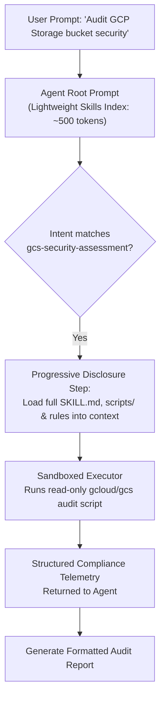

# Module 39.5 Enterprise Playbook: Agent Skills, Progressive Disclosure & Sandboxed Execution

The enterprise AI architect needs this result: A scalable, secure capability-extension framework using Agent Skills that prevents context-window degradation through progressive disclosure, isolates skill execution inside sandboxed environments, and governs skills via centralized corporate registries.

Read the [plain-English task and term explanations](./README.md) before reviewing the implementation details.

## 1. Agent Skills Architectural Principles

Loading hundreds of tools into an agent's initial prompt degrades model accuracy, introduces tool confusion, and spikes token costs. The Agent Skills pattern resolves this through progressive disclosure.

| Skill Principle | Enterprise Pattern | Architectural Benefit |
|---|---|---|
| Progressive Disclosure | Two-Tier Discovery (`SKILL.md` frontmatter -> Detailed instructions) | Only high-level skill names/descriptions load into root prompt; full schemas load on-demand when activated. |
| Sandboxed Execution | Ephemeral gVisor / Cloud Run executors | Dynamic code or script execution generated by skills runs inside isolated, network-restricted containers. |
| Skill Versioning & Governance | Git-based Corporate Skill Registry | Skills undergo code review, static security audits, and automated evaluation before approval in production. |
| Deterministic Recipes | Pre-vetted workflow templates | Skills provide standard operating procedures (SOPs) rather than unconstrained open-ended LLM loops. |

## 2. Progressive Disclosure Workflow

## 3. Production Hardening Checklist

1. **Strict Capability Scoping:** Ensure skills operating in production declare explicit tool requirements and operate with least-privilege service accounts.
2. **Deterministic Script Verification:** Disallow agents from arbitrary `eval()` or unverified bash script generation; mandate parameterized scripts inside the skill's `scripts/` directory.
3. **Registry Attestation:** Cryptographically sign skill releases in the corporate skill repository to prevent unauthorized tampering.

<!-- © 2026 Inder Chauhan (https://github.com/inderanz/google-adk-training). All rights reserved. Ref: IC-ADK-module39_5-agent-skills-enterprise-playbook -->
