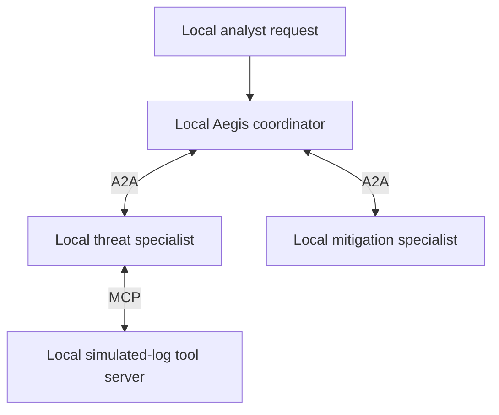

# Module 40: Advanced Capstone - Aegis Incident Response & AgentOps

## Before you begin: what this module teaches

**ADK concept: a distributed capstone with explicit evidence and integration limits.**

A2A connects independently running agent applications; MCP exposes tool operations; ADK callbacks/plugins observe or control execution at defined boundaries. A target architecture diagram describes a design, while a local execution trace proves only the components actually exercised. A regex mask is not managed content inspection, and a printed URL is not a stored report.

**Where you would use this in real work.**

A bank operations analyst asks for an explanation of suspicious access events and a proposed response. Investigation, drafting a response and executing a remediation are separate responsibilities. The assistant must identify which evidence supports its advice and what remains simulated.

**Connection to Gemini Enterprise Agent Platform and Google Cloud.**

The target uses Google-hosted agents, approved log retrieval, Model Armor and Google observability/storage. The lab contains simulated integrations; replacing them requires real client contracts, IAM, error handling and live acceptance evidence. Reuse Modules 23–26 rather than treating the simulations as drop-in enterprise services.

**By the end, you should be able to:**

- Label every component as implemented, simulated or proposed.
- Trace a request across agents and tools with failure outcomes.
- Define a bank handover package with evidence and unresolved integration work.

### Review this lesson through three perspectives

- **Python/ADK beginner:** Explain each boundary without assuming that three agents imply reliability.
- **Experienced engineer:** Test remote failures, unsupported evidence and repeated remediation requests.
- **Bank FDE:** Agree permitted investigation, required human approvals and the owner of each production control.

Use the [guided lab](./lab.md) to observe the mechanism, then compare with the [solution](./lab-solution.md). The banking scenario above explains how to transfer the concept; a lab using a railway, weather or shopping fixture does not implement a live bank integration.

## Theory & Architecture

### 1. The Scenario: Enterprise Security Operations & Threat Remediation
In a modern enterprise security operations center (SOC), analysts are overwhelmed by the sheer volume of system audit logs, security alerts, and vulnerability notices. Sifting through BigQuery access logs, cross-referencing system vulnerabilities with the NIST/CVE database, and drafting actionable mitigation playbooks is slow, manual, and prone to human error.

### 2. The Solution: Aegis Incident Response System (AIRS)
To solve this, you will implement an advanced, distributed multi-agent system called **Aegis Incident Response System (AIRS)**. This is a secure, automated threat hunting and patching coordinator built with **ADK 2.0**, using a real Model Context Protocol (MCP) server and the Agent-to-Agent (A2A) protocol.

**A note on scope:** this capstone runs entirely on your local machine — no GCP project or billing required. Model Armor, Vertex AI Search (RAG), the GCS upload, and the AgentOps telemetry export are represented with **simplified, simulated implementations**, clearly marked as such in the code. What's real and fully functional is the part this capstone is actually testing: three independent ADK agents cooperating correctly over A2A, backed by a real MCP server and real AgentOps callback hooks. The diagram below shows the target production architecture this design is modeled on; see "Going Further" at the end for how to wire the simulated pieces up to the real services.

This diagram describes the local exercise. Managed inspection, search, storage and telemetry export are separate proposed integrations. A2A arrows show possible consultations; they do not force the model to select both services.

---

## The Three Cooperative Agents & AgentOps

### 1. Threat Intelligence Agent (A2A Server, runs locally)
Acts as an automated log investigator and threat hunter.
*   **MCP Log Hunting:** Connects to a real local **MCP server** — a lightweight stand-in for a hosted BigQuery MCP server — to query simulated security audit logs, login attempts, and injection attempts. You built a server just like it in Module 28.
*   **Data Masking (simulated Model Armor):** Prior to outputting threat details, it masks sensitive internal IP addresses using a local regex, standing in for a call to the real **Model Armor** API.
*   **AgentOps Metrics (real hooks, simulated export):**
    *   Real `before_model_callback`/`after_model_callback` hooks measure model-call latency.
    *   The hooks print what a real system would export to Cloud Logging and Cloud Trace — the hook mechanism is real ADK, the export destination is simulated.

### 2. Aegis Orchestrator Agent (Orchestrator, runs locally)
The central dispatch system for SOC analysts.
*   **Coordination:** It acts as an A2A client that calls the Threat Intelligence and Mitigation agents as `AgentTool`-wrapped remote agents — while delegation through `sub_agents` has a different mode-dependent contract. A transfer is not universally permanent; local and remote mode support must be checked separately (Module 19). `AgentTool` gives proper call-and-return semantics, so the orchestrator stays in control across both hops and can combine their results into one final answer.
*   **Command Scope:** Understands commands like:
    *   *"Detect any brute-force attacks on our billing databases and generate patching plans."*
    *   *"Remediate recent SQL injection risks in the mid-market segment logs."*
*   **Reliability:** Uses `RemoteA2aAgent(..., use_legacy=False)` to opt into ADK's reliability-fixed A2A executor (see Module 21), avoiding known streaming-mode message-duplication bugs.

### 3. Mitigation & Patching Agent (A2A Server, runs locally)
Compiles security advisories and automated patch scripts.
*   **Playbook Search (simulated RAG):** A tool function stands in for a Vertex AI Search (RAG) query over CIS Controls, NIST playbooks, and company-approved remediation standards.
*   **Briefing & Simulated GCS Upload:** Generates an executive security advisory and returns a simulated signed GCS URL, standing in for a real PDF render + Cloud Storage upload.

---

## AgentOps Deep-Dive: System Observability in Production

Implementing multi-agent systems in production requires robust **AgentOps** practices to track system performance, debug failures, and monitor costs:

1.  **Distributed Trace Propagation:**
    A2A agents communicate over HTTP. To see a unified timeline of a request, a production system propagates trace contexts across agent boundaries using standard W3C Trace Context headers. This links the user chat span to every downstream tool call and remote agent hop in a single trace tree. (This lab doesn't wire up real trace export — see "Going Further" below.)
2.  **Telemetry Hooks:**
    ADK 2.0's real hook mechanism is `before_model_callback` and `after_model_callback`, passed as constructor arguments to `Agent(...)` (the same pattern you used in Module 26). This lab uses them to measure and print:
    *   **LLM Latency:** Time taken by the model to generate responses.
    *   **AgentOps events:** A line simulating what a real export to Cloud Logging/Cloud Trace would send.

    A production system would keep the exact same callback signatures and replace the `print()` calls with real OpenTelemetry SDK calls.

### Going Further: Wiring Up the Real Services

Each simulated piece identifies an integration task. Real services require credentials, contracts, error handling and evaluation; replacing a function body alone is not sufficient:
*   **Model Armor:** follow Module 25.5's explicit allow/block/unavailable policy and persistence boundaries. A regex mask and managed inspection are different contracts.
*   **Vertex AI Search (RAG):** replace `search_remediation_playbooks`'s fixed string with a real Vertex AI Search query, or an MCP server wrapping one, following the same `McpToolset` pattern already used for BigQuery.
*   **GCS Upload:** replace the simulated URL in `build_and_upload_mitigation_brief` with a real PDF render and a Cloud Storage upload (directly, or via another local MCP server built the same way as `bigquery_mock_server.py`).
*   **Real observability:** configure the supported native ADK exporter and verify cross-service trace propagation. Add bounded domain observations where needed; do not recreate all native spans in callbacks. Module 25 explains the distinction.
*   **Real deployment:** once the pieces above are real, deploy the three agents the same way you learned in Modules 32-35 (Cloud Run for the two A2A servers, Agent Runtime for the orchestrator).
*   **Agent Skills for the playbooks:** `search_remediation_playbooks` is currently a plain function returning a fixed string. Module 39.5's Skills pattern (`SkillToolset` + `load_skill_from_dir`) is arguably a better fit than a hand-written RAG query for this: bundle each CIS/NIST playbook as its own Skill, with the remediation steps living in the Skill's `references/` folder, loaded via Progressive Disclosure only when the Mitigation Agent actually needs that specific playbook instead of always in context.

## Continue the course story

Previous: [Module 39.5](../module39_5-agent-skills/README.md) · Next: [Review the complete journey](../learning-journey.md) · [See how the concepts build](../learning-journey.md)

Before continuing, explain one input, one ADK execution boundary and one failure outcome from this module. Use the next chapter to add a new customer requirement, not merely another component.

<!-- © 2026 Inder Chauhan (https://github.com/inderanz/google-adk-training). All rights reserved. Ref: IC-ADK-module40-advanced-capstone-aegis-incident-response-README -->
---

## Official References

- Google ADK docs (latest): https://google.github.io/adk-docs/
- Gemini API (multimodal): https://ai.google.dev/gemini-api/docs
- Google GenAI Python SDK reference: https://googleapis.github.io/python-genai/
- Vertex AI generative guidance: https://cloud.google.com/vertex-ai/generative-ai
- Cloud Vision and OCR: https://cloud.google.com/vision

